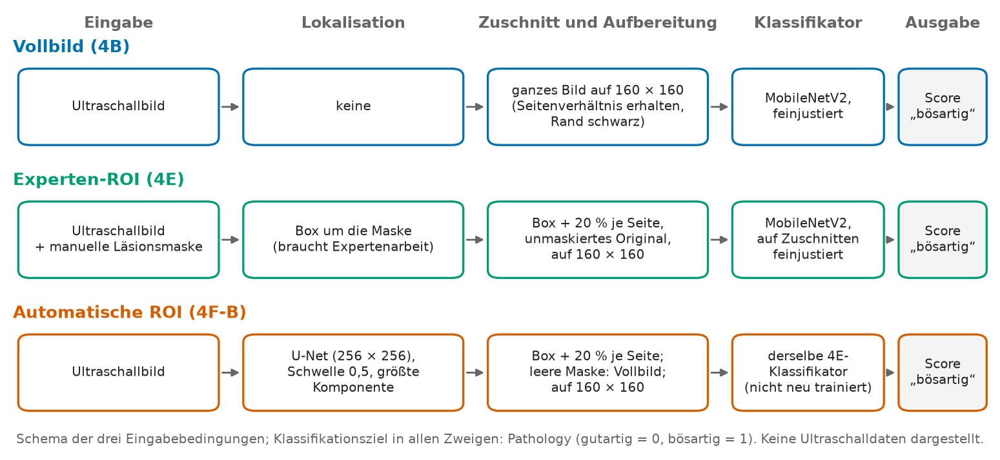
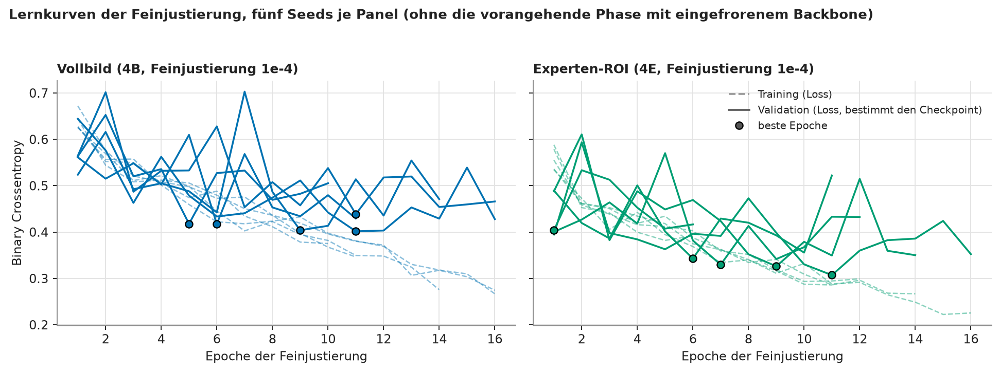
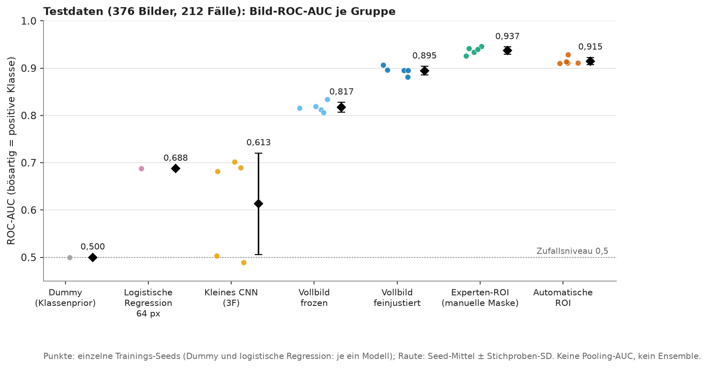
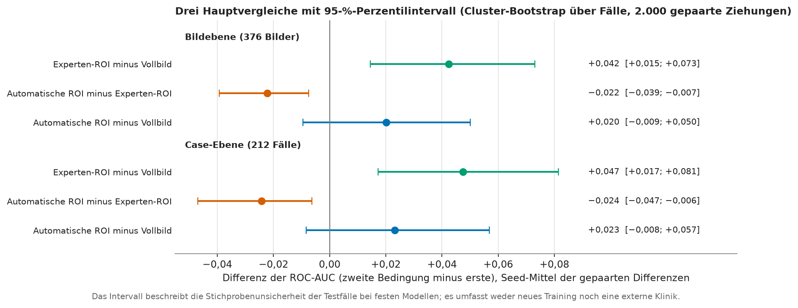
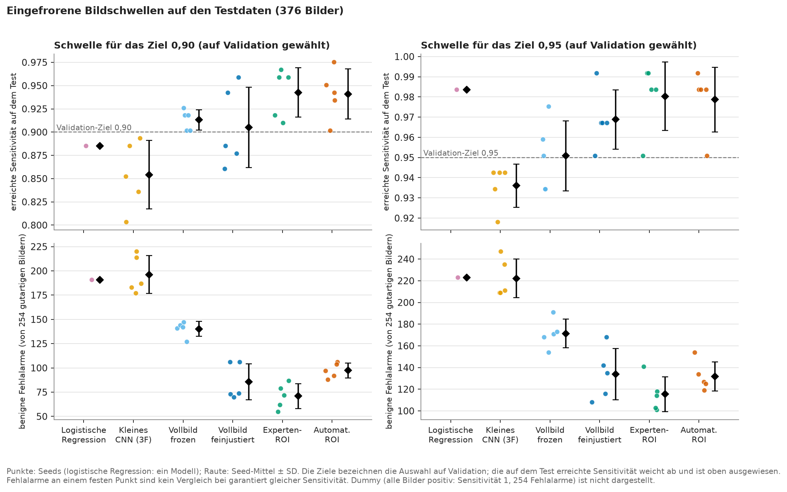
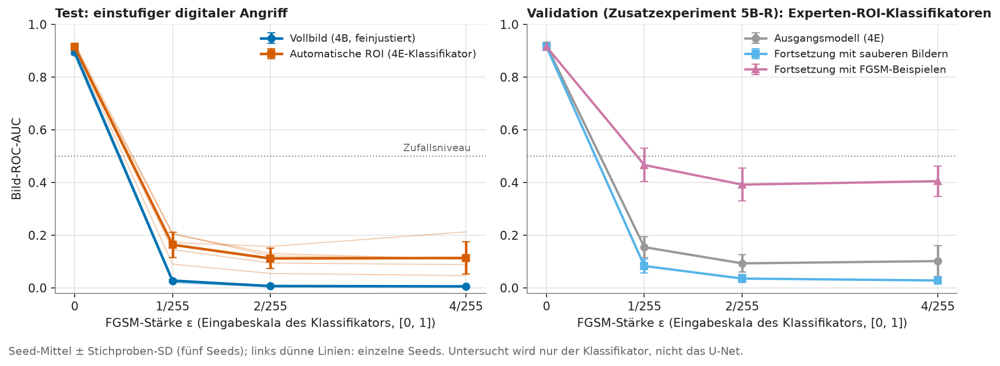

# KI-gestützte Beurteilung von Brustultraschall: Vollbild oder Läsionsausschnitt?

**Projektarbeit Deep Learning · Weiterbildung AI Engineer · IfaDW**  
**Verfasser:** Carlo Babo  ·  **Redaktionsstand:** 22. Oktober 2026

**Geltungsbereich.** Der Bericht richtet sich an ein technisches Team, das computergestützte Entscheidungsunterstützung bei **bereits sichtbaren Brustläsionen** untersucht. Er beschreibt keinen zugelassenen Krebsdetektor und keine Untersuchung gesunder Personen: Der Datensatz enthält nur Läsionsbilder, und „gutartig“ bedeutet eine gutartige Läsion, nicht gesundes Gewebe. Alle Zahlen sind interne Forschungsergebnisse auf einer Datenquelle; sie begründen keine klinische Einsatzfähigkeit.

## 1 Zusammenfassung

**Frage.** Verbessert die Eingrenzung des Läsionsbereichs die Unterscheidung gutartiger und bösartiger Befunde im Brustultraschall? Verglichen werden drei gleichwertig berichtete Eingabebedingungen mit demselben Modelltyp: das **ganze Bild**, ein **Zuschnitt um die Läsion aus der Expertenmaske** (bei der Anwendung wird eine manuelle Maske benötigt) und ein **automatischer Zuschnitt** aus einem U-Net (es wird nur das Bild benötigt).

**Daten und Vorgehen.** Grundlage ist der öffentliche Datensatz BUS-BRA (1.875 Bilder von 1.064 Fällen, vier Ultraschallgeräte, eine Einrichtung). Die Auswertung erfolgt auf einem festen, nach Fällen getrennten Holdout (Training 1.114 Bilder / 639 Fälle, Validation 385 / 213, Test 376 / 212). Die Modelle (MobileNetV2 mit ImageNet-Vortraining, feinjustiert) wurden je mit fünf Trainings-Seeds trainiert; als Referenzen dienen ein Dummy-Klassifikator, eine logistische Regression und ein kleines CNN. Die Entwicklung erfolgte explorativ auf Training und Validation; die Schwellen für die Betriebspunkte wurden auf der Validation eingefroren, danach wurde der Test einmal ausgewertet.

**Ergebnis auf dem Test.** Die Bild-ROC-AUC (Mittel ± Standardabweichung über fünf Seeds) beträgt 0,895 ± 0,009 (Vollbild), 0,937 ± 0,008 (Experten-ROI) und 0,915 ± 0,008 (automatische ROI); die Baselines liegen bei 0,500 (Dummy), 0,688 (logistische Regression) und 0,613 ± 0,107 (kleines CNN). Gepaarte Differenzen mit 95-%-Perzentilintervall (Cluster-Bootstrap über Fälle): Experten-ROI minus Vollbild +0,042 [+0,015; +0,073]; automatische ROI minus Experten-ROI −0,022 [−0,039; −0,007]; automatische ROI minus Vollbild +0,020 [−0,009; +0,050].

**Antwort.** Eine durch einen Experten lokalisierte Läsion verbessert in diesem Test die Trennschärfe gegenüber dem ganzen Bild. Die automatische Eingrenzung behält einen Teil dieses Vorteils und liegt hinter dem Experten-Zuschnitt; ihr Vorteil gegenüber dem ganzen Bild ist in diesem Test nicht gesichert (das Intervall schließt 0 ein). Das ist kein reiner Masken-Effekt, weil die Pipelines getrennt trainiert wurden und sich in der Information unterscheiden, die bei der Anwendung nötig ist.

**Weitere Befunde.** Bei hoher Sensitivität bleiben die Fehlalarme hoch: Am eingefrorenen Punkt für das Ziel 0,95 werden im Mittel 133,8 (Vollbild), 115,4 (Experten-ROI) und 131,8 (automatische ROI) der 254 gutartigen Testbilder als bösartig markiert. Die Segmentierung erreicht einen mittleren Dice-Wert von 0,870 (Median 0,919). Ein einstufiger digitaler Angriff (FGSM) senkt die Bild-ROC-AUC beider Pipelines weit unter das Zufallsniveau (0,895 → 0,027 beim Vollbild und 0,915 → 0,164 bei der automatischen ROI bei ε = 1/255); ein Zusatzexperiment mit Adversarial Training hebt die Robustheit nur teilweise.

**Grenzen.** Ein fester Holdout aus einer Einrichtung, keine externe Validierung, ein U-Net-Seed, Klassifikatoren auf Experten-Zuschnitten trainiert, mögliche Abkürzungen durch eingebrannte Markierungen und Gerätemerkmale, keine Messung ärztlicher Entscheidungen.

## 2 Fragestellung

### 2.1 Anwendungsbezug

Bei bereits sichtbaren Brustläsionen kann eine automatische Einschätzung „gutartig oder bösartig“ ein zweites Urteil liefern. Offen ist, wie viel die **Lokalisierung der Läsion** dazu beiträgt: Ein Modell, das das ganze Bild sieht, muss neben der Läsion auch Gerät, Beschriftung, Gewebe und Bildränder verarbeiten; ein Zuschnitt lenkt die Aufmerksamkeit auf die Läsion, setzt aber voraus, dass sie vorher (manuell oder automatisch) gefunden wird.

### 2.2 Forschungsfrage und drei gleichwertige Vergleiche

> Verbessert die Eingrenzung des Läsionsbereichs die Unterscheidung gutartiger und bösartiger Befunde im Brustultraschall?

1. **Vollbild gegen Experten-ROI:** Nutzen des fachlich lokalisierten Bildausschnitts.
2. **Experten-ROI gegen automatische ROI:** Unterschied durch die automatische Lokalisation.
3. **Vollbild gegen automatische ROI:** Nutzen der Gesamtpipeline, die nur das Bild braucht.

*Abbildung 1: Die drei verglichenen Eingabebedingungen. Der Klassifikator ist in allen Zweigen ein MobileNetV2 (Abschnitt 4); Experten-ROI und automatische ROI verwenden dieselben trainierten Klassifikatoren.*

Die ursprüngliche Unterfrage bleibt erhalten: Wie gut lassen sich gutartige und bösartige BUS-BRA-Läsionen allein anhand des Bildes auf ungesehenen Fällen unterscheiden, und bringt ein CNN einen Mehrwert gegenüber einer einfachen lernenden Baseline?

### 2.3 Metriken, Erfolgskriterium und Status der Hypothese

Primäre Metrik ist die **ROC-AUC** der Scores für „bösartig“ (die AUC ist ein Rangmaß, keine Trefferquote); ergänzt werden Average Precision (AP), Sensitivität, Spezifität, Precision, F1, Accuracy und Konfusionsmatrizen. Die Scores sind keine kalibrierten klinischen Wahrscheinlichkeiten. Betriebspunkte sind die Schwelle 0,5 und zwei auf der Validation festgelegte Sensitivitätsziele (0,90 und 0,95); „Ziel“ bezeichnet die Auswahl auf der Validation, die auf dem Test erreichte Sensitivität wird gesondert ausgewiesen.

Es wurde **kein numerischer Mindestwert** als Erfolgskriterium festgelegt. Beurteilt werden die gepaarten Differenzen mit Unsicherheitsintervall und die benignen Fehlalarme bei gleichen Validation-Zielen. Die Hypothese „Eingrenzung hilft“ war nicht von Projektbeginn an registriert: Die Modellentwicklung war explorativ, die Validation wurde wiederholt genutzt und ihre Ergebnisse sind bekannt. Festgehalten wurden die Auswertungsregeln für den Abschluss (Gruppen, Schwellen, Statistik) schriftlich, hashgesichert und **vor der Auswertung der Testdaten**.

## 3 Daten

### 3.1 BUS-BRA

BUS-BRA (Gómez-Flores, Gregorio-Calas, Coelho de Albuquerque Pereira, *Medical Physics* 51, 3110–3123, 2024) umfasst 1.875 anonymisierte Ultraschallbilder von 1.064 Patientinnen, aufgenommen mit vier Geräten am Nationalen Krebsinstitut in Rio de Janeiro. Die Läsionen sind biopsiegesichert (722 gutartige, 342 bösartige Fälle); eine erfahrene Fachkraft für Ultraschalldiagnostik („senior ultrasonographer“) vergab BI-RADS-Kategorien (2–5) und umriss die Läsionen manuell. Verwendet wurde das Originalarchiv `BUSBRA.zip` des Zenodo-Records 8231412 (Version 1.0; DOI 10.5281/zenodo.8231412).

**Lizenz und Zitierpflicht.** Die Zenodo-Metadaten nennen CC BY 4.0. Das Archiv enthält zusätzlich eine eigene `LICENSE.txt` (Copyright 2023, permissiver Erlaubnistext mit Pflicht zur Nennung der Publikation); sie ist nicht wortgleich mit CC BY 4.0 und nennt die Publikation noch als „in revision“. Beide Hinweise bleiben erhalten; zitiert wird die veröffentlichte Fassung (Quellen, Abschnitt 9). Dieser Bericht bildet keine Ultraschallbilder ab; alle Abbildungen sind eigene Statistikdarstellungen oder Schemata.

### 3.2 Zielgröße, Masken und Metadaten

Ziel ist `Pathology` (gutartig = 0, bösartig = 1); der Modell-Score bedeutet „Score für bösartig“. Das **einzige Modelleingangssignal** ist das Ultraschallbild (im ROI-Zweig der aus ihm geschnittene Ausschnitt). Fall-ID, Histologie, BI-RADS, Gerät, Seite, Bounding-Box-Angaben und Masken sind keine zusätzlichen Eingaben; die Fall-ID steuert nur die Trennung der Teilmengen.

**Zweck und Verwendung der Masken.** Die Masken sind laut Datensatzbeschreibung manuell gezeichnete Läsionsumrisse („Grundwahrheit“ der Läsionsgrenzen), gedacht für Segmentierung und für die Bewertung von Diagnosesystemen. Auch gutartige Läsionen haben eine Maske; die Maske ist weder ein Krebslabel noch eine Markierung gesunden Gewebes. In dieser Arbeit wird sie auf vier Arten genutzt, die getrennt zu lesen sind: (a) Integritätsprüfung; (b) **Trainingsziel und Messreferenz der Segmentierung** (U-Net; die Validation-Masken steuerten dort Checkpoint und Qualitätsmessung); (c) **Grundlage des Zuschnitts im Experten-ROI-Zweig**, in dem sie bei Training, Validation und Test die Lage des Ausschnitts festlegen (daher eine zusätzliche Information, die bei der Anwendung als manuelle Maske beschafft werden müsste); (d) Referenzkontur und Diagnose in der Fehleranalyse nach der Auswertung. Im Vollbildzweig und im automatischen Zweig fließt keine Maske in die Modellvorhersage ein. Das U-Net lernt die Läsionsmarkierung, die Klassifikatoren lernen die Pathologie-Labels.

### 3.3 Datenprüfung

Das Rohdaten-Audit (92 Prüfungen, 0 Fehler, 3 dokumentierte Warnungen; Details in [data_audit.md](data_audit.md)) bestätigte 1.875 Bilder, 1.875 Masken und 1.064 Fälle (253 Fälle mit einem, 811 mit zwei Bildern), 1.268 gutartige und 607 bösartige Bilder, die Zuordnung Bild–Maske–Metadaten über die ID und alle 26 vorab erwarteten Referenzwerte. Dokumentierte Auffälligkeiten: bei vier Bildern (`bus_0856-l`, `bus_0857-r`, `bus_0912-l`, `bus_0990-l`) weicht die Höhe in der CSV von der dekodierten Größe ab (verwendet werden stets die tatsächlichen Größen; die Bilder bleiben im Datensatz); der Fall 856 trägt zwei verschiedene BI-RADS-Werte (nur Dokumentation); die inneren `valid_*`-Spalten der mitgelieferten Fold-Dateien enthalten Fälle sowohl in der inneren Validation als auch im inneren Training und werden deshalb **nicht** verwendet. Ein Hashvergleich schließt exakte Duplikate aus (keine gefunden), nicht aber nahe Duplikate oder unbekannte Beziehungen zwischen Fällen.

### 3.4 Fester Holdout

Aus der äußeren Fold-Spalte `kFold` der mitgelieferten Datei `5-fold-cv.csv` wurde einmal ein fester Holdout gebildet (Folds 3–5 Training, Fold 2 Validation, Fold 1 Test; kein Zufall, kein Fold nach Ergebnissen gewählt). Es ist **keine** vollständig ausgeführte 5-fach-Kreuzvalidierung. Alle Bilder eines Falls liegen in derselben Teilmenge; die Fall-Mengen sind paarweise disjunkt.

| Teilmenge | Bilder | Fälle | Bilder gutartig / bösartig | Fälle gutartig / bösartig |
|---|---:|---:|---:|---:|
| Training | 1.114 | 639 | 754 / 360 | 434 / 205 |
| Validation | 385 | 213 | 260 / 125 | 144 / 69 |
| Test | 376 | 212 | 254 / 122 | 144 / 68 |
| gesamt | 1.875 | 1.064 | 1.268 / 607 | 722 / 342 |

Während der Modellentwicklung waren die Testdaten für Modellwahl, Abstimmung und Schwellenbestimmung gesperrt. Sie wurden für die dokumentierte Abschlussauswertung und danach für Interpretation und Robustheitsanalyse verwendet (Abschnitte 6 und 7); sie sind inzwischen nicht mehr unberührt.

### 3.5 Risiken der Daten

Eine Einrichtung und vier Geräte: Die Geräte haben unterschiedliche Klassenanteile (Toshiba und U-Systems enthalten anteilig mehr bösartige Bilder), Geräteeigenschaften sind daher ein möglicher Abkürzungsweg. Die Bilder enthalten eingebrannte Texte, Messkreuze und Geräte-Markierungen; sie wurden weder entfernt noch per Texterkennung bearbeitet, damit der Datensatz unverändert bleibt. Ob Modelle diese Merkmale nutzen, wird nicht bewiesen, sondern in Abschnitt 7 vorsichtig diskutiert.

## 4 Methoden

### 4.1 Eingabe und Aufbereitung

Jedes Bild (oder jeder Zuschnitt) wird als 8-Bit-Graustufenbild gelesen, **seitenverhältnistreu** in ein Quadrat eingepasst (bilineare Skalierung, zentriert, schwarzer Rand) und als `float32` in [0, 1] (Wert/255, extern vor dem Modell) weitergegeben. Es gibt keine zusätzliche Standardisierung; die Verteilungsparameter werden also nicht aus Daten geschätzt. Nur in den MobileNetV2-Klassifikatoren wird der Kanal zusätzlich im Modell dreifach kopiert und mit `Rescaling(2, −1)` auf [−1, 1] gebracht (die vom Vortraining erwartete Skala); das kleine CNN und das U-Net erhalten das einkanalige Bild in [0, 1] ohne diese Skalierung. Die logistische Regression verwendet 64 × 64 Pixel. Die neuronalen Klassifikatoren verwenden 160 × 160 Pixel; 250 × 250 wurde in 4A als Vergleich untersucht und nicht übernommen. Das U-Net zur Segmentierung verwendet 256 × 256 Pixel. Augmentation wirkt nur im Training. Klassengewichte wurden nicht verwendet.

### 4.2 Modelle

* **Dummy:** konstanter Klassenprior als Score (AUC 0,5 per Konstruktion).
* **Logistische Regression:** L2, `C = 1,0`, `lbfgs`, 4.096 Merkmale (64 × 64 Pixel abgeflacht), nur auf dem Training angepasst.
* **Kleines CNN:** drei Faltungsblöcke (32/64/128 Filter, 3 × 3, ReLU, Max-Pooling), Global Average Pooling, Dense 64, Dropout 0,3, Dense 1 (Sigmoid); 100.993 Parameter; Adam 1e-3, Batch 16, höchstens 30 Epochen, Early Stopping auf dem Validation-Loss (Geduld 5); Augmentation: horizontales Spiegeln.
* **MobileNetV2 (Transfer Learning):** lokales ImageNet-Backbone (Breitenfaktor 1,0, ohne Klassifikationskopf; 2.259.265 Parameter in der Gesamtanordnung), Kopf aus Global Average Pooling, Dropout 0,3 und Dense 1 (Sigmoid). **Frozen:** nur der Kopf wird trainiert (1.281 Parameter, Adam 1e-3, höchstens 30 Epochen). **Feinjustiert (Haupt-Variante):** ausgehend vom Frozen-Checkpoint des gleichen Seeds werden die Faltungsgewichte der letzten drei Blöcke und der abschließenden Faltung (`Conv_1`; zehn Faltungs-Kerne) zusammen mit dem Kopf trainiert (12 Gewichtstensoren, 1.512.001 Parameter, Adam 1e-4, höchstens 20 Epochen, Early Stopping auf dem Validation-Loss mit Geduld 5). **Alle 52 BatchNorm-Schichten bleiben fest** (Backbone im Inferenzmodus), damit die Statistiken des Vortrainings bei kleinen Batches nicht verändert werden. Batchgröße 16, Binary Crossentropy, `float32`.
* **Augmentation der Haupt-Variante (nur Training):** horizontales Spiegeln, Rotation um höchstens ±10° (Keras-Faktor 10/360) und isotroper Zoom mit Keras-Parameter ±0,10 (das entspricht einer linearen Skalierung des Inhalts von etwa 0,909 bis 1,111, also bis zu 11,1 % Vergrößerung), konstant schwarz aufgefüllt.

**Vollbild-Hauptreferenz** („4B“) ist die feinjustierte Variante mit diesen Einstellungen bei 160 × 160 Pixeln. Die Wahl von Auflösung, Lernrate und Augmentation fiel auf der Validation (Abschnitt 5).

### 4.3 Die beiden Zuschnittsbedingungen

**Experten-ROI (4E).** Aus der Expertenmaske wird die achsenparallele Box um alle positiven Maskenpixel bestimmt, in exakter Bruchrechnung um 20 % ihrer Breite beziehungsweise Höhe je Seite erweitert und an den Bildrändern begrenzt. Zugeschnitten wird das **unmaskierte Originalbild**; es gibt keinen Maskenkanal und keine Schwärzung außerhalb der Läsion. Danach gilt die Aufbereitung aus 4.1. Das Verfahren ist als versionierter, gehashter Vertrag (`roi-expert-mask-v1`) festgehalten und nicht an Validation-Ergebnissen optimiert (die 20 % sind eine feste Versuchswahl). Dieser Zweig benötigt bei der Anwendung eine **manuelle Maske**, auch im Test; sein Ergebnis ist keine reine Bild-zu-Score-Leistung. Die Klassifikatoren sind dieselbe Architektur und dieselben Einstellungen wie in 4.2 und werden auf Experten-Zuschnitten trainiert.

**Automatische ROI (4F-B).** Ein U-Net (von Grund auf trainiert, Eingabe 256 × 256, Binary Crossentropy plus Soft-Dice, Adam 1e-3, **ein** Seed) sagt die Läsionsmaske nur aus dem Bild voraus. Die Vorhersage wird auf die Originalpixel zurückgerechnet, bei 0,5 binarisiert, auf die größte 8-zusammenhängende Komponente reduziert und mit derselben Box- und 20-%-Regel zugeschnitten. Eine leere Vorhersage führt zum **Vollbild** (protokollierter Rückfall), das mit demselben ROI-Klassifikator bewertet wird. Die Klassifikatoren der automatischen ROI sind **die fünf Experten-ROI-Klassifikatoren**, die nicht auf automatischen Zuschnitten trainiert wurden; es gibt kein gemeinsames Ende-zu-Ende-Training. Experten-ROI und automatische ROI unterscheiden sich daher nur im Zuschnitt bei der Anwendung.

### 4.4 Bewertung

* **Kombinationen:** Sieben Gruppen mit insgesamt 27 Kombinationen aus Modell, Seed und Eingabebedingung: Dummy und logistische Regression (je ein Modell), kleines CNN, Vollbild frozen, Vollbild feinjustiert, Experten-ROI und automatische ROI (je fünf Seeds: 7, 21, 42, 123, 2026). Experten-ROI und automatische ROI teilen sich je Seed die Klassifikatorgewichte.
* **Seeds:** Fünf Seeds messen die **Trainingsstreuung auf demselben Holdout**; sie sind weder eine Kreuzvalidierung noch unabhängige Kohorten. Berichtet werden Einzelwerte, Mittelwert und Stichproben-Standardabweichung (ddof = 1). Es gibt keinen „besten Seed“, kein Ensemble und keine über Seeds gepoolte AUC.
* **Ebenen:** Die Hauptauswertung erfolgt auf **Bildebene** (Test: 376 Bilder). Daneben wird auf **Fallebene** ausgewertet (212 Fälle): Der Fall-Score ist das Maximum der Bild-Scores des Falls, ein Fall gilt als bösartig, wenn sein Label bösartig ist; Fallschwellen werden getrennt bestimmt. Mehrere Bilder eines Falls sind nicht unabhängig.
* **Betriebspunkte:** Entscheidung bei `Score ≥ Schwelle`. Auf der Validation wurden je Kombination und Ebene die Schwelle 0,5 und die jeweils **höchste** Schwelle gespeichert, die mindestens `⌈q · Anzahl Bösartige⌉` Treffer erreicht (q = 0,90 und 0,95; Bildebene 113 und 119 von 125). Die Schwellen wurden eingefroren, bevor Testdaten ausgewertet wurden; sie stehen im exakten Hex-Format in `reports/tables/final_operating_points.csv`. Auf dem Test wird nichts nachjustiert; die dort erreichte Sensitivität wird berichtet.
* **Statistik der drei Hauptvergleiche:** 2.000 gepaarte, nach Fall-Label geschichtete **Cluster-Bootstrap-Ziehungen** (Zufallsgenerator-Seed 2026): Fälle werden mit Zurücklegen gezogen, alle Bilder eines Falls bleiben zusammen, dieselben Ziehungen gelten für alle Gruppen und Seeds. Je Ziehung wird die Kennzahl je Seed berechnet, dann der gepaarte Unterschied über die Seeds gemittelt. Berichtet werden das Punktergebnis und das zweiseitige 95-%-Perzentilintervall. Das Intervall beschreibt die **Stichprobenunsicherheit der 376 Testbilder bei festen Modellen**; es berücksichtigt weder neues Training noch neue Schwellen noch eine externe Einrichtung. Die Seed-Standardabweichung ist eine andere Größe. Es werden keine weiteren Signifikanztests berechnet.
* **Interpretation und Robustheit:** Grad-CAM auf der letzten Faltung (`Conv_1`, 5 × 5 Zellen) für den Malignant-Logit vor der Sigmoid-Funktion (Seed 7, Vollbild- und ROI-Klassifikator); FGSM als einstufiger, ungezielter Angriff mit den wahren Labels, ε = 0, 1/255, 2/255 und 4/255 auf der Modelleingabe [0, 1], mit Begrenzung auf [0, 1] und konstantem Padding.

## 5 Explorative Entwicklung auf der Validation

Dieser Abschnitt beschreibt die Entwicklung. Die Validation wurde dabei wiederholt für Vergleiche und die Checkpoint-Auswahl genutzt; die Zahlen sind deshalb **explorativ und möglicherweise optimistisch** und nicht die Abschlussbewertung.

| Pipeline (Validation: 385 Bilder, 213 Fälle) | Bild-ROC-AUC | Bild-AP | Studie |
|---|---:|---:|---|
| Dummy (Klassenprior) | 0,500 | 0,325 | ein Modell |
| Logistische Regression, 64 × 64 | 0,669 | 0,509 | ein Modell |
| Kleines CNN, 160 × 160, Spiegeln | 0,661 ± 0,060 | 0,504 ± 0,042 | 3F, fünf Seeds |
| MobileNetV2, Backbone eingefroren, Spiegeln | 0,809 ± 0,004 | 0,706 ± 0,011 | 3F |
| + letzter Block und Conv_1 freigegeben, Adam 1e-5 | 0,825 ± 0,003 | 0,730 ± 0,007 | 3F (begrenztes Fine-Tuning) |
| + Blöcke 14–16 und Conv_1 freigegeben, Adam 1e-5 | 0,840 ± 0,012 | 0,742 ± 0,017 | 3F (erweitert) |
| dasselbe mit Adam 1e-4 | 0,862 ± 0,015 | 0,756 ± 0,031 | 3F |
| dasselbe bei 250 × 250 Pixeln | 0,849 ± 0,009 | 0,731 ± 0,015 | 4A |
| MobileNetV2 frozen mit Rotation und Zoom | 0,797 ± 0,011 | 0,685 ± 0,011 | 4B |
| **Vollbild-Hauptreferenz:** erweitert, Adam 1e-4, Rotation und Zoom | 0,881 ± 0,011 | 0,803 ± 0,024 | 4B |
| **Experten-ROI** (Zuschnitt aus manueller Maske) | 0,921 ± 0,012 | 0,872 ± 0,014 | 4E |
| **Automatische ROI** (U-Net, derselbe Klassifikator) | 0,898 ± 0,011 | 0,820 ± 0,032 | 4F-B |

Die Entwicklung verlief in dieser Reihenfolge, jeweils mit einer geplanten Änderung: (1) Baselines; (2) kleines CNN; (3) MobileNetV2 mit eingefrorenem Backbone; (4) schrittweise Freigabe von Faltungsschichten und eine höhere Lernrate; (5) fünf Seeds je Pipeline, um Trainingsstreuung von Zufallsgewinnen zu trennen; (6) 250 statt 160 Pixel (beim feinjustierten Modell kein Gewinn auf der Validation, daher bei 160 geblieben); (7) Rotation und Zoom als Augmentation (Gewinn bei der feinjustierten Variante, nicht beim eingefrorenen Backbone); (8) Zuschnitt aus der Expertenmaske; (9) U-Net und automatischer Zuschnitt. Eine sensitivitätsorientierte Schwellenanalyse auf der Validation ging dem Einfrieren der Betriebspunkte voraus.

*Abbildung 2: Lernkurven der Feinjustierung für fünf Seeds (Quelle: gespeicherte Verläufe der Läufe 4B und 4E). Der Validation-Loss schwankt stark von Epoche zu Epoche; die Checkpoint-Wahl nach dem kleinsten Validation-Loss ist deshalb ein verrauschtes Kriterium, und frühe Abbrüche sind üblich.*

**Lesart.** Das kleine CNN streut stark über die Seeds (0,661 ± 0,060), die Transferpipelines dagegen wenig. Eine einzelne günstige Validation-Zahl eines Seeds wäre kein belastbares Ergebnis; deshalb gehen alle Seeds in die Abschlussauswertung ein, und es wird kein einzelner Lauf herausgegriffen. Die Experten-ROI (0,921 ± 0,012) und die automatische ROI (0,898 ± 0,011) lagen auf der Validation über dem Vollbild (0,881 ± 0,011); das motivierte die Abschlussvergleiche, war aber noch kein Beleg. Weitere Studiendetails stehen in den Methodendokumenten unter `docs/`.

## 6 Finale Testauswertung (376 Bilder, 212 Fälle)

### 6.1 Trennschärfe der sieben Gruppen

| Gruppe | Modelle | Bild-ROC-AUC | Bild-AP | Case-ROC-AUC |
|---|---:|---:|---:|---:|
| Dummy (Klassenprior) | 1 | 0,500 | 0,324 | 0,500 |
| Logistische Regression, 64 × 64 | 1 | 0,688 | 0,544 | 0,711 |
| Kleines CNN (3F) | 5 | 0,613 ± 0,107 | 0,465 ± 0,106 | 0,614 ± 0,102 |
| MobileNetV2 frozen, Vollbild (4B) | 5 | 0,817 ± 0,010 | 0,697 ± 0,018 | 0,820 ± 0,014 |
| MobileNetV2 feinjustiert, Vollbild (4B) | 5 | 0,895 ± 0,009 | 0,814 ± 0,018 | 0,896 ± 0,012 |
| MobileNetV2 feinjustiert, Experten-ROI (4E) | 5 | 0,937 ± 0,008 | 0,888 ± 0,013 | 0,943 ± 0,004 |
| U-Net → automatische ROI → feinjustiert (4F-B) | 5 | 0,915 ± 0,008 | 0,852 ± 0,015 | 0,919 ± 0,008 |

*Abbildung 3: Bild-ROC-AUC auf den Testdaten, einzelne Seeds und Seed-Mittel ± SD.*

* Der **Dummy** liefert per Konstruktion 0,5. Die **logistische Regression** auf 64 × 64 Pixeln erreicht 0,688: Es gibt ein schwaches, aber vorhandenes Signal im groben Bildinhalt.
* Das **kleine CNN** ist im Mittel nicht besser (0,613 ± 0,107) und sehr instabil: Die fünf Seeds liegen bei 0,682; 0,503; 0,690; 0,489; 0,702, zwei Seeds also nahe dem Zufallsniveau. Die Unterfrage „bringt ein CNN einen Mehrwert gegenüber einer einfachen Baseline?“ ist für dieses kleine, von Grund auf trainierte CNN daher mit **nein, nicht zuverlässig** zu beantworten. Ein vortrainiertes Netz (MobileNetV2) liefert dagegen deutlich bessere und stabilere Ergebnisse (frozen 0,817 ± 0,010, feinjustiert 0,895 ± 0,009).
* Die feinjustierte Variante liegt deutlich über der eingefrorenen, die beiden Zuschnittsbedingungen (Experten-ROI 0,937 ± 0,008, automatische ROI 0,915 ± 0,008) liegen darüber. Die Fallebene (Maximum der Bild-Scores) zeigt dieselbe Reihenfolge.
* Für die drei Hauptbedingungen liegen die Testwerte etwas über den Validation-Werten (Vollbild 0,881 ± 0,011 → 0,895 ± 0,009, Experten-ROI 0,921 ± 0,012 → 0,937 ± 0,008, automatische ROI 0,898 ± 0,011 → 0,915 ± 0,008); beim kleinen CNN liegen sie darunter (0,661 ± 0,060 → 0,613 ± 0,107). Das ist kein Hinweis auf bessere Modelle, sondern spiegelt unter anderem Unterschiede zwischen den beiden Stichproben wider (Fälle, Geräteanteile).

### 6.2 Die drei Hauptvergleiche

| Vergleich (zweite minus erste Bedingung) | Bild-ROC-AUC | Case-ROC-AUC | Spezifität am Punkt für 0,95 (Bild) | Sensitivität am Punkt für 0,95 (Bild) |
|---|---:|---:|---:|---:|
| Experten-ROI minus Vollbild | +0,042 [+0,015; +0,073] | +0,047 [+0,017; +0,081] | +0,072 [+0,009; +0,134] | +0,011 [−0,006; +0,033] |
| Automatische ROI minus Experten-ROI | −0,022 [−0,039; −0,007] | −0,024 [−0,047; −0,006] | −0,065 [−0,099; −0,031] | −0,002 [−0,017; +0,017] |
| Automatische ROI minus Vollbild | +0,020 [−0,009; +0,050] | +0,023 [−0,008; +0,057] | +0,008 [−0,053; +0,069] | +0,010 [−0,014; +0,042] |

*Abbildung 4: Gepaarte Unterschiede der ROC-AUC (Seed-Mittel) mit 95-%-Perzentilintervall; Bild- und Fallebene.*

1. **Experten-ROI minus Vollbild: +0,042 [+0,015; +0,073].** Die Differenz ist in allen fünf Seeds positiv, das Intervall liegt über 0. Auf Fallebene ergibt sich dasselbe Bild (+0,047 [+0,017; +0,081]). Eine Lokalisierung durch einen Experten verbessert hier die Trennschärfe gegenüber dem ganzen Bild.
2. **Automatische ROI minus Experten-ROI: −0,022 [−0,039; −0,007].** Die Differenz ist in allen fünf Seeds negativ. Die automatische Lokalisation kostet gegenüber der Expertenmaske messbar Trennschärfe, vor allem Spezifität am Betriebspunkt (Spezifität am Punkt für 0,95: −0,065 [−0,099; −0,031]).
3. **Automatische ROI minus Vollbild: +0,020 [−0,009; +0,050].** In allen fünf Seeds positiv, aber das Intervall schließt 0 ein; auf Fallebene ebenso (+0,023 [−0,008; +0,057]). Ein Vorteil der nur-bildbasierten Pipeline gegenüber dem ganzen Bild ist in diesem Test nicht gesichert.

Die Intervalle gelten für die 376 Testbilder bei festen Modellen. Die Seed-Streuung (Standardabweichung der Bild-ROC-AUC über die fünf Seeds jeweils unter 0,01) ist kleiner als die Unterschiede zwischen den Bedingungen, ersetzt aber keine Aussage über neue Kohorten.

### 6.3 Betriebspunkte und Fehlalarme

| Gruppe | Schwelle 0,5: Sens. / Spez. | Ziel 0,90: Sens. / FP / FN | Ziel 0,95: Sens. / FP / FN |
|---|---:|---:|---:|
| Logistische Regression | 0,475 / 0,807 | 0,885 / 191,0 / 14,0 | 0,984 / 223,0 / 2,0 |
| Kleines CNN | 0,107 / 0,985 | 0,854 / 196,2 / 17,8 | 0,936 / 222,2 / 7,8 |
| MobileNetV2 frozen, Vollbild | 0,556 / 0,876 | 0,913 / 140,2 / 10,6 | 0,951 / 171,4 / 6,0 |
| MobileNetV2 feinjustiert, Vollbild | 0,707 / 0,894 | 0,905 / 85,8 / 11,6 | 0,969 / 133,8 / 3,8 |
| MobileNetV2 feinjustiert, Experten-ROI | 0,723 / 0,941 | 0,943 / 71,0 / 7,0 | 0,980 / 115,4 / 2,4 |
| U-Net → automatische ROI → feinjustiert | 0,666 / 0,924 | 0,941 / 97,4 / 7,2 | 0,979 / 131,8 / 2,6 |

**Präzision und Fehlerbilanz.** Bei der festen Schwelle 0,5 lauten Precision / F1 / Accuracy auf dem Test 0,764 / 0,731 / 0,833 (Vollbild), 0,862 / 0,780 / 0,870 (Experten-ROI) und 0,814 / 0,729 / 0,840 (automatische ROI). Am auf der Validation gewählten Zielpunkt 0,95 sind es 0,472 / 0,634 / 0,634, 0,511 / 0,671 / 0,687 und 0,476 / 0,640 / 0,643. Dies sind **Mittelwerte der je Seed berechneten Kennzahlen**, nicht Kennzahlen einer gepoolten Konfusionsmatrix. Die jeweiligen mittleren Konfusionszahlen (TN / FP / FN / TP) am Zielpunkt 0,95 sind Vollbild 120,2 / 133,8 / 3,8 / 118,2; Experten-ROI 138,6 / 115,4 / 2,4 / 119,6; automatische ROI 122,2 / 131,8 / 2,6 / 119,4 (Quelle: `test_evaluation_operating_point_summary.csv`).

Das Seed-Mittel von FP / FN bezieht sich auf 254 gutartige und 122 bösartige Testbilder. Die Schwellen sind die auf der Validation eingefrorenen Werte der jeweiligen Kombination; verschiedene Seeds haben verschiedene Schwellen, und es gibt keine universelle Schwelle.

*Abbildung 5: Erreichte Sensitivität und benigne Fehlalarme an den eingefrorenen Bildschwellen für die Ziele 0,90 und 0,95 (Test).*

* Am Punkt für das Ziel 0,95 werden im Mittel 133,8 (Vollbild), 115,4 (Experten-ROI) und 131,8 (automatische ROI) von 254 gutartigen Bildern fälschlich als bösartig markiert; übersehen werden im Mittel 3,8, 2,4 und 2,6 von 122 bösartigen Bildern. Beim Ziel 0,90 sind es 85,8, 71,0 und 97,4 Fehlalarme.
* **Die erreichte Test-Sensitivität ist nicht dieselbe.** Bei Ziel 0,95 liegt sie im Mittel bei 0,969 (Vollbild), 0,980 (Experten-ROI) und 0,979 (automatische ROI); bei Ziel 0,90 bei 0,905, 0,943 und 0,941. Beim Vollbild liegen beim Ziel 0,90 nur zwei von fünf Seeds bei oder über 0,90 (kleinster Wert 0,861); beim Ziel 0,95 erreichen alle drei Gruppen in allen fünf Seeds mindestens 0,951. Fehlalarmzahlen an diesen Punkten sind deshalb **kein Vergleich bei gleicher Sensitivität**; sie beschreiben die jeweils festgelegten Betriebspunkte. Das gepaarte Intervall für die Spezifität am Punkt für 0,95 (Bildebene) lautet für Experten-ROI minus Vollbild +0,072 [+0,009; +0,134], für automatische ROI minus Experten-ROI −0,065 [−0,099; −0,031] und für automatische ROI minus Vollbild +0,008 [−0,053; +0,069].
* Auch die beste Gruppe markiert bei hoher Sensitivität einen großen Teil der gutartigen Läsionen als verdächtig (Spezifität 0,546 beim Experten-ROI am Punkt für 0,95). Bei der Schwelle 0,5 ist die Spezifität höher (0,941 beim Experten-ROI), die Sensitivität aber nur 0,723. Auf Fallebene mit eigenen Fallschwellen sind die Unterschiede kleiner und nicht einheitlich: Am Punkt für 0,95 gibt es im Mittel 59,0 (Vollbild), 57,0 (Experten-ROI) und 64,6 (automatische ROI) Fehlalarme unter 144 gutartigen Fällen, bei erreichten Sensitivitäten von 0,932, 0,976 und 0,950 (`reports/tables/test_evaluation_operating_point_summary.csv`).

### 6.4 Qualität der Segmentierung (getrennt von der Klassifikation)

Das U-Net wurde einmal auf die 376 Testbilder angewendet, die automatischen Zuschnitte wurden eingefroren, bevor irgendeine Testmaske geöffnet wurde. Der Dice-Wert der rohen Vorhersage gegenüber der Expertenmaske beträgt im Mittel 0,870 (SD 0,148, Median 0,919, 5. Perzentil 0,596); der mittlere Intersection-over-Union (IoU) liegt bei 0,793 (Median 0,850). 13 Bilder liegen unter 0,5. Bei 3 Bildern ist die Vorhersage leer (Rückfall auf das Vollbild).

| Kategorie des tatsächlichen Zuschnitts (376 Testbilder) | Bilder | Fälle | Anteil |
|---|---:|---:|---:|
| enthält alle Expertenpixel | 327 | 201 | 87,0 % |
| enthält 90 bis unter 100 % der Expertenpixel | 30 | 28 | 8,0 % |
| enthält mehr als 0 bis unter 90 % | 15 | 13 | 4,0 % |
| enthält kein Expertenpixel | 1 | 1 | 0,3 % |
| kein Zuschnitt (leere Vorhersage, Vollbild) | 3 | 3 | 0,8 % |

327 der 373 tatsächlichen Zuschnitte enthalten alle Expertenpixel, ein Zuschnitt enthält kein Expertenpixel. Dice-Wert und Klassifikations-AUC sind verschiedene Größen: Ein hoher Dice-Wert sichert keine richtige Klassifikation, und ein unvollständiger Zuschnitt führt nicht zwingend zu einem falschen Ergebnis (Beispiele in Abschnitt 7.1).

## 7 Interpretation, Fehleranalyse, Geräte und Robustheit

### 7.1 Grad-CAM und Fehlerbeispiele

Grad-CAM-Karten wurden für 11 nach festen Regeln ausgewählte Testbilder aus 11 verschiedenen Fällen berechnet (sieben Kernbilder: höchstens zwei je Ergebniskategorie TP, TN, FP, FN der automatischen Pipeline am eingefrorenen Punkt für 0,95; vier Sonderfälle mit Lokalisationsfehlern). Die Auswahl erfolgte bei bekannten Testergebnissen und ist deshalb gezielt, nicht zufällig; sie illustriert Fehler und schätzt keine Häufigkeiten. Verwendet werden die Seed-7-Klassifikatoren (Vollbild und Experten-ROI/automatische ROI), ohne Training und ohne neue Schwellen. Die Karten haben nur 5 × 5 Zellen und werden bilinear gedehnt; sie sind keine Segmentierung. Bereiche im Padding sind kein direktes Maß für Aufmerksamkeit, und ihre Farben sind zwischen Karten nicht vergleichbar.

| Bild (Label) | Scores: Vollbild / Experten-ROI / Auto-ROI | Dokumentierte Beobachtung (Vorschau 21.10.2026) |
|---|---|---|
| `bus_0009-l` (bösartig) | 0,526 TP / 0,854 TP / 0,817 TP | ROI-Karten zentral in der Kontur; Vollbild-Maximum unten rechts außerhalb. |
| `bus_0007-l` (gutartig) | 0,323 FP / 0,084 TN / 0,100 TN | Vollbild-Randmuster unten rechts; ROI-Karten ohne klare Spitze. |
| `bus_0810-s` (bösartig) | 0,487 TP / 0,362 TP / 0,115 FN | Vollständige Zuschnittabdeckung, trotzdem automatisches FN. |
| `bus_0870-r` (gutartig) | 0,499 FP / 0,065 TN / 0,634 FP | Leere Segmentierung, daher Vollbild-Fallback mit ROI-Klassifikator. |
| `bus_1047-r` (gutartig) | 0,038 TN / 0,176 FP / 0,230 FP | Nur 0,4 % der Expertenpixel im automatischen Zuschnitt. |

*Tabelle: ausgewählte Beispiele aus elf Fällen (Scores und Ergebnisse an der jeweils eigenen eingefrorenen Schwelle für 0,95; die Spalte „sichtbare Beobachtung“ stammt aus der qualitativen Sichtung der lokalen Vorschauen am 21.10.2026, keine fachärztliche Beurteilung). Alle elf Beispiele: [gradcam_test_interpretation.md](gradcam_test_interpretation.md).*

* **Gutes Beispiel (`bus_0009-l`)**: alle drei Bedingungen klassifizieren die bösartige Läsion richtig; in den ROI-Karten liegt der stärkste Bereich innerhalb der Expertenkontur. Im Vollbild liegt der stärkste Bereich dagegen unten rechts **außerhalb** der Kontur.
* **Wiederkehrendes Muster:** In mehreren Vollbild-Karten (zum Beispiel `bus_0009-l`, `bus_0012-r`, `bus_0007-l`, `bus_0033-l`) liegt ein auffälliger Bereich am rechten unteren Bildrand. Das ist ein möglicher Hinweis auf Rand- oder Layoutmerkmale und eine Beobachtung, kein Beleg: Die Karten beweisen weder die Nutzung bestimmter Texte, Markierungen oder des Paddings noch Ursache und Wirkung.
* **Problematische Beispiele:** `bus_1047-r` (der ausgewählte Bereich liegt neben der Läsion; nur etwa 0,4 % der Expertenpixel im Zuschnitt; beide ROI-Bedingungen FP, das Vollbild TN), `bus_0870-r` (leere Segmentierung, Vollbild-Rückfall) und `bus_0810-s` (vollständiger Zuschnitt, dennoch FN der automatischen ROI). Ein vollständiger Zuschnitt garantiert also keine richtige Entscheidung, und ein passend liegender Kartenschwerpunkt garantiert keine korrekte Benign-/Malign-Entscheidung.
* Die ROI-Karten zeigen nicht durchgehend einen Schwerpunkt innerhalb der Läsion. Aus den Karten wird kein anatomischer oder histologischer Befund abgeleitet.

**Fehler nach Zuschnittskategorie (beschreibend).** Am Punkt für 0,95 treten Fehlalarme der automatischen Pipeline in allen Zuschnittskategorien auf; übersehene Bösartige sind insgesamt selten (im Seed-Mittel 2,6 von 122). Die Zellen der weniger gut abdeckenden Zuschnitte sind klein (15 Bilder mit weniger als 90 % Abdeckung, 1 Bild ohne Expertenpixel, 3 Rückfälle auf das Vollbild). Aus diesen Zahlen lässt sich kein Zusammenhang zwischen Zuschnittqualität und Klassifikationsfehlern ableiten (Tabellen: `reports/tables/device_test_auto_roi_diagnostics.csv`, `reports/tables/test_evaluation_segmentation_crop_categories.csv`).

**Lokale Vorschau.** Die lesbare Einzelzeilen-Fassung der Vorschau der FN-Beispiele (`data/processed/gradcam_test_preview_core_FN_readable.png`, SHA-256 `4800721ddd20c37c3f8cb7c4a9ea259f68797dc923a3a9d05f1960c0935160e0`, laut Darstellungsnachweis `reports/tables/gradcam_test_fn_readable_status.json`) liegt lokal vor. Sie enthält Testbilder und gehört nicht zur öffentlichen Übergabe. Der Abgleich ihres Hashwertes mit dem Nachweis ist keine Sichtung; eine zusätzliche visuelle Abnahme dieser Datei wird hier nicht behauptet.

### 7.2 Geräte

| Gerät (Testdaten) | Bilder | gutartig / bösartig | Fälle | gutartig / bösartig |
|---|---:|---:|---:|---:|
| GE Logiq 5 @10-12MHz | 145 | 92 / 53 | 90 | 59 / 31 |
| GE Logiq 7 @10-14MHz | 192 | 137 / 55 | 102 | 72 / 30 |
| Toshiba Aplio 300 @12-14 MHz | 33 | 21 / 12 | 17 | 11 / 6 |
| U-Systems @10-14MHz | 6 | 4 / 2 | 3 | 2 / 1 |
| gesamt | 376 | 254 / 122 | 212 | 144 / 68 |

| Gerät (Bild-ROC-AUC, Seed-Mittel ± SD) | Vollbild | Experten-ROI | Automatische ROI |
|---|---:|---:|---:|
| GE Logiq 5 @10-12MHz | 0,896 ± 0,016 | 0,962 ± 0,006 | 0,939 ± 0,006 |
| GE Logiq 7 @10-14MHz | 0,891 ± 0,015 | 0,918 ± 0,012 | 0,912 ± 0,011 |
| Toshiba Aplio 300 @12-14 MHz | 0,886 ± 0,036 | 0,943 ± 0,017 | 0,806 ± 0,031 |
| U-Systems @10-14MHz | 1,000 * | 1,000 * | 1,000 * |
| alle Testbilder | 0,895 ± 0,009 | 0,937 ± 0,008 | 0,915 ± 0,008 |

*\* U-Systems: 6 Bilder aus 3 Fällen (2 bösartige und 4 gutartige Bilder); eine AUC von 1,000 ist bei so wenigen Einheiten nicht belastbar und wird nicht interpretiert.*

Alle Geräte wurden mit denselben globalen Schwellen bewertet; es gibt keine gerätespezifischen Schwellen. Jeder Testfall hat genau ein Gerät. Auffällig ist die automatische ROI beim Toshiba-Gerät (0,806 gegenüber 0,943 beim Experten-ROI desselben Geräts; 33 Bilder aus 17 Fällen). Dort ist auch die Segmentierung schwächer (mittlerer Dice-Wert 0,735 gegenüber 0,870 insgesamt; zwei der drei Rückfälle auf das Vollbild betreffen dieses Gerät). Das ist eine beschreibende Beobachtung mit kleiner Stichprobe; ein Gerät als Ursache ist **nicht nachgewiesen**. Die Aufschlüsselung ist kein Nachweis demografischer Fairness.

### 7.3 Robustheit gegenüber einem einstufigen digitalen Angriff

Geprüft wurde, wie sich die Ergebnisse des feinjustierten Vollbildmodells und der automatischen ROI (Klassifikator unverändert) unter einem einstufigen FGSM-Angriff verändern. Der Angriff wirkt auf die Eingabe des Klassifikators; das U-Net und der Zuschnitt werden weder angegriffen noch neu berechnet. Gleiches ε bedeutet deshalb bei Vollbild und Zuschnitt nicht dieselbe Störung des ursprünglichen Bildes (ein Zuschnitt wird anders skaliert).

| Bild-ROC-AUC, Seed-Mittel ± SD | ε = 0 | ε = 1/255 | ε = 2/255 | ε = 4/255 |
|---|---:|---:|---:|---:|
| Vollbild (4B, feinjustiert) | 0,895 ± 0,009 | 0,027 ± 0,005 | 0,007 ± 0,002 | 0,006 ± 0,002 |
| Automatische ROI (4E-Klassifikator) | 0,915 ± 0,008 | 0,164 ± 0,048 | 0,112 ± 0,039 | 0,114 ± 0,061 |

*Abbildung 6: Links: Bild-ROC-AUC unter FGSM (Test). Rechts: Zusatzexperiment 5B-R (Validation, Experten-ROI-Klassifikatoren).*

* Beide Pipelines sind **stark verwundbar**: Schon bei ε = 1/255 fällt die Bild-ROC-AUC beim Vollbild von 0,895 auf 0,027, bei der automatischen ROI von 0,915 auf 0,164 (bei 4/255: 0,006 und 0,114). Werte **unter 0,5** bedeuten, dass die Rangfolge der Scores überwiegend gegen die wahren Klassen verläuft; die Score-Richtung wurde dabei nicht invertiert.
* Am Punkt für 0,95 sinkt die Sensitivität bei ε = 1/255 von 0,969 auf 0,351 (Vollbild) und von 0,979 auf 0,589 (automatische ROI), während fast alle gutartigen Bilder als bösartig markiert werden (253,4 und 250,8 von 254).
* Die automatische ROI behält unter dem Angriff mehr Trennschärfe als das Vollbild. Das ist **keine allgemeine Überlegenheit oder Robustheit**: Beide Pipelines liegen weit unter dem Zufallsniveau 0,5 (Vollbild höchstens 0,027, automatische ROI höchstens 0,164 bei ε ≥ 1/255), und die Bedingungen sind wegen der unterschiedlichen Skalierung nicht streng vergleichbar. Unter der verwendeten TF32-Konfiguration wurden numerische Unterschiede zwischen den Gradientenpfaden beobachtet. Die Richtung ist deshalb nicht als vollständig numerisch stabil belegt; die genaue Ursache wurde nicht abschließend isoliert (Details in [robustness_and_devices.md](robustness_and_devices.md)).
* **Zusatzexperiment 5B-R (Validation, nicht Teil der 27 Testkombinationen).** Im Nachgang zum FGSM-Stresstest wurden die fünf Experten-ROI-Klassifikatoren je Seed fünf Epochen lang fortgesetzt, einmal mit sauberen Bildern (Kontrolle) und einmal mit FGSM-Beispielen (Adversarial Training). Beide Fortsetzungen erreichen auf sauberen Validation-Bildern praktisch dieselbe AUC (0,916 und 0,916). Unter dem Angriff bei ε = 2/255 steigt die AUC der Kontrolle von 0,036 auf 0,392 bei der FGSM-Fortsetzung. Das ist eine Verbesserung unter dem untersuchten Angriff, bleibt aber weit unter der sauberen Leistung; es handelt sich nicht um einen robusten Krebsdetektor. Das Experiment war nicht von Beginn an geplant (es folgte auf den Stresstest), nutzte nur Training und Validation, traf keine Modell- oder Schwellenwahl, und seine Modelle wurden nicht auf dem Test ausgewertet.

## 8 Diskussion

### 8.1 Antwort auf die Forschungsfrage

Ja, mit Einschränkungen: Wird die Läsion von einem Experten markiert und ausgeschnitten, verbessert das die Unterscheidung gutartig/bösartig in diesem Test gegenüber dem ganzen Bild (ROC-AUC 0,937 ± 0,008 gegenüber 0,895 ± 0,009; gepaarte Differenz +0,042 [+0,015; +0,073]). Eine automatische Eingrenzung behält einen Teil des Vorteils (0,915 ± 0,008), bleibt aber hinter der Expertenmaske zurück (−0,022 [−0,039; −0,007]); gegenüber dem ganzen Bild ist ihr Vorteil nicht gesichert (+0,020 [−0,009; +0,050]). Unterfrage: Ein vortrainiertes Netz schlägt die einfache lernende Baseline deutlich, das kleine selbst trainierte CNN tut es nicht zuverlässig.

### 8.2 Was die Ergebnisse nicht aussagen

* **Kein reiner Masken-Effekt.** Die drei Pipelines wurden getrennt trainiert und unterscheiden sich in der bei der Anwendung nötigen Information. Außerdem erhält das Netz im Zuschnitt die Läsion mit **mehr Pixeln** (der Ausschnitt wird auf dieselbe Eingabegröße skaliert); ob der Gewinn von der Lokalisierung, vom Wegfall des Umfelds oder von der höheren effektiven Auflösung der Läsion kommt, trennt die Studie nicht. Dass eine größere Eingabe (250 Pixel) beim Vollbild auf der Validation nichts brachte, spricht gegen eine reine Auflösungserklärung, ersetzt aber keinen kontrollierten Versuch.
* **Kein Beleg für einen bestimmten Mechanismus.** Auffällige Randbereiche in den Vollbild-Karten sind eine Hypothese zu möglichen Abkürzungen, keine Messung.
* **Nicht pure Bild-zu-Score-Leistung** beim Experten-ROI, und beim automatischen Zweig sind die Klassifikatoren auf Experten-Zuschnitten trainiert (Abweichung zwischen Trainings- und Anwendungseingabe).
* **Keine klinische Aussage.** Es wurde nicht gemessen, ob Ärztinnen und Ärzte mit dem System bessere Entscheidungen treffen; die Fehlalarmquoten bei hoher Sensitivität sind hoch.

### 8.3 Einordnung in die Literatur

Neben der BUS-BRA-Datensatzpublikation von Gómez-Flores et al. (2024) wurden Abbadi et al. (2025) und Nastase et al. (2024) als ergänzende Arbeiten herangezogen; dies ist **keine systematische Literaturübersicht**. Ein direkter Leistungsvergleich oder eine Rangfolge ist nicht sinnvoll: Die Veröffentlichungen unterscheiden sich bei Aufteilung, Einheit der Auswertung, möglicher Fallüberlappung und Zugang zu Läsionsmasken. 

Der zur Datensatzpublikation bereitgestellte Autorencode nutzt Masken beim Bildzuschnitt und als zusätzliche Kanäle. Diese Informationslage ist nicht mit einer aus dem Bild allein erzeugten automatischen ROI identisch. Abbadi et al. behandeln mehrere Datensätze; die im vorhandenen Quellenreview aufgeführten kombinierten Leistungsangaben lassen keine isolierte, methodisch gleiche Bewertung für BUS-BRA zu. Nastase et al. vergleichen Rohbilder und unterschiedliche Masken-ROI-Varianten, berichten jedoch keine eindeutig bestätigte fallgetrennte Aufteilung. Hier wird dagegen der offizielle äußere Fold-Plan **fallgetrennt als fester Holdout** genutzt, und die Vollbild- sowie die automatische ROI-Pipeline benötigen bei der Anwendung nur das Bild. Aussagen anderer Studien über höhere absolute AUC-Werte sind damit nicht als Beleg gegen die hier beobachteten Ergebnisse interpretierbar.

### 8.4 Grenzen

* Ein fester Holdout aus **einer** Einrichtung mit vier Geräten; keine externe Validierung; die Seeds messen nur die Trainingsstreuung auf demselben Holdout.
* Die Modellentwicklung war explorativ; Validation-Zahlen sind optimistisch. Der Test wurde in der Abschlussphase einmal ausgewertet; für die Interpretations- und Robustheitsanalyse wurden dieselben Testbilder nach vorab festgelegten Regeln weiterverwendet (ohne Änderung von Modellen, Schwellen oder Regeln).
* **U-Net-Streuung** nicht untersucht (ein Seed); die Klassifikatoren der automatischen ROI sind auf Experten-Zuschnitten trainiert.
* Mögliche Abkürzungen: eingebrannte Texte und Markierungen, Geräteeigenschaften; sie wurden nicht entfernt und nicht kontrolliert untersucht.
* Masken und Labels wurden nicht klinisch nachbegutachtet; die Sichtungen der lokalen Vorschauen waren technisch-qualitativ und keine Facharztprüfung.
* Der Experten-ROI-Zweig braucht bei der Anwendung eine manuelle Maske.
* Die Schwellen tragen die Unsicherheit der Validation (385 Bilder, 213 Fälle, 69 bösartige Fälle); die erreichte Test-Sensitivität weicht von den Zielen ab.
* Der FGSM-Test ist ein digitaler Stresstest, keine Simulation realer Aufnahmefehler.

### 8.5 Nächste Untersuchungen (Ideen, nicht durchgeführt)

1. **Fallgetrennte Out-of-Fold-Segmentierung.** Die Klassifikatoren der automatischen ROI wurden auf Experten-Zuschnitten trainiert, aber mit automatischen Zuschnitten angewendet. Wird das U-Net fallgetrennt „out of fold“ trainiert und die Zuschnitte der Trainingsbilder daraus erzeugt, kann der Klassifikator auf realistischen Zuschnitten lernen; geprüft würde, ob sich der Abstand zwischen automatischer ROI und Experten-ROI schließt.
2. **Externe Validierung und kontrollierte Artefaktstudie.** Zu prüfen sind Daten anderer Einrichtungen und Geräte sowie ein kontrollierter Versuch zu eingebrannten Markierungen (zum Beispiel Kopien mit systematisch ersetzten Randbereichen), um die Hinweise aus Abschnitt 7 zu prüfen und die Geräteunterschiede (insbesondere Toshiba und U-Systems mit kleinen Fallzahlen) belastbar zu quantifizieren.
3. **Mehrere U-Net-Seeds und eine größere unabhängige Basis für Schwellen und Kalibrierung.** Die Streuung der Lokalisation ist unbekannt, und die Schwellen beruhen auf einer kleinen Validation; eine größere Stichprobe würde Schwellen stabilisieren und eine Kalibrierung der Scores erlauben, bevor Fehlalarmquoten sinnvoll beurteilt werden können.
4. **Studie mit Anwenderinnen und Anwendern.** Ob die Eingrenzung ärztliche Entscheidungen tatsächlich verbessert, ist nicht gemessen und erfordert einen eigenen Versuchsaufbau.

## 9 Quellen

**Daten**

* Gómez-Flores, W., Gregorio-Calas, M. J., Coelho de Albuquerque Pereira, W.: BUS-BRA: A breast ultrasound dataset for assessing computer-aided diagnosis systems. *Medical Physics* 51(4), 3110–3123 (2024). [https://doi.org/10.1002/mp.16812](https://doi.org/10.1002/mp.16812)
* Dieselben: BUS-BRA: A Breast Ultrasound Dataset for Assessing Computer-aided Diagnosis Systems (Datensatz, Version 1.0). Zenodo (2023). [https://doi.org/10.5281/zenodo.8231412](https://doi.org/10.5281/zenodo.8231412) (Lizenz laut Zenodo-Metadaten: CC BY 4.0)
* Autorencode: [https://github.com/wgomezf/BUS-BRA](https://github.com/wgomezf/BUS-BRA) (Lizenz laut Repository: GPL-3.0; nur gelesen, nicht verwendet)

**Verfahren**

* Sandler, M., Howard, A., Zhu, M., Zhmoginov, A., Chen, L.-C.: MobileNetV2: Inverted Residuals and Linear Bottlenecks. CVPR 2018. [arXiv:1801.04381](https://arxiv.org/abs/1801.04381)
* Ronneberger, O., Fischer, P., Brox, T.: U-Net: Convolutional Networks for Biomedical Image Segmentation. MICCAI 2015. [arXiv:1505.04597](https://arxiv.org/abs/1505.04597)
* Selvaraju, R. R. et al.: Grad-CAM: Visual Explanations from Deep Networks via Gradient-based Localization. ICCV 2017. [arXiv:1610.02391](https://arxiv.org/abs/1610.02391)
* Goodfellow, I. J., Shlens, J., Szegedy, C.: Explaining and Harnessing Adversarial Examples. ICLR 2015. [arXiv:1412.6572](https://arxiv.org/abs/1412.6572)
* Kingma, D. P., Ba, J.: Adam: A Method for Stochastic Optimization. ICLR 2015. [arXiv:1412.6980](https://arxiv.org/abs/1412.6980)

**Weitere Studien mit BUS-BRA** (Abschnitt 8.3)

* Abbadi, M., Himeur, Y., Atalla, S., Mansoor, W.: Interpretable Deep Transfer Learning for Breast Ultrasound Cancer Detection: A Multi-Dataset Study. Preprint, [arXiv:2509.05004](https://arxiv.org/abs/2509.05004) (2025).
* Nastase, I. A., Moldovanu, S., Biswas, K. C., Moraru, L.: Role of inter- and extra-lesion tissue, transfer learning, and fine-tuning in the robust classification of breast lesions. *Scientific Reports* 14, 22754 (2024). [https://doi.org/10.1038/s41598-024-74316-5](https://doi.org/10.1038/s41598-024-74316-5)

**Software** (Versionen: [environment_freeze.txt](environment_freeze.txt)): Python 3.13, TensorFlow 2.20.0 mit Keras 3.15.1, NumPy, pandas, scikit-learn, Pillow, Matplotlib.

## Anhang: Reproduzierbarkeit und weiterführende Projektdokumente

**Ergebnisbasis und technische Reichweite.** Die wissenschaftlichen Kennzahlen beruhen auf den abgeschlossenen, gespeicherten Experimenten in `reports/tables/`. Die sechs Abbildungen dieses Berichts liegen unter `reports/figures/bericht_*.png` und können über die Zeichenskripte unter `plots/` nachvollzogen werden. Die Abschlussregeln für die Testbewertung wurden dokumentiert, bevor der Holdout hierfür ausgewertet wurde (`docs/final_evaluation_protocol.md`). Der Testbestand wurde anschließend für die ausgewiesenen Interpretations- und Robustheitsanalysen erneut herangezogen; er ist daher nicht mehr unangetastet.

**Aktuelle Codeorganisation.** Die fachlichen Einstiegsskripte sind `analysis/01_prepare_data.py` bis `analysis/12_threshold_analysis.py`. Gemeinsame Komponenten liegen insbesondere unter `src/busbra/data.py` (Datenzugriff/Geometrie), `models.py` (Modellbau), `training.py` (Training), `launcher.py` (Prozessstart), `operating.py` (Betriebspunkte), `roi_study.py` (ROI-Versuche) sowie `segmentation.py` und `final_evaluation.py`. Reproduktionsschritte und Voraussetzungen sind in [reproducibility_and_handover.md](reproducibility_and_handover.md) beschrieben. Die dokumentierten Ergebnisse stammen aus abgeschlossenen Experimenten; eine vollständige erneute Durchführung aller Studien nach der strukturellen Codeüberarbeitung ist nicht belegt. Ein eventueller separater aktueller Funktionslauf ist nicht mit der historischen fünf-Seed-Abschlussauswertung gleichzusetzen.

**Belegstellen für zentrale Aussagen.** Datengrundlage und Fold-Trennung: `reports/tables/split_summary.csv`; Modellentwicklung: `reports/tables/baseline_metrics.csv`, `multiseed_summary_validation.csv`, `augmentation160_summary_validation.csv` und `expert_roi_summary_validation.csv`; eingefrorene Bild- und Fallschwellen: `final_operating_points.csv`; finale Trennschärfe und gepaarte Intervalle: `test_evaluation_metrics_summary.csv` und `test_evaluation_bootstrap_summary.csv`; Betriebspunkte: `test_evaluation_operating_point_summary.csv`; Segmentierungsqualität: `test_evaluation_segmentation_summary.csv` und `test_evaluation_segmentation_crop_categories.csv`; Robustheit und Geräte: `robustness_test_summary_metrics.csv` und die `device_test_*`-Tabellen; Quellen: [literature_and_sources.md](literature_and_sources.md). Sämtliche Tabellenpfade beginnen mit `reports/tables/` und sind vom Projektwurzelverzeichnis aus gemeint. Weitere fachliche Einzelheiten enthalten die Methodendokumente unter `docs/`.
