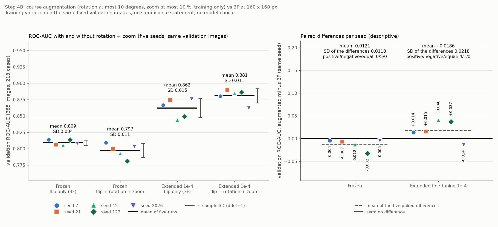

# Kursaugmentation beim 160-Pixel-Vollbildmodell (Schritt 4B)

> Hinweis: Der technische Vorcheck der Augmentationsschichten (`augmentation160_precheck.py`) gehört zum historischen Ablauf und liegt nicht mehr im Projektordner; die verwendeten Augmentationsparameter stehen in `src/busbra/config.py` und `src/busbra/models.py`.

Stand: 20.10.2026. Ursprünglich mit den früheren Treibern erzeugt, heute entsprechend: `analysis/03_classification.py`, `src/busbra/models.py`, `src/busbra/training.py` und `plots/plot_augmentation160_results.py`. Schritt 4B wurde technisch geprüft; die sechs Augmentationsbeispiele wurden nachträglich gesichtet (siehe Abschnitt „Sichtprüfung“). Alle Zahlen stammen aus `reports/tables/augmentation160_*.csv`, `augmentation160_status.json`, `augmentation160_study_config.json`, `augmentation160_calibration.json`, `augmentation160_precheck.json` und den zehn Laufverzeichnissen unter `reports/tables/augmentation160/` (Studie `aug160-110415a4`, Plan-SHA-256 `110415a4b5bdf53e…`). Die Referenzläufe sind die 160-Pixel-Läufe der Studie 3F ([multiseed_comparison.md](multiseed_comparison.md)); sie wurden gelesen (Hashes geprüft), nicht neu gerechnet. Die 250-Pixel-Läufe aus 4A ([resolution_250_comparison.md](resolution_250_comparison.md)) dienen nur als Kontext.

## Frage und Umfang

Verändert die zusätzliche geometrische Augmentation des Kursskripts 09_01b (zufällige Rotation und zufälliger Zoom vor der MobileNetV2-Skalierung) das Validation-Ergebnis der 160 × 160-Vollbild-Pipeline aus 3F? Verglichen werden auf demselben case-getrennten Split, mit denselben fünf Seeds (7, 21, 42, 123, 2026) und derselben Bildreihenfolge nur die beiden Stufen, die in 3F den Kern bilden: ein **neuer Frozen-Kopf** (Adam 1e-3, höchstens 30 Epochen) und danach das **neue erweiterte Fine-Tuning** der zehn Faltungen aus 3D/3E (Adam 1e-4, höchstens 20 Epochen), das je Seed vom besten neuen augmentierten Frozen-Checkpoint desselben Seeds startet. Die 3F-Läufe bleiben Referenz.

Nicht Teil dieses Schritts: andere Stärken, Helligkeit, Kontrast, Farbe, vertikaler Flip, Masken oder Bounding Boxes als Merkmal oder zum Zuschneiden, weitere Architekturen oder Lernraten, Schwellenanalyse, Masken-/ROI-Vergleich, Modell- oder Schwellenfestlegung. **Die Testdaten wurden nicht verwendet** (je Lauf genau 1.499 PNG-Dateien, Train und Validation, kein Treffer auf Test oder Masken).

## Die einzige geplante Änderung gegenüber 3F

Zwischen dem unveränderten horizontalen Flip (Seed s+1) und der Kanalverdreifachung stehen jetzt zwei zusätzliche Schichten, die nur im Training wirken:

| Schicht | Einstellung | Seed |
|---|---|---|
| `RandomRotation` | `factor=10/360`, `fill_mode="constant"`, `fill_value=0.0`, `interpolation="bilinear"` | s+4 |
| `RandomZoom` | `height_factor=(-0.10, 0.10)`, `width_factor=None`, `fill_mode="constant"`, `fill_value=0.0`, `interpolation="bilinear"` | s+5 |

Modellreihenfolge: Eingabe `(N, 160, 160, 1)` → Flip → Rotation → Zoom → drei identische Kanäle → `Rescaling(2, −1)` → MobileNetV2 (mit `training=False` aufgerufen, 52 BatchNorm-Schichten fest) → GAP → Dropout 0,3 → Dense(1, sigmoid). Alles andere folgt dem akzeptierten 3F-Protokoll: Split und Reihenfolge, Verkleinern mit Seitenverhältnis und schwarzem Padding, `float32` in [0, 1], lokale ImageNet-Gewichte, Loss, Metriken, Batchgröße 16, Epochengrenzen, Early Stopping (`val_loss`, Geduld 5), Checkpoint nach Validation-Loss, Seedabbildung (Flip s+1, Dropout s+2, Shuffle s+3, `PYTHONHASHSEED`), frischer Optimierer je Lauf. Augmentierung gibt es nur im Training; Validation- und spätere Testbilder durchlaufen keine zufällige Operation.

### Semantik der Keras-Schichten (gemessen, nicht angenommen)

- **Rotation:** `factor` ist in Keras ein Bruchteil einer vollen Drehung. `factor=10/360` ergibt den Bereich ±0,02778 und damit höchstens ±10 Grad. Die beiden Kursskripte unterscheiden sich hier: Das Keras-Skript 09_01b übergibt `0.1`, was bis zu 36 Grad erlauben würde, das PyTorch-Skript 09_02 verwendet 10 Grad. Für Ultraschallbilder wurde die vorsichtige Variante **±10 Grad bewusst gewählt** und vor dem ersten Training festgelegt; das ist eine eigene Entscheidung, keine Übernahme des Kurswertes 0.1.
- **Zoom:** Mit `height_factor=(-0.10, 0.10)` und `width_factor=None` wird ein einziger Zoomparameter aus [0,9; 1,1] für beide Achsen gezogen (isotrop, in jedem Zug sind Höhen- und Breitenparameter gleich). Der gemessene lineare Inhaltsmaßstab ist der **Kehrwert** des Parameters, also 0,909 bis 1,111: ein Vergrößern des Inhalts um höchstens 11,1 % der linearen Größe, ein Verkleinern um höchstens 9,1 %. Die „10 %“ der Vorgabe beziehen sich auf den Keras-Parameter ±0,10, der genau so umgesetzt wurde. (Die Pixelmessung des Vorchecks mit Quadraten gibt 0,900 bis 1,100 an; sie ist durch die Pixelrundung der Flächenmessung um etwa ±0,01 ungenau. Der Prüftest für diesen Schritt misst Zoomparameter und Quadrate gemeinsam und bestätigt Maßstab = 1 / Parameter mit höchstens 0,012 Abweichung.) Die Geometrie-Abschätzung weiter unten rechnet mit dem ungünstigsten Fall 1/0,9.
- **Auffüllen:** Die neu entstehenden Randbereiche sind exakt 0,0 (konstant schwarz, kein Spiegeln, kein Helligkeitsfüllwert). Bilineare Interpolation erzeugt nur Mischwerte zwischen Bild und Schwarz an den Rändern.
- **Inferenz:** Mit `training=False` geben alle drei Schichten ihre Eingabe exakt zurück; der Backbone erhält im augmentierten und im 3F-Graphen bitgleiche Eingaben.
- **Labels** werden nicht transformiert: Das Modell hat genau eine Eingabe, die Labels laufen getrennt durch die Datenpipeline.

## Vorcheck (vor dem Plan, `analysis/augmentation160_precheck.py`, Exit 0)

Der Vorcheck baut den echten Graphen und prüft (18 Prüfungen, alle bestanden, Bericht `augmentation160_precheck.json`, SHA-256 `e7e45e44b2295924…`, im Studienplan per Hash eingetragen):

- **Konfiguration und Seeds** aus den gebauten Schichten gelesen (Rotation ±10,0000 Grad, Zoom ±0,10 isotrop, konstante Füllung 0,0, bilinear; Generatoren Flip 8, Rotation 11, Zoom 12, Dropout 9 für Seed 7).
- **Synthetische Messungen** (600 Züge, keine Ultraschallbilder): gemessener Rotationswinkel −9,89 bis +10,02 Grad (Bar-Orientierung aus Pixeln, Messtoleranz ±0,6), Zoom siehe oben; Form `(N, 160, 160, 1)`, `float32` und Wertebereich [0, 1] bleiben erhalten; 5,70 % der Pixel sind auf Konstant-Eins-Bildern exakt 0,0; schwarzes Padding bleibt schwarz (maximal 0,0000 in den oberen acht Zeilen); aufeinanderfolgende Trainingsdurchläufe liefern verschiedene Varianten (48 verschiedene Winkel in 50 Zügen); gleicher Seed reproduziert die ersten Varianten bitgleich, anderer Seed nicht.
- **Inferenzidentität:** bitgleiche Eingabe des Backbones, Vorhersagen mit denselben Netzgewichten gleich dem 3F-Graphen.
- **Sechs Trainingsbilder** (nur Trainings-PNGs geöffnet, keine Validation-, Test- oder Maskendatei): `bus_0236-r`, `bus_0632-l`, `bus_0284-l` (benign) sowie `bus_0530-r`, `bus_0268-l`, `bus_0320-l` (maligne). Bei jeder gezeigten Variante bleiben die Pixelwerte in [0, 1], neue schwarze Bereiche sind vorhanden, und die mittlere Helligkeit der nicht schwarzen Pixel ändert sich höchstens um 0,009 (nur Interpolation, keine Helligkeitsaugmentation).
- **Geometrischer Verlust** (aus den bekannten Originalgrößen aller 1.114 Trainingsbilder, ohne Pixelwerte und ohne Masken): Im ungünstigsten erlaubten Fall (Rotation ±10 Grad mit Vergrößern 1/0,9) bleiben mindestens 79,8 % der Bildfläche im 160 × 160-Rahmen (5. Perzentil 83,9 %, Median 90,1 %); bis zu 20,2 % der Bildfläche, überwiegend an den Ecken, können herausragen. Das ist eine gemessene Eigenschaft der gewählten Stärke, kein Pass/Fail-Kriterium. Ob eine Läsion betroffen sein kann, ist eine Bildfrage.

### Sichtprüfung

**Stand zum Zeitpunkt des Hauptlaufs: offen.** Der vor der Studie bestandene Vorcheck schreibt eine lokale Vorher/Nachher-Vorschau (`data/processed/augmentation160_preview_train_only.png`, nur Trainingsbilder, lokal, nicht versioniert). Vor dem Hauptlauf wurde die Vorschau nicht angesehen; die Studie wurde auf Grundlage der quantitativen Prüfungen oben gestartet, es gab keine visuelle Freigabe vor dem Hauptlauf. Der Vorcheck-Bericht (`augmentation160_precheck.json`) dokumentiert diesen Stand (`visual_inspection.status = "open"`) und bleibt unverändert.

**Nachtrag (20.10.2026, nach dem Hauptlauf): nachträgliche Sichtung.** Sechs ausgewählte Trainingsbilder (`bus_0236-r`, `bus_0632-l`, `bus_0284-l`, `bus_0530-r`, `bus_0268-l`, `bus_0320-l`) mit maximal rotierten, vergrößerten, verkleinerten und typischen Varianten wurden erst nach dem Hauptlauf betrachtet. In dieser Stichprobe sind die auffälligen Bereiche weiterhin sichtbar, es ist keine offensichtlich abgeschnittene Struktur und es sind keine hellen oder gespiegelten Füllflächen zu erkennen; sichtbar sind schwarze Eckflächen, ein leichter Randbeschnitt und teilweise weichere Details. Bei `bus_0236-r` lässt sich die genaue Läsionsgrenze in der kleinen Vorschau schwer beurteilen. Eingebrannte Texte und Messmarken bleiben in den Varianten enthalten. Diese Sichtung ist keine Prüfung aller Trainingsvarianten und keine klinische Neubefundung. Die Sichtung erfolgte erst nach dem 4B-Hauptlauf und betraf nur diese sechs Beispiele. Der SHA-256 der lokalen Originalvorschau (`ad6008b231f40b65…`) stimmt mit dem im Vorcheck-Bericht protokollierten Wert überein. Die tatsächlich angesehene hochgeladene Kopie hatte einen anderen Datei-Hash (`73a379d0…`); Pixelidentität mit der lokalen Datei ist nicht belegt.

## Startgewichte: bewiesen, nicht angenommen

- Je Seed wird der neue Frozen-Kopf mit demselben Aufbau wie in 3F initialisiert. Im Lauf ist die Prüfung `initial_weights_equal_the_3F_initial_weights_of_this_seed` vor dem ersten Update verlangt: Fingerabdrücke aller Gewichte, des ImageNet-Backbones (`03276b4c…807ba3`) und des Kopfes sind gleich den aufgezeichneten 3F-Startwerten desselben Seeds; die fünf Köpfe sind verschieden. Der Koordinator wiederholt den Vergleich über alle fünf Seeds, der Prüftest baut die fünf Graphen unabhängig neu und vergleicht erneut.
- Jedes Fine-Tuning kopiert die Netzgewichte seines besten augmentierten Frozen-Checkpoints (Seed s) in einen frisch gebauten Graphen, mit frischen Augmentations- und Dropout-Generatoren und frischem Adam (0 Iterationen); die Startscores reproduzieren die gespeicherten Frozen-Scores innerhalb 1e-5. Der Start unterscheidet sich vom 3F-Frozen-Netz desselben Seeds (anderes Training).
- Der Zählerzustand der Zufallsgeneratoren aus einer geladenen `.keras`-Datei wird in Keras 3.15.1 nicht wiederhergestellt; die Läufe sind deshalb von frischer Konstruktion abhängig und nicht von gespeicherten Zählerständen (so in der Studie belegt: Generatorzustände je Lauf aus den gebauten Schichten gelesen).

## Batchgröße und GPU

Vor der Studie lief eine realistische GPU-Probe mit der echten augmentierten Pipeline (erweitertes Fine-Tuning, vier echte Trainingsschritte, danach ein Validation-Durchlauf über 64 Bilder; Reihenfolge 16, dann 8 nur nach einem sauberen Speicherfehler): **Batchgröße 16 passte** (Allokator-Spitze 1.083,6 MiB), sie ist im Plan für alle Läufe eingefroren. Der Vergleich weicht damit **nicht** durch die Batchgröße von 3F ab. Die Probe wurde registriert, bevor der Plan geschrieben wurde, und hat die Hauptläufe nicht beeinflusst (jeder Lauf baut sich nach seiner eigenen Probe vollständig neu auf; der Reset-Nachweis zeigt Startgewichte, Gruppen-Fingerabdrücke, frische Generatoren und Adam bei 0 Iterationen).

Je Lauf: Memory Growth vor der Initialisierung, weiche Platzierung aus, keine Speichergrenze, CUDA-Bibliotheken nur aus der `.venv`, Probe auf 16 Trainingsbildern mit allen vorgesehenen Gradienten (2 bzw. 12) auf GPU:0, alle endlich, Probeupdate nur in den zulässigen Gruppen. Gemessene Allokator-Spitzen im Training: **Frozen 422 MiB, Fine-Tuning 1.459–1.460 MiB** (`nvidia-smi` des Prozesses 630 bzw. 1.658 MiB). Dem Prozess standen laut TensorFlow gut 2,1 GiB zur Verfügung.

## Ergebnisse je Seed (Validation, 385 Bilder / 213 Cases)

Epoche = beste Epoche (kleinster Validation-Loss); Schwelle 0,5 nur deskriptiv; Konfusion TN/FP/FN/TP. „3F“ bezeichnet den Referenzlauf mit Flip als einziger Augmentation, „aug“ den neuen Lauf mit Flip + Rotation + Zoom. Alle Läufe: Batch 16, Stopp durch Early Stopping.

**Frozen-Kopf** (Training 39–68 s, Worker-Laufzeit 58–87 s, GPU-Spitze 422 MiB):

| Seed | Lauf | beste Ep. / Epochen | ROC-AUC | AP | Sens. | Spez. | TN/FP/FN/TP | gegenüber 3F |
|---|---|---|---:|---:|---:|---:|---|---|
| 7 | 3F | 19 / 24 | 0,8137 | 0,7143 | 0,504 | 0,931 | 242/18/62/63 | |
| 7 | aug | 18 / 23 | 0,8093 | 0,6955 | 0,576 | 0,835 | 217/43/53/72 | +9 TP, **+25 FP** |
| 21 | 3F | 13 / 18 | 0,8062 | 0,6932 | 0,392 | 0,931 | 242/18/76/49 | |
| 21 | aug | 15 / 20 | 0,7996 | 0,6865 | 0,360 | 0,962 | 250/10/80/45 | −4 TP, −8 FP |
| 42 | 3F | 11 / 16 | 0,8054 | 0,7012 | 0,424 | 0,935 | 243/17/72/53 | |
| 42 | aug | 13 / 18 | 0,7929 | 0,6835 | 0,520 | 0,869 | 226/34/60/65 | +12 TP, **+17 FP** |
| 123 | 3F | 17 / 22 | 0,8137 | 0,7192 | 0,448 | 0,946 | 246/14/69/56 | |
| 123 | aug | 8 / 13 | 0,7814 | 0,6681 | 0,536 | 0,854 | 222/38/58/67 | +11 TP, **+24 FP** |
| 2026 | 3F | 14 / 19 | 0,8078 | 0,7011 | 0,440 | 0,938 | 244/16/70/55 | |
| 2026 | aug | 9 / 14 | 0,8032 | 0,6924 | 0,568 | 0,827 | 215/45/54/71 | +16 TP, **+29 FP** |

**Erweitertes Fine-Tuning 1e-4** (Training 35–55 s, Worker-Laufzeit 59–80 s, GPU-Spitze 1.459–1.460 MiB):

| Seed | Lauf | beste Ep. / Epochen | ROC-AUC | AP | Sens. | Spez. | TN/FP/FN/TP | gegenüber 3F |
|---|---|---|---:|---:|---:|---:|---|---|
| 7 | 3F | 6 / 11 | 0,8666 | 0,7642 | 0,608 | 0,915 | 238/22/49/76 | |
| 7 | aug | 6 / 11 | 0,8803 | 0,8002 | 0,712 | 0,877 | 228/32/36/89 | +13 TP, **+10 FP** |
| 21 | 3F | 7 / 12 | 0,8745 | 0,7672 | 0,656 | 0,908 | 236/24/43/82 | |
| 21 | aug | 11 / 16 | 0,8899 | 0,8407 | 0,752 | 0,915 | 238/22/31/94 | +12 TP, −2 FP |
| 42 | 3F | 6 / 11 | 0,8441 | 0,7042 | 0,744 | 0,781 | 203/57/32/93 | |
| 42 | aug | 9 / 14 | 0,8846 | 0,8021 | 0,600 | 0,923 | 240/20/50/75 | −18 TP, −37 FP |
| 123 | 3F | 5 / 10 | 0,8493 | 0,7599 | 0,616 | 0,904 | 235/25/48/77 | |
| 123 | aug | 5 / 10 | 0,8865 | 0,7977 | 0,616 | 0,919 | 239/21/48/77 | ±0 TP, −4 FP |
| 2026 | 3F | 6 / 11 | 0,8759 | 0,7849 | 0,768 | 0,815 | 212/48/29/96 | |
| 2026 | aug | 11 / 16 | 0,8622 | 0,7741 | 0,728 | 0,846 | 220/40/34/91 | −5 TP, −8 FP |

Kein Lauf erreichte das Epochenlimit. Koordinator-Wandzeit des Trainingslaufs 11,9 min (Summe der Worker 689 s). Zum Vergleich der Trainings-ROC-AUC (nur zur Information über Anpassung): Frozen aug 0,803–0,826, Fine-Tuning aug 0,871–0,924.

## Zusammenfassung und gepaarte Seed-Differenzen

Mittelwert und Stichproben-SD (ddof=1) über die fünf Läufe; die 3F-Werte werden gelesen.

| Gruppe | ROC-AUC Mittel | SD | min – max | AP Mittel | SD | Sens. (0,5) | Spez. (0,5) | FP / TP (Mittel) |
|---|---:|---:|---|---:|---:|---|---|---|
| Frozen, nur Flip (3F) | 0,8094 | 0,0041 | 0,8054 – 0,8137 | 0,7058 | 0,0106 | 0,442 ± 0,041 | 0,936 ± 0,006 | 16,6 / 55,2 |
| Frozen, Flip + Rotation + Zoom | 0,7973 | 0,0107 | 0,7814 – 0,8093 | 0,6852 | 0,0107 | 0,512 ± 0,088 | 0,869 ± 0,054 | 34,0 / 64,0 |
| erweitert 1e-4, nur Flip (3F) | 0,8621 | 0,0146 | 0,8441 – 0,8759 | 0,7561 | 0,0305 | 0,678 ± 0,074 | 0,865 ± 0,062 | 35,2 / 84,8 |
| erweitert 1e-4, Flip + Rotation + Zoom | 0,8807 | 0,0109 | 0,8622 – 0,8899 | 0,8029 | 0,0240 | 0,682 ± 0,069 | 0,896 ± 0,034 | 27,0 / 85,2 |
| *Kontext 4A: Frozen 250 px, nur Flip* | 0,8210 | 0,0099 | 0,8045 – 0,8290 | 0,6870 | 0,0159 | 0,466 ± 0,090 | 0,907 ± 0,028 | 24,2 / 58,2 |
| *Kontext 4A: erweitert 1e-4, 250 px, nur Flip* | 0,8492 | 0,0095 | 0,8338 – 0,8571 | 0,7313 | 0,0146 | 0,629 ± 0,127 | 0,881 ± 0,044 | 31,0 / 78,6 |

**Gepaarte Differenzen aug minus 3F** (je Seed, Mittel und SD der fünf Differenzen direkt berechnet; Vorzeichen positiv/negativ/gleich). Alle Metriken in `augmentation160_paired_summary.csv`, Einzelwerte in `augmentation160_paired_differences.csv`.

| Vergleich | Metrik | Mittel | SD | Werte je Seed (7, 21, 42, 123, 2026) | +/−/= |
|---|---|---:|---:|---|---|
| **erweitert 1e-4: aug minus 3F** | ROC-AUC | **+0,0186** | 0,0218 | +0,0137; +0,0154; +0,0405; +0,0372; −0,0136 | 4 / 1 / 0 |
| | Average Precision | +0,0469 | 0,0414 | +0,0360; +0,0736; +0,0979; +0,0378; −0,0109 | 4 / 1 / 0 |
| | Sensitivität (0,5) | +0,0032 | 0,1029 | +0,104; +0,096; −0,144; 0,000; −0,040 | 2 / 2 / 1 |
| | Spezifität (0,5) | +0,0315 | 0,0671 | −0,038; +0,008; +0,142; +0,015; +0,031 | 4 / 1 / 0 |
| **Frozen: aug minus 3F** | ROC-AUC | **−0,0121** | 0,0118 | −0,0044; −0,0066; −0,0125; −0,0323; −0,0046 | 0 / 5 / 0 |
| | Average Precision | −0,0206 | 0,0178 | −0,0187; −0,0067; −0,0177; −0,0511; −0,0087 | 0 / 5 / 0 |
| | Sensitivität (0,5) | +0,0704 | 0,0608 | +0,072; −0,032; +0,096; +0,088; +0,128 | 4 / 1 / 0 |
| | Spezifität (0,5) | −0,0669 | 0,0571 | −0,096; +0,031; −0,065; −0,092; −0,112 | 1 / 4 / 0 |
| Fine-Tuning minus Frozen, mit Augmentation | ROC-AUC | +0,0834 | 0,0183 | +0,0710; +0,0903; +0,0917; +0,1051; +0,0590 | 5 / 0 / 0 |
| Fine-Tuning minus Frozen, 3F (nur Flip) | ROC-AUC | +0,0527 | 0,0156 | +0,0529; +0,0683; +0,0387; +0,0356; +0,0681 | 5 / 0 / 0 |

## Beobachtungen (deskriptiv, ohne Signifikanz- oder Überlegenheitsaussage)

- **Erweitertes Fine-Tuning:** Die Validation-ROC-AUC liegt im Mittel 0,019 über dem 3F-Partner (vier von fünf Seeds positiv; Seed 2026 −0,014); die Average Precision im Mittel 0,047 darüber (vier von fünf Seeds positiv). Die Streuung der gepaarten Differenzen (SD 0,022) ist so groß wie ihr Mittelwert. Sensitivität bei 0,5 im Mittel +0,003 (zwei positive, zwei negative, eine ohne Änderung), Spezifität im Mittel +0,032. Mehr Treffer bei 0,5 kamen in Seed 7 (+13 TP) mit 10 zusätzlichen Fehlalarmen und in Seed 21 (+12 TP) mit 2 weniger Fehlalarmen; in Seed 42 sinken Treffer und Fehlalarme zugleich (−18 TP, −37 FP), das Modell arbeitet bei 0,5 in einem anderen Betriebspunkt. Die Betriebspunkte bei 0,5 sind nicht vergleichbar, die ROC-AUC ist schwellenfrei.
- **Frozen-Kopf:** Mit Augmentation liegt die ROC-AUC im Mittel 0,012 und die Average Precision 0,021 unter 3F, in allen fünf Seeds negativ. Die Sensitivität bei 0,5 steigt im Mittel um 0,070 (vier von fünf Seeds), allerdings mit **mehr Fehlalarmen**: In den vier Seeds mit höherer Sensitivität kommen 25, 17, 24 und 29 Fehlalarme hinzu bei 9, 12, 11 und 16 zusätzlichen Treffern; im Mittel steigt die Fehlalarmzahl von 16,6 auf 34,0. Das ist zunächst eine Verschiebung des Betriebspunkts bei der festen Schwelle 0,5 und keine bessere Trennung: Die schwellenfreie ROC-AUC sinkt. Warum sich der Betriebspunkt verschiebt, wurde nicht untersucht; eine eigene Schwellenanalyse folgt erst in einem späteren Schritt.
- **Abstand Fine-Tuning zu Frozen** ist mit Augmentation (+0,083) größer als in 3F (+0,053), in beiden Fällen in allen fünf Seeds positiv. Er enthält die Wirkung auf zwei Stufen: Der augmentierte Frozen-Start ist schlechter, das augmentierte Fine-Tuning besser. Dass das Fine-Tuning trotz eines im Mittel schlechteren Startpunkts besser abschneidet, ist beobachtet, nicht erklärt.
- Die besten Epochen des Fine-Tunings liegen mit Augmentation später (5–11 statt 5–7); die Läufe stoppen weiter durch Early Stopping.
- Im Vergleich zum Kontext aus 4A (250 Pixel ohne Augmentation, erweitertes Fine-Tuning 0,849) liegt das augmentierte 160-Pixel-Fine-Tuning (0,881) höher, das 160-Pixel-3F-Fine-Tuning (0,862) ebenfalls. Das sind andere Konfigurationen mit unterschiedlicher Streuung; es wird kein Gesamtranking daraus abgeleitet.
- Eine Ursache wurde nicht untersucht. Fünf gepaarte Seeds zeigen eine Tendenz und beweisen keine Überlegenheit auf neuen Daten. Der Frozen-Kopf und das Fine-Tuning zeigen in die entgegengesetzte Richtung; ein pauschales „Augmentation verbessert“ ist daraus nicht ableitbar.

## Technische Abweichungen (und ihre Bedeutung für den Vergleich)

1. **Zwei zusätzliche Schichten und ihre Seeds** (s+4, s+5) sind die geplante Änderung. Flip-, Dropout- und Shuffle-Seeds sind dieselben wie in 3F, die Reihenfolge der Mini-Batches ist durch den Shuffle-Seed gleich. Ob die einzelnen Flip-Entscheidungen Bild für Bild mit 3F übereinstimmen, wurde nicht geprüft und nicht verlangt; der Dropout-Verlauf kann durch die geänderten Aktivierungen ohnehin abweichen.
2. **Zählerstände der Generatoren:** siehe oben (nicht aus `.keras` wiederherstellbar); die Läufe starten deshalb aus frischer Konstruktion, im Reset-Nachweis belegt.
3. **Inferenz-Zwilling:** Der 3F-Vergleichsgraph der Inferenzprüfung wird mit `jit_compile=False` kompiliert, weil ein unkompilierter Keras-Graph XLA benutzt und kleine Gleitkommaabweichungen erzeugt. Beim Funktionstest in einer isolierten Kopie (zwei Epochen, nicht Teil der Studie, Werte nicht berichtet) schlug die Prüfung zunächst mit 2e-3 Abweichung fehl; der Wiederanlaufschutz meldete den Lauf korrekt als `recovery_required` (nichts gelöscht, nichts neu trainiert). Die Ursache war die Prüfung selbst (nicht das Verfahren): Der Zwilling wird seither wie das Modell kompiliert.
4. **Statistikgrafik:** Der Titel der Abbildung war im ersten Lauf abgeschnitten; er wurde zweizeilig gesetzt und die Abbildung durch einen zweiten Koordinatoraufruf aus den unveränderten Tabellen neu erzeugt (dabei wurde die fertige Studie mit null Worker-Starts validiert, `status.json` trägt jetzt `validated_existing`, der Status des Trainingslaufs bleibt in `augmentation160_status_last_success.json` erhalten). Alle Läufe und Tabellen blieben unverändert.
5. **Kein Unterschied** in Batchgröße, Lernraten, Epochengrenzen, Callbacks, Freigabe, Split, Reihenfolge und Evaluationsregel zu 3F.

## Grenzen

- Trainingsstreuung auf denselben 385 Validation-Bildern (fünf gepaarte Seeds), keine Aussage über neue Splits, Einrichtungen oder Kohorten; mehrere Bilder eines Cases sind abhängig; die Validation wurde bereits mehrfach für die Entwicklung verwendet, das Ausmaß einer optimistischen Bewertung ist unbestimmt.
- Keine p-Werte, Konfidenzintervalle, Gewinnerregel, gepoolte Seed-AUC, kein Ensemble, keine Wahl eines besten Seeds; keine Modell- oder Schwellenfestlegung für den Test.
- Die beiden Fine-Tuning-Partner jedes Seeds starten von verschiedenen Frozen-Läufen (3F bzw. augmentiert); Unterschiede enthalten deshalb auch die Streuung und die Wirkung der Augmentation auf den Frozen-Start. GPU-Training ist nicht bitgleich reproduzierbar.
- Eine Stärke (Rotation ±10 Grad, Zoomparameter ±0,10), eine Kombination; andere Stärken oder Einzelwirkungen von Rotation und Zoom wurden nicht untersucht.
- Die Sichtung der Augmentationsbeispiele erfolgte nachträglich an sechs Trainingsbildern und ist keine Prüfung aller Varianten. Rotation und Zoom können Randbereiche herausschieben (im ungünstigsten Fall bis zu 20,2 % der Bildfläche, überwiegend an den Ecken), und Details werden teilweise weicher; ob dabei in einzelnen Trainingsvarianten Läsionen betroffen sind, ist nicht gemessen.
- Eingebrannte Texte und Messmarken werden mit gedreht und skaliert; sie bleiben mögliche Abkürzungen, die hier weder entfernt noch untersucht wurden.

## Prüfungen

Gezielt geprüft (ohne zusätzliches Training; Fehlerfälle in isolierten Kopien mit abgefangenen Worker-Starts; Bilder nur synthetisch):
- **Augmentation am echten Graphen:** Konfiguration und Reihenfolge, Seeds (Flip s+1, Dropout s+2 wie 3F; Rotation s+4, Zoom s+5), gemessene Rotation (−9,99 bis +9,90 Grad) und Zoomparameter (0,900–1,099) in 600 Zügen, Zoom isotrop, Maßstab = 1 / Parameter an Quadraten, Form, Datentyp und Wertebereich erhalten, neuer Außenbereich exakt 0,0, Varianten unterscheiden sich, `training=False` gibt exakt die Eingabe, gleicher Seed reproduziert, andere Seeds nicht, Inferenzidentität mit dem 3F-Graphen (bitgleiche Backbone-Eingabe, gleiche Fingerabdrücke, Vorhersagen innerhalb 1e-6), Checkpoint speichert und lädt.
- **Startgewichte:** Für alle fünf Seeds baut eine frische Konstruktion den augmentierten Graphen mit Gewichten, die den aufgezeichneten 3F-Startwerten (alle Gewichte, Backbone, Kopf) bitgleich entsprechen; die Köpfe sind seedspezifisch.
- **Vorcheck- und Planschranken:** Fehlt der Vorcheck-Bericht oder ist er fehlgeschlagen, stoppt der Koordinator vor der GPU-Probe (kein Plan, kein Worker); ein nach der Plan-Registrierung veränderter Bericht passt nicht mehr zum Planhash und stoppt vor jedem Worker. Eine Gewichtsdatei mit abweichendem Hash oder fehlende Datei stoppt vor jedem Worker (nichts wird geladen).
- **GPU-Probe:** Passt weder Batchgröße 16 noch 8, werden Befund und Fehlerstatus dokumentiert, es gibt keinen Plan, keinen Lauf und keinen Ersatz; bei Speicherfehler mit 16 und Erfolg mit 8 friert die Probe 8 im Plan ein.
- **Wiederanlaufschutz:** Auswertungsfehler nach dem Training, fehlender Status, früher Platzhalterstatus und einzelner Checkpoint werden im Koordinator und im direkten Worker abgewiesen (Worker vor jedem NumPy-/pandas-/TensorFlow-Import), alles bleibt byte-identisch, wiederholte Abweisungen löschen nichts; frühe Fehler ohne Artefakte bleiben fortsetzbar; die vollständige Studie wird mit null Worker-Starts validiert; ein manipulierter Lauf und ein geänderter Plan stoppen; ein falsches Umfeld stoppt beim Interpretercheck.
- **Studienevidenz:** zehn Läufe mit zehn Run-IDs; Vorcheck vor Probe vor Plan vor dem ersten Training; GPU:0-Nachweise mit allen Gradienten, Reset, Generatoren mit Rotation und Zoom, Optimiererrate, Batchgröße, 1.499 PNG-Dateien je Lauf, Augmentationskonfiguration aus den Schichten, Startgewichte gleich 3F bzw. gleich dem augmentierten Frozen-Checkpoint, Ausgabehashes; Neuberechnung von ROC-AUC, AP und Konfusion aller 20 gespeicherten Scoresätze aus den Scores; dieselben 385 Validation-IDs, Cases und Labels in allen 20 Läufen (zehn neue, zehn Referenz).
- Die Abbildung entsteht aus den Tabellen ohne TensorFlow und Keras und ist byte-identisch reproduzierbar. Syntax, `pip check` und Paketstand unverändert; alle früheren Modelle, Tabellen, Status, Configs, Vorhersagen, Grafiken, Skripte und Module, die 25 Läufe der Studie 3F, die zehn Läufe aus 4A sowie Audit, Split, Rohdaten und Environment-Berichte per Hash unverändert.

## Quellen

- Sandler, M. et al.: MobileNetV2: Inverted Residuals and Linear Bottlenecks, CVPR 2018.
- Keras-Dokumentation zu `RandomRotation` und `RandomZoom`: https://keras.io/api/layers/preprocessing_layers/image_augmentation/
- Keras-Leitfaden Transfer Learning und Fine-Tuning: https://keras.io/guides/transfer_learning/
- Bouthillier, X. et al.: Accounting for Variance in Machine Learning Benchmarks, 2021, https://arxiv.org/abs/2103.03098
- Datensatz: Gómez-Flores et al., *Medical Physics* 51 (2024), https://doi.org/10.1002/mp.16812 (Lizenzhinweise siehe README).
