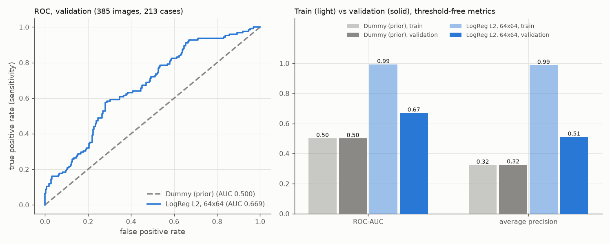

# Bildaufbereitung und klassische Baselines

Stand: 19.10.2026. Ursprünglich mit den früheren Treibern erzeugt, heute entsprechend: `analysis/02_baselines.py` und den Hilfsmodulen in `src/busbra/`. Alle Zahlen stammen aus `reports/tables/baseline_metrics.csv` und `baseline_status.json`.

## Umfang

Zwei bewusst einfache Referenzen auf dem eingefrorenen Split (siehe [split_definition.md](split_definition.md)): ein Dummy, der nur die Klassenhäufigkeit kennt, und eine L2-regularisierte logistische Regression auf Rohpixeln. Beide laufen auf der CPU mit scikit-learn 1.9.1. Es gibt kein neuronales Netz, keine Augmentation, keine Masken- oder BBOX-Information, keine Markerentfernung und keine Hyperparametersuche.

**Verwendete Daten:** Train (1.114 Bilder, 639 Cases) und Validation (385 Bilder, 213 Cases). **Die Testbilder und Testvorhersagen wurden nicht verwendet.** Der Bildlader erhält nur die gefilterten Pfade von Train und Validation; eine Aufzeichnung aller geöffneten PNG-Dateien (1.499 verschiedene) bestätigt, dass kein Test- und kein Maskenbild geöffnet wurde. Das Skript prüft vor dem Laden den eingefrorenen Status und den SHA-256 der Split-Datei, die Eindeutigkeit der IDs, die Label-Codierung, die Teilmengengrößen und die Case-Trennung.

## Bildaufbereitung (fest, nichts wird aus Daten geschätzt)

1. Das Originalbild wird aus `image_relpath` geladen; es zählen nur Pixel. Erwartet wird ein 8-Bit-Graustufenbild (Modus `L`); andere Modi und beschädigte Dateien führen zu einer verständlichen Fehlermeldung statt zu einer stillen Umwandlung. Die tatsächlich dekodierte Größe wird gegen den geprüften Wert im Manifest abgeglichen; die vier fehlerhaften CSV-Höhen steuern keine Transformation.
2. **Zielgröße 64 × 64:** Das gesamte Bild wird proportional verkleinert (`ImageOps.contain`, bilineare Interpolation) und zentriert auf eine schwarze Fläche (Wert 0) gesetzt. Kein Zuschnitt, kein Strecken. Pillow rundet die skalierte Seite mit Pythons `round()` (halb zu gerade); bleibt ein ungerader Rest, liegt der zusätzliche Pixel rechts bzw. unten. Bei der Verkleinerung mittelt Pillows bilineares Verfahren über die abgedeckten Quellpixel.
3. Ein Kanal, `float32 / 255`, Werte in [0, 1]. Kein `StandardScaler`, keine gelernte Normalisierung.
4. Für scikit-learn werden die Bilder zeilenweise zu 4.096 Merkmalen abgeflacht und als zusammenhängendes `float64` übergeben (exakte Umwandlung).

Der Resize-Helfer nimmt die Zielgröße als Parameter, damit die Geometrie später wiederverwendet werden kann. Eine Auflösung für CNNs ist damit **nicht** festgelegt.

**Hinweis zur Einordnung:** Die niedrige Auflösung gehört zu dieser einfachen Baseline; der spätere Vergleich bewertet ganze Pipelines (Aufbereitung plus Modell). Padding und die verbleibende Bilddarstellung entfernen mögliche Gerätehinweise (eingebrannte Marker, Bildlayout, Bildgröße) nicht automatisch.

Eine lokale Vorher-Nachher-Ansicht (acht bereits für die EDA ausgewählte Trainingsbilder, original und aufbereitet) liegt als `data/processed/baseline_preprocessing_preview.png`. Sie bleibt lokal und ist nicht Teil des öffentlichen Bestands.

## Modelle

**Dummy:** `DummyClassifier(strategy="prior")`, nur mit den Trainingslabels gefittet, ignoriert die Pixel. Der Malignant-Score ist für jedes Bild gleich der Trainingshäufigkeit von malignant, 360/1114 = 0,3232. Nichts davon stammt aus Validation, nichts ist zufällig.

**Logistische Regression:** `LogisticRegression` mit den effektiven Parametern `C=1.0`, `l1_ratio=0.0` (L2; in scikit-learn 1.9 gilt das alte Argument `penalty` als veraltet und wird nicht benutzt), `solver="lbfgs"`, `fit_intercept=True`, `class_weight=None`, `tol=1e-4`, `max_iter=2000`. Fit ausschließlich auf Train. Es gibt keine gewichtete Variante, keine C-Suche und keine andere Auflösung.

**Konvergenz:** Der erste Lauf konvergierte nach 158 Iterationen (Limit 2000), ohne Konvergenzwarnung. Der vorgesehene einmalige Wiederholungslauf mit `max_iter=5000` war nicht nötig. Während Fit und Vorhersage wurden keine Warnungen ausgegeben (`warnings_captured` ist leer).

## Score und Entscheidungsregel

Der Score bezeichnet **malignant** (Label 1). Er wird über `classes_` der positiven Klasse zugeordnet, nicht über „die letzte Spalte“ (positive Klasse und `classes_ = [0, 1]` werden geprüft; zusätzlich stimmt das Vorzeichen der `decision_function` mit der 0,5-Schwelle überein). Der Score ist keine kalibrierte klinische Wahrscheinlichkeit. Hart vorhergesagt wird mit der festen Regel `Score >= 0,5`; es gibt weder Schwellenoptimierung noch Kalibrierung.

## Ergebnisse

Hauptvergleich ist die **ROC-AUC auf Validation**. Die Trainingswerte beschreiben nur die Anpassung an die Trainingsdaten. Bild- und Case-Zahlen: Train 1.114 Bilder (360 maligne) / 639 Cases (205 maligne); Validation 385 Bilder (125 maligne) / 213 Cases (69 maligne). Positive Klasse: malignant; Schwelle 0,5; Reihenfolge der Konfusionsmatrix [0, 1].

**Validation:**

| Modell | ROC-AUC | Average Precision | Sensitivität | Spezifität | Precision | F1 | Accuracy | TN | FP | FN | TP |
|---|---:|---:|---:|---:|---:|---:|---:|---:|---:|---:|---:|
| Dummy (Prior) | 0,5000 | 0,3247 | 0,0000 (0/125) | 1,0000 (260/260) | nicht definiert (0/0) | 0,0000 | 0,6753 | 260 | 0 | 125 | 0 |
| LogReg L2, 64×64 | 0,6692 | 0,5092 | 0,3760 (47/125) | 0,7808 (203/260) | 0,4519 (47/104) | 0,4105 | 0,6494 | 203 | 57 | 78 | 47 |

**Train (nur zur Beschreibung der Anpassung):**

| Modell | ROC-AUC | Average Precision | Sensitivität | Spezifität | Precision | F1 | Accuracy | TN | FP | FN | TP |
|---|---:|---:|---:|---:|---:|---:|---:|---:|---:|---:|---:|
| Dummy (Prior) | 0,5000 | 0,3232 | 0,0000 | 1,0000 | nicht definiert | 0,0000 | 0,6768 | 754 | 0 | 360 | 0 |
| LogReg L2, 64×64 | 0,9918 | 0,9868 | 0,8917 | 0,9867 | 0,9698 | 0,9291 | 0,9560 | 744 | 10 | 39 | 321 |

Die Average Precision wird mit `average_precision_score` berechnet. Raten mit Nenner null sind nicht definiert (leer in der CSV, `null` im JSON); der F1-Wert des Dummys ist trotz undefinierter Precision nach 2TP/(2TP+FP+FN) = 0.

**Kontrolle des Dummys:** Die Rechnung bestätigt die vorab aus den Labels abgeleiteten Werte: konstanter Score 0,3232, ROC-AUC 0,5, Average Precision gleich dem positiven Anteil der jeweiligen Teilmenge (0,3232 bzw. 0,3247) und auf Validation TN/FP/FN/TP = 260/0/125/0 mit Sensitivität 0, Spezifität 1 und undefinierter Precision.

## Vorläufiger Vergleich

- Die logistische Regression trennt auf Validation besser als der Dummy (ROC-AUC 0,669 gegenüber 0,5; Average Precision 0,509 gegenüber 0,325). Das Signal ist jedoch schwach: Bei der festen Schwelle 0,5 werden nur 47 von 125 malignen Validation-Bildern erkannt (Sensitivität 0,376), bei 57 Fehlalarmen unter 260 benignen Bildern. Die Accuracy (0,649) liegt unter der des Dummys (0,675), der alles als benign einstuft; Accuracy ist bei dieser Klassenverteilung kein geeignetes Hauptmaß.
- Der große Abstand zwischen Train (ROC-AUC 0,992) und Validation (0,669) zeigt eine starke Überanpassung: 4.096 Merkmale stehen 1.114 Trainingsbildern gegenüber. Ob das Modell bildinhaltliche Merkmale oder Gerätehinweise nutzt, ist damit nicht beantwortet.
- Es gibt keine Signifikanz- oder Konfidenzaussage. Validation besteht aus 385 abhängigen Bildern von 213 Cases, und die Zahlen stammen aus einem einzelnen Split und einem einzelnen Fit.
- Ein schwaches Ergebnis ist ein gültiger Befund. Es wurde weder der Split noch eine Konfiguration anhand der Validation- oder Testdaten angepasst.

## Reproduzierbarkeit und Laufzeit

Der Lauf wurde dreimal ausgeführt; Scores und Metriken waren dabei identisch (maximale Abweichung 0,0; als zulässige Toleranz gilt 1e-9). Modelldateien werden nicht auf Bytegleichheit geprüft. Die gespeicherten Modelle (lokal unter `models/baselines/`, nicht versioniert) enthalten Vorverarbeitung und Klassenvertrag; nach erneutem Laden reproduzieren sie die Validation-Scores (maximale Abweichung 0,0, Toleranz 1e-12).

Gemessen wurden auf der CPU: Laden und Aufbereiten ca. 3,4 s (Train) bzw. 1,1 s (Validation), Fit der logistischen Regression ca. 5 s. Das sind Messungen dieses Laufs; sie erlauben keine Aussage über die Laufzeit späterer neuronaler Netze.

## Grenzen

- Niedrige Auflösung und ein lineares Modell auf Rohpixeln sind Teil dieser einfachen Baseline.
- Mögliche Gerätehinweise (Marker, Layout, Bildgröße) werden nicht entfernt. Ihre Nutzung durch das Modell ist weder nachgewiesen noch ausgeschlossen.
- Ein fester Holdout, eine Einrichtung, abhängige Bilder je Case; die Scores sind nicht kalibriert.
- Der nächste Schritt (CNN, MobileNetV2) vergleicht ganze Pipelines auf demselben Split; die Testdaten bleiben bis zur Abschlussphase gesperrt.
