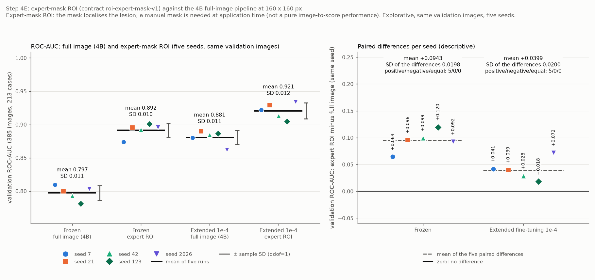
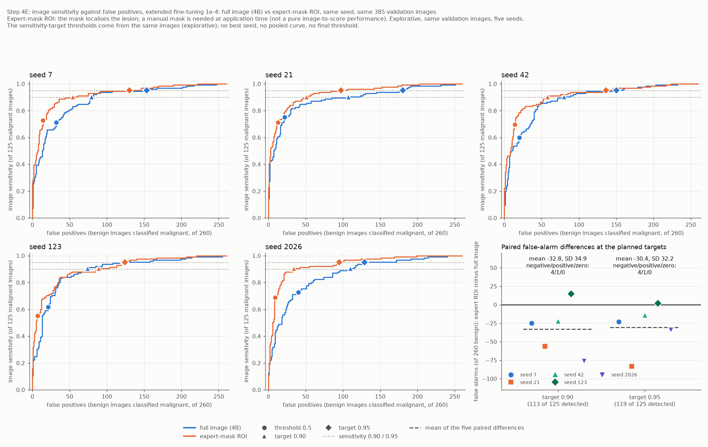

# Experten-ROI gegen Vollbild (Schritt 4E)

Stand: 20.10.2026. Ursprünglich mit den früheren Treibern erzeugt, heute entsprechend: `analysis/03_classification.py`, `src/busbra/data.py` und `plots/plot_expert_roi_results.py`. Alle Zahlen stammen aus `reports/tables/expert_roi_*.csv`, `expert_roi_study_config.json`, `expert_roi_data_check.json`, `expert_roi_status.json` und den zehn Laufverzeichnissen unter `reports/tables/expert_roi/` (Studie `roi4e-a42efa5a`); die Referenz sind die zehn gespeicherten 4B-Läufe ([augmentation_160_comparison.md](augmentation_160_comparison.md)), die gelesen (Hashes geprüft) und nie neu gerechnet oder überschrieben wurden.

**Informationsbedingung: Die Expertenmaske lokalisiert die Läsion.** Die ROI-Variante erhält als Modelleingabe ausschließlich die unmaskierten Originalpixel innerhalb der erweiterten Box (kein Maskenkanal, keine Schwärzung außerhalb der Läsion, keine BBOX-, BI-RADS-, Geräte- oder Case-Metadaten); ihre Anwendung erfordert jedoch eine **manuelle Maske**. Die ROI-Leistung ist deshalb **keine Bild-zu-Score-Leistung ohne menschliche Lokalisation** und nicht mit dem Vollbildzweig als gleichartige Pipeline zu verwechseln. Ob ein automatisch erzeugter Zuschnitt dieselbe Leistung erreichen würde, ist hier nicht untersucht; eine automatische Segmentierung wird erst in einem gesonderten Schritt geprüft. **Alle Ergebnisse sind explorativ**: Die Validation-Bilder wurden wiederholt für Modellentwicklung und Checkpoint-Wahl genutzt, und fünf Seeds auf demselben Holdout sind keine fünf unabhängigen Kohorten. Es gibt keine Modell- oder Schwellenwahl, keinen Testzugriff und keine Signifikanz- oder Überlegenheitsaussage.

## Frage und Umfang

Verändert der Experten-ROI-Zuschnitt (eingefrorener Vertrag `roi-expert-mask-v1` aus Schritt 4D) das Validation-Ergebnis der 160 × 160-Pipeline der akzeptierten Studie 4B? Verglichen werden gepaart über die fünf Seeds 7, 21, 42, 123 und 2026 je ein neuer Frozen-Kopf (Adam 1e-3) auf den Experten-ROIs und das erweiterte Fine-Tuning der zehn Faltungen (Adam 1e-4) aus dem eigenen besten ROI-Frozen-Checkpoint des Seeds: zehn neue Läufe, jeweils gegen den gespeicherten 4B-Lauf desselben Seeds und derselben Stufe auf denselben 385 Validation-IDs, 213 Cases und Labels. Nicht Teil dieses Schritts: Segmentierung, Testauswertung, endgültige Modell- oder Schwellenwahl, andere Stärken, Auflösungen, Architekturen, Lernraten, Randbreiten oder Seeds.

## Studiendesign (vor dem ersten Training festgelegt und registriert)

**Eine geplante Änderung gegenüber 4B: der Pixelinhalt.** Statt des ganzen Bildes erhält das Modell den Zuschnitt des **unmaskierten** Originals innerhalb der um 20 % je Seite erweiterten Box um alle positiven Maskenpixel (Vertrag `roi-expert-mask-v1`, Inhalts-SHA-256 `a0c72744776e92a4…`, unverändert und nicht neu eingefroren). Danach gilt die vorhandene seitenverhältnistreue Resize-/Padding-Regel auf 160 × 160 × 1, `float32`, [0, 1]. Alles Weitere ist die 4B-Pipeline: der ROI-Zuschnitt kommt zuerst; horizontaler Flip (Seed s+1), Rotation ±10° (s+4) und Zoomparameter ±0,10 (s+5) wirken anschließend und nur im Training; drei identische Kanäle, `Rescaling(2, −1)`, lokales ImageNet-MobileNetV2 (`training=False`, 52 BatchNorm-Schichten fest), GAP, Dropout 0,3 (s+2), Dense(1, sigmoid), Batch 16, Shuffle-Seed s+3, `BinaryCrossentropy`, Adam 1e-3 (Frozen, höchstens 30 Epochen) bzw. 1e-4 (erweitertes Fine-Tuning der zehn Faltungen, höchstens 20 Epochen), Early Stopping auf `val_loss` (Geduld 5), Checkpoint nach Validation-Loss. Validation-Inferenz ist deterministisch (die Augmentation ist dort inaktiv).

| Bestandteil | 4B (Vollbild) | 4E (Experten-ROI) |
|---|---|---|
| Modelleingabe | ganzes Bild | unmaskierter Zuschnitt um die erweiterte Maskenbox; **die Maske lokalisiert, ist aber kein Kanal und blendet nichts aus** |
| Augmentation, Architektur, Optimierer, Lernraten, Epochenlimits, Early Stopping, Checkpoint-Wahl, Seeds, Batch 16 | wie 4B | identisch |
| Frozen-Kopf | neu je Seed, ImageNet-Backbone | neu je Seed; Anfangsgewichte (alle, Backbone, Kopf) je Seed **vor dem ersten Update gleich** den 4B-Anfangsgewichten |
| Fine-Tuning | Start vom besten 4B-Frozen-Checkpoint des Seeds | Start vom besten **ROI-Frozen-Checkpoint** des Seeds (nie vom Vollbild-Checkpoint) |
| Anwendbarkeit | nur das Bild | **erfordert eine manuelle Maske** |

**Ausdrücklich festgehaltene Abweichungen:** der andere Pixelinhalt durch den Expertenzuschnitt und dadurch möglicherweise andere Trainingsverläufe (beste Epochen, Stopp). Es gab bewusst **keine** zusätzliche Kalibrierungs-Probe der Batchgröße: Die Tensorformen sind mit 4B identisch (160 × 160 × 1, Batch 16), die dort gemessenen Speicherspitzen (Frozen 422 MiB, Fine-Tuning etwa 1.460 MiB) gelten also; ein Speicherfehler wäre ein technischer Fehler des jeweiligen Laufs (kein Neustart, keine Änderung der Größe, kein CPU-Ausweichen) und trat nicht auf. Keine zusätzliche Stärke, Auflösung, Architektur, Lernrate, Crop-Randbreite, Seed-Auswahl und keine nachträgliche Anpassung auf Validation.

**Registrierung und Reihenfolge.** Der Studienplan (`reports/tables/expert_roi_study_config.json`, Studie `roi4e-a42efa5a`, Plan-SHA-256 `a42efa5aab198112…`) enthält Vertrag, Quellprüfsummen, die Referenzläufe, die Datenregeln, die gemeinsamen Einstellungen, die Vergleichsdefinition und die Hauptzielgrößen. Er wurde registriert (2026-10-20 19:14:13), nachdem Vertrag, Split-Hash, lokale Gewichte, die Quellmodule und alle zehn 4B-Referenzläufe (Status, Metriken, Vorhersagen, Verläufe, Konfigurationen und lokale Checkpoints) per Hash geprüft waren, und **vor** dem Öffnen jeder Validation-Maske. Danach öffnete ein eigener CPU-Prozess die Train- und Validation-Paare **einmal**, prüfte sie und fror den Daten-Fingerabdruck ein (2026-10-20 19:14:20); jeder der zehn Läufe berechnet seine Eingaben neu und muss den Fingerabdruck reproduzieren. Das erste Training begann 2026-10-20 19:14:20 (Sekundenauflösung; der Koordinator startet die Worker erst nach der Datenprüfung). Ein Start der Datenprüfung ohne registrierten Plan bricht ab, bevor irgendeine Bild- oder Maskendatei geöffnet wird (getestet).

**Hauptvergleich (vorab festgelegt).** Zahl der benignen Fehlalarme (von 260 benignen Validation-Bildern) bei den Sensitivitätszielen **0,90** und **0,95** auf Bildebene, d. h. mindestens **113** bzw. **119** der 125 malignen Bilder erkannt, mit der Zielpunktdefinition und der Schwellen-Inklusionsregel aus 4C (`Score >= Schwelle`; die **größte** Schwelle, die das Ziel auf den Validation-Bildern erreicht). Diese Schwellen dienen nur der explorativen Beschreibung; **keine wird als endgültige Schwelle eingefroren**. Daneben werden ROC-AUC, Average Precision und die Konfusion bei der Schwelle 0,5 berichtet; Cases verwenden das Maximum ihrer Bild-Scores bei denselben bildbasierten Schwellen (keine eigenen Case-Schwellen). Verglichen wird je Seed ROI minus Vollbild (gepaart), mit Mittel und Stichproben-SD (ddof = 1) der fünf Differenzen und der Zahl negativer/positiver/gleicher Seeds. Es gibt keine gepoolte AUC über Seeds, keine Signifikanz- oder Überlegenheitsaussage und keinen „besten Seed“. Zwei Vergleichsarten werden getrennt behandelt: (a) bei **gleichem Sensitivitätsziel** mit seed- und pipelinespezifischen Schwellen, (b) beim **Betriebspunkt der festen Schwelle 0,5**, der von den unterschiedlichen Scoreverteilungen der Läufe abhängt.

## Datenweg und Prüfungen vor der Verwendung

- Bild und Maske werden ausschließlich über die ID im eingefrorenen Manifest verknüpft (Split-Hash `fdce9bc991b949cf…`). Das Manifest wird zeilenweise mit Split-Filter zuerst gelesen: Train (1.114 Bilder, 639 Cases) und Validation (385 Bilder, 213 Cases; 125 maligne und 260 benigne Bilder, 69 und 144 Cases) werden verwendet, die 376 Testzeilen nur gezählt; es gibt keine Überschneidung der Cases zwischen Train und Validation.
- Für **alle** 1.114 Train- und 385 Validation-Paare: Bild im Modus `L`, Maske PNG-Modus `1` mit bool-Werten {False, True}, nicht leer, dekodierte Bild- und Maskengröße gleich (und gleich den auditierten Werten; die CSV-Höhen werden nie verwendet), Boxgeometrie (alle positiven Pixel in der engen Box, Box minimal, erweiterte Box enthält die enge, Ränder genau `min(ceil(Kante/5), Abstand zum Bildrand)`). Eine unerwartete Kodierung oder Geometrie ist ein Fehler ohne automatische Reparatur; die beiden Masken mit mehr als 50 % Flächenanteil (`bus_0666-l/-r`) sind kein pauschaler Fehler.
- Die Zuschnitte der 1.114 Trainingsbilder sind mit der Tabelle aus 4D identisch (Boxen, erweiterte Boxen, Zuschnittgrößen, positive Pixel, Komponenten, Randkontakt).
- **Zugriffskontrolle:** Jeder Lauf öffnete genau 2.998 PNG-Dateien (1.499 Bilder und 1.499 Masken, nur Train und Validation); keine Test-, Kontaktübersichts- oder Vorschaudatei, keine Modell- oder Gewichtsdatei außer dem lokalen ImageNet-Backbone und den Checkpoints der eigenen Läufe.
- Gewichtsgruppen je Lauf: Frozen: nur Kopf (2 Tensoren, 1.281 Parameter) trainierbar, Backbone und alle 52 BatchNorm-Schichten bitgleich zum Start; Fine-Tuning: die zehn freigegebenen Faltungen und der Kopf (12 Tensoren, 1.512.001 Parameter), BatchNorm und übriger Backbone bitgleich. GPU-Probe je Lauf: Variablen, Vorwärtslauf, Loss und alle Gradienten auf GPU:0, endlich, Update nur in den zulässigen Gruppen, danach vollständiger Neuaufbau (Reset-Nachweis). Nach dem Training: bestes Modell gleich Checkpoint, zweites Laden reproduziert die Scores (innerhalb 1e-5), der Start des Fine-Tunings reproduziert die gespeicherten ROI-Frozen-Scores.
- **Sichere Wiederaufnahme:** Ein Lauf, dessen Training Checkpoint oder History hinterließ, dessen Auswertung aber nicht abschloss, gilt als `recovery_required`: Koordinator und direkter Worker trainieren ihn nie erneut und löschen nichts; frühere Erfolge werden gesichert. Nur die Auswertung lässt sich gezielt aus dem gespeicherten Checkpoint wiederaufnehmen (`--resume-evaluation SEED PIPELINE`, kein Training, History und Checkpoint bleiben byte-identisch, der frühere Fehlerstatus bleibt als technischer Beleg erhalten). In der Studie war keine Wiederaufnahme nötig.

## Häufigkeiten der geometrischen Auffälligkeiten in Train und Validation

Deskriptiv, Bilder (n) je Gruppe; die Crop-Regel wird nicht angepasst, nichts wird deswegen ausgeschlossen (die Häufigkeiten stammen aus der Datenprüfung, `expert_roi_geometry_frequencies.csv`; Zähler und Nenner auch je Case dort):

| Auffälligkeit | Train alle (n/1.114) | Train benign (n/754) | Train malign (n/360) | Validation alle (n/385) | Validation benign (n/260) | Validation malign (n/125) |
|---|---:|---:|---:|---:|---:|---:|
| more than one connected component (8-connected) | 0 | 0 | 0 | 0 | 0 | 0 |
| mask covers more than half of the image | 2 | 0 | 2 | 1 | 1 | 0 |
| ROI crop covers at least 90 % of the original image area (practically a full image) | 6 | 0 | 6 | 0 | 0 | 0 |
| the tight box touches an image border | 8 | 4 | 4 | 3 | 1 | 2 |
| the 20 % expansion is shortened by the image border | 248 | 132 | 116 | 73 | 38 | 35 |
| crop smaller than 160 pixels is enlarged (scale factor above 1) | 407 | 334 | 73 | 146 | 112 | 34 |
| enlargement factor at least 2 | 29 | 26 | 3 | 22 | 17 | 5 |
| enlargement factor at least 3 (strongly enlarged, visibly blurred crops) | 1 | 1 | 0 | 1 | 1 | 0 |

- **Praktisch ganze Bilder:** In Train bedecken zwei Masken (`bus_0666-l`, `bus_0666-r`, beide malign, ein Case) mehr als die Hälfte des Bildes, und sechs maligne Zuschnitte decken mindestens 90 % der Originalfläche ab (`bus_0103-s`, `bus_0201-s`, `bus_0303-l`, `bus_0303-r`, `bus_0666-l`, `bus_0666-r`; `bus_0666-l/-r` sind Vollbildzuschnitte). In Validation gibt es keinen solchen Zuschnitt; eine Maske (`bus_0959-s`, benign) bedeckt 57,3 % des Bildes (Zuschnitt 89,0 %).
- **Starke Vergrößerung kleiner ROIs:** Die kleinsten Zuschnitte werden durch die vorhandene Resize-Regel hochskaliert, also interpoliert und unschärfer, ohne neuen Informationsgehalt: In Train wird `bus_1008-r` um den Faktor 3,90 vergrößert (sichtbar unscharf), in Validation `bus_1030-r` um 3,81; Faktor mindestens 2 betrifft 29 Trainings- (2,6 %) und 22 Validation-Bilder (5,7 %). Insgesamt werden 407 von 1.114 Trainings- (36,5 %) und 146 von 385 Validation-Zuschnitten (37,9 %) vergrößert, die benignen häufiger (Train 334 von 754 gegenüber 73 von 360 malignen).
- **Randkontakt und Randkürzung:** Die enge Box berührt in Train 8, in Validation 3 Bildränder (`bus_0287-l`, `bus_0508-r`, `bus_0959-s`); die 20-%-Erweiterung wird am Bildrand in 248 Trainings- (22,3 %) und 73 Validation-Zuschnitten (19,0 %) gekürzt. Die Kürzung beschneidet nur den zugefügten Rand, nicht die Maske.
- **Mehrere Komponenten** kommen in keinem Train- oder Validation-Paar vor.
- **Zusammenhang mit der Klasse (deskriptiv):** Maskengröße und Zuschnittgröße hängen mit der Klasse zusammen (Validation: Median des Crop-Flächenanteils benign 0,12, malign 0,32; Median des Skalierungsfaktors benign 0,91, malign 0,72). Damit können Crop-Größe, Skalierung und Detailschärfe im ROI-Zweig Informationen tragen, die im Vollbildzweig so nicht vorliegen; ob das Modell sie nutzt, ist nicht untersucht.
- **Eingebrannte Texte und Messkreuze** bleiben im Zuschnitt erhalten; **Bildkontext** außerhalb der erweiterten Box (umliegendes Gewebe, Randbereiche) geht verloren. Die Sichtung der zwölf 4D-Beispiele bestätigt keine medizinische Richtigkeit aller Masken.

## Ergebnisse (Validation: 385 Bilder, 213 Cases; 125 maligne und 260 benigne Bilder, 69 maligne und 144 benigne Cases)

Mittelwerte und Stichproben-SD (ddof = 1) über die fünf Trainingsläufe einer Gruppe; „Δ“ ist ROI minus Vollbild (4B) innerhalb desselben Seeds, Mittel und SD der fünf Differenzen, dazu die Zahl der negativen/positiven/gleichen Differenzen (−/+/=). Konfusionszahlen werden nicht über Seeds addiert. Alle Tabellen dieses Abschnitts beziehen sich auf die Bildebene, sofern nicht „Case“ angegeben ist.

### Schwellenunabhängig: ROC-AUC und Average Precision

| Seed | Frozen 4B | Frozen ROI | Δ | Extended 4B | Extended ROI | Δ |
|---:|---:|---:|---:|---:|---:|---:|
| 7 | 0,8093 | 0,8737 | +0,0643 | 0,8803 | 0,9217 | +0,0414 |
| 21 | 0,7996 | 0,8953 | +0,0957 | 0,8899 | 0,9294 | +0,0395 |
| 42 | 0,7929 | 0,8923 | +0,0994 | 0,8846 | 0,9130 | +0,0284 |
| 123 | 0,7814 | 0,9010 | +0,1196 | 0,8865 | 0,9048 | +0,0183 |
| 2026 | 0,8032 | 0,8957 | +0,0925 | 0,8622 | 0,9339 | +0,0717 |
| Mittel ± SD (Δ: Mittel, SD; −/+/=) | 0,7973 ± 0,0107 | 0,8916 ± 0,0105 | Mittel +0,0943, SD 0,0198; 0/5/0 | 0,8807 ± 0,0109 | 0,9206 ± 0,0119 | Mittel +0,0399, SD 0,0200; 0/5/0 |

| Seed | Frozen 4B | Frozen ROI | Δ | Extended 4B | Extended ROI | Δ |
|---:|---:|---:|---:|---:|---:|---:|
| 7 | 0,6955 | 0,8037 | +0,1082 | 0,8002 | 0,8754 | +0,0753 |
| 21 | 0,6865 | 0,8412 | +0,1547 | 0,8407 | 0,8882 | +0,0475 |
| 42 | 0,6835 | 0,8254 | +0,1419 | 0,8021 | 0,8665 | +0,0644 |
| 123 | 0,6681 | 0,8519 | +0,1838 | 0,7977 | 0,8519 | +0,0542 |
| 2026 | 0,6924 | 0,8367 | +0,1443 | 0,7741 | 0,8781 | +0,1040 |
| Mittel ± SD (Δ: Mittel, SD; −/+/=) | 0,6852 ± 0,0107 | 0,8318 ± 0,0183 | Mittel +0,1466, SD 0,0272; 0/5/0 | 0,8029 ± 0,0240 | 0,8720 ± 0,0137 | Mittel +0,0691, SD 0,0222; 0/5/0 |

- **Erweitertes Fine-Tuning:** ROC-AUC im Mittel 0,8807 (4B) gegenüber 0,9206 (ROI); in allen fünf Seeds höher (+0,041, +0,039, +0,028, +0,018, +0,072; Mittel +0,0399, SD 0,0200), die Average Precision im Mittel um +0,069 (in allen fünf Seeds höher).
- **Frozen-Kopf:** ROC-AUC im Mittel 0,7973 (4B) gegenüber 0,8916 (ROI), Differenz +0,0943 (SD 0,0198), in allen fünf Seeds positiv; AP +0,147.
- Der Abstand zwischen Fine-Tuning und Frozen ist mit ROI-Eingabe kleiner (+0,0290, SD 0,0171, in allen fünf Seeds positiv) als im Vollbildzweig (+0,0834, SD 0,0183). Ein großer Teil des Vorteils der ROI-Eingabe liegt schon im Frozen-Kopf; er ist aus dieser Studie nicht auf einzelne Ursachen zurückführbar (Lokalisation, Entfernen des Umgebungsgewebes, Größennormierung, Crop-Größe als Information).

### Hauptvergleich: benigne Fehlalarme bei den Sensitivitätszielen 0,90 und 0,95 (erweitertes Fine-Tuning)

Bei gleichem Sensitivitätsziel (113 bzw. 119 von 125 malignen Bildern erkannt; `Score >= Schwelle`, die **größte** Schwelle, die das Ziel auf diesen Validation-Bildern erreicht); die Schwellen der beiden Pipelines und der Seeds sind verschieden und angegeben. Die Schwellen stammen aus denselben 385 Bildern, auf denen sie bewertet werden (optimistisch), dienen nur der Beschreibung und werden **nicht** als Schwelle festgelegt.

**Ziel 0,90 (≥ 113 von 125), Fehlalarme von 260 benignen Bildern; Case-Zahlen von 144 benignen und 69 malignen Cases bei denselben Bildschwellen:**

| Seed | Schwelle 4B | Schwelle ROI | FP 4B | FP ROI | Δ FP | Spez. 4B | Spez. ROI | Precision 4B | Precision ROI | Case-FP 4B → ROI (von 144) | Case-FN 4B → ROI (von 69) |
|---:|---:|---:|---:|---:|---:|---:|---:|---:|---:|---|---|
| 7 | 0,3202 | 0,2421 | 79 | 54 | −25 | 0,696 (181/260) | 0,792 (206/260) | 0,589 | 0,677 | 61 → 39 (−22) | 3 → 4 (+1) |
| 21 | 0,1660 | 0,2023 | 107 | 51 | −56 | 0,588 (153/260) | 0,804 (209/260) | 0,514 | 0,689 | 82 → 41 (−41) | 4 → 3 (−1) |
| 42 | 0,1551 | 0,1688 | 80 | 58 | −22 | 0,692 (180/260) | 0,777 (202/260) | 0,585 | 0,661 | 61 → 44 (−17) | 3 → 4 (+1) |
| 123 | 0,3008 | 0,2060 | 74 | 89 | +15 | 0,715 (186/260) | 0,658 (171/260) | 0,604 | 0,559 | 58 → 64 (+6) | 3 → 3 (+0) |
| 2026 | 0,2328 | 0,2190 | 110 | 34 | −76 | 0,577 (150/260) | 0,869 (226/260) | 0,507 | 0,769 | 87 → 27 (−60) | 2 → 4 (+2) |
| Δ ROI−4B: Mittel, SD; −/+/= | Δ Schwelle −0,0274, SD 0,0571 | | | | Mittel −32,8, SD 34,9; 4/1/0 | Δ +0,126, SD 0,134 | | | | Case-FP Mittel −26,8, SD 25,0; 4/1/0 | Case-FN Mittel +0,6, SD 1,1; 1/3/1 |

**Ziel 0,95 (≥ 119 von 125):**

| Seed | Schwelle 4B | Schwelle ROI | FP 4B | FP ROI | Δ FP | Spez. 4B | Spez. ROI | Precision 4B | Precision ROI | Case-FP 4B → ROI (von 144) | Case-FN 4B → ROI (von 69) |
|---:|---:|---:|---:|---:|---:|---:|---:|---:|---:|---|---|
| 7 | 0,1282 | 0,1082 | 153 | 130 | −23 | 0,412 (107/260) | 0,500 (130/260) | 0,438 | 0,478 | 108 → 92 (−16) | 1 → 0 (−1) |
| 21 | 0,0396 | 0,1176 | 180 | 97 | −83 | 0,308 (80/260) | 0,627 (163/260) | 0,398 | 0,551 | 120 → 72 (−48) | 0 → 0 (+0) |
| 42 | 0,0503 | 0,0443 | 150 | 136 | −14 | 0,423 (110/260) | 0,477 (124/260) | 0,442 | 0,467 | 103 → 94 (−9) | 2 → 1 (−1) |
| 123 | 0,1868 | 0,1639 | 122 | 124 | +2 | 0,531 (138/260) | 0,523 (136/260) | 0,494 | 0,490 | 88 → 83 (−5) | 1 → 1 (+0) |
| 2026 | 0,1833 | 0,0729 | 129 | 95 | −34 | 0,504 (131/260) | 0,635 (165/260) | 0,480 | 0,556 | 96 → 67 (−29) | 1 → 0 (−1) |
| Δ ROI−4B: Mittel, SD; −/+/= | Δ Schwelle −0,0162, SD 0,0669 | | | | Mittel −30,4, SD 32,2; 4/1/0 | Δ +0,117, SD 0,124 | | | | Case-FP Mittel −21,4, SD 17,4; 5/0/0 | Case-FN Mittel −0,6, SD 0,5; 3/0/2 |

Gruppenübersicht des erweiterten Fine-Tunings (Mittel ± Stichproben-SD über die fünf Läufe einer Gruppe, keine Summen über Seeds):

| Punkt | Eingabe | Schwelle (Mittel ± SD) | TP | FN | FP | Spez. | Case-FP | Case-FN |
|---|---|---|---|---|---|---|---|---|
| Schwelle 0,5 | Vollbild 4B | 0,500 ± 0,000 | 85,2 ± 8,6 | 39,8 ± 8,6 | 27,0 ± 8,7 | 0,896 ± 0,034 | 22,4 ± 7,6 | 12,4 ± 4,3 |
| Schwelle 0,5 | Experten-ROI | 0,500 ± 0,000 | 84,4 ± 8,8 | 40,6 ± 8,8 | 11,4 ± 3,2 | 0,956 ± 0,012 | 9,0 ± 2,8 | 15,8 ± 4,1 |
| Ziel 0,90 (≥ 113 von 125) | Vollbild 4B | 0,235 ± 0,075 | 113,0 ± 0,0 | 12,0 ± 0,0 | 90,0 ± 17,1 | 0,654 ± 0,066 | 69,8 ± 13,6 | 3,0 ± 0,7 |
| Ziel 0,90 (≥ 113 von 125) | Experten-ROI | 0,208 ± 0,027 | 113,0 ± 0,0 | 12,0 ± 0,0 | 57,2 ± 20,0 | 0,780 ± 0,077 | 43,0 ± 13,4 | 3,6 ± 0,5 |
| Ziel 0,95 (≥ 119 von 125) | Vollbild 4B | 0,118 ± 0,070 | 119,0 ± 0,0 | 6,0 ± 0,0 | 146,8 ± 22,8 | 0,435 ± 0,088 | 103,0 ± 12,1 | 1,0 ± 0,7 |
| Ziel 0,95 (≥ 119 von 125) | Experten-ROI | 0,101 ± 0,046 | 119,0 ± 0,0 | 6,0 ± 0,0 | 116,4 ± 19,1 | 0,552 ± 0,074 | 81,6 ± 11,9 | 0,4 ± 0,5 |

- **Ziel 0,90:** Mit Experten-ROI sinken die Fehlalarme im Mittel von 90,0 ± 17,1 (34,6 % der 260 benignen Bilder) auf 57,2 ± 20,0 (22,0 %); die gepaarte Differenz ist in vier von fünf Seeds negativ (−25, −56, −22, −76), in Seed 123 positiv (+15); Mittel −32,8, SD 34,9. Die Spezifität steigt im Mittel von 0,654 auf 0,780.
- **Ziel 0,95:** 146,8 ± 22,8 (56,5 %) gegenüber 116,4 ± 19,1 (44,8 %); Differenzen −23, −83, −14, +2, −34 (Mittel −30,4, SD 32,2; vier negativ, eine positiv). Auch mit ROI liegen bei diesem Ziel zwischen 95 und 136 der 260 benignen Bilder (36,5–52,3 %) über der Schwelle.
- **Case-Ebene** (Maximum der Bild-Scores, dieselben Bildschwellen, 144 benigne und 69 maligne Cases): Fehlalarm-Cases bei 0,90 im Mittel 69,8 → 43,0 (−26,8, SD 25,0; vier von fünf Seeds weniger), bei 0,95 103,0 → 81,6 (−21,4, SD 17,4; alle fünf Seeds weniger); übersehene maligne Cases bei 0,90 im Mittel 3,0 → 3,6 (+0,6, SD 1,1), bei 0,95 1,0 → 0,4. Bilder desselben Cases sind abhängig; ein Case ist nicht als unabhängige Patientin belegt.
- **Seed 123** ist in beiden Zielen die Ausnahme (+15 bzw. +2 Fehlalarme): Sein ROI-Fine-Tuning hatte die beste Validation-Loss-Epoche schon nach der ersten Epoche (Early Stopping nach 6 Epochen); das ist beobachtet, nicht erklärt.
- Die Streuung der gepaarten Differenzen (SD 32–35 Fehlalarme) ist so groß wie ihre Mittelwerte. Die Beobachtung beschreibt Trainingsläufe auf denselben Bildern und ist kein Beleg für eine Überlegenheit auf neuen Daten.

### Zusätzlich: Frozen-Kopf bei den Sensitivitätszielen

**Ziel 0,90:**

| Seed | Schwelle 4B | Schwelle ROI | FP 4B | FP ROI | Δ FP | Spez. 4B | Spez. ROI | Precision 4B | Precision ROI | Case-FP 4B → ROI (von 144) | Case-FN 4B → ROI (von 69) |
|---:|---:|---:|---:|---:|---:|---:|---:|---:|---:|---|---|
| 7 | 0,2851 | 0,1675 | 143 | 94 | −49 | 0,450 (117/260) | 0,638 (166/260) | 0,441 | 0,546 | 102 → 68 (−34) | 3 → 3 (+0) |
| 21 | 0,1845 | 0,2229 | 137 | 79 | −58 | 0,473 (123/260) | 0,696 (181/260) | 0,452 | 0,589 | 97 → 58 (−39) | 3 → 4 (+1) |
| 42 | 0,2299 | 0,1850 | 161 | 68 | −93 | 0,381 (99/260) | 0,738 (192/260) | 0,412 | 0,624 | 105 → 50 (−55) | 2 → 4 (+2) |
| 123 | 0,2715 | 0,1852 | 149 | 63 | −86 | 0,427 (111/260) | 0,758 (197/260) | 0,431 | 0,642 | 103 → 47 (−56) | 3 → 3 (+0) |
| 2026 | 0,2905 | 0,2228 | 137 | 69 | −68 | 0,473 (123/260) | 0,735 (191/260) | 0,452 | 0,621 | 102 → 49 (−53) | 0 → 3 (+3) |
| Δ ROI−4B: Mittel, SD; −/+/= | Δ Schwelle −0,0556, SD 0,0589 | | | | Mittel −70,8, SD 18,5; 5/0/0 | Δ +0,272, SD 0,071 | | | | Case-FP Mittel −47,4, SD 10,2; 5/0/0 | Case-FN Mittel +1,2, SD 1,3; 0/3/2 |

**Ziel 0,95:**

| Seed | Schwelle 4B | Schwelle ROI | FP 4B | FP ROI | Δ FP | Spez. 4B | Spez. ROI | Precision 4B | Precision ROI | Case-FP 4B → ROI (von 144) | Case-FN 4B → ROI (von 69) |
|---:|---:|---:|---:|---:|---:|---:|---:|---:|---:|---|---|
| 7 | 0,2502 | 0,0493 | 157 | 200 | +43 | 0,396 (103/260) | 0,231 (60/260) | 0,431 | 0,373 | 105 → 120 (+15) | 1 → 1 (+0) |
| 21 | 0,1290 | 0,0629 | 173 | 181 | +8 | 0,335 (87/260) | 0,304 (79/260) | 0,408 | 0,397 | 113 → 113 (+0) | 1 → 0 (−1) |
| 42 | 0,1487 | 0,0502 | 208 | 165 | −43 | 0,200 (52/260) | 0,365 (95/260) | 0,364 | 0,419 | 129 → 106 (−23) | 1 → 1 (+0) |
| 123 | 0,2136 | 0,0361 | 178 | 174 | −4 | 0,315 (82/260) | 0,331 (86/260) | 0,401 | 0,406 | 115 → 111 (−4) | 1 → 1 (+0) |
| 2026 | 0,2349 | 0,0479 | 175 | 184 | +9 | 0,327 (85/260) | 0,292 (76/260) | 0,405 | 0,393 | 118 → 114 (−4) | 0 → 1 (+1) |
| Δ ROI−4B: Mittel, SD; −/+/= | Δ Schwelle −0,1460, SD 0,0599 | | | | Mittel +2,6, SD 30,9; 2/3/0 | Δ −0,010, SD 0,119 | | | | Case-FP Mittel −3,2, SD 13,6; 3/1/1 | Case-FN Mittel +0,0, SD 0,7; 1/1/3 |

| Punkt | Eingabe | Schwelle (Mittel ± SD) | TP | FN | FP | Spez. | Case-FP | Case-FN |
|---|---|---|---|---|---|---|---|---|
| Schwelle 0,5 | Vollbild 4B | 0,500 ± 0,000 | 64,0 ± 11,0 | 61,0 ± 11,0 | 34,0 ± 14,1 | 0,869 ± 0,054 | 30,0 ± 11,4 | 21,6 ± 6,8 |
| Schwelle 0,5 | Experten-ROI | 0,500 ± 0,000 | 89,2 ± 4,8 | 35,8 ± 4,8 | 20,2 ± 2,9 | 0,922 ± 0,011 | 15,8 ± 2,3 | 13,8 ± 2,3 |
| Ziel 0,90 (≥ 113 von 125) | Vollbild 4B | 0,252 ± 0,045 | 113,0 ± 0,0 | 12,0 ± 0,0 | 145,4 ± 10,0 | 0,441 ± 0,039 | 101,8 ± 2,9 | 2,2 ± 1,3 |
| Ziel 0,90 (≥ 113 von 125) | Experten-ROI | 0,197 ± 0,025 | 113,0 ± 0,0 | 12,0 ± 0,0 | 74,6 ± 12,3 | 0,713 ± 0,047 | 54,4 ± 8,7 | 3,4 ± 0,5 |
| Ziel 0,95 (≥ 119 von 125) | Vollbild 4B | 0,195 ± 0,054 | 119,0 ± 0,0 | 6,0 ± 0,0 | 178,2 ± 18,5 | 0,315 ± 0,071 | 116,0 ± 8,7 | 0,8 ± 0,4 |
| Ziel 0,95 (≥ 119 von 125) | Experten-ROI | 0,049 ± 0,010 | 119,0 ± 0,0 | 6,0 ± 0,0 | 180,8 ± 13,0 | 0,305 ± 0,050 | 112,8 ± 5,1 | 0,8 ± 0,4 |

Beim Frozen-Kopf sinken die Fehlalarme bei 0,90 in allen fünf Seeds (im Mittel 145,4 → 74,6, −70,8, SD 18,5), bei 0,95 gibt es dagegen keine einheitliche Richtung (178,2 → 180,8, +2,6, SD 30,9; zwei negativ, drei positiv): Der Frozen-Kopf erreicht 95 % Sensitivität in beiden Eingaben nur mit rund 70 % Fehlalarmen.

### Betriebspunkt bei der festen Schwelle 0,5 (nicht gleiche Sensitivität)

Der Betriebspunkt bei 0,5 ist **keine** Vergleichsgrundlage gleicher Sensitivität: Er hängt von der Scoreverteilung des jeweiligen Trainingslaufs ab.

**Erweitertes Fine-Tuning:**

| Seed | Eingabe | TP | FN | FP | TN | Sens. | Spez. | Precision | Case-TP/FN/FP/TN |
|---:|---|---:|---:|---:|---:|---:|---:|---:|---|
| 7 | Vollbild 4B | 89 | 36 | 32 | 228 | 0,712 | 0,877 | 0,736 (89/121) | 61/8/28/116 |
| 7 | Experten-ROI | 91 | 34 | 14 | 246 | 0,728 | 0,946 | 0,867 (91/105) | 55/14/11/133 |
| 21 | Vollbild 4B | 94 | 31 | 22 | 238 | 0,752 | 0,915 | 0,810 (94/116) | 59/10/18/126 |
| 21 | Experten-ROI | 89 | 36 | 13 | 247 | 0,712 | 0,950 | 0,873 (89/102) | 55/14/11/133 |
| 42 | Vollbild 4B | 75 | 50 | 20 | 240 | 0,600 | 0,923 | 0,789 (75/95) | 52/17/16/128 |
| 42 | Experten-ROI | 87 | 38 | 14 | 246 | 0,696 | 0,946 | 0,861 (87/101) | 54/15/11/133 |
| 123 | Vollbild 4B | 77 | 48 | 21 | 239 | 0,616 | 0,919 | 0,786 (77/98) | 52/17/17/127 |
| 123 | Experten-ROI | 69 | 56 | 7 | 253 | 0,552 | 0,973 | 0,908 (69/76) | 46/23/5/139 |
| 2026 | Vollbild 4B | 91 | 34 | 40 | 220 | 0,728 | 0,846 | 0,695 (91/131) | 59/10/33/111 |
| 2026 | Experten-ROI | 86 | 39 | 9 | 251 | 0,688 | 0,965 | 0,905 (86/95) | 56/13/7/137 |
| Δ ROI−4B (Mittel, SD; −/+/=) | | Mittel −0,8, SD 8,0; 3/2/0 | Mittel +0,8, SD 8,0; 2/3/0 | Mittel −15,6, SD 9,8; 5/0/0 | Mittel +15,6, SD 9,8; 0/5/0 | | | | Case-FP Mittel −13,4, SD 8,4; 5/0/0; Case-FN Mittel +3,4, SD 3,3; 1/4/0 |

- Bei 0,5 erkennen beide Eingaben im Mittel gleich viele maligne Bilder (TP 85,2 ± 8,6 gegenüber 84,4 ± 8,8; Differenz −0,8, SD 8,0; drei negative, zwei positive Seeds), aber der ROI-Lauf erzeugt deutlich weniger Fehlalarme (27,0 ± 8,7 → 11,4 ± 3,2; Differenz −15,6, SD 9,8, in allen fünf Seeds weniger; Spezifität 0,896 → 0,956). Auf Case-Ebene sinken die Fehlalarm-Cases (22,4 → 9,0), die übersehenen malignen Cases steigen im Mittel (12,4 → 15,8 von 69; Differenz +3,4, SD 3,3). Bei 0,5 arbeitet der ROI-Lauf also an einem strengeren Betriebspunkt; das ist ein anderer Befund als der Vergleich bei gleichem Sensitivitätsziel oben.

**Frozen-Kopf:**

| Seed | Eingabe | TP | FN | FP | TN | Sens. | Spez. | Precision | Case-TP/FN/FP/TN |
|---:|---|---:|---:|---:|---:|---:|---:|---:|---|
| 7 | Vollbild 4B | 72 | 53 | 43 | 217 | 0,576 | 0,835 | 0,626 (72/115) | 51/18/36/108 |
| 7 | Experten-ROI | 85 | 40 | 23 | 237 | 0,680 | 0,912 | 0,787 (85/108) | 53/16/19/125 |
| 21 | Vollbild 4B | 45 | 80 | 10 | 250 | 0,360 | 0,962 | 0,818 (45/55) | 36/33/10/134 |
| 21 | Experten-ROI | 93 | 32 | 20 | 240 | 0,744 | 0,923 | 0,823 (93/113) | 57/12/15/129 |
| 42 | Vollbild 4B | 65 | 60 | 34 | 226 | 0,520 | 0,869 | 0,657 (65/99) | 48/21/32/112 |
| 42 | Experten-ROI | 84 | 41 | 19 | 241 | 0,672 | 0,927 | 0,816 (84/103) | 53/16/15/129 |
| 123 | Vollbild 4B | 67 | 58 | 38 | 222 | 0,536 | 0,854 | 0,638 (67/105) | 48/21/34/110 |
| 123 | Experten-ROI | 89 | 36 | 16 | 244 | 0,712 | 0,938 | 0,848 (89/105) | 55/14/13/131 |
| 2026 | Vollbild 4B | 71 | 54 | 45 | 215 | 0,568 | 0,827 | 0,612 (71/116) | 54/15/38/106 |
| 2026 | Experten-ROI | 95 | 30 | 23 | 237 | 0,760 | 0,912 | 0,805 (95/118) | 58/11/17/127 |
| Δ ROI−4B (Mittel, SD; −/+/=) | | Mittel +25,2, SD 13,4; 0/5/0 | Mittel −25,2, SD 13,4; 5/0/0 | Mittel −13,8, SD 13,6; 4/1/0 | Mittel +13,8, SD 13,6; 1/4/0 | | | | Case-FP Mittel −14,2, SD 10,9; 4/1/0; Case-FN Mittel −7,8, SD 7,6; 5/0/0 |

### Trainingsverläufe

Beste Epoche (kleinster Validation-Loss) / durchlaufene Epochen; alle Läufe Batch 16; die 4B-Werte stammen aus den gelesenen 4B-Läufen:

| Seed | Stufe | beste Ep. / Epochen 4B | Stopp 4B | beste Ep. / Epochen ROI | Stopp ROI | Training ROI (s) | GPU-Spitze ROI (MiB) |
|---:|---|---|---|---|---|---:|---:|
| 7 | Frozen | 18 / 23 | Early Stopping | 6 / 11 | Early Stopping | 30 | 422 |
| 7 | Extended 1e-4 | 6 / 11 | Early Stopping | 7 / 12 | Early Stopping | 39 | 1.458 |
| 21 | Frozen | 15 / 20 | Early Stopping | 18 / 23 | Early Stopping | 62 | 422 |
| 21 | Extended 1e-4 | 11 / 16 | Early Stopping | 11 / 16 | Early Stopping | 49 | 1.458 |
| 42 | Frozen | 13 / 18 | Early Stopping | 7 / 12 | Early Stopping | 33 | 422 |
| 42 | Extended 1e-4 | 9 / 14 | Early Stopping | 6 / 11 | Early Stopping | 36 | 1.460 |
| 123 | Frozen | 8 / 13 | Early Stopping | 24 / 29 | Early Stopping | 74 | 422 |
| 123 | Extended 1e-4 | 5 / 10 | Early Stopping | 1 / 6 | Early Stopping | 22 | 1.460 |
| 2026 | Frozen | 9 / 14 | Early Stopping | 29 / 30 | Epochenlimit | 83 | 422 |
| 2026 | Extended 1e-4 | 11 / 16 | Early Stopping | 9 / 14 | Early Stopping | 50 | 1.459 |

Die Verläufe unterscheiden sich zwischen den Eingaben (z. B. Frozen ROI mit Seed 2026 am Epochenlimit von 30, beste Epoche 29; Frozen ROI mit Seed 123: beste Epoche 24 gegenüber 8 in 4B). Die Gesamtlaufzeit der zehn Läufe betrug 735,8 s (Training und Auswertung der Worker, Koordinator-Wandzeit 12,6 min); die GPU-Spitzen (Allokator) sind mit 4B identisch (Frozen 422 MiB, Fine-Tuning etwa 1.459 MiB).

## Technische Abweichungen und Hinweise

1. **Anderer Pixelinhalt und mögliche andere Trainingsverläufe** sind die geplante Änderung (siehe Studiendesign); die Anfangsgewichte des Frozen-Kopfs sind je Seed bitgleich zu 4B (nachgewiesen im Lauf und im Koordinator), das Fine-Tuning startet vom ROI-Frozen-Checkpoint des Seeds.
2. **Keine Kalibrierungs-Probe der Batchgröße** (gleiche Tensorformen wie 4B); eine GPU-Probe je Lauf prüft stattdessen Variablen, Vorwärtslauf, Loss, alle Gradienten, Frozen- und BatchNorm-Zustand und den Reset.
3. Der Koordinator wurde ein zweites Mal aufgerufen: Er validierte die fertige Studie mit null Worker-Starts (`mode = validated_existing`) und reproduzierte alle Ergebnistabellen und beide Abbildungen byte-identisch; der Status des Trainingslaufs bleibt in `expert_roi_status_last_success.json` erhalten.
4. In der Studie traten keine Speicherfehler, keine `recovery_required`-Fälle und keine Evaluationswiederaufnahme auf.

## Grenzen

- **Explorativ:** Validation-Daten wurden wiederholt für Entwicklung und Checkpoint-Wahl genutzt; fünf Seeds auf demselben Holdout sind Trainingsvariation, keine unabhängigen Kohorten. Es gibt keine p-Werte, Konfidenzintervalle, gepoolte AUC, kein Ensemble, keinen „besten Seed“ und keine Überlegenheitsaussage. Die Sensitivitätsziel-Schwellen stammen von denselben Bildern; keine Schwelle ist festgelegt.
- **Zusatzinformation:** Der Experten-ROI nutzt die Maske zur Lokalisation und erfordert bei der Anwendung eine manuelle Maske. Die Ergebnisse sind keine Bild-zu-Score-Leistung ohne menschliche Lokalisation; sie sagen nichts darüber, ob eine automatische Segmentierung denselben Zuschnitt liefern würde. Maskenqualität und Läsionsgrenzen wurden nicht bewertet; die Maske ist weder Krebslabel noch Markierung gesunden Gewebes.
- **Mögliche Abkürzungen:** Crop-Größe, Skalierungsfaktor und Interpolationsgrad hängen mit der Klasse zusammen; eingebrannte Texte und Messkreuze bleiben im Zuschnitt; Bildkontext außerhalb des Zuschnitts geht verloren.
- Bilder desselben Cases sind abhängig; Case-Zahlen beruhen auf Maximum-Regel und Bildschwellen.
- Der Vollbildzweig bleibt die einzige Pipeline ohne manuelle Maske; 4B bleibt dessen vorläufige Hauptvariante. Keine Segmentierung, keine Festlegung von Modell oder Schwelle, kein Testzugriff.

## Prüfungen

Gezielt geprüft (kein zusätzliches Training; die Wiederaufnahme-Prüfung evaluiert einen vorhandenen Checkpoint):
- **ROI-Geometrie und Datenweg an synthetischen Dateien:** die ROI-Eingaben von sechs Paaren (zwei Komponenten, Randkontakt, Maske über der Hälfte des Bildes, winzige Maske) gleich einer unabhängigen Neuableitung der Regel (Ganzzahlränder, Zuschnitt des unmaskierten Originals, Resize-Regel); Bildgröße/Modus/Kodierung/leere Maske/auditierte Größe als Fehler ohne Reparatur; nur die gelisteten Dateien werden geöffnet; das Manifest wird mit Split-Filter zuerst gelesen (Testzeilen nur gezählt).
- **Schwellen und Vergleiche:** 20 synthetische Läufe mit Gleichständen gegen Brute-Force (Zielschwellen: größte Schwelle, die das Ziel erreicht; Case-Maximum), gepaarte Tabellen gegen unabhängige Differenzen (Mittel, SD mit ddof = 1, Vorzeichen); fehlender Seed und nicht endlicher Score als Fehler.
- **Schranken in isolierten Kopien (Worker-Starts abgefangen):** geänderter Vertrag, abweichender Split-Hash, manipulierte 4B-Referenz, geändertes `roi.py`, falsches Umfeld stoppen vor Plan und vor jedem PNG-Zugriff; die Datenprüfung ohne registrierten Plan öffnet keine Datei; eine Validation-Maske mit anderer Kodierung, leer oder mit anderer Größe stoppt die Datenprüfung unter Nennung der ID vor dem Einfrieren; im Normalfall Plan → Datenprüfung (2.998 PNG-Dateien) → Worker.
- **Wiederanlaufschutz und Wiederaufnahme:** `recovery_required` (Auswertungsfehler, fehlender Status, Platzhalter, einzelner Checkpoint) im Koordinator und im direkten Worker (vor jedem Import eines Drittpakets), frühe Fehler bleiben fortsetzbar, die vollständige Studie wird mit null Worker-Starts validiert, ein manipulierter Lauf und ein geänderter Plan stoppen; die Evaluationswiederaufnahme eines Laufs ohne Evaluationsdateien reproduziert die gespeicherten Vorhersagen (maximale Abweichung 0), History und Checkpoint bleiben byte-identisch, der frühere Status bleibt erhalten; sie wird für fertige Läufe und für Kombinationen ohne Artefakte verweigert.
- **Studienevidenz:** Zehn Läufe, Reihenfolge Plan → Datenprüfung → Training, GPU:0-Probe mit allen Gradienten, Reset, Anfangsgewichte gleich 4B, Fine-Tuning-Start vom ROI-Frozen-Checkpoint, 2.998 PNG-Dateien je Lauf, ROI-Fingerabdruck gleich dem eingefrorenen; alle Kurvenpunkte, Zielschwellen und gepaarten Differenzen aller 20 Läufe unabhängig aus den gespeicherten Scores nachgerechnet; 120 zufällige Paare mit eigener Maskendekodierung nachgerechnet; die Abbildungen entstehen ohne TensorFlow byte-identisch.
- Die unveränderten Vorgänger (Vollbild-, Split-, Audit-, 4D-Artefakte, alle früheren Studien, Modelle und Vorhersagen) sind per Hash unverändert; `py_compile`, `pip check` und der Paketstand ohne Befund.

## Dateien und Reproduktion

`env -u LD_LIBRARY_PATH .venv/bin/python analysis/14_expert_roi_comparison.py` (Plan, Datenprüfung, zehn Läufe, Aggregation; ein erneuter Aufruf validiert fertige Läufe und überspringt sie). Gezielte Wiederaufnahme einer Auswertung: `… analysis/14_expert_roi_comparison.py --resume-evaluation SEED PIPELINE`. Ergebnisse: `expert_roi_study_config.json` (unveränderlicher Plan), `expert_roi_data_check.json` (eingefrorener Daten-Fingerabdruck), `expert_roi_geometry_frequencies.csv`, `expert_roi_geometry_train_validation.csv` (eine Zeile je Paar, **nur lokal**), `expert_roi_run_metrics.csv`, `expert_roi_summary_validation.csv`, `expert_roi_paired_differences.csv`, `expert_roi_paired_summary.csv`, `expert_roi_threshold_curves.csv` (vollständige Kurven je Lauf, Bild und Case), `expert_roi_operating_points.csv`, `expert_roi_operating_point_differences.csv`, `expert_roi_operating_point_summary.csv`, die zwei Abbildungen, `expert_roi_status.json` und `expert_roi_status_last_success.json`; je Lauf `config.json`, `history.csv`, `metrics.csv`, `predictions.csv`, `status.json`, `model_summary.txt`. Die Schwellenwerte stehen mit voller Genauigkeit in den CSV-Dateien (zum Vergleich auf exakte Gleichheit mit `float_precision="round_trip"` einlesen); `inf` bedeutet „alle negativ“.

## Quellen

- Sandler, M. et al.: MobileNetV2: Inverted Residuals and Linear Bottlenecks, CVPR 2018.
- Keras-Leitfaden Transfer Learning und Fine-Tuning: https://keras.io/guides/transfer_learning/
- Bouthillier, X. et al.: Accounting for Variance in Machine Learning Benchmarks, 2021, https://arxiv.org/abs/2103.03098
- Datensatz: Gómez-Flores et al., *Medical Physics* 51 (2024), https://doi.org/10.1002/mp.16812 (Lizenzhinweise siehe README).
