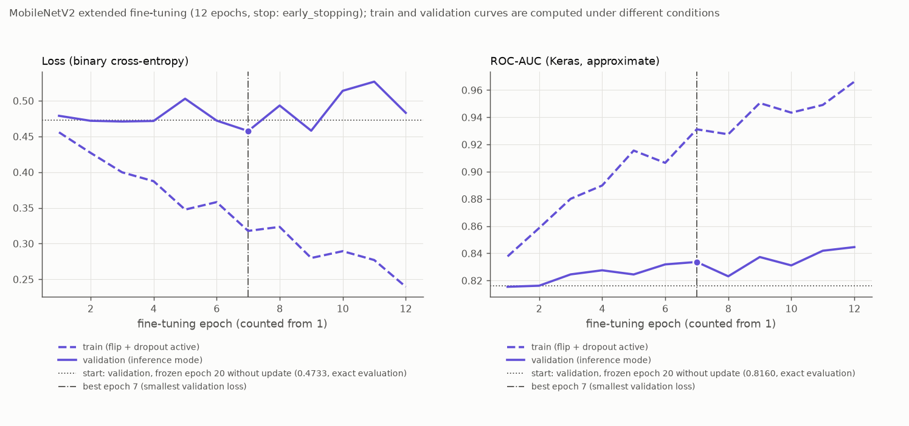
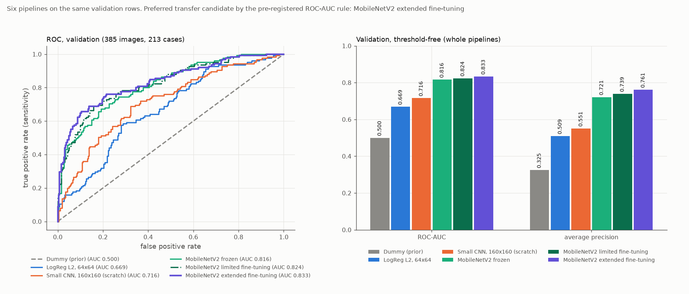

# Erweitertes Fine-Tuning von MobileNetV2

Stand: 19.10.2026. Ursprünglich mit den früheren Treibern erzeugt, heute entsprechend: `analysis/03_classification.py`, `src/busbra/models.py` und `src/busbra/training.py`. Alle Zahlen stammen aus `reports/tables/mobilenetv2_extended_*.csv`, `extended_fine_tuning_comparison_validation.csv` und `mobilenetv2_extended_status.json` (Run `mnv2ext-20261019T221322-54abc47b`). Die akzeptierte 3B- und 3C-Dokumentation steht unverändert in [transfer_learning.md](transfer_learning.md) und [fine_tuning.md](fine_tuning.md).

## Frage und Umfang

Verbessert die Freigabe eines größeren Backbone-Bereichs (die letzten drei MobileNet-Blöcke und die abschließende Faltung) den Transfer-Kandidaten mit eingefrorenem Backbone (3B) und den begrenzt feinjustierten Kandidaten (3C) auf Validation? Ein schlechteres oder unverändertes Ergebnis wäre ein gültiges Resultat gewesen; es gab keine Mindestverbesserung und keine Mindest-AUC. Dies ist der **letzte zusätzliche Klassifikationskandidat**: Genau ein Kandidat, ein Hauptlauf, trainiert auf Train mit Validation zur Checkpoint-Auswahl. **Die Testdaten wurden nicht verwendet**: Es wurden nur die 1.499 Train- und Validation-Originale dekodiert (durch eine Aufzeichnung der geöffneten PNG-Dateien belegt), keine Test-, Masken- oder Vorschaudatei, keine Testvorhersagen. Nicht Teil dieses Schritts: weitere Backbones oder Freigabestufen, Grad-CAM, FGSM, Segmentierung, Kalibrierung, Schwellenoptimierung und die Testauswertung.

Baselines, CNN, die Frozen-Pipeline (3B) und das begrenzte Fine-Tuning (3C) wurden nicht neu trainiert, umbenannt oder verschoben; alle ihre Modelle, Tabellen, Status, Configs und Grafiken sind per Hash unverändert.

## Startpunkt

Der Lauf startet vom akzeptierten **Frozen-Checkpoint** der besten Epoche 20 (Run `mnv2f-20261019T203216-ebb118f5`, SHA-256 `e1d5d317…48873`; Config `80db4aed…cbc54`, Status `5fa269e1…1440f`) und **nicht** vom 3C-Ergebnis. Er wird lokal geladen: kein ImageNet-Download, kein Neuaufbau, keine zufällige Neuinitialisierung des Kopfes. Der 3C-Lauf (`mnv2ft-20261019T214649-3962df17`, Checkpoint `5454f993…c029`, Config `5363076a…530f7`, Status `78081d2e…a601`) bleibt als Vergleichskandidat erhalten; vor dem Training wurden sein Status, alle in ihm genannten Ausgabehashes, Checkpoint, Config und die gespeicherten Validation-Werte (ROC-AUC 0,8235076923, TN/FP/FN/TP 240/20/63/62) geprüft. Ein fehlender oder abweichender Vorgängerlauf hätte den Schritt vor dem Training gestoppt.

Der Startzustand wurde vor dem ersten Update geprüft: Der Backbone-Fingerabdruck entspricht dem des 3B-Status; die Inferenz mit `jit_compile=False` reproduziert die gespeicherten 3B-Scores (größte Abweichung 1,1e-16 auf Validation und Train, Toleranz 1e-5; das ist die einzige erneute Ausführung eines früheren Modells, als Integritätsprüfung). Der **Ausgangszustand ohne Update** (Validation-Loss 0,4733, ROC-AUC 0,8160, AP 0,7211; Train-ROC-AUC 0,8987) stimmt mit den in 3C dokumentierten Startwerten überein und steht getrennt von der neuen History.

## Freigabe und Einfrieren

Die Auswahl erfolgt über eine explizite Namensliste mit Typprüfung, die im neuen Modul steht; die Vier-Schichten-Liste des 3C-Moduls wird weder verwendet noch zur Laufzeit verändert. Bei unerwarteter Struktur stoppt das Skript mit Fehler.

| Gruppe | Inhalt | Zustand |
|---|---|---|
| freigegebener Backbone | `block_14_`, `block_15_`, `block_16_` jeweils `expand` (Conv2D), `depthwise` (DepthwiseConv2D), `project` (Conv2D) sowie `Conv_1` (Conv2D): zehn Schichten mit je genau einem Kernel | trainierbar (zusammen 1.510.720 Parameter) |
| früherer Backbone | alle übrigen gewichtstragenden Backbone-Schichten (42) | fest |
| BatchNorm | alle 52 Schichten mit gamma, beta und gespeicherten Statistiken | vollständig fest |
| Kopf | vorhandene `Dense`-Ausgabe (`output/kernel`, `output/bias`); GAP und Dropout ohne Gewichte | trainierbar (1.281 Parameter) |

Ausgelesen: zwölf trainierbare Gewichte (zehn Backbone-Kernel, zwei Kopfgewichte), 1.512.001 von 2.259.265 Parametern trainierbar (66,9 %), 747.264 nicht trainierbar; keine BatchNorm-Variable ist trainierbar. Der Backbone wird weiterhin mit `training=False` aufgerufen: Das hält die BatchNorm-Statistiken fest, stoppt aber nicht die Gradienten der freigegebenen Faltungen. Flip und Dropout bleiben im Training aktiv. Konfiguriert wurde in dieser Reihenfolge: äußeres Modell und Backbone-Container trainierbar, danach jede Backbone-Schicht einzeln (nur die zehn erlaubten Faltungen trainierbar), anschließend ein **frischer** Adam mit Lernrate 1e-5 (keine übernommenen Optimiererzustände). Die Änderung von Trainierbarkeit und Kompilierung ließ alle Gewichte bitgleich. Alle übrigen Einstellungen entsprechen 3C: Binary Cross-Entropy auf der Sigmoid-Ausgabe, Seed 42, Batchgröße 16, höchstens 20 neue Epochen, `float32`, `jit_compile=False`, keine Klassengewichte, dieselbe Eingabepipeline (extern `(N, 160, 160, 1)` in [0, 1], im Modell Flip, drei identische Kanäle, `Rescaling(2, −1)`).

Der gespeicherte Vertrag (`models/mobilenetv2_extended/mobilenetv2_extended_config.json`) beschreibt ausdrücklich einen **teilweise trainierbaren** Backbone mit festen BatchNorm-Schichten und dem übernommenen Kopf. Die 3B-Aussagen „nur der Kopf ist trainierbar“ und „der gesamte Backbone bleibt identisch“ gelten hier nicht.

## Technischer Probelauf und Neustart

Das Training lief im Terminal mit `env -u LD_LIBRARY_PATH .venv/bin/python analysis/07_train_mobilenetv2_extended.py`; es gab keinen eigenen Interactive-Window-Lauf. Memory Growth wurde vor der GPU-Initialisierung gesetzt, die weiche Geräteplatzierung ist aus (kein stiller CPU-Wechsel), es gibt keine Speichergrenze, die CUDA-Bibliotheken kamen aus der `.venv`.

- **Probe** (echtes Modell, 16 Trainingsbilder): 264 Variablen, Vorwärtsausgabe, Loss und alle **zwölf** Gradienten auf GPU:0, kein fehlender Gradient, alles endlich (größter |Gradient| je Variable zwischen 0,046 und 0,689). Nach einem Optimiererschritt änderten sich alle zehn freigegebenen Faltungen und der Kopf (größte Änderung 1,0e-5); alle übrigen Backbone-Gewichte und alle BatchNorm-Variablen blieben bitgleich.
- **Neustart:** Probemodell und Optimierer wurden verworfen, Zufallszustände zurückgesetzt und derselbe Frozen-Checkpoint erneut geladen. Vor dem Hauptlauf entsprechen die Startgewichte einschließlich des trainierten Kopfes bitgenau dem Checkpoint, Adam hat 0 Iterationen, die trainierbare Menge ist unverändert. Erst danach wurden eventuelle frühere 3D-Ausgaben bereinigt (es gab keine) und die Kandidatenregel in die Konfiguration geschrieben, vor der ersten Trainingsepoche.
- Batchgröße 16 genügte; der vorbereitete Neustart mit Batchgröße 8 war nicht nötig.

## Training

Early Stopping löste nach **12 Epochen** aus; beste Epoche **7** unter den neuen Epochen (Validation-Loss 0,4576 gegenüber 0,4733 im Ausgangszustand und 0,4666 im 3C-Kandidaten). Das Limit von 20 wurde nicht erreicht. Training 41,5 s, Median 2,9 s je Epoche (erste Epoche 9,1 s), Gesamtlauf 62 s. TensorFlow-Allokator-Spitze 1.376 MiB im Training (Probe: 1.116 MiB), `nvidia-smi` zeigte 2.170 MiB für den Prozess; Beobachtungen dieses Laufs ohne Aussagekraft für andere Modelle. Lernkurven: `reports/figures/mobilenetv2_extended_learning_curves.png`, mit dem Ausgangswert als Referenzlinie; Referenz, Bestepoche und Legende stehen unterhalb der Kurven, nicht im Kurvenbereich.



Nach dem Training und im geladenen besten Checkpoint (verglichen mit dem Start):
- früher Backbone (42 Schichten) und alle BatchNorm-Variablen (52 Schichten, gamma/beta/gespeicherte Statistiken) **bitgleich**;
- alle zehn freigegebenen Faltungen wurden aktualisiert (größte absolute Änderung 1,2e-3 bis 2,1e-3), ebenso der Kopf (1,2e-3);
- der Fingerabdruck des gesamten Backbones weicht nun ab, wie vorgesehen;
- wiederhergestelltes bestes Modell, geladener Checkpoint und ein zweites Laden liefern identische Scores (maximale Abweichung 0,0; Toleranz 1e-5, geladen mit `jit_compile=False`); Flip und Dropout sind bei Inferenz aus, wiederholte Vorhersagen sind identisch; der Checkpoint behält die zwölf trainierbaren Gewichte.

## Ergebnisse (bester Checkpoint, Schwelle 0,5, positive Klasse malignant)

Der Score ist die Sigmoid-Ausgabe, nicht als kalibrierte Wahrscheinlichkeit belegt; hart vorhergesagt wird `Score >= 0,5` ohne Optimierung.

**Validation** (385 Bilder, 125 maligne; 213 Cases, 69 maligne): ROC-AUC **0,8333**, Average Precision 0,7615, Sensitivität 0,656 (82/125), Spezifität 0,869 (226/260), Precision 0,707 (82/116), F1 0,680, Accuracy 0,800; TN/FP/FN/TP = 226/34/43/82.

**Train** (nur zur Beschreibung; 1.114 Bilder, 360 maligne; 639 Cases, 205 maligne): ROC-AUC 0,9648, Average Precision 0,9312, Sensitivität 0,894 (322/360), Spezifität 0,902 (680/754), Precision 0,813, F1 0,852, Accuracy 0,899; 680/74/38/322.

## Vergleich der sechs Pipelines (Validation) und Kandidatenwahl

Alle sechs Pipelines wurden auf denselben 385 Validation-Bildern (213 Cases) in derselben Reihenfolge mit derselben Schwelle verglichen; die früheren Metriken und Vorhersagen stammen aus den vorhandenen, per Hash geprüften Dateien (Dummy, LogReg, CNN, Frozen und 3C wurden nicht neu ausgewertet). Der Vergleich steht in der neuen Datei `extended_fine_tuning_comparison_validation.csv` und in `reports/figures/extended_fine_tuning_comparison_validation.png`; die früheren Vergleichsdateien blieben unverändert.

| Pipeline | Rolle | trainierbare Param. | ROC-AUC | AP | Sens. | Spez. | Precision | F1 | Acc. | TN/FP/FN/TP |
|---|---|---:|---:|---:|---:|---:|---:|---:|---:|---|
| Dummy | triviale Referenz | 0 | 0,5000 | 0,3247 | 0 | 1 | nicht def. | 0 | 0,6753 | 260/0/125/0 |
| LogReg L2, 64×64 | klassische lernende Baseline | 4.097 | 0,6692 | 0,5092 | 0,376 | 0,781 | 0,452 | 0,411 | 0,6494 | 203/57/78/47 |
| Kleines CNN, 160×160 | selbst trainierte DL-Baseline | 100.993 | 0,7155 | 0,5507 | 0,448 | 0,850 | 0,590 | 0,509 | 0,7195 | 221/39/69/56 |
| MobileNetV2 frozen | nur Kopf trainiert | 1.281 | 0,8160 | 0,7211 | 0,512 | 0,904 | 0,719 | 0,598 | 0,7766 | 235/25/61/64 |
| MobileNetV2 begrenzt feinjustiert (3C) | vier Schichten + Kopf | 880.321 | 0,8235 | 0,7393 | 0,496 | 0,923 | 0,756 | 0,599 | 0,7844 | 240/20/63/62 |
| MobileNetV2 erweitert feinjustiert (3D) | zehn Schichten + Kopf | 1.512.001 | **0,8333** | 0,7615 | 0,656 | 0,869 | 0,707 | 0,680 | 0,8000 | 226/34/43/82 |



**Differenzen des neuen Kandidaten (erweitert minus Vergleich):**

| | ROC-AUC | AP | Sens. | Spez. | Precision | F1 | Acc. | TN | FP | FN | TP |
|---|---:|---:|---:|---:|---:|---:|---:|---:|---:|---:|---:|
| gegen 3C (begrenzt) | +0,0098 | +0,0222 | +0,160 | −0,054 | −0,049 | +0,082 | +0,016 | −14 | +14 | −20 | +20 |
| gegen 3B (frozen) | +0,0173 | +0,0404 | +0,144 | −0,035 | −0,012 | +0,082 | +0,023 | −9 | +9 | −18 | +18 |

**Regel (vor dem Haupttraining in die 3D-Konfiguration geschrieben):** Unter den technisch gültigen Kandidaten frozen, begrenzt und erweitert entscheidet die höchste ungerundete Validation-ROC-AUC. Kandidaten innerhalb von 1e-12 unter dem besten Wert gelten als gleichauf; dann gewinnt der mit den wenigsten trainierbaren Parametern (frozen vor begrenzt vor erweitert). Ungültige oder nicht endliche Kandidaten sind nicht wählbar; ein fehlender oder hashabweichender Vorgängerlauf stoppt den Schritt vor dem Training; ohne gültigen Kandidaten gibt es keinen Sieger. AP und die Kennzahlen bei 0,5 werden berichtet, ersetzen die Regel aber nicht. Es gibt keine Mindestverbesserung als Bestehensbedingung. Innerhalb eines Laufs wählt der kleinste Validation-Loss den Checkpoint; das sind zwei getrennte Entscheidungen. Die 3C-Zweikandidatenregel und ihre Konfiguration wurden nicht verändert.

**Ergebnis der Regel:** Der erweiterte Kandidat hat die höchste ungerundete ROC-AUC (0,8332923 gegenüber 0,8235077 und 0,8159692; kein Gleichstand) und wird **auf diesem Holdout bevorzugt**. Das ist eine beobachtete Präferenz, kein Signifikanz-, Kausal- oder Überlegenheitsnachweis.

**Einordnung:**
- Die Rangordnung der Scores und das Verhalten bei der festen Schwelle 0,5 entwickeln sich unterschiedlich: Bei 0,5 steigt die Sensitivität gegenüber 3C um 20 Treffer (62 → 82) bei 14 zusätzlichen Fehlalarmen (20 → 34); der Kandidat arbeitet damit an einem anderen Betriebspunkt. Eine Schwellenwahl wurde nicht untersucht, Sensitivität und Spezifität sind deshalb nicht als Verbesserung oder Verschlechterung bei gleichem Betriebspunkt zu lesen.
- Die Keras-ROC-AUC auf Validation schwankt zwischen den zwölf Epochen zwischen 0,815 und 0,845 (Näherung, Inferenzmodus), im 3C-Lauf zwischen 0,815 und 0,826. Die Differenz von 0,0098 zu 3C ist kleiner als die Epoche-zu-Epoche-Spanne dieses Laufs (0,029): Ein anderer Epochenstand hätte eine andere Differenz ergeben können. Der Checkpoint wurde regelkonform nach dem Validation-Loss gewählt (Epoche 7), nicht nach der AUC; die später höheren AUC-Werte (bis 0,845 in Epoche 12) gingen nicht in die Wahl ein.
- Die Train-ROC-AUC steigt gegenüber dem Start von 0,899 auf 0,965 (3C: 0,938), die Validation-ROC-AUC auf 0,833: Mit dem größeren freigegebenen Bereich passt sich das Modell deutlich stärker an die Trainingsdaten an. Der Validation-Loss liegt nur in den Epochen 2–4, 6, 7 und 9 unter dem Startwert 0,4733 (am deutlichsten in Epoche 7 mit 0,4576 und Epoche 9 mit 0,4581), in den übrigen Epochen darüber (bis 0,527); die Ursache dieser Schwankung ist nicht untersucht.
- Der Vergleich ist ein Vergleich ganzer Pipelines und dreier Freigabestufen mit einem Seed; ein Effekt der Freigabegröße selbst ist daraus nicht ableitbar.

## Grenzen

- Ein Seed, ein Lauf je Kandidat, ein fester Holdout aus abhängigen Bildern (mehrere Bilder je Case): keine Varianzschätzung, keine Signifikanz- oder Konfidenzaussage; GPU-Training ist nicht bitgleich reproduzierbar.
- Validation wurde wiederholt zur Entwicklung genutzt (Checkpoint-Auswahl, drei Transfer-Kandidaten, mehrere Pipelines). Die Auswahl des höchsten Validation-Werts kann zu einer optimistischen Bewertung führen; die Validation ist keine unabhängige Abschlussbewertung. Das Ausmaß der Auswahlverzerrung wurde nicht bestimmt.
- Verglichen werden ganze Pipelines; die frühen Pipelines unterscheiden sich in Architektur, Vortraining, Auflösung und Augmentation.
- Scores sind nicht als kalibrierte Wahrscheinlichkeiten belegt; die Schwelle 0,5 ist eine feste Konvention; es gibt keine klinische Einsatzaussage.
- Eingebrannte Marker und Gerätehinweise werden durch Fine-Tuning nicht ausgeschlossen und können als Abkürzung genutzt werden; ob das hier geschieht, ist nicht untersucht.
- Modellwahl und Schwelle für die Testphase sind hier nicht festgelegt; das geschieht in einem späteren, gesonderten Schritt. Der Test bleibt gesperrt.

## Lesbare Darstellung der 3C-Lernkurven

In der 3C-Abbildung überlappen zwei Beschriftungen. Ohne neues Training wurde dieselbe gespeicherte History als zusätzliche Darstellung neu gezeichnet: `reports/figures/mobilenetv2_finetuned_learning_curves_readable.png`, erzeugt auf der CPU mit

```
.venv/bin/python analysis/plot_fine_tuning_history.py
```

Das Skript liest nur `reports/tables/mobilenetv2_finetuned_history.csv` und den Startwert (heute `FROZEN_START_VALIDATION` in `src/busbra/config.py`, früher `mobilenetv2_finetuned_status.json`), nutzt Matplotlib und Pandas und importiert weder TensorFlow noch Keras; es lädt kein Modell, öffnet kein Bild und startet kein Training. Die Zahlen sind unverändert; Referenzlinie und Bestepoche stehen in einer Legende unter den Kurven, die Bestepoche zusätzlich als Marker auf der Validation-Kurve. Die ursprüngliche 3C-Abbildung, der 3C-Status und die 3C-Hashes bleiben unverändert; die neue Datei ist eine getrennte Darstellung und im 3D-Status mit ihrem Hash und den Hashes ihrer Quelldateien vermerkt.

## Prüfungen

- Gezielt geprüft (ohne zweites Training): zehn explizite Layernamen mit Typ und je einem Kernel; zwölf trainierbare Gewichte, 1.510.720 + 1.281 = 1.512.001 von 2.259.265 Parametern; keine trainierbare BatchNorm-Variable; Konfiguration und Kompilierung ändern keine Gewichte; abweichende Strukturen (fehlender Layername, falscher Typ), das 3C-Vier-Schichten-Muster, eine trainierbare BatchNorm-Schicht, ein Setzen nur des äußeren Flags (nur 2 Gewichte trainierbar) und die pauschale Freigabe des Backbones (158 Gewichte) werden abgelehnt; die Vier-Schichten-Liste des 3C-Moduls bleibt unverändert; nach drei echten Trainingsschritten auf synthetischen Daten Updates nur in den zehn Faltungen und im Kopf, alle übrigen Gewichte und alle BatchNorm-Variablen bitgleich; erneutes Laden stellt den Start (Kopf eingeschlossen) exakt wieder her.
- Dreikandidatenregel: jeder Kandidat kann gewinnen; bei Gleichstand (Gleichheit oder innerhalb 1e-12) gewinnt der mit weniger trainierbaren Parametern (frozen vor begrenzt vor erweitert); ungerundete Differenzen (1e-9, 1e-11) entscheiden; ungültige oder nicht endliche Kandidaten sind nicht wählbar, ohne gültigen Kandidaten gibt es keinen Sieger; AP geht nicht ein. Die Entscheidung des echten Laufs wurde aus den ungerundeten gespeicherten Scores neu berechnet und stimmt mit Tabelle und Status überein.
- Fehlerfälle in isolierten Kopien mit Platzhalter-Artefakten eines früheren 3D-Erfolgs und echten Kopien der 3B- und 3C-Dateien: ungültiger Split, geänderte 3B-Quelldatei, geänderte 3C-Vorhersagen, geänderter 3C-Checkpoint, fehlender 3C-Status, simulierter Fehler beim lokalen Laden des Checkpoints und simulierter Fehler in der GPU-Probe. Jeweils Exit 1, aktueller Fehlerstatus (neue Run-ID, Phase, `derived_outputs_of_previous_run_removed: false`), alle früheren 3D-Ausgaben sowie alle 3B- und 3C-Dateien byte-identisch, früherer Erfolg gesichert und referenziert, kein Training gestartet; ein wiederholter Fehler ersetzt die gesicherte Erfolgsmeldung nicht. Eine bewusst falsche Skriptvariante (Löschen vor dem Laden) wird vom selben Prüfaufbau als Abweichung erkannt. Die Bereinigung steht im Skript nach der Probe und dem Reset, vor `model.fit`; kein Schreib-, Lösch- oder Speicheraufruf bezieht sich auf einen 3B-, 3C-, 3A-, Baseline- oder Split-Pfad.
- Bildzugriff des echten Laufs: genau 1.499 PNG-Dateien (Train und Validation), kein Treffer auf Test-, Masken- oder Vorschaudateien; die Vorhersagetabelle enthält 1.114 + 385 Zeilen und keine Test-ID.
- Das zusätzliche 3C-Lernkurvenbild entsteht nur aus gespeicherten Tabellen: ein Systemaufruf-Protokoll des Plot-Laufs zeigt keinerlei TensorFlow-/Keras-/CUDA-Dateien, die beiden Quelldateien bleiben bitgleich.
- Unverändert (Hash): Rohdaten, Audit, eingefrorener Split, alle Modelle, Tabellen, Status, Configs und Grafiken von 2B, 3A, 3B und 3C einschließlich der Vergleichsdateien, die Environment-Berichte sowie die Skripte 01–06 und die früheren Module; keine Paketänderung. Es wurde keine frühere Projektphase und kein Interactive-Lauf erneut ausgeführt.

## Nachtrag: Prüfung des Projektinterpreters beim Start

Nach dem dokumentierten Lauf wurde `analysis/07_train_mobilenetv2_extended.py` um eine Vorbedingung ergänzt, die vor dem Import von NumPy, pandas und TensorFlow, vor jedem Bild- und Modellzugriff und vor jeder Bereinigung prüft, ob tatsächlich die Projektumgebung `.venv` läuft. Verglichen werden `sys.prefix` und das aufgelöste Verzeichnis `<Projekt>/.venv`; `VIRTUAL_ENV`, `CONDA_PREFIX` und die Shell-Eingabeaufforderung werden bewusst nicht herangezogen, `sys.executable` wird nur zur Diagnose protokolliert (bei einem symlinkbasierten venv liegt die Programmdatei außerhalb des venv). Der Aufruf `.venv/bin/python analysis/07_train_mobilenetv2_extended.py` funktioniert deshalb ohne Aktivierung der Umgebung, und eine parallel aktive conda-Basis ist kein Fehler. Bei einer anderen Umgebung endet das Skript mit Exit 1 und dem aktuellen Fehlerstatus (neue Run-ID, Phase `preconditions`, fehlgeschlagene Vorbedingung `project_interpreter_is_project_venv`, erwarteter und tatsächlicher Umgebungspfad, passender Projektaufruf); frühere Ausgaben werden nicht gelöscht, der letzte Erfolg bleibt gesichert und referenziert.

Das ändert weder Datenweg noch Architektur, Lernrate, Callbacks, Auswahlregel oder Auswertung. Der berichtete Lauf (`mnv2ext-20261019T221322-54abc47b`, 69 protokollierte Prüfungen) und seine Dateien bleiben unverändert; diese Prüfung wurde in ihm nicht ausgeführt und wird dort nicht nachgetragen. Geprüft wurde die neue Vorbedingung gezielt ohne Training in isolierten Kopien: bestandene Prüfung für den Projektinterpreter, Ablehnung einer abweichenden Umgebung (auch durch ein Systempython ohne die Projektpakete) vor jedem Drittanbieter-Import sowie Bild-, Split- und Modellzugriff, unveränderte Platzhalter-Ausgaben und erhaltene Erfolgssicherung auch nach einem zweiten Fehler, kein Fehlalarm beim direkten Aufruf ohne Aktivierung oder bei irreführenden `VIRTUAL_ENV`-/`CONDA_PREFIX`-Werten, und eine ältere Vorbedingung (fehlender Split) bleibt erreichbar.

## Quellen

- Sandler, M. et al.: MobileNetV2: Inverted Residuals and Linear Bottlenecks, CVPR 2018.
- Keras-Leitfaden Transfer Learning und Fine-Tuning: https://keras.io/guides/transfer_learning/
- Keras Applications, MobileNetV2: https://keras.io/api/applications/mobilenet/mobilenet_models/#mobilenetv2-function
- Datensatz: Gómez-Flores et al., *Medical Physics* 51 (2024), https://doi.org/10.1002/mp.16812 (Lizenzhinweise siehe README).
