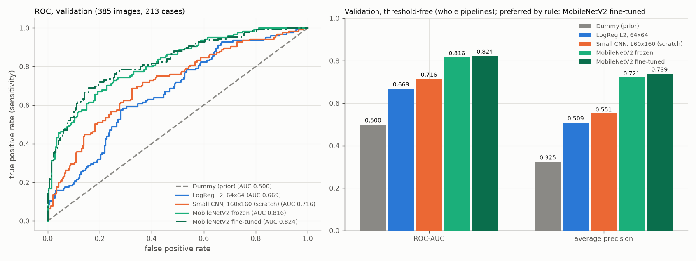

# Begrenztes Fine-Tuning von MobileNetV2

Stand: 19.10.2026. Ursprünglich mit den früheren Treibern erzeugt, heute entsprechend: `analysis/03_classification.py`, `src/busbra/models.py` und `src/busbra/training.py`. Alle Zahlen stammen aus `reports/tables/mobilenetv2_finetuned_*.csv`, `fine_tuning_comparison_validation.csv` und `mobilenetv2_finetuned_status.json` (Run `mnv2ft-20261019T214649-3962df17`). Die akzeptierte 3B-Dokumentation steht unverändert in [transfer_learning.md](transfer_learning.md).

## Frage und Umfang

Verbessert die vorsichtige Anpassung des letzten MobileNet-Blocks und der abschließenden Faltung den bisherigen Transfer-Kandidaten (Backbone eingefroren, nur Kopf trainiert) auf Validation? Ein schlechteres oder unverändertes Ergebnis wäre ein gültiges Resultat gewesen; es gab keine Mindest-AUC. Genau ein Kandidat, ein Hauptlauf, auf Train mit Validation zur Checkpoint-Auswahl. **Die Testdaten wurden nicht verwendet**: Es wurden nur die 1.499 Train- und Validation-Originale dekodiert (durch eine Aufzeichnung der geöffneten PNG-Dateien belegt), keine Test-, Masken- oder Vorschaudatei, keine Testvorhersagen. Nicht Teil dieses Schritts: weitere Backbones, eine MLP-Baseline, längeres CNN-Training, Grad-CAM, FGSM, Segmentierung, Kalibrierung, Schwellenoptimierung und die Testauswertung.

Das kleine CNN bleibt die Deep-Learning-Baseline; Baselines, CNN und die Frozen-Pipeline wurden nicht neu trainiert, umbenannt oder verschoben, und alle ihre Dateien einschließlich der 3A-/3B-Vergleichsdateien sind per Hash unverändert.

## Startpunkt

Der Lauf startet vom akzeptierten Frozen-Checkpoint der besten Epoche 20 (Run `mnv2f-20261019T203216-ebb118f5`, SHA-256 `e1d5d317…48873`; Config `80db4aed…cbc54`, Status `5fa269e1…1440f`) und **nicht** von den letzten Gewichten der Epoche 25. Er wird lokal geladen: kein ImageNet-Download, kein Neuaufbau mit `weights='imagenet'`. Der bereits auf BUS-BRA trainierte Kopf wird übernommen; es gibt keine zufällige Neuinitialisierung.

Vor dem ersten Update wurde der Startzustand geprüft: Der Backbone-Fingerabdruck entspricht dem des 3B-Status; die Inferenz mit `jit_compile=False` reproduziert die gespeicherten 3B-Scores (größte Abweichung 1,1e-16 auf Validation und Train, Toleranz 1e-5; das ist die einzige erneute Ausführung eines früheren Modells, als Integritätsprüfung). Daraus ergibt sich der **Ausgangszustand ohne Fine-Tuning-Update**, getrennt von der neuen History: Validation-Loss 0,4733 (3B-History: 0,4732891619), ROC-AUC 0,8160, AP 0,7211; Train-ROC-AUC 0,8987.

## Freigabe und Einfrieren

Die Auswahl erfolgt über eine explizite Namensliste mit Typprüfung, nicht über „die letzten N Schichten“; bei unerwarteter Struktur stoppt das Skript mit Fehler.

| Gruppe | Inhalt | Zustand |
|---|---|---|
| freigegebener Backbone | `block_16_expand` (Conv2D), `block_16_depthwise` (DepthwiseConv2D), `block_16_project` (Conv2D), `Conv_1` (Conv2D) | trainierbar (je ein Kernel, zusammen 879.040 Parameter) |
| früherer Backbone | alle übrigen gewichtstragenden Backbone-Schichten (48) | fest |
| BatchNorm | alle 52 Schichten mit gamma, beta und gespeicherten Statistiken | vollständig fest |
| Kopf | vorhandene `Dense`-Ausgabe (`output/kernel`, `output/bias`); GAP und Dropout ohne Gewichte | trainierbar (1.281 Parameter) |

Ausgelesen: sechs trainierbare Gewichte (vier Backbone-Kernel, zwei Kopfgewichte), 880.321 von 2.259.265 Parametern trainierbar; keine BatchNorm-Variable ist trainierbar. Der Backbone wird weiterhin mit `training=False` aufgerufen: Das hält die BatchNorm-Statistiken fest, stoppt aber nicht die Gradienten der freigegebenen Faltungen. Flip und Dropout bleiben im Training aktiv. Konfiguriert wurde in dieser Reihenfolge: äußeres Modell und Backbone-Container trainierbar, danach jede Backbone-Schicht einzeln (nur die vier erlaubten Faltungen trainierbar), anschließend ein **frischer** Adam mit Lernrate 1e-5 (keine übernommenen Optimiererzustände). Die Änderung von Trainierbarkeit und Kompilierung ließ alle Gewichte bitgleich.

Der gespeicherte Vertrag (`models/mobilenetv2_finetuned/mobilenetv2_finetuned_config.json`) beschreibt ausdrücklich einen **teilweise trainierbaren** Backbone mit festen BatchNorm-Schichten und dem übernommenen Kopf. Die 3B-Aussagen „nur der Kopf ist trainierbar“ und „der gesamte Backbone bleibt identisch“ gelten hier nicht; die Eingabe (extern `(N, 160, 160, 1)` in [0, 1], im Modell Flip, drei identische Kanäle, `Rescaling(2, −1)`) ist unverändert.

## Technischer Probelauf und Neustart

Das Training lief im Terminal mit `env -u LD_LIBRARY_PATH .venv/bin/python analysis/03_classification.py`; es gab keinen eigenen Interactive-Window-Lauf. Memory Growth wurde vor der GPU-Initialisierung gesetzt, die weiche Geräteplatzierung ist aus (kein stiller CPU-Wechsel), es gibt keine Speichergrenze, die CUDA-Bibliotheken kamen aus der `.venv`.

- **Probe** (echtes Modell, 16 Trainingsbilder): 264 Variablen, Vorwärtsausgabe, Loss und alle sechs Gradienten auf GPU:0, kein fehlender Gradient, alles endlich (größter |Gradient| je Variable zwischen 0,05 und 0,46). Nach einem Optimiererschritt änderten sich die freigegebenen Faltungen und der Kopf; alle übrigen Backbone-Gewichte und alle BatchNorm-Variablen blieben bitgleich.
- **Neustart:** Probemodell und Optimierer wurden verworfen, Zufallszustände zurückgesetzt und derselbe Frozen-Checkpoint erneut geladen. Vor dem Hauptlauf entsprechen die Startgewichte einschließlich des trainierten Kopfes bitgenau dem Checkpoint, Adam hat 0 Iterationen, die trainierbare Menge ist unverändert. Erst danach wurden eventuelle frühere 3C-Ausgaben bereinigt (es gab keine) und die Kandidatenregel in die 3C-Konfiguration geschrieben, vor der ersten Trainingsepoche.
- Batchgröße 16 genügte; der vorbereitete Neustart mit Batchgröße 8 war nicht nötig.

## Training

Höchstens 20 neue Epochen, `EarlyStopping` und `ModelCheckpoint` auf dem Validation-Loss (min, Geduld 5, `min_delta=0`, beste Gewichte wiederherstellen), `TerminateOnNaN`; `float32`, `jit_compile=False`, keine Klassengewichte. Die History zählt die Fine-Tuning-Epochen ab 1 und ist keine Fortsetzung der Frozen-History.

Early Stopping löste nach **12 Epochen** aus; beste Epoche **7** unter den neuen Epochen (Validation-Loss 0,4666 gegenüber 0,4733 im Ausgangszustand). Das Limit von 20 wurde nicht erreicht. Training 36,6 s, Median 2,5 s je Epoche (erste Epoche 8,9 s), Gesamtlauf 62 s. TensorFlow-Allokator-Spitze 1.367 MiB im Training (Probe: 1.116 MiB), `nvidia-smi` zeigte 2.170 MiB für den Prozess; Beobachtungen dieses Laufs ohne Aussagekraft für andere Modelle. Lernkurven: `reports/figures/mobilenetv2_finetuned_learning_curves.png` mit dem Ausgangswert als Referenzlinie (in dieser Abbildung überlappen zwei Beschriftungen leicht).

Nach dem Training und im geladenen besten Checkpoint (verglichen mit dem Start):
- früher Backbone (48 Schichten) und alle BatchNorm-Variablen (52 Schichten, gamma/beta/gespeicherte Statistiken) **bitgleich**;
- alle vier freigegebenen Faltungen wurden aktualisiert (größte absolute Änderung 1,5e-3 bis 1,9e-3), ebenso der Kopf (1,4e-3);
- der Fingerabdruck des gesamten Backbones weicht nun ab, wie vorgesehen;
- wiederhergestelltes bestes Modell, geladener Checkpoint und ein zweites Laden liefern identische Scores (maximale Abweichung 0,0; Toleranz 1e-5, geladen mit `jit_compile=False`); Flip und Dropout sind bei Inferenz aus, wiederholte Vorhersagen sind identisch; der Checkpoint behält die sechs trainierbaren Gewichte.

## Ergebnisse (bester Checkpoint, Schwelle 0,5, positive Klasse malignant)

Der Score ist die Sigmoid-Ausgabe, nicht als kalibrierte Wahrscheinlichkeit belegt; hart vorhergesagt wird `Score >= 0,5` ohne Optimierung.

**Validation** (385 Bilder, 125 maligne; 213 Cases, 69 maligne): ROC-AUC **0,8235**, Average Precision 0,7393, Sensitivität 0,496 (62/125), Spezifität 0,923 (240/260), Precision 0,756 (62/82), F1 0,599, Accuracy 0,7844; TN/FP/FN/TP = 240/20/63/62.

**Train** (nur zur Beschreibung; 1.114 Bilder, 360 maligne; 639 Cases, 205 maligne): ROC-AUC 0,9376, Average Precision 0,8833, Sensitivität 0,761 (274/360), Spezifität 0,919 (693/754), Precision 0,818, F1 0,789, Accuracy 0,868; 693/61/86/274.

## Vergleich der fünf Pipelines (Validation) und Kandidatenwahl

Alle fünf Pipelines wurden auf denselben 385 Validation-Bildern (213 Cases) in derselben Reihenfolge mit derselben Schwelle verglichen; die früheren Metriken und Vorhersagen stammen aus den vorhandenen, per Hash geprüften Dateien (Dummy, LogReg und CNN wurden nicht neu ausgewertet). Der Vergleich steht in der neuen Datei `fine_tuning_comparison_validation.csv` und in `reports/figures/fine_tuning_comparison_validation.png`; die 3A- und 3B-Vergleichsdateien blieben unverändert.

| Pipeline | Rolle | ROC-AUC | AP | Sens. | Spez. | Precision | F1 | Acc. | TN/FP/FN/TP |
|---|---|---:|---:|---:|---:|---:|---:|---:|---|
| Dummy | triviale Referenz | 0,5000 | 0,3247 | 0 | 1 | nicht def. | 0 | 0,6753 | 260/0/125/0 |
| LogReg L2, 64×64 | klassische lernende Baseline | 0,6692 | 0,5092 | 0,376 | 0,781 | 0,452 | 0,411 | 0,6494 | 203/57/78/47 |
| Kleines CNN, 160×160 | selbst trainierte DL-Baseline | 0,7155 | 0,5507 | 0,448 | 0,850 | 0,590 | 0,509 | 0,7195 | 221/39/69/56 |
| MobileNetV2 frozen | Transfer Learning, nur Kopf | 0,8160 | 0,7211 | 0,512 | 0,904 | 0,719 | 0,598 | 0,7766 | 235/25/61/64 |
| MobileNetV2 begrenzt feinjustiert | neuer Kandidat | **0,8235** | 0,7393 | 0,496 | 0,923 | 0,756 | 0,599 | 0,7844 | 240/20/63/62 |

**Differenz Fine-Tuning minus Frozen:** ROC-AUC +0,0075 (0,8235077 gegenüber 0,8159692), AP +0,0182; Sensitivität −0,016, Spezifität +0,019, Precision +0,037, F1 +0,001, Accuracy +0,008; TN +5, FP −5, FN +2, TP −2.

**Regel (vor dem Haupttraining in die 3C-Konfiguration geschrieben):** Zwischen den technisch gültigen Frozen- und Fine-Tuning-Kandidaten entscheidet die primäre Validation-ROC-AUC mit ungerundeten Werten; bei Gleichstand innerhalb 1e-12 oder bei ungültigem Lauf bleibt Frozen bevorzugt. AP und die Kennzahlen bei 0,5 werden berichtet, ersetzen die Regel aber nicht. Innerhalb eines Laufs wählt der kleinste Validation-Loss den Checkpoint; das sind zwei getrennte Entscheidungen.

**Ergebnis der Regel:** Der Fine-Tuning-Kandidat hat die höhere ungerundete ROC-AUC (Differenz 0,00754 > 1e-12) und wird **auf diesem Holdout bevorzugt**. Das ist eine beobachtete Präferenz, kein Signifikanz- oder Überlegenheitsnachweis.

**Einordnung der unterschiedlichen Entwicklungen:**
- Validation-Loss (0,4733 → 0,4666) und ROC-AUC (+0,0075) verbessern sich leicht, die Sensitivität bei der festen Schwelle 0,5 sinkt dagegen um zwei Treffer (64 → 62), bei fünf Fehlalarmen weniger (25 → 20). Die Rangordnung der Scores und das Verhalten bei einem festen Schwellenwert müssen sich nicht gleich entwickeln; eine Schwellenwahl wurde nicht untersucht.
- Die Keras-ROC-AUC auf Validation schwankt zwischen den zwölf Epochen zwischen 0,815 und 0,827 (Näherung, Inferenzmodus). Die Differenz von 0,0075 zum Frozen-Kandidaten liegt in der Größenordnung dieser Epoche-zu-Epoche-Schwankung. Ein anderer Epochenstand hätte eine ähnliche oder abweichende Differenz ergeben können; der Checkpoint wurde regelkonform nach dem Validation-Loss gewählt, nicht nach der AUC.
- Die Train-AUC stieg gegenüber dem Start von 0,899 auf 0,938, die Validation-AUC nur wenig; das Fine-Tuning passt die Trainingsdaten also deutlich stärker an. Die Ursache der kleinen Validation-Veränderung ist nicht untersucht.

## Grenzen

- Ein Seed, ein Lauf, ein fester Holdout aus abhängigen Bildern (mehrere Bilder je Case): keine Varianzschätzung, keine Signifikanz- oder Konfidenzaussage.
- Validation wurde wiederholt zur Entwicklung genutzt (Checkpoint- und Kandidatenwahl, mehrere Pipelines); sie ist deshalb keine unabhängige abschließende Bewertung. Das Ausmaß einer Auswahlverzerrung wurde nicht bestimmt.
- Verglichen werden ganze Pipelines; die frühen Pipelines unterscheiden sich in Architektur, Vortraining, Auflösung und Augmentation.
- Scores sind nicht als kalibrierte Wahrscheinlichkeiten belegt; die Schwelle 0,5 ist eine feste Konvention; es gibt keine klinische Einsatzaussage.
- Eingebrannte Marker und Gerätehinweise werden durch Fine-Tuning nicht ausgeschlossen; ob sie genutzt werden, ist nicht untersucht.
- Modellwahl und Schwelle für die Testphase sind hier nicht festgelegt; das geschieht in einem späteren, gesonderten Schritt. Der Test bleibt gesperrt.
- Ein nicht auf Reproduzierbarkeit angelegter Lauf: fester Seed für Nachvollziehbarkeit, keine Zusage bytegleicher GPU-Trainingsläufe; kein zweiter vollständiger Lauf.

## Prüfungen

- Gezielt geprüft (ohne zweites Training): erlaubte Trainierbarkeit einschließlich aller BatchNorm-Schichten und Ablehnung abweichender Strukturen (fehlender Layername, falscher Typ); nach drei echten Trainingsschritten auf synthetischen Daten Updates nur in den vier Faltungen und im Kopf, alle übrigen Gewichte und alle BatchNorm-Variablen bitgleich; erneutes Laden stellt den Start (Kopf eingeschlossen) exakt wieder her; Kandidatenregel (höhere AUC bevorzugt Fine-Tuning; niedrigere AUC, Gleichstand innerhalb 1e-12 und ungültiger Lauf bevorzugen Frozen; AP geht nicht ein; ungerundete Werte entscheiden).
- Fehlerfälle in isolierten Kopien mit Platzhalter-Artefakten eines früheren 3C-Erfolgs und echten Kopien der 3B-Dateien: ungültiger Split, geänderte 3B-Quelldatei, simulierter Fehler beim lokalen Laden des Checkpoints und simulierter Fehler in der GPU-Probe. Jeweils Exit 1, aktueller Fehlerstatus (neue Run-ID, Phase, `derived_outputs_of_previous_run_removed: false`), alle früheren 3C-Ausgaben und alle 3B-Dateien byte-identisch, früherer Erfolg gesichert und referenziert, kein Training gestartet; ein wiederholter Fehler ersetzt die gesicherte Erfolgsmeldung nicht. Die Bereinigung steht im Skript nach der Probe und dem Reset, vor `model.fit`; kein Schreib-, Lösch- oder Speicheraufruf bezieht sich auf einen 3B-, 3A-, Baseline- oder Split-Pfad.
- Unverändert (Hash, 45 Dateien): Rohdaten, Audit, eingefrorener Split, alle Modelle, Tabellen, Status, Configs und Grafiken von 2B, 3A und 3B einschließlich der Vergleichsdateien, die Environment-Berichte sowie die Skripte 01–05 und die früheren Module; keine Paketänderung. Es wurde keine frühere Projektphase und kein Interactive-Lauf erneut ausgeführt.

## Nachtrag: lesbare Darstellung der Lernkurven

Die oben erwähnte Überlappung zweier Beschriftungen in `mobilenetv2_finetuned_learning_curves.png` wurde ohne neues Training behoben, indem dieselbe gespeicherte History als **zusätzliche** Abbildung neu gezeichnet wurde: `reports/figures/mobilenetv2_finetuned_learning_curves_readable.png` (CPU, `.venv/bin/python plots/plot_fine_tuning_history.py`; Einzelheiten in [extended_fine_tuning.md](extended_fine_tuning.md)). Die ursprüngliche Abbildung, der Status und alle hier genannten Zahlen und Hashes bleiben unverändert.

## Quellen

- Sandler, M. et al.: MobileNetV2: Inverted Residuals and Linear Bottlenecks, CVPR 2018.
- Keras-Leitfaden Transfer Learning und Fine-Tuning: https://keras.io/guides/transfer_learning/
- Keras Applications, MobileNetV2: https://keras.io/api/applications/mobilenet/mobilenet_models/#mobilenetv2-function
- Datensatz: Gómez-Flores et al., *Medical Physics* 51 (2024), https://doi.org/10.1002/mp.16812 (Lizenzhinweise siehe README).
