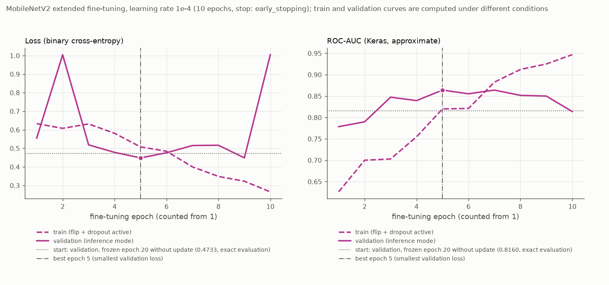
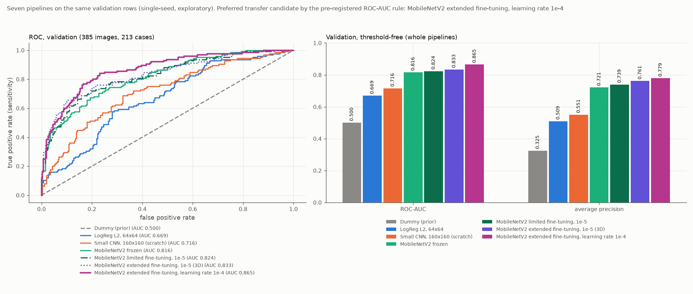

# Lernratenvergleich beim erweiterten Fine-Tuning (1e-4)

Stand: 19.10.2026. Ursprünglich mit den früheren Treibern erzeugt, heute entsprechend: `analysis/03_classification.py`, `src/busbra/models.py` und `src/busbra/training.py`. Alle Zahlen stammen aus `reports/tables/mobilenetv2_higher_lr_*.csv`, `learning_rate_comparison_validation.csv` und `mobilenetv2_higher_lr_status.json` (Run `mnv2lr-20261019T225113-22dd3628`). Der Vorgänger 3D steht unverändert in [extended_fine_tuning.md](extended_fine_tuning.md).

## Frage und Umfang

Liefert beim erweiterten Fine-Tuning die zehnmal höhere Lernrate (Adam 1e-4 statt 1e-5) einen anderen Validation-Befund, wenn Startcheckpoint, Freigabe, Datenpipeline und Trainingsregeln gleich bleiben? Einziger geplanter Konfigurationsunterschied zu 3D ist die Lernrate. Im Kursskript zum funktionalen MobileNetV2 beträgt die Fine-Tuning-Lernrate ebenfalls 0,0001; daraus folgt kein Nachweis, dass dieser Wert für BUS-BRA optimal ist, und die Pipeline hier behält ihre vollständig festen BatchNorm-Schichten und die übrige BUS-BRA-Verarbeitung (keine Replikation der Lehrpipeline).

Es ist ein **explorativer Vergleich mit einem Seed je Konfiguration**: eine Aussage über Stabilität oder Signifikanz und die Wahl eines „besten Seeds“ sind daraus nicht ableitbar. Der vereinbarte Vergleich über mehrere Trainings-Seeds und die sensitivitätsorientierte Schwellenuntersuchung folgen später; beides ist hier nicht durchgeführt. Die Testdaten wurden nicht verwendet: Es wurden nur die 1.499 Train- und Validation-Originale dekodiert (durch eine Aufzeichnung der geöffneten PNG-Dateien belegt), keine Test-, Masken- oder Vorschaudatei, keine Testvorhersagen.

## Konfiguration (gleich zu 3D, außer Lernrate)

- Start: bester akzeptierter **Frozen-Checkpoint** (Run `mnv2f-20261019T203216-ebb118f5`, beste Epoche 20), lokal geladen, trainierter Kopf übernommen; nicht das Ergebnis von 3C oder 3D. Vor dem Training wurden Split, die akzeptierten Läufe 3B, 3C und 3D (Run-IDs, Status-, Config- und Checkpoint-Hashes, alle in den Status genannten Ausgabehashes, gespeicherte Validation-Werte) geprüft. 3D: Run `mnv2ext-20261019T221322-54abc47b`, Checkpoint `30900846…`, Config `a9f15dd1…`, Status `1743a0b3…`, 69 historische Prüfungen unverändert.
- Freigegeben: `block_14_`, `block_15_`, `block_16_` jeweils `expand`, `depthwise`, `project` sowie `Conv_1` und der Kopf: zwölf trainierbare Gewichte, 1.510.720 + 1.281 = 1.512.001 von 2.259.265 Parametern; alle 52 BatchNorm-Schichten und der übrige frühe Backbone fest; Backbone mit `training=False`.
- Optimierer **neu**: `Adam(learning_rate=1e-4)`, Iterationszähler anfangs 0; Binary Cross-Entropy (`from_logits=False`), Seed 42, Batchgröße 16, höchstens 20 neue Epochen, `EarlyStopping` und `ModelCheckpoint` auf `val_loss` (min, Geduld 5, `min_delta=0`, beste Gewichte), `TerminateOnNaN`, `float32`, `jit_compile=False`, keine Klassengewichte, unveränderte Eingabepipeline.
- **Die Kompilierung ist eine eigene Funktion**: Die Kompilierfunktion des 3D-Moduls legt 1e-5 an (geprüft: sie liefert 1e-5 und wird von der 3E-Prüfung abgelehnt) und wird nicht verwendet. Die Konstanten früherer Module wurden zur Laufzeit nicht verändert.
- **Tatsächliche Lernrate, aus dem Optimierer ausgelesen:** 9,999999747378752e-05 (float32-Darstellung von 1e-4, relative Abweichung 2,5e-8, Toleranz rtol 1e-6) beim Start, nach dem Reset, am trainierten Modell und an beiden geladenen und neu kompilierten Checkpoints (Iterationen dort 0; am trainierten Modell 700).
- Startzustand: reproduziert die gespeicherten 3B-Scores mit Abweichung 1,1e-16 (Toleranz 1e-5) und die in 3D dokumentierten Startwerte (Validation-Loss 0,4733, ROC-AUC 0,8160); Freigabe und Kompilierung ändern kein Gewicht.

## Technischer Probelauf, Reset, Training

- **Probe** (echtes Modell, 16 Trainingsbilder): alle **zwölf** Gradienten vorhanden, endlich und auf GPU:0; Änderungen in allen zehn freigegebenen Faltungen und im Kopf; die übrigen 42 Backbone-Schichten und alle BatchNorm-Variablen bitgleich. Der Loss dieses einen Batches stieg nach dem einen Optimiererschritt von 0,330 auf 1,144 (bei 3D mit 1e-5: 0,330 → 0,323); das ist eine Beobachtung an einem einzelnen Schritt und kein Befund über das Training.
- **Reset:** Probemodell und Optimierer verworfen, Zufallszustände zurückgesetzt, derselbe Frozen-Checkpoint neu geladen; Startgewichte einschließlich Kopf bitgleich, zwölf trainierbare Gewichte, frischer Adam(1e-4) mit 0 Iterationen. Erst danach wurden eventuelle frühere 3E-Ausgaben bereinigt (es gab keine) und die Konfiguration mit der Vier-Kandidaten-Regel vor der ersten Epoche geschrieben. Batchgröße 16 genügte, kein Neustart mit 8.
- **Training:** Early Stopping nach **10 Epochen**, beste Epoche **5** (Validation-Loss 0,4486; Epoche 9 liegt mit 0,4488 praktisch gleichauf, Startwert 0,4733, 3D 0,4576). Training 37,0 s, Median 3,0 s je Epoche (erste Epoche 9,2 s), Gesamtlauf 58,0 s. TensorFlow-Allokator-Spitze 1.376 MiB, `nvidia-smi` 2.170 MiB für den Prozess; Beobachtungen dieses Laufs. Das Terminalskript lief ohne Interactive-Window-Lauf; Memory Growth vor der Initialisierung, weiche Platzierung aus, CUDA-Bibliotheken nur aus der `.venv`.
- Der Validation-Loss verläuft mit der höheren Lernrate unruhiger (1,004 in Epoche 2 und 1,005 in Epoche 10 gegenüber 0,45–0,55 in den übrigen Epochen); die Keras-ROC-AUC auf Validation (Näherung, Inferenzmodus) schwankt zwischen 0,779 und 0,864. Die Ursache wurde nicht untersucht.

Nach dem Training und im geladenen besten Checkpoint (verglichen mit dem Start): früher Backbone (42 Schichten) und alle BatchNorm-Variablen (52 Schichten) **bitgleich**; alle zehn freigegebenen Faltungen aktualisiert (größte absolute Änderung je Schicht 7,6e-3 bis 1,8e-2, in 3D mit 1e-5: 1,2e-3 bis 2,1e-3), ebenso der Kopf (8,7e-3); wiederhergestelltes Modell, geladener Checkpoint und zweites Laden liefern identische Scores (Abweichung 0,0; Toleranz 1e-5; `jit_compile=False`); Flip und Dropout sind bei Inferenz aus; der Checkpoint behält die zwölf trainierbaren Gewichte.

## Ergebnisse (bester Checkpoint, Schwelle 0,5, positive Klasse malignant)

Die Schwelle 0,5 dient dem historischen Vergleich; sie hat keine klinische Bedeutung und wurde nicht optimiert. Scores sind Sigmoid-Ausgaben ohne Kalibrierungsnachweis.

**Validation** (385 Bilder, 125 maligne; 213 Cases, 69 maligne): ROC-AUC **0,8650**, Average Precision 0,7789, Sensitivität 0,776 (97/125), Spezifität 0,815 (212/260), Precision 0,669 (97/145), F1 0,719, Accuracy 0,8026; TN/FP/FN/TP = 212/48/28/97.

**Train** (nur zur Beschreibung; 1.114 Bilder, 360 maligne; 639 Cases, 205 maligne): ROC-AUC 0,9139, Average Precision 0,8183, Sensitivität 0,869 (313/360), Spezifität 0,796 (600/754), Precision 0,670, F1 0,757, Accuracy 0,820; 600/154/47/313.

## Vergleich der sieben Pipelines (Validation)

Alle sieben Pipelines wurden auf denselben 385 Validation-Bildern (213 Cases), in derselben Reihenfolge und mit derselben Schwelle verglichen; die früheren Metriken und Vorhersagen stammen aus den per Hash geprüften Dateien (nicht neu ausgewertet). Neue Dateien: `learning_rate_comparison_validation.csv`, `reports/figures/learning_rate_comparison_validation.png`.

| Pipeline | Adam-Lernrate | trainierbare Param. | ROC-AUC | AP | Sens. | Spez. | Precision | F1 | Acc. | TN/FP/FN/TP |
|---|---|---:|---:|---:|---:|---:|---:|---:|---:|---|
| Dummy | – | 0 | 0,5000 | 0,3247 | 0 | 1 | nicht def. | 0 | 0,6753 | 260/0/125/0 |
| LogReg L2, 64×64 | – | 4.097 | 0,6692 | 0,5092 | 0,376 | 0,781 | 0,452 | 0,411 | 0,6494 | 203/57/78/47 |
| Kleines CNN, 160×160 | – | 100.993 | 0,7155 | 0,5507 | 0,448 | 0,850 | 0,590 | 0,509 | 0,7195 | 221/39/69/56 |
| MobileNetV2 frozen | – | 1.281 | 0,8160 | 0,7211 | 0,512 | 0,904 | 0,719 | 0,598 | 0,7766 | 235/25/61/64 |
| begrenzt feinjustiert (3C) | 1e-5 | 880.321 | 0,8235 | 0,7393 | 0,496 | 0,923 | 0,756 | 0,599 | 0,7844 | 240/20/63/62 |
| erweitert feinjustiert (3D) | 1e-5 | 1.512.001 | 0,8333 | 0,7615 | 0,656 | 0,869 | 0,707 | 0,680 | 0,8000 | 226/34/43/82 |
| **erweitert feinjustiert, Lernrate 1e-4 (3E)** | 1e-4 | 1.512.001 | **0,8650** | 0,7789 | 0,776 | 0,815 | 0,669 | 0,719 | 0,8026 | 212/48/28/97 |

**Direkter Vergleich 3E gegen 3D** (gleiche Zehnerliste, gleicher Start, Lernrate als einziger geplanter Unterschied): ROC-AUC +0,0317 (0,8650154 gegenüber 0,8332923), AP +0,0174, Sensitivität +0,120 (97 statt 82 Treffer), Spezifität −0,054, Precision −0,038, F1 +0,038, Accuracy +0,003; TN −14, FP +14, FN −15, TP +15. Gegen den frozen-Kandidaten: ROC-AUC +0,0490, AP +0,0578, Sensitivität +0,264, Spezifität −0,089, TN −23, FP +23, FN −33, TP +33.

**Vorab festgelegte Regel** (vor dem Haupttraining in die 3E-Konfiguration geschrieben): Unter den technisch gültigen Kandidaten frozen, begrenzt 1e-5, erweitert 1e-5 und erweitert 1e-4 entscheidet die höchste ungerundete Validation-ROC-AUC; Kandidaten innerhalb von 1e-12 unter dem Höchstwert gelten als gleichauf, dann gilt die Reihenfolge frozen, begrenzt, erweitert 1e-5, erweitert 1e-4. Ungültige oder nicht endliche Kandidaten sind nicht wählbar, ohne gültigen Kandidaten gibt es keinen Gewinner, ein fehlender akzeptierter Vorgänger stoppt den Schritt vor dem Training. AP und die Kennzahlen bei 0,5 gehen nicht ein und wurden nach Einsicht der Zahlen nicht nachträglich zugefügt; das sensitivitätsorientierte Anwendungsziel erhält später eine eigene, ausdrücklich dokumentierte Auswertung. Innerhalb eines Laufs wählt der kleinste Validation-Loss den Checkpoint (nicht die höchste AUC).

**Ergebnis der Regel:** Der Kandidat mit Lernrate 1e-4 hat die höchste ungerundete ROC-AUC und wird **in diesem Einseed-Vergleich bevorzugt**. Das ist eine explorative Präferenz auf wiederholt genutzten Validation-Daten, keine Aussage über Stabilität, Signifikanz oder Ursache und keine Modellwahl für die Testphase.

**Einordnung:**
- Zur Orientierung beschreiben die Keras-Validation-AUC-Spannen über die Epochen den Verlauf je Lauf: 3D 0,0292 (0,815 bis 0,845), 3E 0,0855 (0,7785 bis 0,8640). Epochenspannen sind keine Schätzung der Streuung zwischen Trainingsläufen und kein Signifikanztest; beide Konfigurationen sind je ein Seed. Ob der Unterschied zu 3D (+0,0317) bei anderen Trainings-Seeds bestehen bleibt, zeigt erst der vereinbarte Mehrseedvergleich.
- Eine höhere AUC oder ein niedrigerer Loss sichern keine höhere Sensitivität bei 0,5. Hier steigt die Sensitivität bei 0,5 (82 → 97 Treffer), zugleich steigen die Fehlalarme (34 → 48); der Kandidat arbeitet an einem anderen Betriebspunkt, die Spezifität sinkt. Eine Schwellenwahl wurde nicht untersucht.
- Die Train-ROC-AUC des gewählten Checkpoints (0,914) liegt unter der von 3D (0,965); der Checkpoint stammt aus einer früheren Trainingsphase (Epoche 5, bei 3D Epoche 7). Ein Rückschluss auf Über- oder Unteranpassung ist daraus nicht gezogen.
- Der Vergleich ist ein Vergleich ganzer Pipelines mit einer Konfigurationsänderung und einem Seed; ein kausaler Effekt der Lernrate ist daraus nicht ableitbar.

## Grenzen

- Ein Seed, ein Lauf je Konfiguration, ein fester Holdout aus abhängigen Bildern (mehrere Bilder je Case): keine Varianzschätzung, keine Signifikanz- oder Konfidenzaussage; GPU-Training ist nicht bitgleich reproduzierbar. Die zahlreichen Softwareprüfungen früherer Schritte sind kein Mehrseedvergleich.
- Validation wurde wiederholt zur Entwicklung genutzt (Checkpoint-Auswahl, vier Transfer-Kandidaten, mehrere Pipelines). Die Auswahl des höchsten Validation-Werts kann zu einer optimistischen Bewertung führen; die Validation ist keine unabhängige Abschlussbewertung. Das Ausmaß der Auswahlverzerrung wurde nicht bestimmt.
- Verglichen werden ganze Pipelines; die frühen Pipelines unterscheiden sich in Architektur, Vortraining, Auflösung und Augmentation.
- Scores sind nicht als kalibrierte Wahrscheinlichkeiten belegt; die Schwelle 0,5 ist eine Vergleichskonvention; es gibt keine klinische Einsatzaussage.
- Eingebrannte Marker und Gerätehinweise werden durch Fine-Tuning nicht ausgeschlossen und können als Abkürzung genutzt werden; ob das hier geschieht, ist nicht untersucht.
- Die Wahl der Lernrate und des Epochenbudgets ist eine Projektentscheidung; weitere Lernraten, Freigabeumfänge, Backbones oder Seeds sind nicht Teil dieses Schritts.

## Noch ausstehend

1. Vergleich über mehrere Trainings-Seeds (Trainingsstreuung).
2. Sensitivitätsorientierte Schwellenuntersuchung mit eigener, dokumentierter Auswertung.
3. Festlegung von Modell und Schwelle für die Testphase, danach Testauswertung, Interpretation (Grad-CAM), kleiner FGSM-Stresstest, Geräteaufschlüsselung, Bericht und Vortrag. Der Test bleibt gesperrt.

## Prüfungen

- Gezielt geprüft (ohne zweites Training, ohne produktiven Fehlerlauf): Die 3E-Kompilierung hält 1e-4 (aus dem Optimierer gelesen), die 3D-Kompilierung 1e-5 und wird abgelehnt; Konstanten früherer Module unverändert; frischer Optimierer; ein gespeichertes, ohne Kompilierung geladenes und neu kompiliertes Modell hält wieder 1e-4 mit 0 Iterationen; Struktur und Freigabe 3D-konform (zehn Schichten, zwölf Gewichte, Parameterzahlen, alle BatchNorm fest); Freigabe und Kompilierung ändern kein Gewicht; nach drei echten Schritten auf synthetischen Daten Updates nur in den zehn Faltungen und im Kopf.
- Vier-Kandidaten-Regel: jeder Kandidat kann gewinnen; Gleichstände folgen der festgelegten Reihenfolge (auch für die beiden erweiterten Kandidaten mit gleicher Parameterzahl); ungerundete Differenzen (1e-9, 1e-11, 2e-12) entscheiden; ungültige oder nicht endliche Kandidaten sind nicht wählbar; ohne gültigen Kandidaten kein Gewinner; AP geht nicht ein. Die Entscheidung des echten Laufs wurde aus den ungerundeten gespeicherten Scores neu berechnet.
- Fehlerfälle in isolierten Kopien (erwartetes `.venv` per Symlink auf die echte Umgebung; Platzhalter-Ausgaben des 3E-Namensraums und echte Kopien der 3B-/3C-/3D-Dateien): abweichende Umgebung (Meldung nennt Skript 08), fehlender Split, geänderte 3B-Quelle, geänderte 3D-Vorhersagen, geänderter 3D-Checkpoint, fehlender 3D-Status, simulierter Fehler beim lokalen Laden und simulierter Fehler in der GPU-Probe. Jeweils Exit 1, aktueller Fehlerstatus (neue Run-ID, Skript 08, Phase), alle früheren 3E-Ausgaben und alle 3B-/3C-/3D-Dateien byte-identisch, früherer Erfolg gesichert und referenziert, kein Training gestartet; ein wiederholter Fehler ersetzt die Sicherung nicht. Statisch: Bereinigung nach Probe und Reset, vor `model.fit`; kein Schreibzugriff auf einen früheren Pfad; keine Zuweisung an Konstanten früherer Module.
- Bildzugriff: genau 1.499 PNG-Dateien (Train und Validation); die Vorhersagetabelle enthält keine Test-ID.
- Unverändert (Hash): Rohdaten, Audit, eingefrorener Split, alle Modelle, Tabellen, Status, Configs und Grafiken von 2B bis 3D einschließlich der lesbaren 3C-Abbildung und der Vergleichsdateien, die Environment-Berichte sowie die Skripte 01–07 und die früheren Module; keine Paketänderung; keine frühere Projektphase und kein Interactive-Lauf erneut ausgeführt.

## Quellen

- Sandler, M. et al.: MobileNetV2: Inverted Residuals and Linear Bottlenecks, CVPR 2018.
- Keras-Leitfaden Transfer Learning und Fine-Tuning: https://keras.io/guides/transfer_learning/
- Keras Adam: https://keras.io/api/optimizers/adam/
- Keras EarlyStopping: https://keras.io/api/callbacks/early_stopping/
- Entscheidungsschwellen (scikit-learn, für die spätere Schwellenuntersuchung): https://scikit-learn.org/stable/modules/classification_threshold.html
- Datensatz: Gómez-Flores et al., *Medical Physics* 51 (2024), https://doi.org/10.1002/mp.16812 (Lizenzhinweise siehe README).
