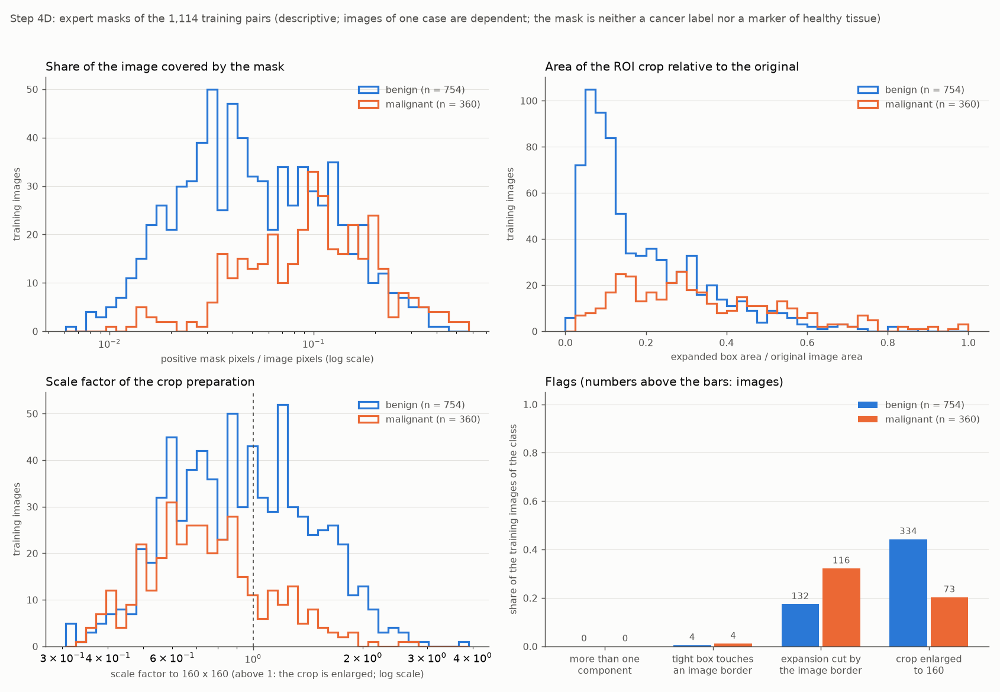

# Masken prüfen und Experten-ROI festlegen (Schritt 4D)

Stand: 20.10.2026. Ursprünglich mit den früheren Treibern erzeugt, heute entsprechend: `analysis/04_mask_eda_roi.py` und `src/busbra/roi.py`. Schritt 4D wurde technisch geprüft; die zwölf Trainingsbeispiele wurden nachträglich gesichtet (siehe „Nachtrag vom 20.10.2026“). Die Beschreibung der Vorschau und der Sichtfragen unten gibt den Stand zum Zeitpunkt des 4D-Laufs wieder; die Sichtung erfolgte erst danach. Alle Zahlen stammen aus `reports/tables/mask_eda_*.csv`, `roi_contract.json`, `roi_preview_selection.csv` und `mask_eda_status.json` (Lauf `mask-20261020T165852-30b9954c` bestätigt den ersten Lauf byte-identisch). Dieser Schritt trainiert nichts, verwendet keine GPU, keine Validation- und keine Testbilder oder -masken und trifft keine Modell- oder Schwellenwahl.

## Zweck und Abgrenzung

Ein späterer **Experten-ROI-Zweig** soll das Läsionsgebiet lokalisiert bekommen: Aus der von Expertinnen oder Experten gezeichneten Läsionsmaske wird ein Zuschnitt des Originalbildes abgeleitet. Vorher wird (a) die Maskenkodierung und -geometrie an den Trainingsdaten geprüft und (b) die Zuschnittregel in einem versionierten, gehashten Vertrag festgelegt, bevor Masken der Validation für irgendetwas verwendet werden.

- Der **Vollbildzweig bleibt gültig und unverändert**; seine Input-Verträge und Ergebnisse (Schritte 2B–4C) werden nicht umdefiniert.
- Der **Experten-ROI-Zweig** erhält die Maske als zusätzliche Information für die Lokalisation. Seine Anwendung setzt eine manuelle Maske voraus. Seine Klassifikationsleistung darf deshalb **nicht als reine Bild-zu-Score-Pipeline** ausgegeben werden. Erst ein gesonderter, später zu prüfender Segmentierungszweig könnte den Zuschnitt ohne Expertenmaske erzeugen; er ist nicht Teil von 4D.
- Die Maske ist **kein Krebslabel**: Auch benigne Läsionen haben Masken (754 benigne und 360 maligne Trainingsmasken). Sie markiert die annotierte Läsion und **nicht** histologisch gesundes Hintergrundgewebe.
- In diesem Schritt dient die Maske ausschließlich der Berechnung einer Zuschnittsbox. Sie ist keine Modelleingabe (kein Maskenkanal, keine Schwärzung außerhalb der Läsion). Auswertungsspalten wie ID, Case, Klasse und Gerät sind keine Pixelinputs; Bilder desselben Cases sind abhängig, und ein Case ist nicht als unabhängige Patientin belegt.

## Datenzugriff und Vorbedingungen

- Geprüft vor dem ersten Dateizugriff: Projektinterpreter (`sys.prefix` gegen die aufgelöste `.venv`), erfolgreicher Audit, eingefrorener Split mit dem SHA-256 `fdce9bc991b949cf…` (byteweise gehasht und gleich dem Eintrag in `split_status.json`). Bei einer Abweichung bricht das Skript mit einer Meldung ab; frühere Ausgaben bleiben erhalten.
- Das Manifest wird Zeile für Zeile gelesen und **sofort nach `split` gefiltert**: Von den Trainingszeilen (1.114 Bilder, 639 Cases, 754 benign, 360 malign) werden alle Spalten behalten, von den Validation-Zeilen (385 Bilder, 213 Cases) nur der `Case` für die Prüfung der Trennung (Überschneidung Train/Validation: 0). Die übrigen Zeilen (Test) werden nur gezählt und nie ausgewertet. Bild, Maske, ID, Case, Label und Pfade sind über das Manifest explizit verknüpft (Bild `Images/<ID>.png`, Maske `Masks/mask_<NNNN-x>.png`); es gibt keine unabhängig sortierten Dateilisten und keinen neuen Split.
- **Zugriffskontrolle:** Geöffnet wurden genau die 1.114 Trainingsbilder und die 1.114 Trainingsmasken (2.228 verschiedene Dateien), keine Validation- oder Testdatei, keine Modell- oder Gewichtsdatei, kein TensorFlow. Das belegt der Statusbericht (eigener Audit-Hook im Skript) und unabhängig der Prüftest (zweiter Audit-Hook um das gesamte Skript, Vergleich mit dem aus dem Manifest abgeleiteten Pfadsatz).
- Es werden die tatsächlich **dekodierten** Pixelgrößen verwendet. Bild- und Maskengröße sind in allen 1.114 Paaren gleich und gleich den auditierten Werten. Drei der vier bekannten CSV-Höhenabweichungen liegen im Training (`bus_0856-l`, `bus_0912-l`, `bus_0990-l`); sie sind nur markiert, die Geometrie wird nie anhand der CSV-Metadaten korrigiert.

## Rohkodierung der Masken (vor jeder Binarisierung geprüft)

An allen 1.114 Trainingsmasken wurden Modus, Array-Typ und unterschiedliche Pixelwerte erfasst (`mask_eda_encoding.csv`): **alle** sind PNG im Modus `1`, als NumPy-Array `bool` mit genau den Werten {`False`, `True`}; kein anderer Modus, kein Zwischenwert, keine leere Maske.

**Eindeutige Umwandlung:** `True` = 1 = annotierte Läsion, `False` = 0 = Hintergrund. **Begründung der Richtung aus den Trainingsdateien:** Der Anteil `True` je Maske liegt zwischen 0,0061 und 0,5754 (Median 0,0634); `True` ist in 1.112 von 1.114 Masken der kleinere Wert. Bei invertierter Kodierung wäre `True` in nahezu jeder Maske der Hintergrund und damit der größere Anteil. Vorab festgelegte Regel (im Vertrag): `True` ist die Läsion, wenn der Median des `True`-Anteils unter einem Halb liegt. Jede andere Kodierung, ein Zwischenwert, eine leere Maske oder eine abweichende Größe wäre ein Fehler (keine stille Schwelle, keine Reparatur); die Prüfung ist als Test an künstlichen Masken (Modus L mit 0/255 und 0/1, L mit Zwischenwerten, P, RGB) und an einer in einer isolierten Kopie umkodierten echten Trainingsmaske belegt.

**Befund:** Zwei Masken bedecken mehr als die Hälfte des Bildes: `bus_0666-l` (0,575) und `bus_0666-r` (0,554), beide malign und vom selben Case. Das ist keine Verletzung der Umwandlung (die Regel betrifft den Median), aber ein Fall für die Sichtprüfung: Der Zuschnitt umfasst dort das gesamte Bild.

## Train-Masken-EDA (1.114 Paare, 639 Cases; deskriptiv, ohne Ausschluss und ohne neu gezeichnete Konturen)

Je Trainingsbild wurden positive Pixel und Anteil, die gesamte enge Box, die Zahl der zusammenhängenden Komponenten (**8er-Nachbarschaft**), der Bildrandkontakt der engen Box sowie Breite, Höhe und Flächenanteil des vorgeschlagenen Zuschnitts bestimmt (`mask_eda_train_pairs.csv`, nur lokal; kompakte Tabellen `mask_eda_summary.csv`, `mask_eda_flag_counts.csv`, `mask_eda_extremes.csv`). Alle 1.114 Paare haben die Geometrieprüfung bestanden.

| Gruppe | Bilder / Cases | Maskenanteil am Bild: Median [Q1–Q3] (Min–Max) | positive Pixel: Median | enge Box B × H: Median | Crop-Flächenanteil: Median [Q1–Q3] | Skalierung auf 160: Median [Q1–Q3] |
|---|---:|---|---:|---|---|---|
| alle Trainingsbilder | 1114 / 639 | 0,063 [0,033–0,119] (0,0061–0,575) | 7.767 | 133 × 84 | 0,184 [0,093–0,329] | 0,851 [0,621–1,203] |
| benign | 754 / 434 | 0,047 [0,028–0,096] (0,0061–0,437) | 6.190 | 123 × 72 | 0,132 [0,077–0,272] | 0,925 [0,666–1,290] |
| malignant | 360 / 205 | 0,102 [0,058–0,162] (0,0096–0,575) | 11.790 | 156 × 121 | 0,300 [0,173–0,472] | 0,726 [0,579–0,916] |
| GE Logiq 5 | 522 / 315 | 0,055 [0,031–0,107] (0,0099–0,575) | 8.874 | 138 × 93 | 0,158 [0,086–0,303] | 0,796 [0,588–1,157] |
| GE Logiq 7 | 504 / 277 | 0,073 [0,037–0,140] (0,0079–0,491) | 7.218 | 132 × 80 | 0,210 [0,109–0,371] | 0,856 [0,635–1,205] |
| Toshiba Aplio 300 | 75 / 39 | 0,063 [0,029–0,099] (0,0061–0,261) | 5.340 | 116 × 74 | 0,205 [0,086–0,302] | 0,976 [0,757–1,468] |
| U-Systems | 13 / 8 | 0,081 [0,032–0,159] (0,0164–0,307) | 12.638 | 138 × 91 | 0,208 [0,083–0,319] | 0,825 [0,513–1,524] |

Zur Lesart: Der Maskenanteil ist das Verhältnis positiver Pixel zur Bildfläche; die Skalierung ist der Faktor `min(160/Crop-Breite, 160/Crop-Höhe)`, den die vorhandene Resize-Regel anwendet (Faktor > 1: Vergrößerung durch Interpolation, kein neuer Informationsgehalt). Mittelwerte, Perzentile und Extremwerte je Gruppe stehen in `mask_eda_summary.csv`.

Befunde mit Zählern und Nennern (Bilder; je Befund und Gruppe):

| Befund | alle (n/1.114) | benign (n/754) | malignant (n/360) | GE Logiq 5 (n/522) | GE Logiq 7 (n/504) | Toshiba Aplio 300 (n/75) | U-Systems (n/13) |
|---|---:|---:|---:|---:|---:|---:|---:|
| mehr als eine Komponente | 0 | 0 | 0 | 0 | 0 | 0 | 0 |
| Maske bedeckt mehr als die Hälfte des Bildes | 2 | 0 | 2 | 2 | 0 | 0 | 0 |
| enge Box berührt einen Bildrand | 8 | 4 | 4 | 4 | 4 | 0 | 0 |
| … davon links | 2 | 2 | 0 | 0 | 2 | 0 | 0 |
| … davon rechts | 6 | 2 | 4 | 4 | 2 | 0 | 0 |
| … davon oben | 0 | 0 | 0 | 0 | 0 | 0 | 0 |
| … davon unten | 0 | 0 | 0 | 0 | 0 | 0 | 0 |
| Erweiterung am Bildrand gekürzt | 248 | 132 | 116 | 103 | 127 | 13 | 5 |
| Zuschnitt wird auf 160 vergrößert (Faktor > 1) | 407 | 334 | 73 | 175 | 189 | 37 | 6 |
| bekannte CSV-Höhenabweichung (nur markiert) | 3 | 1 | 2 | 0 | 2 | 0 | 1 |

- **Komponenten:** Alle 1.114 Masken bestehen aus genau einer zusammenhängenden Komponente (8er-Nachbarschaft). Die Regel „bei mehreren Komponenten alle einschließen“ ist implementiert und getestet, kam im Training aber nicht zur Anwendung.
- **Bildrandkontakt der engen Box:** 8 von 1.114 Bildern (8 Cases): `bus_0164-l`, `bus_0272-r`, `bus_0331-s`, `bus_0369-r`, `bus_0436-r`, `bus_0438-l`, `bus_0535-r`, `bus_0878-s` (links: 2, rechts: 6, oben und unten: 0). Die Erweiterung wird an der Bildgrenze gekürzt; es wird nichts gespiegelt oder aufgefüllt.
- **Kürzung der Erweiterung am Bildrand** (die 20 %-Erweiterung erreicht an mindestens einer Seite die Bildgrenze): 248 von 1.114 (22,3 %), benign 132 von 754 (17,5 %), malign 116 von 360 (32,2 %).
- **Vergrößerung auf 160:** 407 von 1.114 Zuschnitten (36,5 %) sind kleiner als 160 Pixel und werden hochskaliert, benign 334 von 754 (44,3 %), malign 73 von 360 (20,3 %). Skalierungsfaktoren: Minimum 0,31, Maximum 3,90.
- **Klassenunterschiede (deskriptiv):** Die malignen Masken sind im Median größer als die benignen (Maskenanteil 0,102 gegenüber 0,047; Crop-Flächenanteil 0,300 gegenüber 0,132). Damit hängen Crop-Größe und Skalierungsfaktor, und über die Interpolation auch die Detailschärfe des 160 × 160-Eingabebildes, mit der Klasse zusammen. Ein späterer ROI-Vergleich kann daraus eine Abkürzung ableiten, die im Vollbildzweig so nicht besteht; das ist hier nicht untersucht und wird nicht als Ursache behauptet.
- **Geräte:** Die Verteilungen unterscheiden sich zwischen den vier Geräten (Tabelle oben); U-Systems hat nur 13 Bilder (8 Cases), Toshiba Aplio 300 nur 75 (39 Cases). Die Gerätevergleiche sind deskriptiv und belegen keine Fairness oder Übertragbarkeit.
- **Auffällige Fälle (je zehn, `mask_eda_extremes.csv`):** kleinste Masken (positive Pixel): `bus_1008-r`, `bus_1061-r`, `bus_1008-l`, `bus_0257-l`, `bus_0176-l`, `bus_0179-l`, `bus_0013-r`, `bus_0305-r`, `bus_0257-r`, `bus_0179-r`; größte Maskenanteile: `bus_0666-l`, `bus_0666-r`, `bus_0303-l`, `bus_0303-r`, `bus_0535-r`, `bus_0089-s`, `bus_0878-s`, `bus_0272-r`, `bus_0272-l`, `bus_0114-s`; stärkste Vergrößerung: `bus_1008-r`, `bus_1061-r`, `bus_0257-r`, `bus_0305-r`, `bus_0257-l`, `bus_1007-r`, `bus_0444-l`, `bus_0868-r`, `bus_0179-l`, `bus_0868-l`; stärkste Verkleinerung: `bus_0843-s`, `bus_0826-s`, `bus_0970-s`, `bus_0822-s`, `bus_0771-s`, `bus_0811-s`, `bus_0830-s`, `bus_0666-l`, `bus_0666-r`, `bus_0720-s`; stärkste Kürzung der Erweiterung am Bildrand: `bus_0666-r`, `bus_0666-l`, `bus_0331-s`, `bus_0878-s`, `bus_0438-l`, `bus_0535-r`, `bus_0089-s`, `bus_0272-r`, `bus_0643-l`, `bus_0685-l`. Keines dieser Beispiele wurde ausgeschlossen oder verändert.

## ROI-Vertrag `roi-expert-mask-v1` (`reports/tables/roi_contract.json`, SHA-256 des Vertragsinhalts `a0c72744776e92a4ea63265c21a0939626691ab98f4d911b37040625067e0aad`)

Eingefroren am 2026-10-20T16:58:43+02:00, nach bestandener Geometrieprüfung aller 1.114 Trainingspaare und **vor** jeder Verwendung von Validation-Masken; die Datei wird nie überschrieben, ein abweichender Vertrag stoppt die Analyse. Eine spätere Änderung ist nur als neue Vertragsversion mit dokumentierter Begründung möglich. Der Vertrag lautet im Wesentlichen:

1. **Koordinaten:** Originalpixel des dekodierten Bildes, halboffen: `[x0, x1) × [y0, y1)`, `w = x1 − x0`, `h = y1 − y0`.
2. **Enge Box:** achsenparallele Box um **alle** positiven Maskenpixel (bei mehreren Komponenten alle eingeschlossen). **Leere Maske: Abbruch**, keine Ersatzbox.
3. **Erweiterung um 20 % je Seite**, der jeweiligen Boxbreite (links/rechts) bzw. -höhe (oben/unten), in **exakter Bruchrechnung**: `links = floor(x0 − w/5)`, `rechts = ceil(x1 + w/5)`, `oben = floor(y0 − h/5)`, `unten = ceil(y1 + h/5)`. Das entspricht einem Rand von `ceil(w/5)` bzw. `ceil(h/5)` Pixeln auf beiden Seiten (z. B. `w = 5`: genau 1 Pixel; `w = 6` oder `w = 7`: 2 Pixel; `w = 1`: 1 Pixel), die Erweiterung beträgt also mindestens 20 %.
4. **Reihenfolge:** (1) enge Box aus allen positiven Pixeln, (2) Erweiterung in exakter Bruchrechnung, (3) Begrenzung auf `[0, W] × [0, H]`.
5. **Randkontakt:** Eine Seite, die die Bildgrenze berührt oder überschreiten würde, endet an der Bildgrenze; es wird nicht gespiegelt und nichts mit erfundenen Pixeln aufgefüllt. Die Kürzung wird je Bild festgehalten (`margin_deficit_pixels`).
6. **Zuschnitt:** das **unmaskierte Originalbild** innerhalb der erweiterten Box. Kein zusätzlicher Maskenkanal, keine Schwärzung außerhalb der Läsion, keine Kontraststreckung, kein OCR, keine Markerentfernung, keine BBOX- oder BI-RADS-Metadaten als Modelleingabe.
7. **Aufbereitung:** erst danach die vorhandene seitenverhältnistreue Regel (`busbra.image_processing.resize_with_padding`: gesamter Zuschnitt in das Quadrat eingepasst, bilinear, zentriert auf Schwarz) auf **160 × 160 × 1, `float32`, [0, 1]**. Pillows `ImageOps.contain` vergrößert auch kleine Zuschnitte; der Skalierungsfaktor steht je Bild in der EDA.
8. **Feste Versuchswahl:** Die 20 % sind weder auf Validation optimiert noch ein Optimum noch eine Millimeterangabe.
9. **Informationsbedingung:** siehe oben (manuelle Maske nötig, keine reine Bild-zu-Score-Pipeline, Segmentierung später und getrennt).

**Rechenbeispiel** (synthetisch): enge Box `[100, 107) × [40, 90)` in einem Bild 300 × 200: `w = 7`, `h = 50` → links `floor(100 − 1,4) = 98`, rechts `ceil(107 + 1,4) = 109`, oben `floor(40 − 10) = 30`, unten `ceil(90 + 10) = 100`, erweiterte Box `[98, 109) × [30, 100)` (11 × 70 Pixel); berührt die enge Box dagegen die linke Bildkante (`x0 = 0`), bleibt `links = 0`.

## Lokale Trainingsvorschau (nicht angesehen, nicht versioniert)

Pfad: `data/processed/roi_preview_train_only.png` (`data/processed/` ist ausgeschlossen). **SHA-256: `c94332b86f49964f5588dca40e41a2e91699f63409d2b8e31ddd97176ade666e`.** Je Kachel: Original mit Maskenkontur (cyan), enger Box (gelb gestrichelt) und erweiterter Box (rot), daneben der unmaskierte Zuschnitt und die 160 × 160-Eingabe. Die Auswahl folgt einer vorab im Vertrag festgelegten deterministischen Regel (nur Trainingsbilder): je Gerät und Klasse das Bild mit dem Median-Maskenanteil (Gleichstand: kleinste ID) und die Extreme (kleinste Maske, größter Anteil, meiste Komponenten falls mehr als eine [kam nicht vor], meiste berührte Ränder, stärkste Randkürzung):

| ID | Auswahlgrund | Klasse | Gerät | Maskenanteil | Skalierung |
|---|---|---|---|---:|---:|
| `bus_0496-l` | Median-Maskenanteil von GE Logiq 5 @10-12MHz / benign | benign | GE Logiq 5 | 0,0437 | 1,05 |
| `bus_0428-r` | Median-Maskenanteil von GE Logiq 5 @10-12MHz / malignant | malignant | GE Logiq 5 | 0,1006 | 0,63 |
| `bus_0311-r` | Median-Maskenanteil von GE Logiq 7 @10-14MHz / benign | benign | GE Logiq 7 | 0,0560 | 0,86 |
| `bus_0250-r` | Median-Maskenanteil von GE Logiq 7 @10-14MHz / malignant | malignant | GE Logiq 7 | 0,1113 | 0,92 |
| `bus_1051-r` | Median-Maskenanteil von Toshiba Aplio 300 @12-14 MHz / benign | benign | Toshiba Aplio 300 | 0,0293 | 1,18 |
| `bus_1062-r` | Median-Maskenanteil von Toshiba Aplio 300 @12-14 MHz / malignant | malignant | Toshiba Aplio 300 | 0,0776 | 0,88 |
| `bus_0851-s` | Median-Maskenanteil von U-Systems @10-14MHz / benign | benign | U-Systems | 0,0808 | 0,82 |
| `bus_0854-s` | Median-Maskenanteil von U-Systems @10-14MHz / malignant | malignant | U-Systems | 0,0824 | 0,51 |
| `bus_1008-r` | kleinste Maske (positive Pixel) | benign | Toshiba Aplio 300 | 0,0061 | 3,90 |
| `bus_0666-l` | größter Maskenanteil | malignant | GE Logiq 5 | 0,5754 | 0,35 |
| `bus_0164-l` | berührt die meisten Bildränder (der enge Box) | benign | GE Logiq 7 | 0,3486 | 0,58 |
| `bus_0666-r` | stärkste Kürzung der Erweiterung am Bildrand | malignant | GE Logiq 5 | 0,5539 | 0,35 |

**Stand zum Zeitpunkt des 4D-Laufs: Die Vorschau wurde von diesem Schritt weder geöffnet noch fachlich freigegeben; vor dem 4D-Lauf hatte keine Sichtung stattgefunden, die Sichtprüfung war offen und sollte vor dem ROI-Training erfolgen.** Zu beurteilen waren: Läsion in der erweiterten Box und im Zuschnitt enthalten; plausible enge und erweiterte Box je ID; Maskenkontur auf der sichtbaren Läsion; die auffälligen Masken (`bus_0666-l/-r`: Zuschnitt = ganzes Bild); eingebrannte Texte und Messmarken im Zuschnitt; geometrische Fehler. Sollten geometrische Fehler auftreten, wird die Regel vor einem Training korrigiert und der Vertrag als neue Version eingefroren; ein später gestarteter Hauptlauf wird nicht als vorher gesichtet bezeichnet.

### Nachtrag vom 20.10.2026: nachträgliche Sichtung der zwölf Trainingsbeispiele

Nach dem 4D-Lauf wurde die lokale Vorschau für die zwölf Trainingsbeispiele (IDs in der Tabelle oben) gesichtet; der SHA-256 der gesichteten Datei ist `c94332b86f49964f5588dca40e41a2e91699f63409d2b8e31ddd97176ade666e` und gleich dem im Statusbericht protokollierten Wert. Die Sichtung erfolgte erst nach dem 4D-Lauf; vor dem 4D-Lauf hatte keine Sichtung stattgefunden (siehe oben). **Befund:** In den zwölf Beispielen ist kein offensichtlicher Versatz und keine klar abgeschnittene markierte Läsion zu erkennen. Die sehr großen Masken von `bus_0666-l` und `bus_0666-r` führen praktisch zu Vollbildzuschnitten. `bus_1008-r` wird stark vergrößert (Faktor 3,90) und ist sichtbar unscharf. Messkreuze und teils eingebrannte Angaben bleiben im Zuschnitt erhalten. Die Sichtung bestätigt keine medizinische Richtigkeit aller Masken, ist keine Prüfung aller Zuschnitte und keine klinische Neubefundung.

## Grenzen

- Beschreibend, ohne klinische Neubefundung; die Qualität der Masken und der Läsionsgrenzen wurde nicht bewertet.
- Die Maske ist weder ein Krebslabel noch eine Markierung gesunden Gewebes; benigne Läsionen haben Masken.
- Der Experten-ROI erfordert bei der Anwendung eine manuelle Maske; Ergebnisse des späteren ROI-Zweigs sind keine reine Bild-zu-Score-Leistung und nicht mit dem Vollbildzweig als gleichartige Pipeline zu vergleichen.
- Zuschnittgröße, Skalierung und Interpolationsgrad hängen mit der Klasse zusammen (siehe oben); eingebrannte Texte und Messmarken bleiben im Zuschnitt erhalten.
- Im 4D-Lauf wurden ausschließlich Trainingsbilder und Trainingsmasken geöffnet; Validation-Masken wurden dort noch nicht verwendet (ab Schritt 4E nach Registrierung des Studienplans, siehe [expert_roi_comparison.md](expert_roi_comparison.md)), Testdaten bleiben gesperrt. In 4D wurde kein ROI-Training durchgeführt und keine Segmentierung begonnen.
- Die 20 % sind eine feste Versuchswahl; andere Randanteile wurden nicht geprüft.

## Prüfungen

Gezielt geprüft (kein Training, keine GPU, Bilder nur synthetisch außer dem Lauf selbst):
- **Synthetische Fälle** für `roi.py`: mehrere Komponenten, Ein-Pixel- und sehr kleine Masken, Berührung jedes einzelnen und aller vier Bildränder, ungerade Erweiterung und Rundung (Formel für `w = 1…60`), 300 Zufallsmasken als Eigenschaftstest (alle positiven Pixel in der Box; die erweiterte Box enthält die enge; jeder Rand genau `min(ceil(Kante/5), Abstand zum Bildrand)`, also nur durch Bildgrenzen gekürzt), Erkennung falscher Boxen, falsch gepaarte Größen, leere Masken, unerwartete Kodierungen, Resize-Geometrie eines nichtquadratischen Bildes (160 × 112 zentriert, 24 schwarze Zeilen oben und unten) und Zuschnitt aus unmaskierten Originalpixeln, deterministische Vorschauauswahl.
- **Echtlauf:** alle 1.114 Paare gemessen und geometrisch geprüft; die gespeicherten erweiterten Boxen aller Paare gleich der unabhängig gerechneten Ganzzahlformel; 60 zufällige Paare mit eigener Dekodierung der Maske nachgerechnet; zweiter Aufruf reproduziert alle Ergebnisdateien, die Statistikfigur und die lokale Vorschau byte-identisch und lässt den eingefrorenen Vertrag unverändert; Fehlerfälle in isolierten Kopien (abweichender Split-Hash stoppt, bevor irgendeine Bilddatei geöffnet wird; geänderter Vertrag stoppt; falsches Umfeld stoppt; eine in 8 Bit 0/255 umkodierte Trainingsmaske stoppt vor jeder Binarisierung und vor dem Einfrieren), jeweils mit gesichertem früheren Erfolg und unverändertem früheren Ergebnis.
- Rohdaten, Manifest, Split, alte Modelle, Vorhersagen, Tabellen, Studien (3F, 4A, 4B, 4C) und Environment-Berichte sind per Hash unverändert; `py_compile` und `pip check` ohne Befund; keine Installation.

## Dateien und Reproduktion

`.venv/bin/python analysis/13_mask_eda_and_roi_definition.py` (CPU, etwa 12 s). Ergebnisse: `reports/tables/roi_contract.json` (einmalig geschrieben), `mask_eda_encoding.csv`, `mask_eda_summary.csv`, `mask_eda_flag_counts.csv`, `mask_eda_extremes.csv`, `roi_preview_selection.csv`, `mask_eda_train_pairs.csv` (eine Zeile je Trainingsbild, **nur lokal**), `reports/figures/mask_eda_train_overview.png`, die lokale Vorschau und `mask_eda_status.json` mit `mask_eda_status_last_success.json`. Die Schwellenwerte und Anteile stehen mit voller Genauigkeit in den CSV-Dateien (zum Vergleich auf exakte Gleichheit mit `float_precision="round_trip"` einlesen).

## Nächste Schritte (nicht Teil von 4D)

Die Sichtung der zwölf Trainingsbeispiele ist erfolgt (siehe Nachtrag). Das Experten-ROI-Training über fünf gepaarte Seeds gegen den Vollbildzweig wurde in Schritt 4E durchgeführt und ist technisch geprüft ([expert_roi_comparison.md](expert_roi_comparison.md)): eine explorative Verbesserung mit Expertenmasken, aber keine automatisch anwendbare Bild-zu-Score-Pipeline. Die automatische Segmentierung ist von 4D getrennt: Schritt 4F-A (erste feste Segmentierung auf Vollbildern) ist umgesetzt und ausgeführt ([segmentation_4fa.md](segmentation_4fa.md)); die ROI-Klassifikation mit vorhergesagten Masken wurde in Schritt 4F-B nur per Inferenz mit den unveränderten 4E-Klassifikatoren geprüft ([auto_roi_classification.md](auto_roi_classification.md)).

## Quellen

- Datensatz: Gómez-Flores et al., *Medical Physics* 51 (2024), https://doi.org/10.1002/mp.16812 (Lizenzhinweise siehe README).
