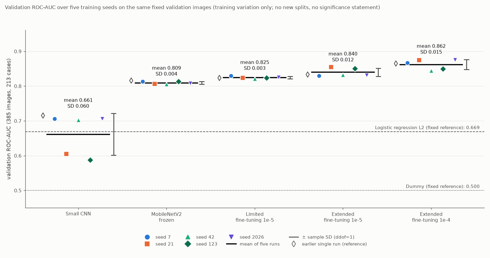
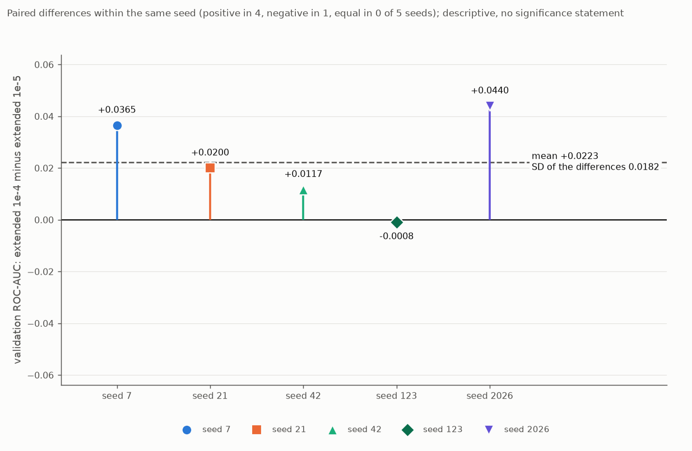

# Vergleich über fünf Trainings-Seeds

Stand: 19.10.2026. Ursprünglich mit den früheren Treibern erzeugt, heute entsprechend: `analysis/03_classification.py`, `src/busbra/models.py`, `src/busbra/training.py` und `plots/plot_multiseed_results.py`. Alle Zahlen stammen aus `reports/tables/multiseed_*.csv`, `multiseed_status.json`, `multiseed_study_config.json` und den 25 Laufverzeichnissen unter `reports/tables/multiseed/` (Studie `ms3f-97e0f17c`, Plan-SHA-256 `97e0f17c595cc1de…`). Die früheren Einseedläufe (3A bis 3E) stehen unverändert in den jeweiligen Dokumenten und dienen hier nur als Referenz.

## Frage und Umfang

Wie stark schwanken die Validation-Ergebnisse der neuronalen Pipelines mit dem Trainings-Seed auf **demselben festen Holdout**? Die Initialisierung des kleinen CNN und des neuen Frozen-Kopfes gehört ausdrücklich zur untersuchten Trainingsstreuung. Es ist keine neue Hyperparametersuche: jede Konfiguration ist die akzeptierte, es gibt genau einen Hauptlauf je Kombination, und ein schlechtes Ergebnis war kein Wiederholungsgrund.

Die Studie misst **Trainingsstreuung auf den 385 Validation-Bildern (213 Cases)**, nicht die Streuung über neue Datensplits, Einrichtungen oder Patientenkohorten. Mehrere Bilder eines Cases sind abhängig; fünf Seeds sind keine fünf unabhängigen Validation-Kohorten; die Validation wurde wiederholt für Entwicklung und Checkpoint-Auswahl genutzt, was die Seedwiederholungen nicht beseitigen. Es gibt keine p-Werte, keine Konfidenzintervalle, keine Gewinnerregel, kein Ensemble, keine gemeinsame AUC über die 5 × 385 Vorhersagen (das würde dieselben Bilder mehrfach zählen) und keine Wahl eines „besten Seeds“. Die endgültige Modell- und Schwellenwahl, die Testauswertung und die sensitivitätsorientierte Schwellenuntersuchung folgen in späteren Schritten; **die Testdaten wurden nicht verwendet** (je Lauf genau 1.499 PNG-Dateien, Train und Validation, kein Treffer auf Test oder Masken).

## Versuchsplan (vor dem ersten Haupttraining unveränderlich festgeschrieben)

`reports/tables/multiseed_study_config.json` enthält Plan, Zeitstempel (`registered_at` 19.10.2026 23:23:33, vor dem ersten Training) und SHA-256 des Plans; jeder Worker prüft Plan, Kombination und Split-Hash vor dem Start, und ein geänderter Plan stoppt die Studie.

- **Seeds** in dieser Reihenfolge: 7, 21, 42, 123, 2026; alle fünf für jede der fünf Pipelines (25 Läufe). Auch Seed 42 wurde neu trainiert; dieser Lauf ist keine behauptete Reproduktion des historischen Seed-42-Laufs.
- **Pipelines:** kleines CNN (Adam 1e-3, höchstens 30 Epochen), MobileNetV2 frozen (1e-3, 30), begrenztes Fine-Tuning (1e-5, 20), erweitertes Fine-Tuning (1e-5, 20), erweitertes Fine-Tuning (1e-4, 20). Architektur, Freigabe (6 bzw. 12 trainierbare Gewichte, 880.321 bzw. 1.512.001 Parameter, alle 52 BatchNorm-Schichten fest), Batchgröße 16, BCE, Early Stopping (`val_loss`, Geduld 5, beste Gewichte), Checkpoint nach kleinstem Validation-Loss, `float32`, `jit_compile=False`, keine Klassengewichte wie in den akzeptierten Schritten.
- **Start der Fine-Tuning-Zweige:** je Seed der **beste Checkpoint des neuen Frozen-Laufs desselben Seeds**, unabhängig voneinander, nicht die letzte Epoche und nicht ein historischer Checkpoint. Die neuen Frozen-Läufe starten vom lokalen ImageNet-Gewichtsfile (9.406.464 Bytes, SHA-256 `1e9310d9…8bf04e`, Download nicht vorgesehen) mit einem je Seed neu initialisierten Kopf. Kein historisches trainiertes BUS-BRA-Modell diente als Start.

### Seedsteuerung

| Zufallsquelle | Festlegung |
|---|---|
| `PYTHONHASHSEED` | `str(s)`, vom Koordinator vor dem Start des Worker-Prozesses gesetzt und im Worker geprüft |
| Python, NumPy, TensorFlow/Keras | `keras.utils.set_random_seed(s)` unmittelbar vor der Modellkonstruktion in frischer Keras-Sitzung |
| Gewichtsinitialisierung | frische Konstruktion nach diesem Reset (CNN-Gewichte und neuer Kopf variieren, der ImageNet-Backbone nicht) |
| `RandomFlip('horizontal')` | explizit `seed=s+1` |
| `Dropout(0.3)` | explizit `seed=s+2` |
| Trainings-Shuffle | `seed=s+3`, in jeder Epoche neu gemischt |

Die Zuordnung steht im Plan, in jeder Run-Config und im aus den gebauten Layern **ausgelesenen** Vertrag (Seed-Argument und Anfangszustand `[Seed, 0]` beider Generatoren); die historische Beschreibung mit `seed=42` ist nicht der Vertrag dieser Studie. Belegt (Prüfskript und je Lauf im Status):
- Gleiche Seeds geben bitgleiche Initialgewichte, Flip-Muster, Dropout-Maske und Shuffle-Reihenfolge; andere Seeds ändern alle vier.
- Die fünf CNN-Initialisierungen und die fünf neuen Frozen-Köpfe sind verschieden; der ImageNet-Backbone-Fingerabdruck ist für alle Seeds identisch und gleich dem akzeptierten 3B-Wert `03276b4c…807ba3`.
- Die Fine-Tuning-Zweige werden als **frisch konstruierter Graph** gebaut, in den nur die Netzgewichte (Faltungen, BatchNorm gamma/beta/gleitende Statistiken, Kopf) aus dem besten Frozen-Checkpoint kopiert werden; Generatorzustände werden nicht übertragen, der Optimierer ist neu (0 Iterationen). Lokaler Befund mit der installierten Keras-Version (3.15.1): Die Generatorzähler schreiten im Speicher beim Training fort (gemessen: Zähler 2 nach einer kurzen Anpassung); beim beobachteten Laden des Frozen-Checkpoints (Seed 7) standen sie wieder auf den konfigurierten Anfangszuständen `[s+1, 0]` und `[s+2, 0]`. Die frische Zweigkonstruktion macht den Start unabhängig von diesem Speicherverhalten und belegt die frischen Zustände; eine Aussage über andere Keras-Versionen wird daraus nicht abgeleitet.
- Alle drei Zweige eines Seeds starten mit bitgleichen Netzgewichten (Fingerabdruck aller Gewichte, des Backbones und des Kopfes) gleich dem besten Frozen-Netz dieses Seeds, und sie reproduzieren dessen gespeicherte Validation- und Train-Scores innerhalb 1e-5.

GPU-Nichtdeterminismus bleibt möglich; es wurde keine Determinismusoption nur für einen Teil der Studie eingeschaltet.

## Durchführung

Aufruf: `env -u LD_LIBRARY_PATH .venv/bin/python analysis/03_classification.py`. Ein Koordinator (kein TensorFlow-Import) startet die 25 Jobs nacheinander als frische Python-Kindprozesse, einen GPU-Prozess zugleich; die Prüfung des Projektinterpreters (`sys.prefix` gegen die aufgelöste `.venv`) läuft in Koordinator und Worker vor jedem Drittanbieter-Import. Je Lauf: Vorbedingungen (Plan, Split, bei Fine-Tuning der gültige Frozen-Lauf desselben Seeds mit Seed-, Run-ID-, Checkpoint- und Config-Hash), Datenaufbereitung (nur Train/Validation), GPU-Setup, technische Probe auf 16 Trainingsbildern (alle vorgesehenen Gradienten auf GPU:0, endlich; zulässige Gruppen aktualisiert, feste Gruppen bitgleich), Reset mit vollständiger Neukonstruktion (Probeupdates und verbrauchte Generatorzustände gehen nicht ein, Adam bei 0 Iterationen), Training, Neuladen des besten Checkpoints (zweimal, `jit_compile=False`, Abweichung höchstens 1e-5), Auswertung. Alle 25 Hauptläufe liefen mit Batchgröße 16 (kein GPU-Speicherfehler, kein technischer Neustart, keine Wiederholung); die Studie variiert damit ausschließlich den Seed. Die ausgelesene Optimierer-Lernrate stimmt in jedem Lauf mit dem Plan überein (rtol 1e-6; Beispiel 1e-4 als 9,999999747378752e-05). Laufzeit (aus den Statusdateien der 25 Läufe gelesen, Messungen dieses Aufrufs): Koordinator 29,4 min Wandzeit; die reine Trainingszeit (`model.fit`) lag je Lauf zwischen 13,4 s (CNN, Seed 123) und 86,3 s (begrenztes Fine-Tuning, Seed 2026), Median 49,2 s, Summe 1.230 s; die gesamte Worker-Laufzeit je Prozess (Datenaufbereitung, GPU-Setup, Probe, Reset, Training, Neuladen und Auswertung) lag zwischen 23,5 s und 125,9 s, Median 66,5 s, Summe 1.739 s.

**Wiederanlauf:** Ein erneuter Aufruf validiert jeden fertigen Lauf (Plan, Split, Quell- und Ausgabehashes) und überspringt ihn, ein geänderter Plan oder ein manipuliertes Artefakt eines fertigen Laufs stoppt die Studie, Kombinationen, die vor jedem Trainingsergebnis scheiterten, werden unter identischem Protokoll fortgesetzt, fertige Läufe nie überschrieben. Für Kombinationen mit vorhandenen Trainingsartefakten ohne erfolgreichen Status gilt seit dem Nachtrag vom 20.10.2026 (siehe unten) der Zustand „Wiederherstellung erforderlich“: kein Trainingsworker, keine Bereinigung. Belegt durch den kontrollierten Validierungsaufruf des vollständigen Stands (Run `ms-20261019T235915-e4ffa210`: 25 von 25 validiert und übersprungen, 0 trainiert, 4,2 s; alle 125 Tabellendateien der Läufe, 25 lokale Checkpoints, Plan, Aggregattabellen und Abbildungen bytegleich). Die Erfolgsmeldung des ursprünglichen Trainingsaufrufs (`ms-20261019T232332-0cc596d6`) ist in `multiseed_status_last_success.json` gesichert.

### Lauf-IDs und Quellenzuordnung

Jeder Lauf hat eigene Run-ID, Config, History, Metriken, Vorhersagen, Status und lokalen besten Checkpoint (`reports/tables/multiseed/seed_<s>/<pipeline>/`, `models/multiseed/seed_<s>/<pipeline>/`). Die Fine-Tuning-Zweige eines Seeds verweisen auf dessen Frozen-Lauf.

| Seed | CNN | Frozen (Quelle der drei Zweige) | begrenzt 1e-5 | erweitert 1e-5 | erweitert 1e-4 |
|---|---|---|---|---|---|
| 7 | `ms-…232333-2efb978b` | `ms-…232440-d7df34b3` | `ms-…232604-b80c9354` | `ms-…232710-be4ca57e` | `ms-…232811-4c705e35` |
| 21 | `ms-…232912-754a0a96` | `ms-…232940-44524520` | `ms-…233049-b9a95fd2` | `ms-…233149-7ded06b5` | `ms-…233311-3f6740a2` |
| 42 | `ms-…233417-b8a3df2e` | `ms-…233524-2f043838` | `ms-…233629-99fbf4ae` | `ms-…233743-b1d5d3b8` | `ms-…233853-c6545245` |
| 123 | `ms-…233955-c55c6559` | `ms-…234019-37f27825` | `ms-…234139-8c066501` | `ms-…234248-f546492b` | `ms-…234356-ccccb788` |
| 2026 | `ms-…234454-c9c33cc5` | `ms-…234600-6ec4d07b` | `ms-…234725-e5d7d8d3` | `ms-…234933-8802dc72` | `ms-…235113-ae637f95` |

(Run-IDs gekürzt: vollständig `ms-20261019T<Uhrzeit>-<Kennung>`; die vollständige Liste mit Checkpoint- und Status-Hashes steht in `multiseed_status.json`.)

## Ergebnisse je Seed (Validation, 385 Bilder / 213 Cases)

ROC-AUC (links) und Average Precision (rechts) aus den gespeicherten kontinuierlichen Scores; Schwelle 0,5 nur für den historischen Vergleich.

| Seed | CNN | Frozen | begrenzt 1e-5 | erweitert 1e-5 | erweitert 1e-4 |
|---|---|---|---|---|---|
| 7 | 0,7058 / 0,5380 | 0,8137 / 0,7143 | 0,8301 / 0,7372 | 0,8301 / 0,7211 | 0,8666 / 0,7642 |
| 21 | 0,6050 / 0,4688 | 0,8062 / 0,6932 | 0,8234 / 0,7293 | 0,8545 / 0,7666 | 0,8745 / 0,7672 |
| 42 | 0,7026 / 0,5307 | 0,8054 / 0,7012 | 0,8208 / 0,7238 | 0,8324 / 0,7436 | 0,8441 / 0,7042 |
| 123 | 0,5875 / 0,4485 | 0,8137 / 0,7192 | 0,8235 / 0,7355 | 0,8501 / 0,7454 | 0,8493 / 0,7599 |
| 2026 | 0,7062 / 0,5348 | 0,8078 / 0,7011 | 0,8258 / 0,7230 | 0,8319 / 0,7312 | 0,8759 / 0,7849 |

Für Seed 7 sind begrenzt und erweitert 1e-5 in der ROC-AUC gleich (0,830123…, Unterschied unterhalb 1e-12); es sind verschiedene Modelle mit verschiedenen Scores (Korrelation 0,97, größte Score-Differenz 0,25): die AUC zählt konkordante Paare und kann bei verschiedenen Scores zufällig gleich sein.

## Zusammenfassung über die fünf Läufe (Mittelwert, Stichproben-SD mit ddof=1, Minimum, Maximum)

Kennzahlen über Trainingsläufe, nicht über unabhängige Patientenkohorten. Spalte „früherer Einseedlauf“: historischer Wert der Schritte 3A–3E (nur Orientierung, kein Mindestwert).

| Pipeline | ROC-AUC Mittel | SD | min – max | früherer Einseedlauf | AP Mittel | SD | früherer Einseedlauf |
|---|---:|---:|---|---:|---:|---:|---:|
| Kleines CNN | 0,6614 | 0,0598 | 0,5875 – 0,7062 | 0,7155 | 0,5042 | 0,0422 | 0,5507 |
| MobileNetV2 frozen | 0,8094 | 0,0041 | 0,8054 – 0,8137 | 0,8160 | 0,7058 | 0,0106 | 0,7211 |
| begrenzt 1e-5 | 0,8248 | 0,0035 | 0,8208 – 0,8301 | 0,8235 | 0,7298 | 0,0065 | 0,7393 |
| erweitert 1e-5 | 0,8398 | 0,0115 | 0,8301 – 0,8545 | 0,8333 | 0,7416 | 0,0171 | 0,7615 |
| erweitert 1e-4 | **0,8621** | 0,0146 | 0,8441 – 0,8759 | 0,8650 | 0,7561 | 0,0305 | 0,7789 |

Feste Referenzen ohne Seedstreuung (nicht neu trainiert; Dummy ist deterministisch, die lbfgs-Logistische-Regression wird von einem anderen `random_state` nicht verändert): Dummy ROC-AUC 0,5000 / AP 0,3247, LogReg L2 0,6692 / 0,5092.

Ergänzend die Kennzahlen bei Schwelle 0,5 (Mittel ± SD über die fünf Läufe; Konfusionszahlen je Lauf in `multiseed_run_metrics.csv`, eine Summe über Seeds wäre keine Zahl verschiedener Bilder):

| Pipeline | Sensitivität | Spezifität | Precision (definierte Läufe) | F1 | Accuracy |
|---|---|---|---|---|---|
| Kleines CNN | 0,066 ± 0,062 | 0,981 ± 0,019 | 0,625 ± 0,029 (3 von 5) | 0,111 ± 0,103 | 0,684 ± 0,008 |
| frozen | 0,442 ± 0,041 | 0,936 ± 0,006 | 0,768 ± 0,026 | 0,560 ± 0,037 | 0,776 ± 0,014 |
| begrenzt 1e-5 | 0,528 ± 0,072 | 0,912 ± 0,027 | 0,748 ± 0,040 | 0,615 ± 0,043 | 0,788 ± 0,010 |
| erweitert 1e-5 | 0,618 ± 0,042 | 0,904 ± 0,007 | 0,755 ± 0,012 | 0,679 ± 0,028 | 0,811 ± 0,012 |
| erweitert 1e-4 | 0,678 ± 0,074 | 0,865 ± 0,062 | 0,718 ± 0,071 | 0,692 ± 0,018 | 0,804 ± 0,022 |

Das CNN sagt bei 0,5 in den Seeds 21 und 123 keinen einzigen Fall als maligne voraus (Sensitivität 0, Precision undefiniert und nicht als 0 gezählt; 3 von 5 Läufen definiert).

## Gepaarte ROC-AUC-Differenzen (Modell B minus Modell A, je Seed; alle zehn Paare)

Mittelwert und Stichproben-SD der fünf gepaarten Differenzen selbst (nicht die Differenz der beiden Modell-SDs); Vorzeichen: positiv / negativ / gleich (Toleranz 1e-12). Die fünf Einzelwerte stehen in `multiseed_paired_differences.csv` und `multiseed_paired_summary.csv`; dort auch die Differenzen der Average Precision.

| Paar (B minus A) | Mittel | SD | min – max | +/−/= |
|---|---:|---:|---|---|
| **erweitert 1e-4 minus erweitert 1e-5** | **+0,0223** | 0,0182 | −0,0008 – +0,0440 | 4 / 1 / 0 |
| frozen minus CNN | +0,1479 | 0,0607 | +0,1016 – +0,2262 | 5 / 0 / 0 |
| begrenzt minus CNN | +0,1633 | 0,0587 | +0,1182 – +0,2361 | 5 / 0 / 0 |
| erweitert 1e-5 minus CNN | +0,1784 | 0,0711 | +0,1243 – +0,2626 | 5 / 0 / 0 |
| erweitert 1e-4 minus CNN | +0,2007 | 0,0603 | +0,1415 – +0,2695 | 5 / 0 / 0 |
| begrenzt minus frozen | +0,0154 | 0,0032 | +0,0098 – +0,0180 | 5 / 0 / 0 |
| erweitert 1e-5 minus frozen | +0,0304 | 0,0123 | +0,0164 – +0,0483 | 5 / 0 / 0 |
| erweitert 1e-4 minus frozen | +0,0527 | 0,0156 | +0,0356 – +0,0683 | 5 / 0 / 0 |
| erweitert 1e-5 minus begrenzt | +0,0150 | 0,0133 | 0,0000 – +0,0310 | 4 / 0 / 1 |
| erweitert 1e-4 minus begrenzt | +0,0373 | 0,0131 | +0,0233 – +0,0510 | 5 / 0 / 0 |

Einzelwerte des direkten Vergleichs erweitert 1e-4 minus erweitert 1e-5 je Seed: 7: +0,0365; 21: +0,0200; 42: +0,0117; 123: −0,0008; 2026: +0,0440.

## Beobachtungen (deskriptiv, ohne Signifikanzaussage)

- **Rangfolge der Mittelwerte:** CNN < frozen < begrenzt < erweitert 1e-5 < erweitert 1e-4. Innerhalb jedes Seeds gilt dieselbe Reihenfolge bis auf Seed 123, in dem erweitert 1e-4 (0,8493) minimal unter erweitert 1e-5 (0,8501) liegt; bei begrenzt gegen erweitert 1e-5 ist Seed 7 ein Gleichstand. Die Abstände zwischen den Transfer-Varianten sind teilweise kleiner als die Streuung einzelner Varianten (z. B. erweitert 1e-4 gegen erweitert 1e-5: Mittel +0,0223, SD der Differenzen 0,0182, vier von fünf Seeds positiv); fünf Seeds zeigen eine Tendenz und beweisen keine Überlegenheit auf neuen Daten.
- **Streuung:** Die ROC-AUC des CNN streut stark (SD 0,060; 0,5875 bis 0,7062), die der Transfer-Pipelines weniger (SD 0,0035 bis 0,0146), bei den erweiterten Zweigen mehr als bei frozen und begrenzt. Höhere Streuung bei der größeren Lernrate und bei der größeren Freigabe ist beobachtet, eine Ursache wurde nicht untersucht.
- **CNN:** Die Läufe der Seeds 7 und 2026 erreichten das Limit von 30 Epochen (beste Epoche 30), Seed 42 stoppte nach 30 Epochen mit bester Epoche 25, die Seeds 21 und 123 stoppten früh (beste Epoche 3 bzw. 1, nach 8 bzw. 6 Epochen) mit den schwächsten Ergebnissen (ROC-AUC 0,6050 und 0,5875). Das frühe Stoppen folgt der unveränderten Regel (kleinster Validation-Loss, Geduld 5); ob längeres Training diese Läufe verbessert hätte, wurde nicht untersucht und war nicht Teil der Studie.
- **Frozen und Fine-Tuning:** Alle 20 Transfer-Läufe stoppten durch Early Stopping vor dem Epochenlimit (Frozen nach 16–24 Epochen, begrenzt nach 11–17, erweitert 1e-5 nach 10–18, erweitert 1e-4 nach 10–12).
- **Schwelle 0,5:** Sensitivität und Spezifität bei 0,5 liegen bei den Varianten an unterschiedlichen Betriebspunkten (Sensitivität steigt von frozen 0,44 über 0,53 und 0,62 auf 0,68, die Spezifität sinkt von 0,94 auf 0,87) und streuen bei erweitert 1e-4 stark (Spezifität 0,781 bis 0,915). Eine sensitivitätsorientierte Schwellenwahl wurde nicht untersucht und folgt gesondert.
- **Frühere Einseedwerte:** Die historischen Werte von frozen (0,8160) und CNN (0,7155) liegen oberhalb der neuen Fünf-Seed-Spannen (0,8054–0,8137 bzw. 0,5875–0,7062); die von begrenzt, erweitert 1e-5 und erweitert 1e-4 liegen innerhalb. Der neue Seed-42-Lauf (z. B. CNN 0,7026, frozen 0,8054) entspricht nicht den historischen Seed-42-Werten: Das Seedprotokoll dieser Studie ist ein anderes (explizite Flip-, Dropout- und Shuffle-Seeds), und GPU-Training ist nicht bitgleich. Ein historischer Einseedwert ist kein Erwartungswert; auch ein ungünstigerer Mittelwert wäre ein gültiges Ergebnis.

## Grenzen

1. Die Studie misst Trainingsstreuung auf demselben festen Holdout einschließlich neuer CNN- und Kopf-Initialisierung, keine Streuung über neue Splits oder Einrichtungen.
2. Mehrere Bilder desselben Cases sind abhängig; fünf Seeds erzeugen keine fünf unabhängigen Validation-Kohorten; Mittelwert und SD sind Größen über Trainingsläufe.
3. Die Validation wurde wiederholt für Entwicklung und Checkpoint-Auswahl verwendet; die Seedwiederholungen beseitigen diese Auswahlproblematik nicht, das Ausmaß einer möglichen optimistischen Bewertung ist unbestimmt.
4. Zwischen CNN und Transfer unterscheiden sich Architektur und Vortraining. Bei den beiden erweiterten Zweigen bleiben Freigabe, Anfangsgewichte und Seedsteuerung innerhalb eines Seeds gleich; die geplante Lernrate unterscheidet sich.
5. Die Zweige eines Seeds teilen den Frozen-Start dieses Seeds; Unterschiede zwischen Seeds enthalten damit auch die Streuung des Frozen-Trainings.
6. GPU-Training ist nicht bitgleich reproduzierbar; die Schwelle 0,5 ist nur eine Vergleichskonvention, Scores sind nicht als kalibrierte Wahrscheinlichkeiten belegt, und es gibt keine klinische Einsatzaussage. Eingebrannte Marker und Gerätehinweise werden nicht ausgeschlossen.
7. Seedliste, Budget, gepaarte Vergleiche und das spätere Sensitivitätsziel sind Projektentscheidungen.

## Nachtrag vom 20.10.2026: Wiederanlaufsicherung bei vorhandenen Trainingsartefakten

**Anlass.** Bei einer Prüfung wurde ein Fehler der Wiederanlaufsicherung gefunden: `inspect_run()` stufte jeden nicht erfolgreichen Status als „fortsetzbar“ ein. Ein Lauf mit vorhandenem Checkpoint und vorhandener History, aber Status `failed` (etwa nach einem Auswertungsfehler), wäre damit erneut an einen Trainingsworker übergeben worden, der nach Probe und Reset die vorhandenen Ergebnisdateien entfernt und das Training neu gestartet hätte. Das widerspricht dem Grundsatz, reine Auswertungsfehler am vorhandenen Checkpoint zu beheben. Keiner der 25 Studienläufe war betroffen (es gab keinen solchen Fehlerfall); ihre Ergebnisse, die Zahl der Haupttrainings und alle Hashes bleiben gültig. **Die Sicherung wurde nach Abschluss der 25 Läufe ergänzt; sie war bei diesen Läufen nicht Teil des ausgeführten Skripts.** Die in Studienplan und Laufstatus festgehaltenen Quellcode-Hashes bezeichnen weiterhin die damals ausgeführte Fassung und wurden nicht umgeschrieben; Studienkonfiguration, Plan-Hash und registrierte Zeitpunkte sind unverändert.

**Änderung** (`analysis/03_classification.py`; Diff im Korrekturpaket):
- Neuer Zustand `recovery_required`: Eine Kombination mit Trainingsartefakten (Checkpoint, History, Metriken, Vorhersagen, Modellzusammenfassung oder eine **finale** Run-Config) ohne erfolgreichen, vollständigen Status. Entschieden wird an den vorhandenen Dateien, nicht am Statusfeld `phase`: Ein nicht abgefangener Auswertungsabbruch kann einen frühen Platzhalterstatus oder gar keinen Status hinterlassen. Vorhandene Artefakte sind kein Beweis eines vollständigen Trainings; auch ein einzelner Zwischencheckpoint wird zur Prüfung erhalten und nicht als fertiges Modell akzeptiert.
- **Koordinator:** meldet Seed, Pipeline, vorhandene Dateien und Grund, startet für diese Kombination keinen Worker, nennt den Fall im Gesamtstatus (`recovery_required`, Status `incomplete`) und gibt keine vollständige Erfolgsmeldung aus. Fertige Kombinationen bleiben erhalten; Fine-Tuning-Zweige eines nicht gültigen Frozen-Laufs bleiben blockiert.
- **Direkter Worker-Aufruf:** wird in der Standardbibliotheks-Phase nach der Interpreterprüfung abgewiesen, vor jedem Drittanbieter-Import (auch NumPy und pandas), vor Probe, Bild- und TensorFlow-Zugriff und vor jedem Schreiben von Status, Config, History oder Checkpoint. Stattdessen entsteht ein separater Vermerk `recovery_required_<Run-ID>.json` mit neuer Run-ID, Grund, SHA-256 und Größe der erhaltenen Dateien und dem Hinweis, den gespeicherten Checkpoint zu prüfen und die Auswertung gezielt aus ihm abzuschließen. Ein Retrain-Fallback und ein allgemeiner Wiederherstellungsmodus wurden nicht eingeführt.
- Ein früher Fehler eines Workers (Interpreter, Vorbedingung) neben vorhandenen Trainingsartefakten oder einem Erfolg überschreibt `status.json` nicht, sondern wird als `status_failed_attempt_<Run-ID>.json` daneben abgelegt. Ein früherer nicht erfolgreicher Status ohne Artefakte wird als `status_attempt_<Run-ID>.json`, eine nur vorab festgeschriebene Run-Config als `config_attempt_<Run-ID>.json` aufbewahrt, bevor die Kombination fortgesetzt wird. Der Archivvermerk des Gesamtstatus ersetzt eine vorhandene Erfolgssicherung nicht mehr, sondern legt eine weitere Datei mit der Run-ID an.
- **Unverändert:** Eine wirklich neue Kombination und eine Kombination mit frühem Vorbedingungs-, Lade- oder Probefehler **ohne** Trainingsartefakte dürfen weiter für den vorgesehenen Hauptlauf starten; die einmalige GPU-Speicherregel (Neustart mit Batchgröße 8) im tatsächlich begonnenen Hauptlauf bleibt. Architektur, Seedmapping, Datenweg, Lernraten, Batchgrößen, Freigabe, Callbacks, Auswahlregel und Aggregationsformeln wurden nicht angefasst.

**Prüfung** (ohne Training, Inferenz, GPU-Probe und Bildzugriff, in isolierten Kopien; Workerstarts des Koordinators und der Eintritt in die Datenaufbereitung des Workers wurden in der Kopie abgefangen und gezählt):
Auswertungsfehler nach dem Training, fehlender Status, früher Platzhalterstatus und einzelner Checkpoint werden vom Koordinator und vom direkten Worker abgewiesen (keine Worker-Starts, kein NumPy-/pandas-/TensorFlow-Import, alle früheren Dateien byte-identisch); die bisherige Skriptfassung übergibt denselben Auswertungsfehlerzustand an einen Worker (Gegenprobe). Frühe Fehler ohne Artefakte bleiben zugelassen (Koordinator-Start gezählt, Worker erreicht die Datenaufbereitung, frühere Status- und Config-Belege erhalten). Die vollständige Studie wird mit null Workerstarts validiert und übersprungen; ein manipuliertes Ergebnis und ein geänderter Plan stoppen weiterhin vor jedem Start. Wiederholte Abweisungen löschen und ersetzen nichts, jede hat eine eigene Run-ID.

## Noch ausstehend

Die sensitivitätsorientierte Schwellenuntersuchung (mit einem gesondert festgelegten Sensitivitätszielwert als Projektentscheidung, nicht als klinischer Standard), die Festlegung von Modell und Schwelle, die Testauswertung, Interpretation (Grad-CAM), der kleine FGSM-Stresstest, die Geräteaufschlüsselung, Bericht und Vortrag. Der Test bleibt gesperrt.

## Prüfungen

- **Seedsteuerung** (ohne zusätzliche Trainingsläufe): ausgelesene Generatorverträge für alle fünf Seeds und beide Architekturen; Reproduzierbarkeit und Seedabhängigkeit von Initialisierung, Flip, Dropout und Shuffle; ImageNet-Backbone identisch; Zweigstart bitgleich zum Frozen-Netz bei frischen Generatoren und Adam 0, je Lernrate aus dem Optimierer gelesen.
- **Aggregation** an kleinen künstlichen Tabellen mit von Hand prüfbaren Werten (Mittel 0,8 und SD √0,025 bei 0,6…1,0, ddof=1; gepaarte Differenz und deren SD direkt berechnet, nicht als Differenz der Modell-SDs); fehlender Seed, doppelte Kombination, nicht endlicher Wert, unerwarteter Seed und nicht passende Seeds in Paaren werden gemeldet; eine undefinierte Precision wird nicht als 0 gezählt.
- **Studienevidenz** (alle 25 Läufe): Plan-Hash, Seed, ausgelesene Generatorzustände, `PYTHONHASHSEED`, 1.499 PNG-Dateien ohne verbotene Treffer, Optimierer-Lernrate, GPU:0-Probe, CUDA-Bibliotheken nur aus der `.venv`, Batchgröße 16, Ausgabehashes; Quellenzuordnung der Zweige; Neuberechnung von ROC-AUC, AP und Konfusionsmatrix aller 50 gespeicherten Scoresätze aus den Scores; gleiche 385 Validation-IDs, Cases und Labels in allen Läufen.
- **Isolierte Kopien** (erwartetes `.venv` per Symlink auf die echte Umgebung, fertige Läufe aus der echten Studie kopiert): falsche Umgebung (Abbruch vor jedem Drittanbieter-Import, Bild-, Split- und Modellzugriff; der frühere Gesamterfolg bleibt bytegleich gesichert), fehlender Split, geänderter Plan und manipulierter fertiger Lauf (jeweils Stopp vor dem Start eines Workers), Fehlerprotokoll neben einem vorhandenen Erfolg, fehlender bzw. falsch zugeordneter Frozen-Lauf eines Seeds (Ablehnung vor Daten und Training), simulierter Bau-/Ladefehler und Probefehler samt wiederholtem Fehlversuch (früherer Versuch als technischer Beleg archiviert). Jeweils Exit 1, aktueller Fehlerstatus mit Phase, fertige Läufe und Plan byte-identisch, kein Training.
- Die Abbildungen entstehen aus den gespeicherten Tabellen (ohne TensorFlow und Keras; byte-identisch reproduzierbar). Syntax, `pip check` und Paketstand unverändert; alle früheren Modelle, Tabellen, Status, Configs, Vorhersagen, Grafiken, Skripte und Module bis 3E sowie Audit, Split, Rohdaten und Environment-Berichte per Hash unverändert.

## Quellen

- Keras-Dokumentation: `keras.utils.set_random_seed` (https://keras.io/api/utils/python_utils/), `Dropout` mit Seed (https://keras.io/api/layers/regularization_layers/dropout/), Modellserialisierung (https://keras.io/api/models/model_saving_apis/model_config_serialization/), Transfer Learning und BatchNorm (https://keras.io/guides/transfer_learning/).
- Bouthillier, X. et al.: Accounting for Variance in Machine Learning Benchmarks, 2021, https://arxiv.org/abs/2103.03098
- Sandler, M. et al.: MobileNetV2: Inverted Residuals and Linear Bottlenecks, CVPR 2018.
- Datensatz: Gómez-Flores et al., *Medical Physics* 51 (2024), https://doi.org/10.1002/mp.16812 (Lizenzhinweise siehe README).
