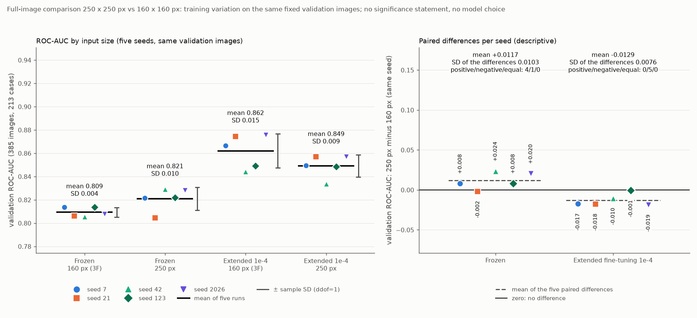

# Vollbildvergleich mit 250 × 250 Pixeln (Schritt 4A)

Stand: 20.10.2026. Ursprünglich mit den früheren Treibern erzeugt, heute entsprechend: `analysis/03_classification.py`, `src/busbra/models.py`, `src/busbra/training.py` und `plots/plot_resolution250_results.py`. Alle Zahlen stammen aus `reports/tables/resolution250_*.csv`, `resolution250_status.json`, `resolution250_study_config.json`, `resolution250_calibration.json` und den zehn Laufverzeichnissen unter `reports/tables/resolution250/` (Studie `res250-cb0ccf81`, Plan-SHA-256 `cb0ccf8177a890a7…`). Die 160-Pixel-Partner sind die Läufe der Studie 3F ([multiseed_comparison.md](multiseed_comparison.md)); sie wurden gelesen (Hashes geprüft), nicht neu gerechnet.

## Frage und Umfang

Verändert die Eingabegröße 250 × 250 statt 160 × 160 das Validation-Ergebnis der Vollbild-Pipeline? Verglichen werden auf demselben case-getrennten Split, mit denselben fünf Seeds (7, 21, 42, 123, 2026) und derselben Bildreihenfolge nur die beiden dafür nötigen MobileNetV2-Varianten: der **Frozen-Kopf** und das **erweiterte Fine-Tuning** der zehn Faltungen aus 3D/3E (Adam 1e-4, Start vom besten 250-Frozen-Checkpoint desselben Seeds). Alles andere folgt dem akzeptierten Protokoll der Studie 3F: Backbone-Architektur, vollständig feste BatchNorm-Schichten, Dropout 0,3, horizontaler Flip als einzige Augmentation (nur Training), Loss, Epochengrenzen (30 bzw. 20), Early Stopping (`val_loss`, Geduld 5), Checkpoint nach Validation-Loss, Seedabbildung (Flip s+1, Dropout s+2, Shuffle s+3, `PYTHONHASHSEED`), frischer Optimierer je Lauf. Ein Detailgewinn durch die höhere Auflösung war eine Hypothese, keine Vorgabe. Nicht Teil dieses Schritts: neue Augmentation (Schritt 4B), Schwellenanalyse, Masken, ROI, Modell- oder Schwellenfestlegung. **Die Testdaten wurden nicht verwendet** (je Lauf genau 1.499 PNG-Dateien, Train und Validation, kein Treffer auf Test oder Masken).

## Eingabevertrag

Extern `(N, 250, 250, 1)`, `float32`, [0, 1]: das ganze Graustufenbild, Seitenverhältnis erhalten, bilineares Verkleinern, zentriertes schwarzes Padding; Train und Validation erhalten dieselbe deterministische Umwandlung, zufällige Operationen gibt es nur im Training. Alle Train-/Validation-Bilder haben eine längere Seite von mindestens 261 Pixeln: 250 Pixel ist also immer eine Verkleinerung, nie eine Vergrößerung (bei 160 Pixel ebenfalls). Im Modell: Flip (nur Training), drei identische Kanäle, `Rescaling(2, −1)`; der Backbone liefert `(N, 8, 8, 1280)` statt `(N, 5, 5, 1280)`; die Anzahl der Parameter ist unverändert (2.259.265; trainierbar 1.281 bzw. 1.512.001).

## Gewichte: Übertrag vom 160er Backbone

Die offizielle ImageNet-Gewichtsdatei existiert für 160-Pixel-Backbones. Die lokale Datei (9.406.464 Bytes, SHA-256 `1e9310d9…8bf04e`; der Hash identifiziert nur die lokale Datei) wird in einen 160-Backbone (`include_top=False`) gelesen, ein 250-Backbone mit Zufallsgewichten gebaut und **nur** die Backbone-Werte kopiert, nachdem Anzahl, Typ, Name und Gewichts-Shapes aller 154 Layer verglichen wurden (260 Gewichtstensoren in 104 Layern; nur der automatisch nummerierte Name der `InputLayer` wird ignoriert). Bei 250 Pixeln passt Keras das Padding zweier Faltungen an die Parität der Feldgröße an (`block_1_pad`: `((0,1),(0,1))` → `((1,1),(1,1))`, ebenso `block_3_pad`); diese Layer haben keine Gewichte. Der Fingerabdruck des kopierten 250-Backbones ist für **jeden Seed vor dem Kopftraining** gleich dem des vortrainierten 160-Backbones und gleich dem akzeptierten 3B-Wert `03276b4c…807ba3` (zuvor je Seed verschiedene Zufallsgewichte, z. B. Seed 7: `fbaf5299…`). Es wurde nichts heruntergeladen, es gibt keinen Rückfall auf Zufallsgewichte, und es wurde kein auf BUS-BRA trainierter Kopf übernommen (der neue Kopf jedes Seeds unterscheidet sich von allen trainierten 160er Köpfen; er ist für alle fünf Seeds bitgleich zum anfänglichen, noch untrainierten 160er Frozen-Kopf desselben Seeds, weil dieselbe Initialisierungsfolge gilt – informativ aufgezeichnet, nicht verlangt). Der 160er Frozen-Checkpoint ist kein Start für das 250er Fine-Tuning: jeder Fine-Tuning-Lauf startet von seinem eigenen 250er Frozen-Checkpoint desselben Seeds (Netzgewichte in einen frisch gebauten 250-Graphen kopiert, frische Generatoren, Adam mit 0 Iterationen) und reproduziert dessen gespeicherte Scores innerhalb 1e-5.

## Batchgröße und GPU

Vor der Studie wurde die gemeinsame Batchgröße mit einer realistischen 250er GPU-Probe bestimmt (erweitertes Fine-Tuning, vier echte Trainingsschritte im kompilierten Graphen, danach ein Validation-Durchlauf über 64 Bilder, jeder Versuch in einem eigenen Prozess; Reihenfolge 16, 8, 4): **Batchgröße 16 passte** (Allokator-Spitze 1.104 MiB, Wert 16 wie in 3F), die Größe ist im Plan für alle Läufe eingefroren. Der Auflösungsvergleich weicht damit **nicht** durch die Batchgröße von 3F ab. Memory Growth vor der Initialisierung, weiche Platzierung aus, keine Speichergrenze, CUDA-Bibliotheken nur aus der `.venv`; je Lauf Probe auf 16 Trainingsbildern mit allen vorgesehenen Gradienten (2 bzw. 12) auf GPU:0, endlich, Probeupdate nur in den zulässigen Gruppen, danach vollständiger Neuaufbau (Reset-Nachweis: Startgewichte, Gruppen-Fingerabdrücke und frische Generatoren gleich dem geplanten Start, Adam bei 0). Dem Prozess standen laut TensorFlow gut 2,1 GiB GPU-Speicher zur Verfügung (4-GiB-Karte, Rest durch andere Anwendungen belegt); gemessene Allokator-Spitzen im Training: **Frozen 1.034 MiB, Fine-Tuning 1.885 MiB** (`nvidia-smi` des Prozesses 1.142 bzw. 2.170 MiB). Das Fine-Tuning bei 250 Pixeln läuft damit nahe an der verfügbaren Grenze; bei weniger freiem Speicher wäre es nicht ausführbar. Ein Speicherfehler innerhalb der Studie wäre ein technischer Fehler des Laufs (kein Neustart, keine Änderung der Größe); er trat nicht auf.

## Ergebnisse je Seed (Validation, 385 Bilder / 213 Cases)

Epoche = beste Epoche (kleinster Validation-Loss); Schwelle 0,5 nur deskriptiv; Konfusion TN/FP/FN/TP.

| Seed | Variante | beste Ep. / Epochen | Stopp | Batch | GPU-Spitze (MiB) | ROC-AUC | AP | Sens. | Spez. | TN/FP/FN/TP |
|---|---|---|---|---:|---:|---:|---:|---:|---:|---|
| 7 | Frozen 250 | 19 / 24 | Early Stopping | 16 | 1.034 | 0,8217 | 0,6921 | 0,512 | 0,896 | 233/27/61/64 |
| 7 | erweitert 1e-4, 250 | 3 / 8 | Early Stopping | 16 | 1.885 | 0,8494 | 0,7414 | 0,728 | 0,831 | 216/44/34/91 |
| 21 | Frozen 250 | 6 / 11 | Early Stopping | 16 | 1.034 | 0,8045 | 0,6605 | 0,320 | 0,950 | 247/13/85/40 |
| 21 | erweitert 1e-4, 250 | 6 / 11 | Early Stopping | 16 | 1.885 | 0,8569 | 0,7132 | 0,624 | 0,885 | 230/30/47/78 |
| 42 | Frozen 250 | 24 / 29 | Early Stopping | 16 | 1.034 | 0,8290 | 0,7028 | 0,456 | 0,915 | 238/22/68/57 |
| 42 | erweitert 1e-4, 250 | 2 / 7 | Early Stopping | 16 | 1.886 | 0,8338 | 0,7360 | 0,464 | 0,923 | 240/20/67/58 |
| 123 | Frozen 250 | 17 / 22 | Early Stopping | 16 | 1.034 | 0,8218 | 0,6874 | 0,480 | 0,900 | 234/26/65/60 |
| 123 | erweitert 1e-4, 250 | 6 / 11 | Early Stopping | 16 | 1.882 | 0,8486 | 0,7188 | 0,552 | 0,923 | 240/20/56/69 |
| 2026 | Frozen 250 | 27 / 30 | Epochenlimit | 16 | 1.034 | 0,8282 | 0,6924 | 0,560 | 0,873 | 227/33/55/70 |
| 2026 | erweitert 1e-4, 250 | 6 / 11 | Early Stopping | 16 | 1.886 | 0,8571 | 0,7469 | 0,776 | 0,842 | 219/41/28/97 |

Der Frozen-Lauf von Seed 2026 erreichte das 30-Epochen-Limit (beste Epoche 27); alle übrigen Läufe stoppten durch Early Stopping. Training je Lauf 45–161 s, Worker-Laufzeit 75–184 s, Koordinator-Wandzeit 20,1 min.

## Zusammenfassung und gepaarte Seed-Differenzen

Mittelwert und Stichproben-SD (ddof=1) über die fünf Läufe; die 160er Werte stammen aus 3F.

| Gruppe | ROC-AUC Mittel | SD | min – max | AP Mittel | SD | Sens. (0,5) | Spez. (0,5) |
|---|---:|---:|---|---:|---:|---|---|
| Frozen 160 px (3F) | 0,8094 | 0,0041 | 0,8054 – 0,8137 | 0,7058 | 0,0106 | 0,442 ± 0,041 | 0,936 ± 0,006 |
| Frozen 250 px | 0,8210 | 0,0099 | 0,8045 – 0,8290 | 0,6870 | 0,0159 | 0,466 ± 0,090 | 0,907 ± 0,028 |
| erweitert 1e-4, 160 px (3F) | 0,8621 | 0,0146 | 0,8441 – 0,8759 | 0,7561 | 0,0305 | 0,678 ± 0,074 | 0,865 ± 0,062 |
| erweitert 1e-4, 250 px | 0,8492 | 0,0095 | 0,8338 – 0,8571 | 0,7313 | 0,0146 | 0,629 ± 0,127 | 0,881 ± 0,044 |

**Gepaarte Differenzen 250 px minus 160 px** (je Seed, Mittel und SD der fünf Differenzen direkt berechnet; Vorzeichen positiv/negativ/gleich bei Toleranz 1e-12). Alle Metriken in `resolution250_paired_summary.csv`.

| Vergleich | Metrik | Mittel | SD | Werte je Seed (7, 21, 42, 123, 2026) | +/−/= |
|---|---|---:|---:|---|---|
| **erweitert 1e-4: 250 minus 160** | ROC-AUC | **−0,0129** | 0,0076 | −0,0173; −0,0176; −0,0103; −0,0007; −0,0188 | 0 / 5 / 0 |
| | Average Precision | −0,0248 | 0,0335 | −0,0228; −0,0539; +0,0318; −0,0411; −0,0380 | 1 / 4 / 0 |
| | Sensitivität (0,5) | −0,0496 | 0,1464 | +0,120; −0,032; −0,280; −0,064; +0,008 | 2 / 3 / 0 |
| | Spezifität (0,5) | +0,0162 | 0,0833 | −0,085; −0,023; +0,142; +0,019; +0,027 | 3 / 2 / 0 |
| Frozen: 250 minus 160 | ROC-AUC | +0,0117 | 0,0103 | +0,0080; −0,0017; +0,0236; +0,0082; +0,0204 | 4 / 1 / 0 |
| | Average Precision | −0,0188 | 0,0149 | −0,0222; −0,0327; +0,0016; −0,0317; −0,0087 | 1 / 4 / 0 |
| | Sensitivität (0,5) | +0,0240 | 0,0686 | +0,008; −0,072; +0,032; +0,032; +0,120 | 4 / 1 / 0 |
| | Spezifität (0,5) | −0,0292 | 0,0319 | −0,035; +0,019; −0,019; −0,046; −0,065 | 1 / 4 / 0 |
| Fine-Tuning minus Frozen, 250 px | ROC-AUC | +0,0281 | 0,0169 | +0,0276; +0,0525; +0,0048; +0,0267; +0,0289 | 5 / 0 / 0 |
| Fine-Tuning minus Frozen, 160 px (3F) | ROC-AUC | +0,0527 | 0,0156 | +0,0529; +0,0683; +0,0387; +0,0356; +0,0681 | 5 / 0 / 0 |

## Beobachtungen (deskriptiv, ohne Signifikanz- oder Überlegenheitsaussage)

- **Erweitertes Fine-Tuning:** Bei 250 Pixeln liegt die Validation-ROC-AUC im Mittel 0,013 unter dem 160er Partner, in allen fünf Seeds (die Differenzen reichen von −0,0007 bis −0,0188). Die Average Precision sinkt im Mittel ebenfalls (in vier von fünf Seeds). Sensitivität und Spezifität bei 0,5 streuen stark und ohne einheitliche Richtung. Ein Detailgewinn durch die höhere Auflösung ist hier nicht zu sehen.
- **Frozen-Kopf:** Die ROC-AUC liegt im Mittel 0,012 über dem 160er Partner (vier von fünf Seeds positiv, Seed 21 −0,0017), die Average Precision im Mittel 0,019 darunter (vier von fünf Seeds negativ). Die beiden Metriken zeigen hier nicht in dieselbe Richtung.
- **Abstand Fine-Tuning zu Frozen** ist bei 250 Pixeln (+0,028) kleiner als bei 160 (+0,053), in beiden Auflösungen in allen fünf Seeds positiv. Das Fine-Tuning stoppt bei 250 Pixeln früh (beste Epoche 2–6).
- Eine Ursache wurde nicht untersucht (etwa der Zusammenhang zwischen der Auflösung der Vortraining-Gewichte, der Feldgröße 8 × 8 und dem Fine-Tuning). Fünf gepaarte Seeds zeigen eine Tendenz und beweisen keine Überlegenheit auf neuen Daten; Unterschiede dieser Größe liegen teilweise in der Größenordnung der Streuung zwischen Seeds.

## Technische Abweichungen (und ihre Bedeutung für den Vergleich)

1. **Gewichtsübertrag über den 160er Backbone** (siehe oben): technisch notwendig, weil die offizielle Datei nur für 160 Pixel vorliegt; die übertragenen Werte sind bitgleich zu den 160er Werten, der Vergleich startet also von denselben vortrainierten Backbone-Werten.
2. **Kompilierte Probe und Kalibrierung:** Der eager-Gradiententape der 3F-Probe hält bei 250 Pixeln alle Aktivierungen (Speicherfehler beim Vorversuch der Kalibrierung); die Probe der neuen Läufe führt denselben Schritt (Vorwärtslauf, Verlust, alle Gradienten, ein Optimiererschritt, Gradientenplatzierung auf GPU:0) als kompilierte Funktion aus, wie `model.fit`. Das ändert nur die Probe, nicht das Training; die Gradienten- und Platzierungsnachweise sind gleich vollständig.
3. **Kein Unterschied** in Batchgröße, Lernraten, Epochengrenzen, Callbacks, Freigabe, Augmentation und Seedabbildung zu 3F. Vor dem echten Lauf wurde der Ablauf einmal in einer isolierten Kopie mit auf zwei Epochen gekürzten Läufen durchgespielt (Funktionstest, dabei die beiden Speicherprobleme entdeckt und behoben); dessen Werte sind nicht Teil der Studie und werden nicht berichtet.
4. Wie in 3F wurde ein Training mit hinterlassenem Checkpoint oder History und fehlgeschlagener Auswertung durch Koordinator und Worker weder gelöscht noch neu trainiert, sondern als `recovery_required` gemeldet (hier nicht aufgetreten; im Test belegt).

## Grenzen

- Trainingsstreuung auf denselben 385 Validation-Bildern (fünf gepaarte Seeds), keine Aussage über neue Splits, Einrichtungen oder Kohorten; mehrere Bilder eines Cases sind abhängig; die Validation wurde bereits mehrfach für die Entwicklung verwendet, das Ausmaß einer optimistischen Bewertung ist unbestimmt.
- Keine p-Werte, Konfidenzintervalle, Gewinnerregel, gepoolte Seed-AUC, kein Ensemble, keine Wahl eines besten Seeds; keine Modell- oder Schwellenfestlegung für den Test.
- Die beiden Partner jedes Seeds starten von verschiedenen Frozen-Läufen (160 bzw. 250); Unterschiede enthalten deshalb auch die Streuung des Frozen-Trainings. GPU-Training ist nicht bitgleich reproduzierbar.
- Das Fine-Tuning bei 250 Pixeln benötigt nahe 1,9 GiB GPU-Speicher; auf einer anderen Auslastung der Grafikkarte könnte es nicht ausführbar sein.

## Prüfungen

Gezielt geprüft (ohne zusätzliches Training; Fehlerfälle in isolierten Kopien mit abgefangenen Worker-Starts):
- **Größe und Gewichtsübertrag** an den echten Modellen: Formen `(N, 250, 250, 1)` und `(N, 8, 8, 1280)`; die Layer-Vergleichsprüfung akzeptiert die echten Backbones und lehnt einen anderen Breitenfaktor (Gewichts-Shapes), eine andere Layer-Zahl (mit Klassifikationskopf) und einen umbenannten Layer ab; jede der 260 übertragenen Arrays ist bitgleich; Kopf und Generatoren bleiben unberührt; ein 250er Checkpoint speichert und lädt.
- **Gewichtsdatei:** eine veränderte oder fehlende lokale Datei stoppt den Koordinator vor jedem Worker; es wird nichts geladen oder ersetzt, der Quelltext enthält keinen Download- und keinen Netzwerkaufruf.
- **Kalibrierung:** passt keine Größe (16, 8, 4), werden Befund und Fehlerstatus dokumentiert, es gibt keinen Plan, keinen Lauf und keinen Wechsel auf 224 Pixel; bei Speicherfehler mit 16 und Erfolg mit 8 friert die Kalibrierung 8 im Plan ein.
- **Wiederanlaufschutz:** Auswertungsfehler nach dem Training, fehlender Status, früher Platzhalterstatus und einzelner Checkpoint werden im Koordinator und im direkten Worker abgewiesen (Worker vor jedem NumPy-/pandas-/TensorFlow-Import), alles bleibt byte-identisch, wiederholte Abweisungen löschen nichts; frühe Fehler ohne Artefakte bleiben fortsetzbar; die vollständige Studie wird mit null Worker-Starts validiert; ein manipulierter Lauf und ein geänderter Plan (Größe 224) stoppen; ein falsches Umfeld stoppt beim Interpretercheck.
- **Studienevidenz:** zehn Läufe mit zehn Run-IDs, Plan nach der Kalibrierung und vor dem ersten Training registriert, GPU:0-Nachweise, Reset, Generatoren, Optimiererrate, Batchgröße, 1.499 PNG-Dateien je Lauf, Fingerabdrücke, Quellenketten, Ausgabehashes; Neuberechnung von ROC-AUC, AP und Konfusion aller 20 gespeicherten Scoresätze aus den Scores; dieselben 385 Validation-IDs, Cases und Labels in allen 20 (10 neuen, 10 Referenz-)Läufen.
- Die Abbildung entsteht aus den Tabellen ohne TensorFlow und Keras und ist byte-identisch reproduzierbar. Syntax, `pip check` und Paketstand unverändert; alle früheren Modelle, Tabellen, Status, Configs, Vorhersagen, Grafiken, Skripte und Module, die 25 Läufe der Studie 3F sowie Audit, Split, Rohdaten und Environment-Berichte per Hash unverändert.

## Quellen

- Sandler, M. et al.: MobileNetV2: Inverted Residuals and Linear Bottlenecks, CVPR 2018.
- Keras-Leitfaden Transfer Learning und Fine-Tuning: https://keras.io/guides/transfer_learning/
- Bouthillier, X. et al.: Accounting for Variance in Machine Learning Benchmarks, 2021, https://arxiv.org/abs/2103.03098
- Datensatz: Gómez-Flores et al., *Medical Physics* 51 (2024), https://doi.org/10.1002/mp.16812 (Lizenzhinweise siehe README).
