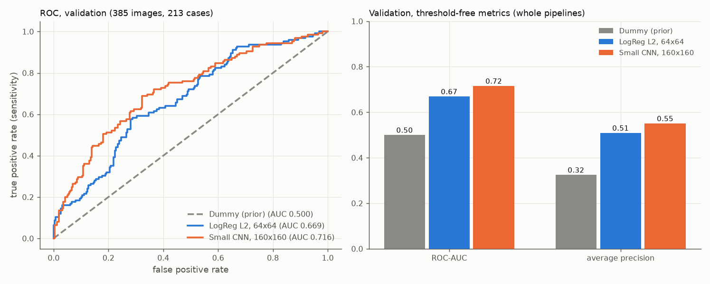

# Kleines CNN

Stand: 19.10.2026. Ursprünglich mit den früheren Treibern erzeugt, heute entsprechend: `analysis/03_classification.py` und den Hilfsmodulen in `src/busbra/` (`models.py`, `evaluation.py`, `image_processing.py`). Alle Zahlen stammen aus `reports/tables/small_cnn_*.csv`, `model_comparison_validation.csv` und `small_cnn_status.json`.

## Umfang

Genau ein kleines CNN, ein vollständiger Trainingslauf auf Train mit Validation zur Auswahl des Checkpoints. Kein MobileNetV2, kein Fine-Tuning, keine Interpretationsmethode, kein Robustheitstest, keine Segmentierung. **Die Testdaten wurden nicht verwendet**: Es wurden weder Testbilder dekodiert noch Testvorhersagen erzeugt. Eine Aufzeichnung der geöffneten PNG-Dateien zeigt genau die 1.499 Train- und Validation-Bilder und keine Test-, Masken- oder Kontaktübersichtsdatei.

Grundlage ist der eingefrorene Split (`manifest_split.csv`, SHA-256 `fdce9bc9…8349a`, unverändert; train 1.114 Bilder / 639 Cases, validation 385 / 213). Es ist ein fester Holdout aus den offiziellen äußeren Folds, keine Kreuzvalidierung. Positive Klasse: malignant = 1.

## Umgebung und GPU

Der Umgebungs-Check wurde nach Carlos Angabe am 19.10.2026 um 19:01:54 im tatsächlich verwendeten VS-Code-Interactive-Window ausgeführt. Der zugehörige lokale Bericht (`reports/tables/environment_check.json`) bestätigt: Status PASSED, Projektinterpreter (Python 3.13.14), TensorFlow 2.20.0, Keras 3.15.1, RTX 3050 Laptop mit 4096 MiB, alle 22 GPU-Operationsprüfungen bestanden, keine CUDA-Bibliotheken außerhalb der `.venv`, keine Warnungen. Dieser Check belegt nur die Umgebung; ein erfolgreiches Training belegt er nicht.

Das Training selbst lief im Terminal mit `env -u LD_LIBRARY_PATH .venv/bin/python analysis/03_classification.py`. Das Skript setzt Memory Growth vor der GPU-Initialisierung, deaktiviert die weiche Geräteplatzierung (kein stiller Wechsel auf die CPU) und setzt keine Speichergrenze. Vor dem Training wurde mit dem echten CNN und einem Trainingsbatch von 16 Bildern geprüft, dass Modellvariablen, Vorwärtsrechnung, Loss und alle 10 Gradienten auf GPU:0 liegen, Loss und Gradienten endlich sind und ein Gradientenschritt die Gewichte verändert (Loss 0,6921 → 0,6883 nach einem Schritt). Danach wurden Sitzung, Seed und Modell zurückgesetzt und CNN samt Optimierer neu aufgebaut; die Anfangsgewichte des Hauptlaufs entsprechen denen des Probemodells vor seinem Gradientenschritt (Prüfsumme gleich). Nach dem Training waren alle Modellvariablen auf GPU:0; der TensorFlow-Allokator meldete einen Spitzenwert von ca. 665 MiB (697.178.624 Bytes im Status; Beobachtung dieses Laufs, nicht gesetzt), `nvidia-smi` zeigte für den Prozess 938 MiB. Es wurde kein CPU-Fallback verwendet und kein Wiederanlauf mit kleinerer Batchgröße benötigt.

## Datenweg

Wie bei den Baselines: Originalbild aus `image_relpath`, Graustufen, tatsächlich dekodierte Größe (gegen den geprüften Wert im Manifest abgeglichen), das **gesamte** Bild wird proportional (bilinear) auf höchstens 160 × 160 gebracht und zentriert auf schwarzem Grund aufgefüllt; kein Strecken, kein Zuschnitt. Eingabe `(N, 160, 160, 1)`, `float32`, Werte in [0, 1]; die Division durch 255 geschieht genau einmal in der Aufbereitung, das Modell enthält keine weitere Skalierung und keine gelernte Standardisierung. Die Vorberechnung erfolgt im CPU-RAM (Laden und Aufbereiten ca. 3,9 s Train und 1,4 s Validation), danach `tf.data`-Batches der Größe 16 einschließlich des letzten kleineren Batches (70 Trainings- und 25 Validation-Batches). Train wird mit Seed 42 über den gesamten Datensatz pro Epoche neu gemischt; Validation und alle Vorhersagen behalten die feste ID-Reihenfolge. Kein zufälliger `validation_split`, keine Klassengewichte, kein Oversampling.

Der gespeicherte Eingabevertrag (`models/small_cnn/small_cnn_config.json`, ebenso im Status) beschreibt die CNN-Eingabe als NHWC `(N, 160, 160, 1)`, ein Kanal, `float32`, Werte in [0, 1], ohne Abflachen; 25.600 steht dort nur als Pixelzahl je Bild.

## Modell und Training (einzige Konfiguration dieses Schritts)

| Bestandteil | Festlegung |
|---|---|
| Seed | `keras.utils.set_random_seed(42)` vor dem Modellaufbau |
| Augmentation | `RandomFlip("horizontal", seed=42)`, nur im Training (reguläre Keras-Schicht) |
| Block 1–3 | `Conv2D` 32 / 64 / 128 Filter, 3×3, `same`, ReLU (benannt `conv1`–`conv3`), je gefolgt von `MaxPooling2D` 2×2 |
| Kopf | `GlobalAveragePooling2D`, `Dense` 64 ReLU, `Dropout` 0,3, `Dense` 1 Sigmoid |
| Parameter | 100.993, alle trainierbar (Zusammenfassung: `models/small_cnn/model_summary.txt`) |
| Optimierer / Loss | Adam (Lernrate 0,001), `BinaryCrossentropy(from_logits=False)` |
| Batchgröße / Epochen | 16 / höchstens 30 |
| Rechnung | `float32`, `jit_compile=False`, kein Mixed Precision |
| Auswahl | `EarlyStopping(monitor="val_loss", mode="min", patience=5, min_delta=0, restore_best_weights=True)` und `ModelCheckpoint(monitor="val_loss", mode="min", save_best_only=True, save_weights_only=False)` (lokal `models/small_cnn/small_cnn_best.keras`), außerdem `TerminateOnNaN` |

Early Stopping und Checkpoint richten sich nach demselben Validation-Loss; bei Gleichstand zählt die erste beste Epoche (an einer synthetischen Loss-Folge geprüft). Die Keras-Kennzahlen Accuracy und ROC-AUC laufen nur zur Verlaufsbeobachtung mit; die berichteten Metriken stammen aus den kontinuierlichen Scores und `src/busbra/evaluation.py`.

## Verlauf

- Early Stopping ist korrekt implementiert und an einer vorgegebenen Loss-Folge geprüft, wurde im Hauptlauf aber nicht ausgelöst: Das Training lief **bis zum Epochenlimit von 30 Epochen**, beste Epoche 28. Eine nachträgliche Verlängerung wäre eine gesonderte Modellierungsentscheidung und gehört nicht zu den Korrekturen dieses Schrittes. Das ist kein Fehler, bedeutet aber, dass der Validation-Loss am Ende noch nicht eindeutig stagnierte. Beste Epoche war **28** (Validation-Loss 0,5783); danach stieg er in den Epochen 29 und 30 leicht an. Der Checkpoint von Epoche 28 wurde wiederhergestellt.
- Gemessene Dauer in diesem Lauf: Training 90,1 s, Median 2,85 s je Epoche (die erste Epoche 7,2 s), Gesamtlauf mit Datenaufbereitung und Auswertung 111 s. Das sind Beobachtungen eines Laufs ohne Aussagekraft für andere Modelle oder Auflösungen.
- Lernkurven: `reports/figures/small_cnn_learning_curves.png`. Train-Loss und -AUC werden mit aktiver Spiegelung und Dropout berechnet, Validation ohne diese Schichten. Die beiden Kurven entstehen unter verschiedenen Bedingungen; ihr Abstand ist kein quantitativer Beleg einer Generalisierungslücke.

## Ergebnisse (bester Checkpoint, Schwelle 0,5, positive Klasse malignant)

Der Score ist die Sigmoid-Ausgabe des Modells (Score für Klasse 1) und nicht als kalibrierte Erkrankungswahrscheinlichkeit belegt. Hart vorhergesagt wird `Score >= 0,5`; es gibt keine Schwellenoptimierung und keine Kalibrierung. Die Vorhersagen entstehen aus dem von der Festplatte geladenen Checkpoint mit deaktivierter Augmentation und Dropout.

**Validation** (385 Bilder, 125 maligne; 213 Cases, 69 maligne):

| ROC-AUC | Average Precision | Sensitivität | Spezifität | Precision | F1 | Accuracy | TN | FP | FN | TP |
|---:|---:|---:|---:|---:|---:|---:|---:|---:|---:|---:|
| 0,7155 | 0,5507 | 0,4480 (56/125) | 0,8500 (221/260) | 0,5895 (56/95) | 0,5091 | 0,7195 | 221 | 39 | 69 | 56 |

**Train** (nur zur Beschreibung der Anpassung; 1.114 Bilder, 360 maligne; 639 Cases, 205 maligne): ROC-AUC 0,7350, Average Precision 0,5962, Sensitivität 0,4833 (174/360), Spezifität 0,8515 (642/754), Precision 0,6084 (174/286), F1 0,5387, Accuracy 0,7325, TN/FP/FN/TP = 642/112/186/174.

## Vergleich mit den Baselines (Validation)

Die Baseline-Werte stammen aus den vorhandenen Ergebnistabellen und wurden nicht neu berechnet; Split, Validation-Bild- und Case-Zahlen, positive Klasse, Schwelle und die Reihenfolge der Bilder sind geprüft gleich (`model_comparison_validation.csv`).

| Pipeline | Eingabe | ROC-AUC | AP | Sensitivität | Spezifität | Precision | F1 | Accuracy |
|---|---|---:|---:|---:|---:|---:|---:|---:|
| Dummy (Prior) | Pixel ignoriert | 0,5000 | 0,3247 | 0,000 | 1,000 | nicht definiert | 0,000 | 0,6753 |
| LogReg L2 | 64×64, 4.096 Pixelmerkmale | 0,6692 | 0,5092 | 0,376 | 0,781 | 0,452 | 0,411 | 0,6494 |
| Kleines CNN | 160×160×1, Flip im Training | 0,7155 | 0,5507 | 0,448 | 0,850 | 0,590 | 0,509 | 0,7195 |

**Einordnung (vorläufig, ohne Signifikanzbehauptung):**

- Das CNN liegt auf Validation in ROC-AUC (0,716 gegenüber 0,669) und Average Precision (0,551 gegenüber 0,509) über der logistischen Regression und bei der festen Schwelle in Sensitivität, Spezifität und Accuracy ebenfalls. Der Unterschied ist moderat; es gibt einen einzelnen Lauf mit einem Seed auf einem Holdout aus abhängigen Bildern, also keine Varianzschätzung und keine Signifikanz- oder Konfidenzaussage.
- Verglichen werden **ganze Pipelines**: Auflösung (160 gegenüber 64), Modellfamilie und Augmentation unterscheiden sich. Der Unterschied kann nicht allein der Architektur zugeschrieben werden.
- Die Validation dient der Checkpoint-Auswahl und ist deshalb keine unabhängige abschließende Leistungsbewertung. Das Ausmaß einer möglichen Auswahlverzerrung wurde nicht bestimmt. Die unabhängige Prüfung ist der Test in der Abschlussphase.
- Im Gegensatz zur logistischen Regression (Train 0,992, Validation 0,669) liegen Train und Validation beim CNN eng beieinander (0,735 gegenüber 0,716); das CNN passt die Trainingsdaten also deutlich weniger stark an. Zusammen mit dem Erreichen des Epochenlimits deutet das darauf hin, dass die Konfiguration nach 30 Epochen noch nicht ausgereizt ist. Eine Verlängerung oder Änderung wurde in diesem Schritt bewusst nicht vorgenommen.
- Ob das CNN bildinhaltliche Merkmale oder gerätespezifische Hinweise nutzt, ist nicht untersucht. Der horizontale Flip erhält die Klasse, entfernt aber eingebrannte Marker nicht.

## Prüfungen und Reproduzierbarkeit

- **Zwei vollständige Trainingsläufe, berichtet wird nur Lauf 2:** Der erste Lauf mit derselben Konfiguration lief vollständig durch (30 Epochen, beste Epoche 28, Validation-Loss 0,5770). Gescheitert ist die anschließende Vergleichsprüfung „wiederhergestelltes Modell = geladener Checkpoint“: Bei identischen Gewichten betrug die Scoreabweichung 6,57e-5 (Toleranz 1e-5). Das Modell war dadurch nicht grundsätzlich unbrauchbar; die Auswertung hätte nach Korrektur des Inferenzpfads grundsätzlich am gespeicherten Checkpoint wiederholt werden können. Tatsächlich wurde stattdessen ein zweites Mal vollständig trainiert. Berichtet wird ausschließlich Lauf 2, nicht der bessere von zwei Läufen und ohne Auswahl nach dem Ergebnis; die Belege des ersten Laufs (Protokoll, Fehlerstatus, Verlauf) sind nicht Teil des Repositories. Künftige reine Auswertungs- oder Metadatenkorrekturen rechtfertigen kein automatisches Neutraining.
- **Befund zur Abweichung (lokal beobachtet):** In einer Diagnose am gespeicherten Checkpoint des ersten Laufs (ohne neues Training, 96 Validation-Bilder) meldete ein mit `load_model(..., compile=False)` geladenes Modell `jit_compile=True`; seine Scores wichen um ca. 5e-5 von denen desselben, mit `jit_compile=False` kompilierten Modells ab. Das gilt als lokaler Befund unter Keras 3.15.1 und TensorFlow 2.20.0 auf dieser GPU; eine allgemeine Aussage über andere Versionen, Modelle oder Geräte wird daraus nicht abgeleitet. Die vorab festgelegte Einstellung `jit_compile=False` gilt einheitlich für Training und Auswertung; geladene Modelle werden entsprechend kompiliert, und die Vergleichstoleranz 1e-5 blieb unverändert.
- **Wiederholbarkeit:** Zwischen den beiden Läufen mit demselben Seed unterscheidet sich der beste Validation-Loss (0,5770 gegenüber 0,5783) bei gleicher bester Epoche. Ein fester Seed unterstützt die Nachvollziehbarkeit, garantiert auf der GPU aber keine bytegleichen Trainingsläufe; in dieser Größenordnung sind Abweichungen zwischen Läufen zu erwarten.
- **Ladevergleich im zweiten Lauf:** Wiederhergestelltes bestes Modell gegen geladenen Checkpoint: maximale Scoreabweichung 0,0, maximale Gewichtsabweichung 0,0; erneutes Laden: Scoreabweichung 0,0 (Toleranz 1e-5).
- **Inferenzmodus:** Die Spiegelungsschicht lässt Bilder bei Inferenz unverändert und verändert sie im Trainingsmodus; wiederholte Vorhersagen sind identisch.
- **Auswahlmechanismus:** An einer vorgegebenen Loss-Folge mit einem kleinen Modell (ohne zweites Netztraining) wurde geprüft: erste beste Epoche bei Gleichstand, Abbruch nach genau fünf Epochen ohne Verbesserung, Wiederherstellung und Checkpoint der besten Epoche, kein Abbruch bei stetiger Verbesserung, `TerminateOnNaN`.
- **Fehlerfall:** Mit geänderter Split-Datei in einer isolierten Kopie endet das Skript mit Fehlerstatus, bevor Bilder oder TensorFlow benutzt werden; produktive Dateien blieben unverändert.

## Nachträgliche Metadatenkorrektur (19.10.2026, 19:46)

Konfiguration und Status des Laufs `cnn-20261019T192513-3cfd6ee8` hatten die Vorverarbeitungsbeschreibung der klassischen Baselines übernommen, die einen Abflach-Schritt (zeilenweise, `float64`, für scikit-learn) und `n_features: 25600` nennt. Das beschrieb die CNN-Eingabe falsch; das CNN erhielt und verarbeitete korrekt Arrays der Form `(N, 160, 160, 1)`. Korrigiert wurde ausschließlich diese **Beschreibung** (neuer Helfer `describe_cnn_preprocessing`; die Baseline-Beschreibung und ihr gespeicherter Vertrag blieben unverändert). Es gab **kein neues Training**. Run-ID, Zeitpunkte, Verlauf, Metriken, Vorhersagen, Checkpoint (SHA-256 `b9fc953b…e33e0`) und alle übrigen Ausgabe-Prüfsummen blieben gleich; geändert wurden nur der Eingabevertrag in der Konfigurationsdatei, der zugehörige Eintrag im Status samt neuem Hash der Konfigurationsdatei und ein Vermerk `metadata_corrections` mit Zeitstempel.

## Grenzen

- Ein fester Holdout, eine Einrichtung, abhängige Bilder je Case, ein Seed, ein Lauf.
- Die Konfiguration wurde vorab festgelegt und nicht anhand von Validation-Werten angepasst; trotzdem nutzt die Checkpoint-Wahl die Validation.
- Das Epochenlimit wurde erreicht; ein längeres Training könnte andere Werte liefern.
- Mögliche Gerätehinweise (eingebrannte Marker, Bildlayout, Größe) werden nicht entfernt; der Flip beseitigt sie nicht.
- Scores sind nicht als kalibrierte Wahrscheinlichkeiten belegt; die Schwelle 0,5 ist eine feste Konvention. Es gibt keine klinische Einsatzaussage.
- MobileNetV2, Interpretation (z. B. Grad-CAM), Robustheitstest und die Testauswertung folgen in späteren, gesondert freigegebenen Schritten.
