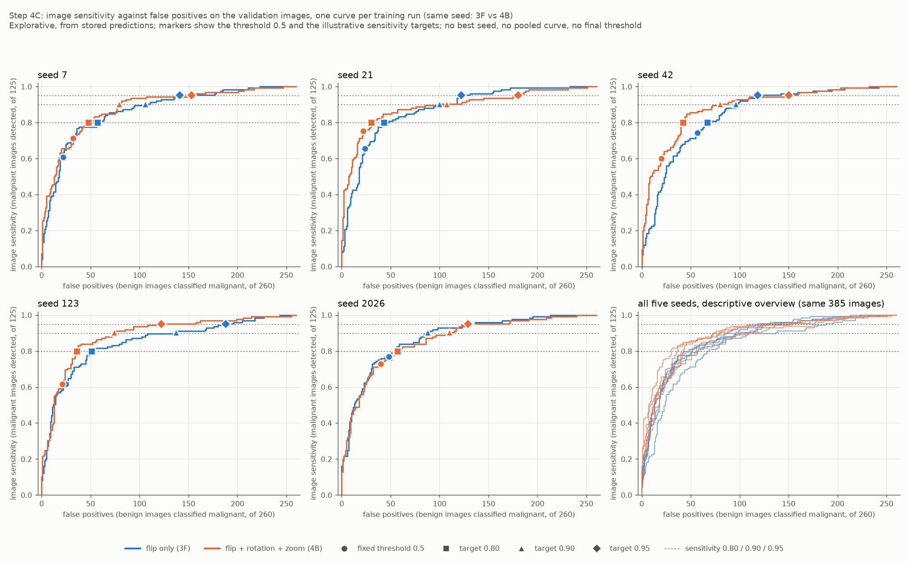

# Sensitivitätsorientierte Schwellenanalyse auf Validation (Schritt 4C)

Stand: 20.10.2026. Erzeugt mit `analysis/12_threshold_analysis.py` und `src/busbra/thresholds.py`. Schritt 4C ist nach unabhängigem Nachrechnen der Schwellenkurven, Konfusionszahlen und gepaarten Vergleiche technisch geprüft; die finale Schwelle bleibt offen (die Analyse ist explorativ und legt weder Checkpoint noch Schwelle fest). Alle Zahlen stammen aus den Dateien `reports/tables/threshold_analysis_*.csv`, `threshold_analysis_plan.json` und `threshold_analysis_status.json` (Analyse `thr4c-fcd7fed4`, Plan-SHA-256 `fcd7fed461e7d78a…`) sowie aus der Abbildung `reports/figures/threshold_analysis_sensitivity_vs_fp.png`. Es ist ein reiner Auswertungsschritt aus bereits gespeicherten Vorhersagen: kein Training, keine Inferenz, keine GPU, kein Öffnen von Bildern oder Masken, kein Zugriff auf die Testdaten.

## Frage und Umfang

Die 160-Pixel-Vollbild-Pipeline mit Flip, Rotation, Zoom und erweitertem MobileNetV2-Fine-Tuning (Adam 1e-4; Schritt 4B) erkennt bei der festen Schwelle 0,5 je Trainings-Seed 75 bis 94 der 125 malignen Validation-Bilder. Untersucht wird, wie sich bei verschobener Schwelle erkannte maligne Befunde (True Positives, TP) und Fehlalarme (False Positives, FP) zueinander verhalten und wie sich diese Abwägung gegenüber derselben Pipeline ohne Rotation und Zoom (Studie 3F, dieselben fünf Seeds) verhält. Die zwei Gruppen sind ausschließlich:

| Gruppe | Beschreibung |
|---|---|
| **3F** | erweitertes Fine-Tuning 1e-4, nur horizontaler Flip (Studie `ms3f-97e0f17c`, gelesen und nie neu gerechnet) |
| **4B** | erweitertes Fine-Tuning 1e-4, Flip + Rotation + Zoom (Studie `aug160-110415a4`) |

Je Gruppe sind es fünf eigenständig trainierte Checkpoints derselben Konfiguration (Seeds 7, 21, 42, 123, 2026), nicht ein einzelnes Modell. Die mittlere Validation-ROC-AUC von 0,8807 (4B) ist der Mittelwert der fünf Einzelwerte; für 3F beträgt sie 0,8621. Frozen-Köpfe, 250 Pixel und frühere Einseedläufe sind nicht Teil dieser Analyse.

**Explorativ.** Die Validation-Bilder wurden bereits mehrfach für Modell- und Epochenentwicklung genutzt. Die Suche nach Betriebspunkten liefert deshalb keine unabhängig geschätzte Leistungsfähigkeit. Die Sensitivitätsziele 0,80, 0,90 und 0,95 sind illustrative Beispiele für eine Analyse, keine klinisch festgelegten Anforderungen und keine Schwellenwahl. Es wird weder ein Modell noch ein Checkpoint noch eine Schwelle festgelegt; die Testdaten bleiben gesperrt. Die Scores sind Sigmoid-Ausgaben und nicht als kalibrierte Krebswahrscheinlichkeit belegt: Eine Schwelle von 0,3 bedeutet hier nicht „30 % Krebsrisiko“. Eine Änderung der Schwelle ändert Labels und Konfusionszahlen, nicht ROC-AUC, Average Precision (AP) oder die Gewichte. Ein F1- oder Accuracy-Maximum wird nicht als Auswahlziel verwendet.

## Quellen und Prüfung vor jeder Auswertung

- **Vorhersagen:** je Gruppe und Seed `reports/tables/<Studie>/seed_<s>/<Pipeline>/predictions.csv` (4B: `augmentation160/…/mobilenetv2_higher_lr_160_aug`, 3F: `multiseed/…/mobilenetv2_higher_lr_160`). Jede Datei enthält Train- und Validation-Zeilen; es wird **sofort nach dem Einlesen nur `subset == "validation"` behalten**, noch bevor Metriken oder Schwellen berechnet werden. Jeder andere Subset-Wert (auch `test`) bricht die Analyse ab, ohne etwas auszuwerten. Train-Scores werden nicht verwendet.
- **Kette der Prüfsummen:** festgelegte SHA-256-Werte der Studien-Konfigurationen, Studien-Status (4B: Trainingslauf `augmentation160_status_last_success.json`, Run `ms-20261020T023534-c6ae221b`, und Validierungsaufruf `augmentation160_status.json`, Run `ms-20261020T024800-786639f4`; 3F: `multiseed_status.json` und `multiseed_status_last_success.json`) und der Metriktabellen; Plan-Hash der Studie neu aus dem gespeicherten Plan berechnet (4B `110415a4b5bdf53e…`, 3F `97e0f17c595cc1de…`); `status = passed` und `complete = true`; je Lauf Run-ID, Hash der Lauf-Statusdatei (in beiden Studien-Status gleich) und Hash der Vorhersagedatei im Lauf-Status. Die Run-IDs der zehn Läufe stehen in `threshold_analysis_plan.json`.
- **Split:** `data/processed/manifest_split.csv` wird nur byteweise gehasht (SHA-256 `fdce9bc991b949cf…`, gleich dem eingefrorenen Wert); die Datei und ihre Testzeilen werden nicht geparst.
- **Provenienz der Augmentationsvorschau:** Die lokale Datei `data/processed/augmentation160_preview_train_only.png` hat den SHA-256 `ad6008b231f40b65…`, gleich dem im unveränderten 4B-Vorcheck-Bericht protokollierten Wert (das belegt die lokale Datei, nicht die Pixelidentität der angesehenen hochgeladenen Kopie, die einen anderen Datei-Hash hatte). Es werden nur ihre Bytes gehasht; das Bild wird nicht geöffnet. Bei Abweichung oder fehlender Datei bricht das Skript vor jedem Abnahmevermerk ab.
- **Validation-Vertrag je Lauf:** 385 Bilder, 213 Cases, davon 125 maligne Bilder (69 maligne Cases) und 260 benigne Bilder (144 benigne Cases); eindeutige IDs; Labels 0/1 (maligne = 1); ein Label je Case; endliche Scores in [0, 1]; der gespeicherte `predicted_label` entspricht `malignant_score >= 0,5` (Scoreorientierung unverändert); ID, Case und Label sind in allen zehn Läufen in gleicher Reihenfolge identisch.
- **Unabhängige Nachrechnung:** TN/FP/FN/TP bei 0,5, Sensitivität, Spezifität, Precision, F1, Accuracy, ROC-AUC und AP aller zehn Läufe werden aus den gespeicherten Validation-Scores neu berechnet und stimmen mit den gespeicherten Metrikzeilen überein (größte Abweichung unter 1e-9; im Prüfskript zusätzlich ROC-AUC mit der Rangformel und AP mit eigener Stufensumme: Abweichung unter 1e-15).

## Analyseplan (vor dem Einlesen der Validation-Scores registriert)

`reports/tables/threshold_analysis_plan.json` wird einmalig geschrieben, nachdem alle Quellen und Hashes geprüft sind und bevor ein Score gelesen wird (Registrierung 2026-10-20 03:24:59, danach unverändert; spätere Läufe müssen exakt diesen Plan reproduzieren, sonst stoppt die Analyse). Der Plan enthält keine Zeitangabe im gehashten Teil. Regeln:

- **Klassifikation:** `Score >= Schwelle` (inklusive), maligne = 1. Gleiche Scores bilden einen gemeinsamen Schritt der Kurve, sie können nur zusammen klassifiziert werden; die Reihenfolge der Eingabezeilen beeinflusst nichts.
- **Vollständige stückweise Kurve:** je Lauf ein Punkt je unterschiedlichem beobachteten Validation-Score (hier 385 verschiedene Scores, keine Gleichstandsgruppe), in absteigender Schwelle, davor der Randpunkt „alle negativ“ (Schwelle +∞, in den CSV-Dateien `inf`); der kleinste Score ist „alle positiv“.
- **Referenz und Raster:** feste Referenzschwelle 0,5 und ein kompaktes Raster 0,1 bis 0,9 in Schritten von 0,1 (ersetzt die exakten Score-Grenzen nicht).
- **Illustrative Sensitivitätsziele 0,80 / 0,90 / 0,95:** der **größte** Schwellenwert, der auf diesen Validation-Bildern mindestens das Ziel erreicht. Bei festem Ranking ist das der Betriebspunkt mit den wenigsten als positiv klassifizierten Bildern unter dieser Nebenbedingung; er entspricht dem k-ten größten Score der malignen Bilder, mit k = 100 / 113 / 119 von 125 (exakte Bruchrechnung: 0,80·125 = 100, 0,90·125 = 112,5 → 113, 0,95·125 = 118,75 → 119). Ein Punkt, der mindestens 90 % aller Bilder (347 von 385) als positiv klassifiziert, würde offen als „fast alle positiv“ markiert (bei keinem der 30 Zielpunkte der Fall; Höchstwert 79,7 %, siehe unten).
- **Case-Ebene:** Case-Score = **Maximum** der Bild-Scores des Cases; ein Case ist bei gleicher Schwelle positiv, sobald eines seiner Bilder positiv ist. Die Case-Konfusion (69 maligne, 144 benigne Cases) wird für dieselben, bildbasiert gefundenen Schwellen berichtet; es werden keine eigenen Case-Schwellen bestimmt. Die Labels sind je Case einheitlich (geprüft). **Bilder eines Cases sind voneinander abhängig, und ein Case ist ohne Beleg nicht mit einer unabhängigen Patientin gleichzusetzen.**
- **Gepaarter Vergleich 4B minus 3F innerhalb desselben Seeds**, getrennt in zwei Vergleichsarten (siehe unten); Mittel und Stichproben-SD (ddof = 1) der fünf Differenzen und Vorzeichenzählung; keine Addition von Konfusionszahlen über Seeds, keine gepoolte ROC-AUC, kein Ensemble, keine Konfidenzintervalle aus fünf Seeds.

## Zwei Arten des Vergleichs von 4B und 3F

1. **Gleicher numerischer Schwellenwert (0,5).** Beide Pipelines werden mit derselben Zahl geschnitten. Das Ergebnis hängt stark von der Scoreverteilung des jeweiligen Trainingslaufs ab: Ein Lauf, dessen Scores insgesamt höher liegen, hat bei 0,5 mehr positive Klassifikationen, ohne besser zu trennen. Die Differenzen bei 0,5 vergleichen daher Betriebspunkte, die nicht gleich „streng“ sind.
2. **Gleiches Sensitivitätsziel.** Jede Pipeline erhält die Schwelle, die das Ziel gerade noch erreicht; die Schwellen der beiden Pipelines (und der Seeds) dürfen und werden verschieden sein, und sie sind in den Tabellen angegeben. Hier ist die Zahl der Fehlalarme bei gleicher Zahl erkannter maligner Bilder (100, 113 bzw. 119 von 125) die vergleichbare Größe. Diese Schwellen stammen aus denselben 385 Bildern, auf denen sie bewertet werden (optimistisch). Eine Schwelle kann für denselben Checkpoint auf neue Bilder angewandt werden; die hier auf Validation erreichten Raten sind dort jedoch nicht garantiert, und Schwellen verschiedener Seeds (Checkpoints) sind nicht austauschbar.

## Ergebnisse

Alle Zählungen beziehen sich auf die 385 Validation-Bilder (125 maligne, 260 benigne) bzw. 213 Cases (69 maligne, 144 benigne). Die Einzelwerte aller fünf Seeds stehen in den Tabellen; Konfusionszahlen werden nicht über Seeds addiert.

### Schwellenunabhängige Maße (je Lauf einmal aus den unveränderten Scores)

| Gruppe | Seed | ROC-AUC | AP | verschiedene Scores | größte Gleichstandsgruppe |
|---|---:|---:|---:|---:|---:|
| 3F | 7 | 0,8666 | 0,7642 | 385 | 1 |
| 3F | 21 | 0,8745 | 0,7672 | 385 | 1 |
| 3F | 42 | 0,8441 | 0,7042 | 385 | 1 |
| 3F | 123 | 0,8493 | 0,7599 | 385 | 1 |
| 3F | 2026 | 0,8759 | 0,7849 | 385 | 1 |
| 4B | 7 | 0,8803 | 0,8002 | 385 | 1 |
| 4B | 21 | 0,8899 | 0,8407 | 385 | 1 |
| 4B | 42 | 0,8846 | 0,8021 | 385 | 1 |
| 4B | 123 | 0,8865 | 0,7977 | 385 | 1 |
| 4B | 2026 | 0,8622 | 0,7741 | 385 | 1 |

### Referenzschwelle 0,5, Bildebene

| Gruppe | Seed | TP | FN | FP | TN | Sens. (TP/125) | Spez. (TN/260) | Precision | positiv klass. |
|---|---:|---:|---:|---:|---:|---:|---:|---:|---:|
| 3F | 7 | 76 | 49 | 22 | 238 | 0,608 | 0,915 | 0,776 (76/98) | 98 |
| 3F | 21 | 82 | 43 | 24 | 236 | 0,656 | 0,908 | 0,774 (82/106) | 106 |
| 3F | 42 | 93 | 32 | 57 | 203 | 0,744 | 0,781 | 0,620 (93/150) | 150 |
| 3F | 123 | 77 | 48 | 25 | 235 | 0,616 | 0,904 | 0,755 (77/102) | 102 |
| 3F | 2026 | 96 | 29 | 48 | 212 | 0,768 | 0,815 | 0,667 (96/144) | 144 |
| 4B | 7 | 89 | 36 | 32 | 228 | 0,712 | 0,877 | 0,736 (89/121) | 121 |
| 4B | 21 | 94 | 31 | 22 | 238 | 0,752 | 0,915 | 0,810 (94/116) | 116 |
| 4B | 42 | 75 | 50 | 20 | 240 | 0,600 | 0,923 | 0,789 (75/95) | 95 |
| 4B | 123 | 77 | 48 | 21 | 239 | 0,616 | 0,919 | 0,786 (77/98) | 98 |
| 4B | 2026 | 91 | 34 | 40 | 220 | 0,728 | 0,846 | 0,695 (91/131) | 131 |

### Referenzschwelle 0,5, Case-Ebene (Maximum der Bild-Scores)

| Gruppe | Seed | Case-TP | Case-FN | Case-FP | Case-TN | Case-Sens. (/69) | Case-Spez. (/144) | Case-Precision |
|---|---:|---:|---:|---:|---:|---:|---:|---:|
| 3F | 7 | 51 | 18 | 18 | 126 | 0,739 | 0,875 | 0,739 (51/69) |
| 3F | 21 | 53 | 16 | 19 | 125 | 0,768 | 0,868 | 0,736 (53/72) |
| 3F | 42 | 62 | 7 | 45 | 99 | 0,899 | 0,688 | 0,579 (62/107) |
| 3F | 123 | 53 | 16 | 20 | 124 | 0,768 | 0,861 | 0,726 (53/73) |
| 3F | 2026 | 60 | 9 | 40 | 104 | 0,870 | 0,722 | 0,600 (60/100) |
| 4B | 7 | 61 | 8 | 28 | 116 | 0,884 | 0,806 | 0,685 (61/89) |
| 4B | 21 | 59 | 10 | 18 | 126 | 0,855 | 0,875 | 0,766 (59/77) |
| 4B | 42 | 52 | 17 | 16 | 128 | 0,754 | 0,889 | 0,765 (52/68) |
| 4B | 123 | 52 | 17 | 17 | 127 | 0,754 | 0,882 | 0,754 (52/69) |
| 4B | 2026 | 59 | 10 | 33 | 111 | 0,855 | 0,771 | 0,641 (59/92) |

### Kompaktes Raster 0,1–0,9 (Bildebene, Zellen: TP/FP; die exakten Kurven stehen in `threshold_analysis_curves.csv`)

| Gruppe | Seed | 0,1 | 0,2 | 0,3 | 0,4 | 0,5 | 0,6 | 0,7 | 0,8 | 0,9 |
|---|---:|---:|---:|---:|---:|---:|---:|---:|---:|---:|
| 3F | 7 | 115/117 | 107/72 | 97/51 | 87/30 | 76/22 | 59/15 | 37/7 | 27/4 | 13/1 |
| 3F | 21 | 113/108 | 108/77 | 101/51 | 94/37 | 82/24 | 58/18 | 42/8 | 5/0 | 0/0 |
| 3F | 42 | 121/168 | 119/128 | 112/96 | 105/81 | 93/57 | 79/38 | 55/21 | 27/9 | 13/1 |
| 3F | 123 | 112/119 | 104/75 | 102/54 | 89/37 | 77/25 | 71/19 | 57/11 | 41/8 | 19/2 |
| 3F | 2026 | 122/175 | 118/129 | 115/98 | 105/68 | 96/48 | 80/27 | 61/12 | 29/6 | 10/0 |
| 4B | 7 | 120/165 | 118/127 | 115/84 | 104/54 | 89/32 | 71/17 | 54/10 | 34/3 | 14/1 |
| 4B | 21 | 116/135 | 112/97 | 109/63 | 106/45 | 94/22 | 69/10 | 53/3 | 32/1 | 19/1 |
| 4B | 42 | 116/103 | 109/66 | 99/42 | 84/32 | 75/20 | 65/12 | 53/7 | 43/5 | 28/2 |
| 4B | 123 | 121/174 | 118/116 | 113/74 | 95/34 | 77/21 | 52/13 | 31/4 | 19/1 | 6/0 |
| 4B | 2026 | 119/163 | 117/121 | 109/90 | 100/58 | 91/40 | 75/23 | 59/12 | 43/8 | 27/3 |

### Sensitivitätsziel 0,80 (100 von 125 malignen Bildern), Bildebene

| Gruppe | Seed | Schwelle | TP | FN | FP | TN | Sens. | Spez. | Precision | positiv klass. (Anteil) | fast alle positiv |
|---|---:|---:|---:|---:|---:|---:|---:|---:|---:|---:|---|
| 3F | 7 | 0,2674 | 100 | 25 | 57 | 203 | 0,800 (100/125) | 0,781 (203/260) | 0,637 | 157 (0,408) | nein |
| 3F | 21 | 0,3497 | 100 | 25 | 43 | 217 | 0,800 (100/125) | 0,835 (217/260) | 0,699 | 143 (0,371) | nein |
| 3F | 42 | 0,4507 | 100 | 25 | 67 | 193 | 0,800 (100/125) | 0,742 (193/260) | 0,599 | 167 (0,434) | nein |
| 3F | 123 | 0,3247 | 100 | 25 | 51 | 209 | 0,800 (100/125) | 0,804 (209/260) | 0,662 | 151 (0,392) | nein |
| 3F | 2026 | 0,4684 | 100 | 25 | 56 | 204 | 0,800 (100/125) | 0,785 (204/260) | 0,641 | 156 (0,405) | nein |
| 4B | 7 | 0,4301 | 100 | 25 | 48 | 212 | 0,800 (100/125) | 0,815 (212/260) | 0,676 | 148 (0,384) | nein |
| 4B | 21 | 0,4569 | 100 | 25 | 30 | 230 | 0,800 (100/125) | 0,885 (230/260) | 0,769 | 130 (0,338) | nein |
| 4B | 42 | 0,2991 | 100 | 25 | 42 | 218 | 0,800 (100/125) | 0,838 (218/260) | 0,704 | 142 (0,369) | nein |
| 4B | 123 | 0,3929 | 100 | 25 | 36 | 224 | 0,800 (100/125) | 0,862 (224/260) | 0,735 | 136 (0,353) | nein |
| 4B | 2026 | 0,4044 | 100 | 25 | 57 | 203 | 0,800 (100/125) | 0,781 (203/260) | 0,637 | 157 (0,408) | nein |

Case-Ebene bei denselben Schwellen:

| Gruppe | Seed | Schwelle (Bild) | Case-TP | Case-FN | Case-FP | Case-TN | Case-Sens. | Case-Spez. | Case-Precision |
|---|---:|---:|---:|---:|---:|---:|---:|---:|---:|
| 3F | 7 | 0,2674 | 63 | 6 | 46 | 98 | 0,913 (63/69) | 0,681 (98/144) | 0,578 |
| 3F | 21 | 0,3497 | 64 | 5 | 34 | 110 | 0,928 (64/69) | 0,764 (110/144) | 0,653 |
| 3F | 42 | 0,4507 | 64 | 5 | 53 | 91 | 0,928 (64/69) | 0,632 (91/144) | 0,547 |
| 3F | 123 | 0,3247 | 62 | 7 | 42 | 102 | 0,899 (62/69) | 0,708 (102/144) | 0,596 |
| 3F | 2026 | 0,4684 | 63 | 6 | 46 | 98 | 0,913 (63/69) | 0,681 (98/144) | 0,578 |
| 4B | 7 | 0,4301 | 62 | 7 | 39 | 105 | 0,899 (62/69) | 0,729 (105/144) | 0,614 |
| 4B | 21 | 0,4569 | 63 | 6 | 26 | 118 | 0,913 (63/69) | 0,819 (118/144) | 0,708 |
| 4B | 42 | 0,2991 | 64 | 5 | 35 | 109 | 0,928 (64/69) | 0,757 (109/144) | 0,646 |
| 4B | 123 | 0,3929 | 60 | 9 | 30 | 114 | 0,870 (60/69) | 0,792 (114/144) | 0,667 |
| 4B | 2026 | 0,4044 | 63 | 6 | 48 | 96 | 0,913 (63/69) | 0,667 (96/144) | 0,568 |

### Sensitivitätsziel 0,90 (113 von 125), Bildebene

| Gruppe | Seed | Schwelle | TP | FN | FP | TN | Sens. | Spez. | Precision | positiv klass. (Anteil) | fast alle positiv |
|---|---:|---:|---:|---:|---:|---:|---:|---:|---:|---:|---|
| 3F | 7 | 0,1258 | 113 | 12 | 106 | 154 | 0,904 (113/125) | 0,592 (154/260) | 0,516 | 219 (0,569) | nein |
| 3F | 21 | 0,1243 | 113 | 12 | 100 | 160 | 0,904 (113/125) | 0,615 (160/260) | 0,531 | 213 (0,553) | nein |
| 3F | 42 | 0,2990 | 113 | 12 | 96 | 164 | 0,904 (113/125) | 0,631 (164/260) | 0,541 | 209 (0,543) | nein |
| 3F | 123 | 0,0767 | 113 | 12 | 137 | 123 | 0,904 (113/125) | 0,473 (123/260) | 0,452 | 250 (0,649) | nein |
| 3F | 2026 | 0,3354 | 113 | 12 | 88 | 172 | 0,904 (113/125) | 0,662 (172/260) | 0,562 | 201 (0,522) | nein |
| 4B | 7 | 0,3202 | 113 | 12 | 79 | 181 | 0,904 (113/125) | 0,696 (181/260) | 0,589 | 192 (0,499) | nein |
| 4B | 21 | 0,1660 | 113 | 12 | 107 | 153 | 0,904 (113/125) | 0,588 (153/260) | 0,514 | 220 (0,571) | nein |
| 4B | 42 | 0,1551 | 113 | 12 | 80 | 180 | 0,904 (113/125) | 0,692 (180/260) | 0,585 | 193 (0,501) | nein |
| 4B | 123 | 0,3008 | 113 | 12 | 74 | 186 | 0,904 (113/125) | 0,715 (186/260) | 0,604 | 187 (0,486) | nein |
| 4B | 2026 | 0,2328 | 113 | 12 | 110 | 150 | 0,904 (113/125) | 0,577 (150/260) | 0,507 | 223 (0,579) | nein |

Case-Ebene bei denselben Schwellen:

| Gruppe | Seed | Schwelle (Bild) | Case-TP | Case-FN | Case-FP | Case-TN | Case-Sens. | Case-Spez. | Case-Precision |
|---|---:|---:|---:|---:|---:|---:|---:|---:|---:|
| 3F | 7 | 0,1258 | 68 | 1 | 81 | 63 | 0,986 (68/69) | 0,438 (63/144) | 0,456 |
| 3F | 21 | 0,1243 | 67 | 2 | 78 | 66 | 0,971 (67/69) | 0,458 (66/144) | 0,462 |
| 3F | 42 | 0,2990 | 67 | 2 | 71 | 73 | 0,971 (67/69) | 0,507 (73/144) | 0,486 |
| 3F | 123 | 0,0767 | 66 | 3 | 98 | 46 | 0,957 (66/69) | 0,319 (46/144) | 0,402 |
| 3F | 2026 | 0,3354 | 67 | 2 | 69 | 75 | 0,971 (67/69) | 0,521 (75/144) | 0,493 |
| 4B | 7 | 0,3202 | 66 | 3 | 61 | 83 | 0,957 (66/69) | 0,576 (83/144) | 0,520 |
| 4B | 21 | 0,1660 | 65 | 4 | 82 | 62 | 0,942 (65/69) | 0,431 (62/144) | 0,442 |
| 4B | 42 | 0,1551 | 66 | 3 | 61 | 83 | 0,957 (66/69) | 0,576 (83/144) | 0,520 |
| 4B | 123 | 0,3008 | 66 | 3 | 58 | 86 | 0,957 (66/69) | 0,597 (86/144) | 0,532 |
| 4B | 2026 | 0,2328 | 67 | 2 | 87 | 57 | 0,971 (67/69) | 0,396 (57/144) | 0,435 |

### Sensitivitätsziel 0,95 (119 von 125), Bildebene

| Gruppe | Seed | Schwelle | TP | FN | FP | TN | Sens. | Spez. | Precision | positiv klass. (Anteil) | fast alle positiv |
|---|---:|---:|---:|---:|---:|---:|---:|---:|---:|---:|---|
| 3F | 7 | 0,0640 | 119 | 6 | 141 | 119 | 0,952 (119/125) | 0,458 (119/260) | 0,458 | 260 (0,675) | nein |
| 3F | 21 | 0,0645 | 119 | 6 | 122 | 138 | 0,952 (119/125) | 0,531 (138/260) | 0,494 | 241 (0,626) | nein |
| 3F | 42 | 0,2223 | 119 | 6 | 118 | 142 | 0,952 (119/125) | 0,546 (142/260) | 0,502 | 237 (0,616) | nein |
| 3F | 123 | 0,0186 | 119 | 6 | 188 | 72 | 0,952 (119/125) | 0,277 (72/260) | 0,388 | 307 (0,797) | nein |
| 3F | 2026 | 0,1956 | 119 | 6 | 130 | 130 | 0,952 (119/125) | 0,500 (130/260) | 0,478 | 249 (0,647) | nein |
| 4B | 7 | 0,1282 | 119 | 6 | 153 | 107 | 0,952 (119/125) | 0,412 (107/260) | 0,438 | 272 (0,706) | nein |
| 4B | 21 | 0,0396 | 119 | 6 | 180 | 80 | 0,952 (119/125) | 0,308 (80/260) | 0,398 | 299 (0,777) | nein |
| 4B | 42 | 0,0503 | 119 | 6 | 150 | 110 | 0,952 (119/125) | 0,423 (110/260) | 0,442 | 269 (0,699) | nein |
| 4B | 123 | 0,1868 | 119 | 6 | 122 | 138 | 0,952 (119/125) | 0,531 (138/260) | 0,494 | 241 (0,626) | nein |
| 4B | 2026 | 0,1833 | 119 | 6 | 129 | 131 | 0,952 (119/125) | 0,504 (131/260) | 0,480 | 248 (0,644) | nein |

Case-Ebene bei denselben Schwellen:

| Gruppe | Seed | Schwelle (Bild) | Case-TP | Case-FN | Case-FP | Case-TN | Case-Sens. | Case-Spez. | Case-Precision |
|---|---:|---:|---:|---:|---:|---:|---:|---:|---:|
| 3F | 7 | 0,0640 | 68 | 1 | 99 | 45 | 0,986 (68/69) | 0,312 (45/144) | 0,407 |
| 3F | 21 | 0,0645 | 68 | 1 | 90 | 54 | 0,986 (68/69) | 0,375 (54/144) | 0,430 |
| 3F | 42 | 0,2223 | 68 | 1 | 89 | 55 | 0,986 (68/69) | 0,382 (55/144) | 0,433 |
| 3F | 123 | 0,0186 | 68 | 1 | 127 | 17 | 0,986 (68/69) | 0,118 (17/144) | 0,349 |
| 3F | 2026 | 0,1956 | 67 | 2 | 94 | 50 | 0,971 (67/69) | 0,347 (50/144) | 0,416 |
| 4B | 7 | 0,1282 | 68 | 1 | 108 | 36 | 0,986 (68/69) | 0,250 (36/144) | 0,386 |
| 4B | 21 | 0,0396 | 69 | 0 | 120 | 24 | 1,000 (69/69) | 0,167 (24/144) | 0,365 |
| 4B | 42 | 0,0503 | 67 | 2 | 103 | 41 | 0,971 (67/69) | 0,285 (41/144) | 0,394 |
| 4B | 123 | 0,1868 | 68 | 1 | 88 | 56 | 0,986 (68/69) | 0,389 (56/144) | 0,436 |
| 4B | 2026 | 0,1833 | 68 | 1 | 96 | 48 | 0,986 (68/69) | 0,333 (48/144) | 0,415 |

### Gepaarter Vergleich 4B gegen 3F bei gleichem Schwellenwert 0,5

Je Seed Zahl vor → nach (Differenz 4B minus 3F). Die letzte Zeile gibt Mittel und Stichproben-SD der fünf Differenzen sowie die Zahl der positiven / negativen / gleichen Differenzen an.

| Seed | TP 3F → 4B (Δ) | FN 3F → 4B (Δ) | FP 3F → 4B (Δ) | Case-FP 3F → 4B (Δ) | Case-FN 3F → 4B (Δ) |
|---:|---|---|---|---|---|
| 7 | 76 → 89 (+13) | 49 → 36 (−13) | 22 → 32 (+10) | 18 → 28 (+10) | 18 → 8 (−10) |
| 21 | 82 → 94 (+12) | 43 → 31 (−12) | 24 → 22 (−2) | 19 → 18 (−1) | 16 → 10 (−6) |
| 42 | 93 → 75 (−18) | 32 → 50 (+18) | 57 → 20 (−37) | 45 → 16 (−29) | 7 → 17 (+10) |
| 123 | 77 → 77 (+0) | 48 → 48 (+0) | 25 → 21 (−4) | 20 → 17 (−3) | 16 → 17 (+1) |
| 2026 | 96 → 91 (−5) | 29 → 34 (+5) | 48 → 40 (−8) | 40 → 33 (−7) | 9 → 10 (+1) |
| Mittel der Differenzen (SD; +/−/=) | Mittel +0,4, SD 12,9; 2/2/1 | Mittel −0,4, SD 12,9; 2/2/1 | Mittel −8,2, SD 17,4; 1/4/0 | Mittel −6,0, SD 14,3; 1/4/0 | Mittel −0,8, SD 7,7; 3/2/0 |

### Gepaarter Vergleich 4B gegen 3F bei gleichem Sensitivitätsziel (Schwellen verschieden)

**Ziel 0,80** (beide Pipelines 100 TP, 25 FN):

| Seed | Schwelle 3F | Schwelle 4B | FP 3F → 4B (Δ) | FN 3F → 4B | Case-FP 3F → 4B (Δ) | Case-FN 3F → 4B (Δ) |
|---:|---:|---:|---|---|---|---|
| 7 | 0,2674 | 0,4301 | 57 → 48 (−9) | 25 → 25 | 46 → 39 (−7) | 6 → 7 (+1) |
| 21 | 0,3497 | 0,4569 | 43 → 30 (−13) | 25 → 25 | 34 → 26 (−8) | 5 → 6 (+1) |
| 42 | 0,4507 | 0,2991 | 67 → 42 (−25) | 25 → 25 | 53 → 35 (−18) | 5 → 5 (+0) |
| 123 | 0,3247 | 0,3929 | 51 → 36 (−15) | 25 → 25 | 42 → 30 (−12) | 7 → 9 (+2) |
| 2026 | 0,4684 | 0,4044 | 56 → 57 (+1) | 25 → 25 | 46 → 48 (+2) | 6 → 6 (+0) |
| Mittel der Differenzen | | Δ Schwelle Mittel +0,0245, SD 0,1291 | Mittel −12,2, SD 9,4; 1/4/0 | – | Mittel −8,6, SD 7,3; 1/4/0 | Mittel +0,8, SD 0,8; 3/0/2 |

**Ziel 0,90** (beide 113 TP, 12 FN):

| Seed | Schwelle 3F | Schwelle 4B | FP 3F → 4B (Δ) | FN 3F → 4B | Case-FP 3F → 4B (Δ) | Case-FN 3F → 4B (Δ) |
|---:|---:|---:|---|---|---|---|
| 7 | 0,1258 | 0,3202 | 106 → 79 (−27) | 12 → 12 | 81 → 61 (−20) | 1 → 3 (+2) |
| 21 | 0,1243 | 0,1660 | 100 → 107 (+7) | 12 → 12 | 78 → 82 (+4) | 2 → 4 (+2) |
| 42 | 0,2990 | 0,1551 | 96 → 80 (−16) | 12 → 12 | 71 → 61 (−10) | 2 → 3 (+1) |
| 123 | 0,0767 | 0,3008 | 137 → 74 (−63) | 12 → 12 | 98 → 58 (−40) | 3 → 3 (+0) |
| 2026 | 0,3354 | 0,2328 | 88 → 110 (+22) | 12 → 12 | 69 → 87 (+18) | 2 → 2 (+0) |
| Mittel der Differenzen | | Δ Schwelle Mittel +0,0428, SD 0,1672 | Mittel −15,4, SD 32,8; 2/3/0 | – | Mittel −9,6, SD 22,2; 2/3/0 | Mittel +1,0, SD 1,0; 3/0/2 |

**Ziel 0,95** (beide 119 TP, 6 FN):

| Seed | Schwelle 3F | Schwelle 4B | FP 3F → 4B (Δ) | FN 3F → 4B | Case-FP 3F → 4B (Δ) | Case-FN 3F → 4B (Δ) |
|---:|---:|---:|---|---|---|---|
| 7 | 0,0640 | 0,1282 | 141 → 153 (+12) | 6 → 6 | 99 → 108 (+9) | 1 → 1 (+0) |
| 21 | 0,0645 | 0,0396 | 122 → 180 (+58) | 6 → 6 | 90 → 120 (+30) | 1 → 0 (−1) |
| 42 | 0,2223 | 0,0503 | 118 → 150 (+32) | 6 → 6 | 89 → 103 (+14) | 1 → 2 (+1) |
| 123 | 0,0186 | 0,1868 | 188 → 122 (−66) | 6 → 6 | 127 → 88 (−39) | 1 → 1 (+0) |
| 2026 | 0,1956 | 0,1833 | 130 → 129 (−1) | 6 → 6 | 94 → 96 (+2) | 2 → 1 (−1) |
| Mittel der Differenzen | | Δ Schwelle Mittel +0,0046, SD 0,1252 | Mittel +7,0, SD 46,5; 3/2/0 | – | Mittel +3,2, SD 25,7; 4/1/0 | Mittel −0,2, SD 0,8; 1/2/2 |

### Gruppenübersicht (deskriptiv: Mittel ± Stichproben-SD über die fünf eigenständigen Trainingsläufe einer Gruppe; keine gepoolten Konfusionszahlen)

| Punkt | Gruppe | Schwelle (Mittel ± SD) | TP | FP | FN | Spez. | Case-FP | Case-FN |
|---|---|---|---|---|---|---|---|---|
| Schwelle 0,5 | 3F | 0,500 ± 0,000 | 84,8 ± 9,2 | 35,2 ± 16,1 | 40,2 ± 9,2 | 0,865 ± 0,062 | 28,4 ± 13,0 | 13,2 ± 4,9 |
| Schwelle 0,5 | 4B | 0,500 ± 0,000 | 85,2 ± 8,6 | 27,0 ± 8,7 | 39,8 ± 8,6 | 0,896 ± 0,034 | 22,4 ± 7,6 | 12,4 ± 4,3 |
| Ziel 0.80 | 3F | 0,372 ± 0,085 | 100,0 ± 0,0 | 54,8 ± 8,8 | 25,0 ± 0,0 | 0,789 ± 0,034 | 44,2 ± 6,9 | 5,8 ± 0,8 |
| Ziel 0.80 | 4B | 0,397 ± 0,060 | 100,0 ± 0,0 | 42,6 ± 10,5 | 25,0 ± 0,0 | 0,836 ± 0,040 | 35,6 ± 8,5 | 6,6 ± 1,5 |
| Ziel 0.90 | 3F | 0,192 ± 0,116 | 113,0 ± 0,0 | 105,4 ± 18,8 | 12,0 ± 0,0 | 0,595 ± 0,072 | 79,4 ± 11,5 | 2,0 ± 0,7 |
| Ziel 0.90 | 4B | 0,235 ± 0,075 | 113,0 ± 0,0 | 90,0 ± 17,1 | 12,0 ± 0,0 | 0,654 ± 0,066 | 69,8 ± 13,6 | 3,0 ± 0,7 |
| Ziel 0.95 | 3F | 0,113 ± 0,090 | 119,0 ± 0,0 | 139,8 ± 28,3 | 6,0 ± 0,0 | 0,462 ± 0,109 | 99,8 ± 15,7 | 1,2 ± 0,4 |
| Ziel 0.95 | 4B | 0,118 ± 0,070 | 119,0 ± 0,0 | 146,8 ± 22,8 | 6,0 ± 0,0 | 0,435 ± 0,088 | 103,0 ± 12,1 | 1,0 ± 0,7 |

Je Seed ein Feld mit je einer Kurve für 3F (blau) und 4B (orange); Marker: Schwelle 0,5 (Kreis) und die Sensitivitätsziele 0,80 (Quadrat), 0,90 (Dreieck) und 0,95 (Raute); gepunktete Linien bei Sensitivität 0,80 / 0,90 / 0,95. Das sechste Feld legt die zehn Kurven nur als deskriptive Übersicht über dieselben 385 Bilder übereinander. Es wird kein Seed hervorgehoben, es gibt keine gepoolte Kurve und keine Konfidenzbänder. Die Markerfarbe gehört zur Pipeline, die Form zum Punkt.

## Beobachtungen (deskriptiv, ohne Signifikanz- oder Überlegenheitsaussage)

- **Bei 0,5:** 4B erkennt 75–94 (3F: 76–96) der 125 malignen Bilder bei 20–40 (3F: 22–57) Fehlalarmen von 260. Die gepaarten Differenzen zeigen im Mittel keine Änderung der Treffer (TP +0,4, SD 12,9; Seeds +13, +12, −18, ±0, −5) und im Mittel 8,2 weniger Fehlalarme (SD 17,4; in vier von fünf Seeds weniger, in Seed 7 zehn mehr). Seed 42 trägt viel (−18 TP, −37 FP): Dort liegt 3F bei 0,5 an einem sensitiven Betriebspunkt (93 TP, 57 FP), 4B an einem strengeren (75 TP, 20 FP). Das ist eine Verschiebung der Scoreverteilung und kein Beleg für bessere oder schlechtere Trennung.
- **Bei gleichem Sensitivitätsziel** hängt die Fehlalarmzahl von der Höhe des Ziels ab, und die Richtung des Unterschieds ist nicht in allen Zielen gleich:
  - **0,80:** 3F 54,8 ± 8,8 FP, 4B 42,6 ± 10,5 FP; die Differenz ist in vier von fünf Seeds negativ (−9, −13, −25, −15, +1; Mittel −12,2, SD 9,4). Bei 100 erkannten malignen Bildern sind das im Mittel 21,1 % (3F) bzw. 16,4 % (4B) der 260 benignen Bilder.
  - **0,90:** 105,4 ± 18,8 FP (3F) bzw. 90,0 ± 17,1 FP (4B); die Differenzen (−27, +7, −16, −63, +22; Mittel −15,4, SD 32,8) haben keine einheitliche Richtung (3 negativ, 2 positiv). Im Mittel sind das 40,5 % bzw. 34,6 % der benignen Bilder.
  - **0,95:** 139,8 ± 28,3 FP (3F) bzw. 146,8 ± 22,8 FP (4B); die Differenzen (+12, +58, +32, −66, −1; Mittel +7,0, SD 46,5) haben keine einheitliche Richtung (2 negativ, 3 positiv). Das sind im Mittel 53,8 % bzw. 56,5 % der benignen Bilder.
  Die Seed-Streuung der Differenzen ist bei 0,90 und 0,95 größer als ihre Mittelwerte; eine Tendenz zugunsten von 4B ist allenfalls beim Ziel 0,80 sichtbar und beweist nichts.
- **Kosten hoher Sensitivität:** Von Ziel 0,80 über 0,90 zu 0,95 steigen die Fehlalarme im Mittel von 54,8 über 105,4 auf 139,8 (3F) bzw. von 42,6 über 90,0 auf 146,8 (4B). Beim Ziel 0,95 werden 61,6–79,7 % aller Validation-Bilder positiv klassifiziert (3F: 237–307, 4B: 241–299 von 385), die Spezifität liegt bei 0,277–0,546, die Precision bei 0,388–0,502. Die Marke „fast alle positiv“ (≥ 347 positive Klassifikationen) wurde in keinem der 30 Zielpunkte erreicht; der höchste Anteil ist 79,7 % (3F, Seed 123, Ziel 0,95, Spezifität 0,277). Ob ein Betriebspunkt „vertretbare“ Fehlalarme hat, ist hier nicht festgelegt und nicht beurteilt; eine klinische Eignung wird nicht behauptet. Es ist ein mögliches Ergebnis dieser Untersuchung, dass bei hohen Sensitivitätszielen kein Betriebspunkt mit geringer Fehlalarmrate existiert; für die Ziele 0,90 und 0,95 liegt der Anteil falsch-positiver benigner Bilder in allen zehn Läufen zwischen 28,5 % und 72,3 %.
- **Case-Ebene:** In allen 40 Betriebspunkten (zehn Läufe × Referenz 0,5 und die drei Ziele) ist die Case-Sensitivität größer und die Case-Spezifität kleiner als die Bild-Sensitivität bzw. -Spezifität bei derselben Schwelle; im Raster 0,1–0,9 (90 Punkte) ist sie nie kleiner bzw. größer (Gleichheit kommt vor). Das ist hier beobachtet. Die Maximum-Regel macht einen Case positiv, sobald eines seiner Bilder positiv ist; ein allgemeiner Vergleich der Raten folgt daraus allein nicht, weil die Nenner verschieden sind (213 Cases mit 69 malignen und 144 benignen statt 385 Bildern mit 125 und 260) und die Zahl der Bilder je Case schwankt. Bei 0,5 liegen die übersehenen malignen Cases bei 7–18 (3F) bzw. 8–17 (4B) von 69, die benignen Fehlalarm-Cases bei 18–45 bzw. 16–33 von 144. Bei den Bildzielschwellen sind es beim Ziel 0,80 5–7 (3F) bzw. 5–9 (4B) übersehene und 34–53 bzw. 26–48 Fehlalarm-Cases, beim Ziel 0,90 1–3 bzw. 2–4 übersehene und 69–98 bzw. 58–87 Fehlalarm-Cases (47,9–68,1 % bzw. 40,3–60,4 % der benignen Cases), beim Ziel 0,95 0–2 übersehene und 88–127 Fehlalarm-Cases. Die gepaarten Case-Differenzen (4B minus 3F) sind bei Fehlalarmen im Mittel −6,0 (0,5), −8,6 (0,80), −9,6 (0,90) und +3,2 (0,95) mit großer Streuung (SD 14,3 / 7,3 / 22,2 / 25,7). Die Case-Zahlen beruhen auf Bild-Schwellen und abhängigen Bildern desselben Cases.
- **Schwellen verschiedener Checkpoints sind nicht austauschbar:** Eine Schwelle kann für denselben Checkpoint auf neue Bilder angewandt werden; die auf Validation erreichten Raten sind dort nicht garantiert. Dasselbe Sensitivitätsziel verlangt je Lauf sehr unterschiedliche Schwellen (Ziel 0,90: 3F 0,077–0,335, 4B 0,155–0,320). Ein Zahlenwert wie „0,2“ entspricht in verschiedenen Trainingsläufen verschiedenen Betriebspunkten. Das ist ein Grund, eine Schwelle erst für einen konkreten Checkpoint festzulegen und nicht aus Seed-Mittelwerten zu übernehmen.
- Die ROC-AUC (4B 0,8803 / 0,8899 / 0,8846 / 0,8865 / 0,8622; 3F 0,8666 / 0,8745 / 0,8441 / 0,8493 / 0,8759 für die Seeds 7 / 21 / 42 / 123 / 2026) und AP sind von der Schwelle unabhängig und unverändert gegenüber 4B.

## Grenzen

- Explorativ auf Validation-Bildern, die bereits für die Entwicklung verwendet wurden: keine unabhängig geschätzte Sensitivität, Spezifität oder Fehlalarmzahl; Betriebspunkte, die auf denselben Bildern gewählt und bewertet werden, sind optimistisch.
- Fünf Seeds sind fünf Trainingsläufe einer Konfiguration auf denselben 385 Bildern, keine fünf unabhängigen Kohorten. Mehrfache Vorhersagen derselben Bilder werden nicht zu einer größeren Stichprobe gemacht; Konfusionszahlen werden nicht über Seeds addiert; es gibt keine Konfidenzintervalle, keine gepoolte ROC-AUC, kein Ensemble und keinen „besten Seed“.
- Bilder desselben Cases sind abhängig; Case-Aussagen beruhen auf der Maximum-Regel und auf Bild-Schwellen. Ein Case ist nicht als unabhängige Patientin belegt.
- Scores sind nicht kalibriert; die Sensitivitätsziele sind Beispiele ohne klinische Begründung; es gibt keine Festlegung von Modellinstanz, Case-Regel oder Schwelle. Die Pipeline wird nicht als klinisch geeignet bezeichnet.
- Einzelne Schwellen liegen bei sehr kleinen Scores (z. B. 3F Seed 123 Ziel 0,95: 0,0186); die Rangfolge nahe null ist wenig stabil.
- Die Testdaten wurden nicht verwendet. 4B bleibt die vorläufige Vollbild-Hauptvariante. Vor einer Festlegung von Checkpoint, Case-Regel und Schwelle folgen die geplante Masken-EDA, der Expertenmasken-ROI-Vergleich und gegebenenfalls die automatische Segmentierung; erst danach wird die vollständige Pipeline festgelegt und der gesperrte Test genau einmal ausgewertet.

## Prüfungen

Gezielt geprüft (ohne Training, ohne GPU; Fehlerfälle in isolierten Kopien der gelesenen Dateien; Bilder nur synthetisch oder gar nicht):
- **Hilfsfunktionen an künstlichen Daten:** Gleichstände als ein Schritt, konstante Scores, nicht endliche und außerhalb [0, 1] liegende Scores, leere positive Vorhersage (Precision undefiniert statt 0), Randpunkte, exakte Schwelleninklusion (`Score = Schwelle` zählt, die nächstgrößere Schwelle nicht), Monotonie (TP und FP wachsen nicht, wenn die Schwelle steigt, und sinken nicht, wenn sie fällt), 40 Zufallsdatensätze mit vielen Gleichständen gegen eine Brute-Force-Zählung, Zielschwellen gegen eine Brute-Force-Suche und gegen die aus der Kurve abgelesene Schwelle, exakte Bruchrechnung (0,55 von 100 sind 55 trotz des Gleitkommaprodukts 55,00000000000001), Case-Maximum gegen Brute-Force und gemischte Case-Labels, Differenzstatistik (SD mit ddof = 1, undefinierte Werte ausgeschlossen), Vertragsverstöße.
- **Fehlerfälle in isolierten Kopien (je Exit 1, Status `failed`, kein Ergebnis):** manipulierte Vorhersagedatei, beschädigte 4B-Quelle (Studien-Status abgeschnitten, Lauf-Status verändert, Vorhersagedatei abgeschnitten), fehlender Seed bzw. fehlendes Laufverzeichnis, abweichender Split-Hash, falsches Umfeld, fehlende oder abweichende lokale Vorschau; bei konsistent nachgezogenen Hashes: NaN, ∞ und zu große Scores, doppelte und fehlende IDs, gemischte Case-Labels, Testzeile in der Datei, gespiegelte Scoreorientierung, andere ID-Reihenfolge, abweichendes Label, Scores, die die gespeicherten 0,5-Metriken nicht mehr reproduzieren; ein nach der Registrierung geänderter Plan.
- **Erfolg → Fehler → Erfolg:** Ein früherer Erfolg wird vor jeder Ersetzung gesichert (eigene Datei unter der Run-ID, wenn sich seine Ergebnisdateien von den neuen unterscheiden); nach einem Fehler steht in `threshold_analysis_status.json` `failed` und der frühere Erfolg ist ausdrücklich als solcher bezeichnet, nicht als aktuell; die Quellprüfung läuft vor jeder Bereinigung (ein bestehendes früheres Ergebnis bleibt bei einem Quellfehler unangetastet, kein temporäres Verzeichnis bleibt zurück). Ein wiederholter Aufruf mit denselben Quellen reproduziert alle acht Ergebnisdateien (sieben Tabellen und die Abbildung) byte-identisch, ändert den Plan nicht und startet kein Training.
- **Zugriff:** Das Skript importiert weder TensorFlow noch Keras noch PyTorch; geöffnet wurden keine Bild-, Masken-, Modell- oder Rohdatendateien, ausgenommen das byteweise Hashen der lokalen Vorschau (Provenienz) und das Schreiben der Abbildung; das Split-Manifest wurde nur gehasht.
- **Produktionsergebnisse** unabhängig aus den gespeicherten Scores neu berechnet: jeder Punkt der gespeicherten Kurven (Bild und Case), Referenz, Raster und Zielschwellen (größter Schwellenwert, der das Ziel erreicht; die nächstgrößere Schwelle erreicht es nicht), ROC-AUC und AP, gepaarte Differenzen, Mittel und SD.

## Dateien und Reproduktion

`.venv/bin/python analysis/12_threshold_analysis.py` (CPU, etwa 4 s). Ergebnisse: `threshold_analysis_run_metrics.csv` (ROC-AUC und AP je Lauf, Zahl verschiedener Scores), `threshold_analysis_curves.csv` (vollständige Kurven je Lauf, Bild und Case), `threshold_analysis_operating_points.csv` (Referenz, Raster, Ziele; Bild und Case), `threshold_analysis_case_level.csv` (kompakte Case-Tabelle), `threshold_analysis_paired_differences.csv` und `threshold_analysis_paired_summary.csv` (4B minus 3F je Seed, Mittel, SD, Vorzeichen), `threshold_analysis_group_summary.csv` (Mittel und SD je Gruppe), die Abbildung, `threshold_analysis_plan.json` (unveränderlich), `threshold_analysis_status.json` und `threshold_analysis_status_last_success.json`. Die Schwellenwerte stehen mit voller Genauigkeit in den CSV-Dateien; zum Vergleich auf exakte Gleichheit sollten sie mit `float_precision="round_trip"` eingelesen werden. `inf` bedeutet „alle negativ“, leere Zellen sind undefinierte Werte (z. B. Precision ohne positive Klassifikation).

## Quellen

- Fawcett, T.: An introduction to ROC analysis, *Pattern Recognition Letters* 27 (2006), 861–874.
- Datensatz: Gómez-Flores et al., *Medical Physics* 51 (2024), https://doi.org/10.1002/mp.16812 (Lizenzhinweise siehe README).
