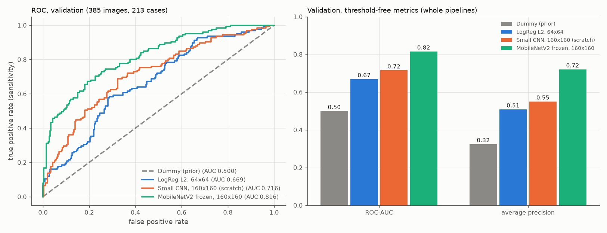

# Transfer Learning: MobileNetV2 mit eingefrorenem Backbone

Stand: 19.10.2026. Ursprünglich mit den früheren Treibern erzeugt, heute entsprechend: `analysis/03_classification.py`, `src/busbra/models.py` und `src/busbra/training.py`. Alle Zahlen stammen aus `reports/tables/mobilenetv2_frozen_*.csv`, `transfer_comparison_validation.csv` und `mobilenetv2_frozen_status.json` (Run `mnv2f-20261019T203216-ebb118f5`).

## Umfang und Rollen der Modelle

Genau eine Transfer-Learning-Pipeline: ein ImageNet-vortrainiertes MobileNetV2, dessen Backbone vollständig eingefroren ist, mit einem neu trainierten Klassifikationskopf. Kein Fine-Tuning, keine weiteren Backbones, kein längeres CNN-Training, keine Schwellenoptimierung. **Die Testdaten wurden nicht verwendet**: Es wurden nur die 1.499 Train- und Validation-Originalbilder dekodiert (durch eine Aufzeichnung aller geöffneten PNG-Dateien belegt), keine Test-, Masken- oder Kontaktübersichtsdatei, und es wurden keine Testvorhersagen erzeugt.

„Baseline“ bezeichnet hier die Vergleichsrolle, nicht eine vorgegebene Unterlegenheit. Das bereits trainierte kleine CNN bleibt als Deep-Learning-Baseline für den Vergleich erhalten; es wurde weder neu trainiert noch umbenannt oder verschoben (Checkpoint-SHA-256 `b9fc953b…e33e0`, Run `cnn-20261019T192513-3cfd6ee8`, korrigierte Config `faf12243…ed6e`; alle Dateien per Hash unverändert).

| Modell | Rolle | Eingabe | Vortraining | Trainierbare Parameter |
|---|---|---|---|---:|
| Dummy mit Trainingsprior | triviale Referenz | Pixel ignoriert | – | 0 |
| LogReg L2 | klassische lernende Baseline | 64×64, 4.096 Pixelmerkmale | – | 4.097 |
| Kleines CNN | selbst trainierte Deep-Learning-Baseline (zufällige Initialisierung) | 160×160×1 | – | 100.993 |
| MobileNetV2, Backbone eingefroren | Transfer-Learning-Pipeline | 160×160×1, im Modell auf 3 Kanäle in [−1, 1] gebracht | ImageNet | 1.281 (von 2.259.265) |

Der Split ist unverändert der eingefrorene Holdout (SHA-256 `fdce9bc9…8349a`; train 1.114 Bilder / 639 Cases, validation 385 / 213, test 376 / 212), ein fester Holdout aus den äußeren Folds, keine Kreuzvalidierung. Positive Klasse: malignant = 1.

## Eingabevertrag und Anpassung an das Vortraining

**Extern** (wie beim kleinen CNN): Originalbild, Graustufen, tatsächlich dekodierte Größe, das **gesamte** Bild proportional (bilinear) auf höchstens 160 × 160 gebracht und zentriert schwarz aufgefüllt, `float32 / 255` genau einmal; Modelleingabe `(N, 160, 160, 1)` in [0, 1]. Die CPU bereitet vor, `tf.data`-Batches (Train mit Seed 42 pro Epoche gemischt, Validation und Inferenz in fester Reihenfolge, letzte kleinere Batches bleiben erhalten).

**Im gespeicherten Keras-Modell**, mit regulären serialisierbaren Schichten:

1. `augment_flip`: horizontaler Flip (`seed=42`), nur im Training.
2. `gray_to_rgb`: der eine Kanal wird dreifach kopiert (`Concatenate([x, x, x])`). Alle drei Kanäle sind identisch; es entsteht keine Farbinformation.
3. `scale_to_minus1_1`: `Rescaling(scale=2.0, offset=-1.0)` bildet [0, 1] auf [−1, 1] ab (0 → −1, 0,5 → 0, 1 → 1). Das ist äquivalent zur offiziellen MobileNetV2-Vorverarbeitung für Daten in [0, 255]; es wird weder `preprocess_input` noch eine zweite Division durch 255 angewendet. Schwarzes Padding wird im Backbone zu −1. Die Aussage „keine Reskalierung im Modell“ des kleinen CNN gilt hier ausdrücklich nicht.
4. `mobilenetv2_backbone`: Eingabe `(N, 160, 160, 3)` in [−1, 1], Ausgabe `(N, 5, 5, 1280)`. Es gibt keine automatische Resize- oder Crop-Schicht.

Der Vertrag steht in `models/mobilenetv2_frozen/mobilenetv2_frozen_config.json` und im Status. Er wurde an einem synthetischen Batch geprüft: drei identische Kanäle, 0 → −1, 0,5 → 0, 1 → 1, und Übereinstimmung mit `mobilenet_v2.preprocess_input(255·x)` bis 1,2e-7.

## Modell und Training (vorab festgelegt)

| Bestandteil | Festlegung |
|---|---|
| Backbone | `keras.applications.MobileNetV2(input_shape=(160,160,3), alpha=1.0, include_top=False, weights='imagenet', pooling=None)`, `trainable=False`, Aufruf mit `training=False` |
| Kopf | `GlobalAveragePooling2D` → `Dropout(0.3)` → `Dense(1, sigmoid)` |
| Parameter | gesamt 2.259.265; Backbone 2.257.984 (alle fest, davon 52 BatchNorm-Schichten); Kopf 1.281, alle trainierbar |
| Optimierer / Loss | Adam (0,001), `BinaryCrossentropy(from_logits=False)`; `float32`, `jit_compile=False`, kein Mixed Precision |
| Batch / Epochen | 16 / höchstens 30; keine Klassengewichte, kein Oversampling |
| Auswahl | `EarlyStopping(val_loss, min, patience=5, min_delta=0, restore_best_weights=True)` und `ModelCheckpoint(val_loss, min, save_best_only=True, save_weights_only=False)` (lokal `models/mobilenetv2_frozen/`), `TerminateOnNaN` |

**Eingefrorener Backbone und BatchNorm:** Der Backbone läuft auch beim Training im Inferenzmodus; seine BatchNorm-Mittelwerte und -Varianzen ändern sich nicht. Nur Flip und Dropout bleiben im Training aktiv.

**Gewichte:** Offizielle Keras-Application; für die Datei `mobilenet_v2_weights_tf_dim_ordering_tf_kernels_1.0_160_no_top.h5` wurde ein **vorhandener lokaler Cache** verwendet, nichts wurde in diesem Lauf heruntergeladen. Quelle: `https://storage.googleapis.com/tensorflow/keras-applications/mobilenet_v2/…`. Lokale Datei: 9.406.464 Bytes, SHA-256 `1e9310d9…bf04e` (lokale Identifikation; Keras prüft für diese Datei keinen Herausgeber-Hash). Ein nachträglicher Abgleich nur der Metadaten (HEAD-Anfrage, ohne Download) ergab für Größe und MD5 dieselben Werte wie im Header der Quelle; das Protokoll ist nicht Teil des Repositories. Keras 3.15.1, TensorFlow 2.20.0.

## GPU-, Frozen- und Reset-Nachweise

Das Training lief im Terminal mit `env -u LD_LIBRARY_PATH .venv/bin/python analysis/03_classification.py`; es gab keinen eigenen Interactive-Window-Lauf. Memory Growth wurde vor der GPU-Initialisierung gesetzt, die weiche Geräteplatzierung ist aus (kein stiller CPU-Wechsel), es gibt keine Speichergrenze, und die geladenen CUDA-Bibliotheken kamen aus der `.venv`.

- **Technischer Probelauf** (echtes Modell, 16 Trainingsbilder): 264 Modellvariablen (Backbone eingeschlossen), Vorwärtsausgabe, Loss und beide Kopf-Gradienten auf GPU:0; Loss und Gradienten endlich (Loss 0,7957 → 0,7368 nach einem Schritt, größter |Gradient| 1,43); die Kopfgewichte änderten sich; **alle Backbone-Gewichte einschließlich BatchNorm-Mittelwerten und -Varianzen blieben unverändert.**
- **Reset:** Danach Sitzung, Seed und Modell zurückgesetzt und mit denselben ImageNet-Gewichten neu aufgebaut. Der Backbone-Fingerabdruck entspricht dem Zustand vor dem Probeschritt, der Kopf ist frisch initialisiert (gleich dem Probekopf vor seinem Update).
- **Nach dem Training:** Der Backbone-Fingerabdruck (SHA-256 über alle Backbone-Gewichte einschließlich BatchNorm-Statistiken) ist nach 25 Epochen **identisch** mit dem Anfangszustand (`03276b4c…`); trainiert wurden nur `output/kernel` und `output/bias`. Dasselbe gilt für den neu geladenen Checkpoint.
- **GPU-Beobachtungen** dieses Laufs (keine gesetzten Grenzen): TensorFlow-Allokator-Spitze 278 MiB im Training (954 MiB im Probelauf), `nvidia-smi` zeigte für den Prozess 1.112 MiB. Batchgröße 16 genügte; der vorbereitete Neustart mit Batchgröße 8 war nicht nötig.

## Verlauf

Early Stopping hat nach **25 Epochen** ausgelöst; beste Epoche **20** (Validation-Loss 0,4733), danach fünf Epochen ohne Verbesserung. Das Epochenlimit (30) wurde nicht erreicht. Training 106,5 s, Median 3,8 s je Epoche (erste Epoche 11,2 s), Gesamtlauf 143 s; Messungen eines Laufs, keine Aussage über andere Modelle. Lernkurven: `reports/figures/mobilenetv2_frozen_learning_curves.png`. Train-Kurven entstehen mit aktivem Flip und Dropout, Validation ohne; ihr Abstand ist kein quantitativer Beleg einer Generalisierungslücke.

## Ergebnisse (bester Checkpoint, Schwelle 0,5, positive Klasse malignant)

Der Score ist die Sigmoid-Ausgabe, nicht als kalibrierte Erkrankungswahrscheinlichkeit belegt; hart vorhergesagt wird `Score >= 0,5` ohne Optimierung. Die Vorhersagen stammen aus dem von der Festplatte geladenen Checkpoint mit deaktiviertem Flip und Dropout.

**Validation** (385 Bilder, 125 maligne; 213 Cases, 69 maligne): ROC-AUC **0,8160**, Average Precision 0,7211, Sensitivität 0,512 (64/125), Spezifität 0,904 (235/260), Precision 0,719 (64/89), F1 0,598, Accuracy 0,777; TN/FP/FN/TP = 235/25/61/64.

**Train** (nur zur Beschreibung; 1.114 Bilder, 360 maligne; 639 Cases, 205 maligne): ROC-AUC 0,8987, Average Precision 0,8100, Sensitivität 0,700 (252/360), Spezifität 0,894 (674/754), Precision 0,759, F1 0,728, Accuracy 0,831; 674/80/108/252.

## Vergleich der vier Pipelines (Validation)

Alte Vorhersagen und Metriken wurden aus den vorhandenen Dateien übernommen (Hashes geprüft, kein altes Modell neu ausgeführt); alle vier Pipelines werden auf denselben 385 Validation-Bildern (213 Cases) in derselben Reihenfolge und mit derselben Schwelle verglichen. Die 3A-Vergleichsdateien `model_comparison_validation.csv/.png` blieben unverändert; der erweiterte Vergleich steht in `transfer_comparison_validation.csv` und `reports/figures/transfer_comparison_validation.png`.

| Pipeline | ROC-AUC | AP | Sensitivität | Spezifität | Precision | F1 | Accuracy |
|---|---:|---:|---:|---:|---:|---:|---:|
| Dummy (Prior) | 0,5000 | 0,3247 | 0,000 | 1,000 | nicht definiert | 0,000 | 0,6753 |
| LogReg L2, 64×64 | 0,6692 | 0,5092 | 0,376 | 0,781 | 0,452 | 0,411 | 0,6494 |
| Kleines CNN, 160×160 | 0,7155 | 0,5507 | 0,448 | 0,850 | 0,590 | 0,509 | 0,7195 |
| MobileNetV2 eingefroren, 160×160 | **0,8160** | 0,7211 | 0,512 | 0,904 | 0,719 | 0,598 | 0,7766 |

**Einordnung (vorläufig):**

- Auf Validation liegt die Transfer-Pipeline in ROC-AUC (0,816 gegenüber 0,716 und 0,669) und Average Precision (0,721 gegenüber 0,551 und 0,509) vor den beiden anderen lernenden Modellen; bei der festen Schwelle sind auch Sensitivität, Spezifität, Precision, F1 und Accuracy höher. Sie trainiert dabei nur 1.281 Parameter.
- Es sind **ganze Pipelines**: Architektur und ImageNet-Vortraining unterscheiden sich; bei der LogReg zusätzlich Auflösung und Augmentation. Der Vergleich trennt weder einen reinen Architektur- noch einen reinen Vortrainingseffekt.
- Ein einzelner Lauf mit einem Seed auf einem Holdout aus abhängigen Bildern (zwei Bilder pro Case sind keine unabhängigen Patientinnen): keine Varianzschätzung, keine Signifikanz- oder Konfidenzaussage.
- Die Validation dient der Checkpoint-Auswahl und ist deshalb keine unabhängige abschließende Bewertung; das Ausmaß einer Auswahlverzerrung wurde nicht bestimmt. Die unabhängige Prüfung ist der Test in der Abschlussphase.
- Zwischen Train (0,899) und Validation (0,816) liegt ein Abstand der ROC-AUC; seine Ursache ist nicht untersucht.
- Ob die Modelle bildinhaltliche Merkmale oder gerätespezifische Hinweise (eingebrannte Marker, Layout, Bildgröße) nutzen, ist nicht untersucht; ImageNet-Merkmale und der Flip entfernen solche Hinweise nicht.

## Prüfungen und Reproduzierbarkeit

- **Auswahl und Laden:** Wiederhergestelltes bestes Modell gegen geladenen Checkpoint sowie ein zweites Laden: maximale Scoreabweichung je 0,0 und maximale Gewichtsabweichung 0,0 (Toleranz 1e-5). Geladene Modelle werden mit `jit_compile=False` kompiliert (der lokale Befund aus Schritt 3A ist berücksichtigt); es gibt keinen Optimiererupdate in der Auswertung. Das geladene Modell behält die Frozen-Einstellung (nur 1.281 trainierbare Parameter, Backbone-Fingerabdruck gleich dem ImageNet-Anfangszustand).
- **Inferenz:** Der Flip ist bei Inferenz die Identität und verändert Bilder im Training; wiederholte Vorhersagen sind identisch. Der interne Backbone-Eingang ist `(16, 160, 160, 3)`, drei identische Kanäle, gleich 2x − 1.
- **Gezielte Tests** (synthetisch, kein zweites vollständiges Training): Kanalwiederholung und Skalierung, ausschließlich trainierbarer Kopf, nach drei echten Trainingsschritten unveränderte Backbone- und BatchNorm-Gewichte, geänderte Kopfgewichte, Inferenzmodus; Vorbedingungsfehler in einer isolierten Kopie mit Platzhalter-Artefakten (Split fehlt; Hash eines akzeptierten CNN-Ergebnisses geändert): Exit 1, aktueller Fehlerstatus, Platzhalter unverändert, frühere Erfolgsmeldung gesichert, Abbruch vor Bildladen und TensorFlow.
- **Reproduzierbarkeit:** Kein zweiter vollständiger Lauf; ein fester Seed unterstützt die Nachvollziehbarkeit, garantiert auf der GPU aber keine bytegleichen Trainingsläufe.
- **Unverändert** (Hash): Rohdaten, Audit, eingefrorener Split, Baseline-Artefakte, alle akzeptierten CNN-Artefakte einschließlich korrigierter Config und Status sowie die Environment-Berichte; keine Paketänderung.

## Fehlerbehandlung (Korrektur vom 19.10.2026)

Die Markierung eines neuen Versuchs und das Löschen früherer Ausgaben sind getrennt. Nach den statischen Vorprüfungen sichert `mark_attempt_started()` den Erfolgsstatus samt Konfiguration des vorherigen Laufs (`mobilenetv2_frozen_status_last_success.json`, `mobilenetv2_frozen_config_last_success.json`) und schreibt einen vorläufigen Status „unvollständig“; gelöscht wird dabei nichts. Die früheren Ausgaben dieses Schritts (Checkpoint, Config, Tabellen, Grafiken) entfernt `remove_previous_outputs()` erst, nachdem die ImageNet-Gewichte geladen, die Daten aufbereitet, die GPU konfiguriert und die technische Probe bestanden ist, unmittelbar vor dem frischen Haupttraining. Scheitert vorher etwas (Vorbedingungen, Bildladen, GPU-Einrichtung, Laden oder Download der Gewichte, Probe), bleiben alle früheren Ausgaben unverändert; der aktuelle Fehlerbericht trägt eine neue Run-ID, die Phase des Fehlers, `derived_outputs_of_previous_run_removed: false` und den Bezug zum früheren Erfolg. Ein Fehler beim Laden der Gewichte wird mit Quelle und Fehlermeldung gemeldet; es gibt keinen Wechsel auf zufällige Gewichte oder einen anderen Backbone.

Die ursprüngliche Fassung löschte die Ausgaben bereits vor dem Laden der Gewichte. Das betraf nur den Fehlerfall; der erfolgreiche Lauf `mnv2f-20261019T203216-ebb118f5` und alle seine Dateien sind unverändert (Checkpoint-SHA-256 `e1d5d317…48873`). Geprüft wurde die Korrektur in isolierten Kopien mit Platzhalter-Artefakten eines früheren Erfolgs, mit einem simulierten Ladefehler an der Stelle, an der die ImageNet-Gewichte geladen werden, sowie mit einem simulierten Fehler in der GPU-Probe: jeweils Exit 1, aktueller Fehlerstatus, alle neun früheren Ausgaben byte-identisch, früherer Erfolg gesichert, kein Training gestartet; ein zweiter Fehlerlauf ersetzt die gesicherte Erfolgsmeldung nicht. Dieselbe Simulation löscht mit der früheren Fassung alle neun Ausgaben und wird von der Prüfung erkannt.

## Grenzen

- Ein fester Holdout, eine Einrichtung, abhängige Bilder je Case, ein Seed, ein Lauf.
- Nur der Kopf wird trainiert; ein mögliches Fine-Tuning, weitere Backbones oder eine Segmentierung sind spätere, gesonderte Schritte, die auf diesem Ergebnis aufbauen würden.
- Scores sind nicht als kalibrierte Wahrscheinlichkeiten belegt; die Schwelle 0,5 ist eine feste Konvention. Es gibt keine klinische Einsatzaussage.
- Der SHA-256 der Gewichtsdatei ist eine lokale Identifikation; der Metadatenabgleich (Größe, MD5) ist eine Beobachtung vom 19.10.2026.
- Interpretation (z. B. Grad-CAM), Robustheitstest und die Testauswertung folgen in späteren Schritten; der Test bleibt gesperrt.

## Quellen

- Sandler, M. et al.: MobileNetV2: Inverted Residuals and Linear Bottlenecks, CVPR 2018.
- Keras Applications, MobileNetV2: https://keras.io/api/applications/mobilenet/mobilenet_models/#mobilenetv2-function
- Keras-Leitfaden Transfer Learning: https://keras.io/guides/transfer_learning/
- Datensatz: Gómez-Flores et al., *Medical Physics* 51 (2024), https://doi.org/10.1002/mp.16812 (Lizenzhinweise siehe README).
